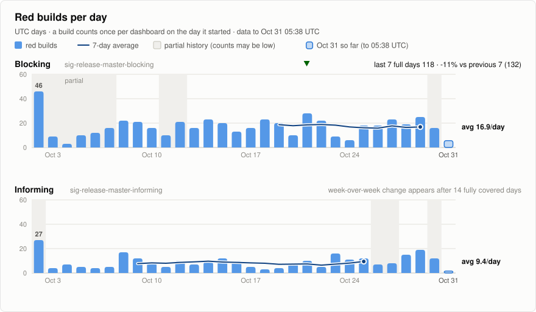
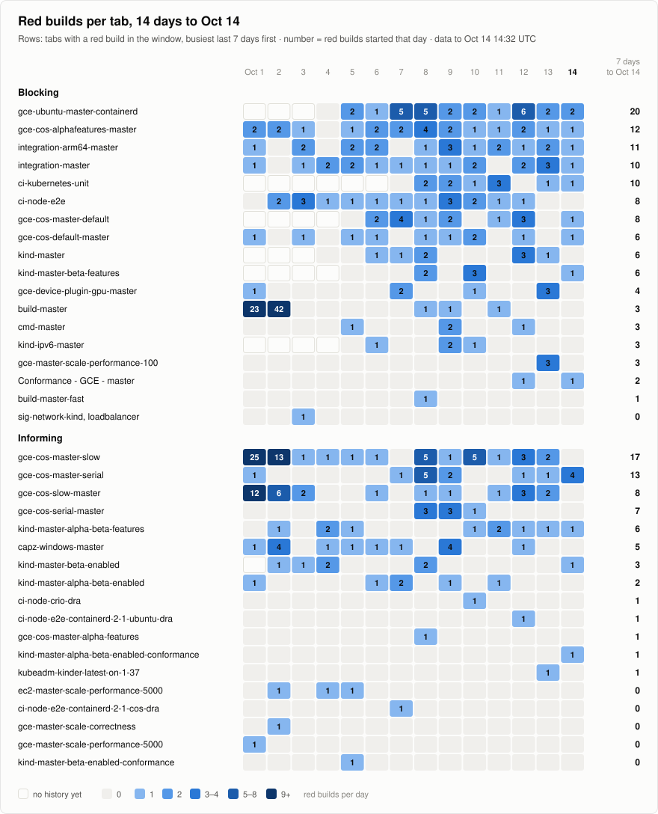

# Red TestGrid build logs

This repository keeps the raw Prow `build-log.txt` of builds that TestGrid shows
red on
[sig-release-master-blocking](https://testgrid.k8s.io/sig-release-master-blocking)
and [sig-release-master-informing](https://testgrid.k8s.io/sig-release-master-informing).
A GitHub Actions workflow reads both dashboards about twice a day and saves one
copy per build. A build that scrolled off a tab between two runs is found in GCS
instead and judged by TestGrid's own rule. [Limits](#limits) says what the
archive can miss, and when a build taken from GCS may never have shown red.

<picture>
  <source media="(prefers-color-scheme: dark)" srcset="archive/charts/trend-dark.svg">
  
</picture>

<picture>
  <source media="(prefers-color-scheme: dark)" srcset="archive/charts/tabs-dark.svg">
  
</picture>

## Finding a log

[archive/INDEX.md](archive/INDEX.md) lists the runs and red builds of the last
14 days, and links a page per week for older ones. Each run that archives has a
folder under [archive/runs/](archive/runs/), named by its start time in UTC, and
a build stays in the folder of the run that first saved it:

```
archive/runs/<YYYY-MM>/<run>/<job>/<build>/build-log.txt.gz
```

Read it with `gzip -dc build-log.txt.gz | less`. A log over 95 MiB after gzip is
split into `build-log.txt.gz.000`, `.001` and so on, because GitHub blocks files
over 100 MiB; read those with `cat build-log.txt.gz.* | gzip -dc | less`. A build
whose pod never ran has only its `podinfo.json`, and a build GCS had no file for
has only its `meta.json`. The `meta.json` in each build folder records the tabs,
the red tests, TestGrid's messages and the log's md5.

## What counts as red

A cell is red when TestGrid paints it red: `FAIL`, `TIMED_OUT`,
`CATEGORIZED_FAIL` or `TOOL_FAIL`. Flaky, build-failed, unknown and aborted
cells are not. A build Prow aborted is usually red anyway, because TestGrid
marks its Overall cell `FAIL`.

The red cells come from the same tables the TestGrid page loads. A build can
scroll off a tab between two runs. The workflow then finds it in GCS and judges
it by TestGrid's own rule ([`testgrid_rule.py`](tool/testgrid_rule.py)), with
the config the tab had at the time, and marks it as taken from GCS.

## How a run works

1. Build the TestGrid config of each new run of test-infra's upload job, so a
   build judged from GCS is judged by the config its tab had then.
2. Read every tab of both dashboards and collect the red builds.
3. Search GCS for the builds in any gap in TestGrid's history, and judge them by
   TestGrid's rule.
4. Download each new log, including those found in step 3, and check its size
   and checksum against GCS. In the same pass, compare recent builds with GCS
   again, since Prow can upload a log twice. A build is compared until 48 hours
   after it finished; one without a log or without `finished.json`, until 14
   days after it was archived. After that, it is compared at least once a week:
   the archive's builds are split into seven by a hash of their job and build,
   and each run compares the seventh for its UTC day, and those of any days
   since the run before, as `cross_check.py` does. A run cut off before it got
   to a build leaves it to the next run that compares its seventh.
5. Rewrite the index and the charts, then run
   [`cross_check.py`](tool/cross_check.py). It checks the archive again on its
   own, and fails the run if a red build is missing or a stored file changed.
   What it checked, and the outcome, are kept in the run's folder as
   `verification.json`.

The docstrings in [`tool/`](tool/) explain each step.
[`tool/oracle/`](tool/oracle/README.md) checks the port of TestGrid's rule
against TestGrid's own Go code.

## Schedule and alerts

The workflow is scheduled every 3 hours, but GitHub often starts scheduled runs
late or skips them. A scheduled run archives unless the archive already changed
in the same half of the UTC day (00:00 to 12:00, 12:00 to 24:00) less than 11
hours before. A run started by hand, and any re-run, always archives.

When a run fails, GitHub emails the person who last changed the schedule, or who
started the run. A scheduled run that finds the archive more than 26 hours old
still archives, then fails. GitHub sends nothing when it starts no run at all.
For that case, an optional heartbeat pings an outside check that alerts when the
pings stop, such as healthchecks.io: set the repository variable `HEARTBEAT` to
`on`, and the ping URL as the secret `HEARTBEAT_URL` of an environment named
`heartbeat`. Only scheduled runs ping, so set the check to expect a ping about
every 12 hours.

GitHub disables the schedule of a public repository after 60 days without
activity. If that happens, enable the workflow again from the Actions tab, or
with `gh workflow enable red-build-logs.yml`.

## Limits

- TestGrid does not publish when it read a build, and some of its reads can end
  in more than one way. The workflow works these out from TestGrid's code and
  from GCS timestamps. When that leaves a doubt, the build counts as red, so a
  build taken from GCS may never have shown red on TestGrid.
- The same goes for a build judged before the archive has read any TestGrid
  config, or on a tab it knows only from a build it still watches (the rows the
  tab's filters hide then count as shown), and for a build on a tab with a base
  option the archive does not know: TestGrid's tabulator ignores the option, and
  so does the archive, but the tab's page may hide rows by it.
- TestGrid does not publish which of its updates failed either, or which left
  columns for more than the next update to read. The workflow takes no update
  to have done so, and misses a build judged from GCS that only such a later
  read showed red, such as the retry of a failed update.
- A build its tab may have shown under a config the archive does not know yet,
  or under one whose test group sets an option `testgrid_rule.py` does not
  support, waits until it can be judged, up to 60 days after it was made. Past
  that it is not archived, and the run fails with a warning that TestGrid may
  have shown it red. One held because TestGrid showed its tab while the latest
  config the archive knows lacked it is judged once TestGrid stops listing the
  tab instead, as if TestGrid had had no such tab since the last config with it:
  not red, though TestGrid may have shown it red meanwhile.
- A build a scan saw, not red, that has since scrolled off is judged from GCS
  if its tab's config changed after that scan. If a config the archive does not
  know yet was in force after that scan, the build waits for it, at most 14
  days after the scan, and is then dropped without a warning of its own.
- A cell that was red only between two runs, on a build the tab still shows,
  is not seen.
- A gap in TestGrid's history is searched in GCS newest first: up to 28 days
  back in the run that finds it, then 14 days more in each later run.
- If a tab's test group now sets an option `testgrid_rule.py` does not
  support, the run fails rather than guess.

## Running it locally

```sh
cd tool
uv sync --locked
PYTHON=.venv/bin/python ./testgrid_config.sh /tmp/testgrid-config.json   # needs git, and docker or podman
uv run fetch_red_logs.py --archive ../archive --gzip --testgrid-config /tmp/testgrid-config.json
uv run cross_check.py --archive ../archive
uv run --locked python -m unittest
```

## License

[Apache License 2.0](LICENSE). The archived logs are copies of Kubernetes CI
output that is already public in the `kubernetes-ci-logs` bucket. Parts of
`tool/` are ports of Go, TestGrid and Kubernetes code under their own licenses;
[THIRD_PARTY_NOTICES.md](THIRD_PARTY_NOTICES.md) lists them.
