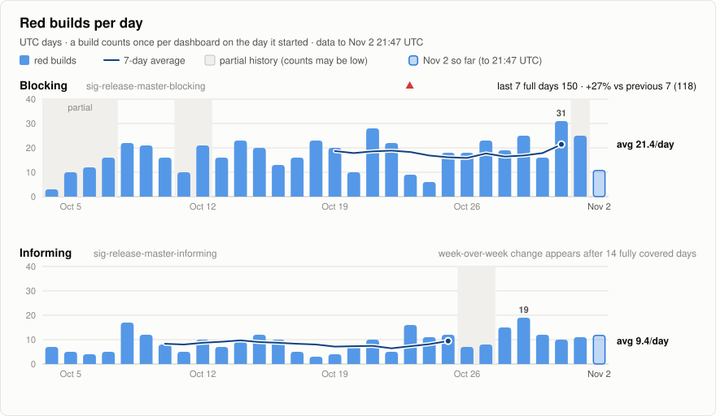
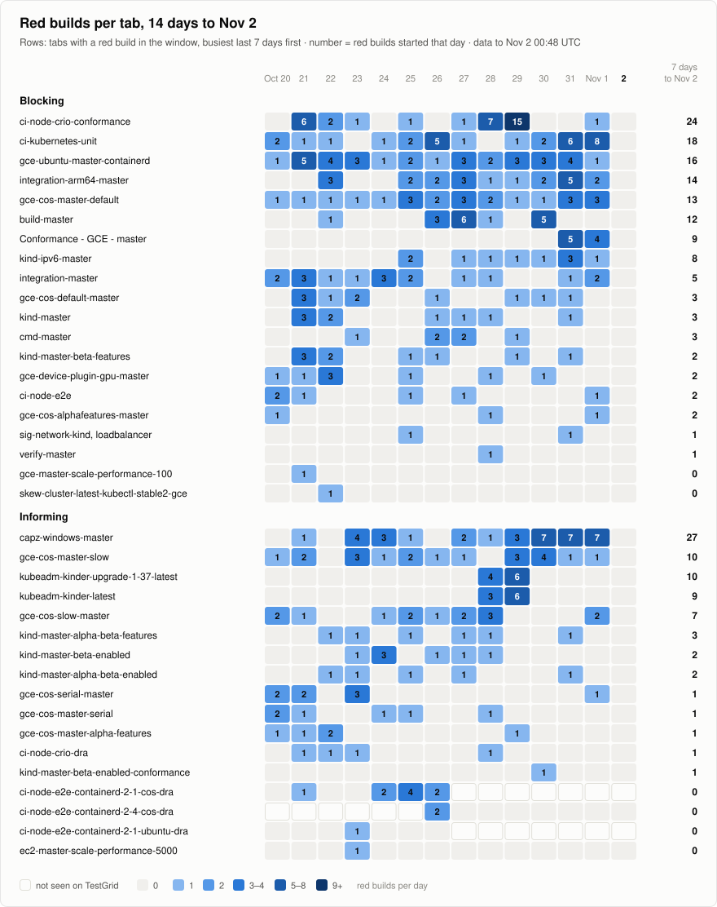

# Red TestGrid builds

Updated 2026-11-13T17:13:17Z. The builds with a red cell on sig-release-master-blocking and sig-release-master-informing that the runs found: seen red on TestGrid, or taken from GCS by TestGrid's rule ([what that can miss or add](../README.md#limits)); times are UTC. Each archived build is in the folder of the run that first archived it, under [runs/](runs/). A file marked provisional may have been taken before Prow finished uploading; it is compared with GCS on every run and fetched again if GCS changes.

<picture>
  <source media="(prefers-color-scheme: dark)" srcset="charts/trend-dark.svg">
  
</picture>

<picture>
  <source media="(prefers-color-scheme: dark)" srcset="charts/tabs-dark.svg">
  
</picture>

Red builds per tab (table)

| Dashboard | Tab | 7 days to Nov 13 | 14 days |
|---|---|---:|---:|
| Blocking | integration-arm64-master | 42 | 52 |
| Blocking | gce-cos-master-default | 25 | 52 |
| Blocking | gce-ubuntu-master-containerd | 24 | 50 |
| Blocking | integration-master | 15 | 24 |
| Blocking | ci-kubernetes-unit | 11 | 35 |
| Blocking | gce-cos-default-master | 9 | 20 |
| Blocking | build-master | 6 | 13 |
| Blocking | ci-node-crio-conformance | 6 | 8 |
| Blocking | kind-master | 5 | 10 |
| Blocking | gce-device-plugin-gpu-master | 5 | 8 |
| Blocking | kind-master-beta-features | 5 | 6 |
| Blocking | kind-ipv6-master | 4 | 10 |
| Blocking | gce-cos-alphafeatures-master | 4 | 7 |
| Blocking | verify-master | 3 | 3 |
| Blocking | Conformance - GCE - master | 2 | 25 |
| Blocking | ci-node-e2e | 2 | 4 |
| Blocking | cmd-master | 2 | 4 |
| Blocking | sig-network-kind, loadbalancer | 2 | 4 |
| Blocking | gce-master-scale-performance-100 | 2 | 2 |
| Blocking | conformance-ga-only | 1 | 1 |
| Informing | capz-windows-master | 28 | 68 |
| Informing | gce-cos-master-slow | 15 | 29 |
| Informing | gce-cos-master-serial | 9 | 16 |
| Informing | gce-cos-serial-master | 9 | 14 |
| Informing | kind-master-beta-enabled | 6 | 7 |
| Informing | Conformance - EC2 - arm64 - master | 6 | 6 |
| Informing | kind-master-alpha-beta-features | 4 | 7 |
| Informing | Conformance - EC2 - master | 4 | 5 |
| Informing | kind-master-alpha-beta-enabled | 3 | 6 |
| Informing | gce-cos-slow-master | 2 | 12 |
| Informing | gce-master-scale-correctness | 2 | 4 |
| Informing | gce-cos-master-alpha-features | 2 | 2 |
| Informing | ci-node-e2e-containerd-2-4-cos-dra | 1 | 2 |
| Informing | ci-node-e2e-containerd-2-4-ubuntu-dra | 1 | 1 |
| Informing | ec2-master-scale-performance-5000 | 1 | 1 |
| Informing | kind-master-alpha-beta-enabled-conformance | 1 | 1 |
| Informing | kind-master-beta-enabled-conformance | 1 | 1 |
| Informing | kubeadm-kinder-latest | 1 | 1 |
| Informing | ci-kind-dra | 0 | 2 |

Daily counts (table)

| Day (UTC) | Blocking | Informing |
|---|---:|---:|
| 2026-11-13 | 16 (so far, to 17:13 UTC) | 3 (so far, to 17:13 UTC) |
| 2026-11-12 | 25 | 13 |
| 2026-11-11 | 23 | 21 |
| 2026-11-10 | 21 | 10 |
| 2026-11-09 | 31 | 16 |
| 2026-11-08 | 36 | 23 |
| 2026-11-07 | 23 | 10 |
| 2026-11-06 | 18 | 16 |
| 2026-11-05 | 20 | 11 |
| 2026-11-04 | 43 | 14 |
| 2026-11-03 | 14 | 12 |
| 2026-11-02 | 12 | 15 |
| 2026-11-01 | 25 (partial) | 11 |
| 2026-10-31 | 31 | 10 |
| 2026-10-30 | 16 | 12 |
| 2026-10-29 | 25 | 19 |
| 2026-10-28 | 19 | 15 |
| 2026-10-27 | 23 | 8 (partial) |
| 2026-10-26 | 18 | 7 (partial) |
| 2026-10-25 | 18 | 12 |
| 2026-10-24 | 6 | 11 |
| 2026-10-23 | 9 | 16 |
| 2026-10-22 | 22 | 5 |
| 2026-10-21 | 28 | 10 |
| 2026-10-20 | 10 | 8 |
| 2026-10-19 | 20 | 4 |
| 2026-10-18 | 23 | 3 |
| 2026-10-17 | 16 | 5 |
| 2026-10-16 | 13 | 10 |
| 2026-10-15 | 20 | 12 |

## Runs in the last 14 days

Collection result is how the run's fetch went: ok, interrupted, its number of problems (errors, serious warnings, and the tabs and dashboard summaries it could not read, listed in the README of the run's folder and in its run.json), no run report if the run was cut off before writing one, or unreadable run report if its run.json cannot be read. It does not include the verification that follows the fetch ([cross_check.py](../tool/cross_check.py)).

Verification is the outcome that verification recorded in the run's verification.json: ok, its number of problems, timed out, interrupted, stopped (by an error), or incomplete (it ended without recording one). It is pending for the run that wrote this page until its verification ends, when the workflow puts the outcome here; not recorded when the run has no verification.json (it ran before verifications were recorded, was not verified, or none could be written); and unreadable when the file is damaged.

| Run (UTC) | New builds | Updated | Collection result | Verification |
|---|---:|---:|---|---|
| [2026-11-13 17:12:55](runs/2026-11/2026-11-13T171255Z/) | 16 | 0 | ok | [ok](runs/2026-11/2026-11-13T171255Z/verification.json) |
| [2026-11-13 06:44:16](runs/2026-11/2026-11-13T064416Z/) | 15 | 0 | ok | [ok](runs/2026-11/2026-11-13T064416Z/verification.json) |
| [2026-11-12 17:36:14](runs/2026-11/2026-11-12T173614Z/) | 19 | 0 | ok | [ok](runs/2026-11/2026-11-12T173614Z/verification.json) |
| [2026-11-12 07:09:02](runs/2026-11/2026-11-12T070902Z/) | 28 | 0 | ok | [ok](runs/2026-11/2026-11-12T070902Z/verification.json) |
| [2026-11-11 14:27:20](runs/2026-11/2026-11-11T142720Z/) | 11 | 0 | ok | [ok](runs/2026-11/2026-11-11T142720Z/verification.json) |
| [2026-11-11 06:15:43](runs/2026-11/2026-11-11T061543Z/) | 23 | 0 | ok | [ok](runs/2026-11/2026-11-11T061543Z/verification.json) |
| [2026-11-10 14:52:16](runs/2026-11/2026-11-10T145216Z/) | 15 | 0 | ok | [ok](runs/2026-11/2026-11-10T145216Z/verification.json) |
| [2026-11-10 03:34:24](runs/2026-11/2026-11-10T033424Z/) | 13 | 0 | ok | [ok](runs/2026-11/2026-11-10T033424Z/verification.json) |
| [2026-11-09 19:50:21](runs/2026-11/2026-11-09T195021Z/) | 28 | 0 | ok | [ok](runs/2026-11/2026-11-09T195021Z/verification.json) |
| [2026-11-09 06:23:45](runs/2026-11/2026-11-09T062345Z/) | 18 | 0 | ok | [ok](runs/2026-11/2026-11-09T062345Z/verification.json) |
| [2026-11-08 17:56:17](runs/2026-11/2026-11-08T175617Z/) | 53 | 0 | ok | [ok](runs/2026-11/2026-11-08T175617Z/verification.json) |
| [2026-11-08 00:35:32](runs/2026-11/2026-11-08T003532Z/) | 15 | 0 | ok | [ok](runs/2026-11/2026-11-08T003532Z/verification.json) |
| [2026-11-07 12:59:06](runs/2026-11/2026-11-07T125906Z/) | 10 | 0 | ok | [ok](runs/2026-11/2026-11-07T125906Z/verification.json) |
| [2026-11-07 05:57:33](runs/2026-11/2026-11-07T055733Z/) | 21 | 0 | ok | [ok](runs/2026-11/2026-11-07T055733Z/verification.json) |
| [2026-11-06 16:46:12](runs/2026-11/2026-11-06T164612Z/) | 12 | 0 | ok | [ok](runs/2026-11/2026-11-06T164612Z/verification.json) |
| [2026-11-06 06:41:45](runs/2026-11/2026-11-06T064145Z/) | 19 | 0 | ok | [ok](runs/2026-11/2026-11-06T064145Z/verification.json) |
| [2026-11-05 17:25:25](runs/2026-11/2026-11-05T172525Z/) | 13 | 0 | ok | [ok](runs/2026-11/2026-11-05T172525Z/verification.json) |
| [2026-11-05 06:45:18](runs/2026-11/2026-11-05T064518Z/) | 23 | 5 | ok | [ok](runs/2026-11/2026-11-05T064518Z/verification.json) |
| [2026-11-04 17:15:42](runs/2026-11/2026-11-04T171542Z/) | 32 | 0 | ok | [ok](runs/2026-11/2026-11-04T171542Z/verification.json) |
| [2026-11-04 06:19:16](runs/2026-11/2026-11-04T061916Z/) | 21 | 3 | ok | [ok](runs/2026-11/2026-11-04T061916Z/verification.json) |
| [2026-11-03 17:05:20](runs/2026-11/2026-11-03T170520Z/) | 12 | 0 | ok | [ok](runs/2026-11/2026-11-03T170520Z/verification.json) |
| [2026-11-03 06:46:23](runs/2026-11/2026-11-03T064623Z/) | 6 | 3 | ok | [ok](runs/2026-11/2026-11-03T064623Z/verification.json) |
| [2026-11-02 21:46:36](runs/2026-11/2026-11-02T214636Z/) | 24 | 0 | ok | [ok](runs/2026-11/2026-11-02T214636Z/verification.json) |
| [2026-11-02 00:44:14](runs/2026-11/2026-11-02T004414Z/) | 16 | 6 | ok | [ok](runs/2026-11/2026-11-02T004414Z/verification.json) |
| [2026-11-01 13:22:21](runs/2026-11/2026-11-01T132221Z/) | 24 | 0 | ok | [ok](runs/2026-11/2026-11-01T132221Z/verification.json) |
| [2026-11-01 00:06:56](runs/2026-11/2026-11-01T000656Z/) | 18 | 4 | ok | [ok](runs/2026-11/2026-11-01T000656Z/verification.json) |
| [2026-10-31 13:42:59](runs/2026-10/2026-10-31T134259Z/) | 1 | 0 | ok | [ok](runs/2026-10/2026-10-31T134259Z/verification.json) |
| [2026-10-31 12:26:14](runs/2026-10/2026-10-31T122614Z/) | 9 | 0 | ok | [ok](runs/2026-10/2026-10-31T122614Z/verification.json) |
| [2026-10-31 05:38:38](runs/2026-10/2026-10-31T053838Z/) | 21 | 1 | ok | [ok](runs/2026-10/2026-10-31T053838Z/verification.json) |

## Builds from the last 14 days

523 archived builds that started since 2026-10-31 (UTC), newest first.

### 2026-11-13

| Time | Tab | Build | Red tests | Files |
|---|---|---|---|---|
| 16:12 | blocking#gce-cos-master-default | [ci-kubernetes-e2e-gci-gce 2121275088580907008](https://prow.k8s.io/view/gs/kubernetes-ci-logs/logs/ci-kubernetes-e2e-gci-gce/2121275088580907008) | Kubernetes e2e suite.\[It\] \[sig-api-machinery\] AdmissionWebhook \[Privileged:ClusterAdmin\] s (+2) | [build-log.txt.gz](runs/2026-11/2026-11-13T171255Z/ci-kubernetes-e2e-gci-gce/2121275088580907008/build-log.txt.gz) [podinfo.json.gz](runs/2026-11/2026-11-13T171255Z/ci-kubernetes-e2e-gci-gce/2121275088580907008/podinfo.json.gz) (provisional) |
| 16:02 | blocking#integration-arm64-master | [ci-kubernetes-integration-arm64-master 2121272320864555008](https://prow.k8s.io/view/gs/kubernetes-ci-logs/logs/ci-kubernetes-integration-arm64-master/2121272320864555008) | \[sig-scheduling\] k8s.io/kubernetes/test/integration/scheduler.preemption (+1) | [build-log.txt.gz](runs/2026-11/2026-11-13T171255Z/ci-kubernetes-integration-arm64-master/2121272320864555008/build-log.txt.gz) [podinfo.json.gz](runs/2026-11/2026-11-13T171255Z/ci-kubernetes-integration-arm64-master/2121272320864555008/podinfo.json.gz) (provisional) |
| 15:54 | blocking#integration-master | [ci-kubernetes-integration-master 2121270307518943232](https://prow.k8s.io/view/gs/kubernetes-ci-logs/logs/ci-kubernetes-integration-master/2121270307518943232) | \[sig-scheduling\] k8s.io/kubernetes/test/integration/scheduler/podgroup.topology\_aware\_sche (+1) | [build-log.txt.gz](runs/2026-11/2026-11-13T171255Z/ci-kubernetes-integration-master/2121270307518943232/build-log.txt.gz) [podinfo.json.gz](runs/2026-11/2026-11-13T171255Z/ci-kubernetes-integration-master/2121270307518943232/podinfo.json.gz) (provisional) |
| 15:43 | blocking#build-master | [ci-kubernetes-build 2121267538976313344](https://prow.k8s.io/view/gs/kubernetes-ci-logs/logs/ci-kubernetes-build/2121267538976313344) | ci-kubernetes-build.Overall | [build-log.txt.gz](runs/2026-11/2026-11-13T171255Z/ci-kubernetes-build/2121267538976313344/build-log.txt.gz) [podinfo.json.gz](runs/2026-11/2026-11-13T171255Z/ci-kubernetes-build/2121267538976313344/podinfo.json.gz) (provisional) |
| 14:52 | blocking#ci-node-crio-conformance | [ci-node-crio-conformance 2121254704120860672](https://prow.k8s.io/view/gs/kubernetes-ci-logs/logs/ci-node-crio-conformance/2121254704120860672) | kubetest2.Test (+1) | [build-log.txt.gz](runs/2026-11/2026-11-13T171255Z/ci-node-crio-conformance/2121254704120860672/build-log.txt.gz) [podinfo.json.gz](runs/2026-11/2026-11-13T171255Z/ci-node-crio-conformance/2121254704120860672/podinfo.json.gz) |
| 13:41 | blocking#ci-kubernetes-unit | [ci-kubernetes-unit 2121236334419906560](https://prow.k8s.io/view/gs/kubernetes-ci-logs/logs/ci-kubernetes-unit/2121236334419906560) | \[sig-api-machinery\] k8s.io/apiserver/pkg/server.egressselector (+1) | [build-log.txt.gz](runs/2026-11/2026-11-13T171255Z/ci-kubernetes-unit/2121236334419906560/build-log.txt.gz) [podinfo.json.gz](runs/2026-11/2026-11-13T171255Z/ci-kubernetes-unit/2121236334419906560/podinfo.json.gz) |
| 12:28 | blocking#gce-cos-master-default | [ci-kubernetes-e2e-gci-gce 2121218717210644480](https://prow.k8s.io/view/gs/kubernetes-ci-logs/logs/ci-kubernetes-e2e-gci-gce/2121218717210644480) | Kubernetes e2e suite.\[It\] \[sig-cli\] Kubectl client Simple pod should return command exit c (+2) | [build-log.txt.gz](runs/2026-11/2026-11-13T171255Z/ci-kubernetes-e2e-gci-gce/2121218717210644480/build-log.txt.gz) [podinfo.json.gz](runs/2026-11/2026-11-13T171255Z/ci-kubernetes-e2e-gci-gce/2121218717210644480/podinfo.json.gz) |
| 12:17 | informing#kind-master-alpha-beta-features | [ci-kubernetes-e2e-kind-alpha-beta-features 2121215696649064448](https://prow.k8s.io/view/gs/kubernetes-ci-logs/logs/ci-kubernetes-e2e-kind-alpha-beta-features/2121215696649064448) | Kubernetes e2e suite.\[It\] \[sig-storage\] Volume metrics PVC should create prometheus metric (+1) | [build-log.txt.gz](runs/2026-11/2026-11-13T171255Z/ci-kubernetes-e2e-kind-alpha-beta-features/2121215696649064448/build-log.txt.gz) [podinfo.json.gz](runs/2026-11/2026-11-13T171255Z/ci-kubernetes-e2e-kind-alpha-beta-features/2121215696649064448/podinfo.json.gz) |
| 11:58 | blocking#integration-arm64-master | [ci-kubernetes-integration-arm64-master 2121210916857974784](https://prow.k8s.io/view/gs/kubernetes-ci-logs/logs/ci-kubernetes-integration-arm64-master/2121210916857974784) | \[sig-apps\] k8s.io/kubernetes/test/integration.daemonset (+1) | [build-log.txt.gz](runs/2026-11/2026-11-13T171255Z/ci-kubernetes-integration-arm64-master/2121210916857974784/build-log.txt.gz) [podinfo.json.gz](runs/2026-11/2026-11-13T171255Z/ci-kubernetes-integration-arm64-master/2121210916857974784/podinfo.json.gz) |
| 09:36 | blocking#build-master | [ci-kubernetes-build 2121175180729389056](https://prow.k8s.io/view/gs/kubernetes-ci-logs/logs/ci-kubernetes-build/2121175180729389056) | ci-kubernetes-build.Overall | [build-log.txt.gz](runs/2026-11/2026-11-13T171255Z/ci-kubernetes-build/2121175180729389056/build-log.txt.gz) [podinfo.json.gz](runs/2026-11/2026-11-13T171255Z/ci-kubernetes-build/2121175180729389056/podinfo.json.gz) |
| 08:57 | blocking#integration-arm64-master | [ci-kubernetes-integration-arm64-master 2121165365743456256](https://prow.k8s.io/view/gs/kubernetes-ci-logs/logs/ci-kubernetes-integration-arm64-master/2121165365743456256) | \[sig-apps\] k8s.io/kubernetes/test/integration.daemonset (+1) | [build-log.txt.gz](runs/2026-11/2026-11-13T171255Z/ci-kubernetes-integration-arm64-master/2121165365743456256/build-log.txt.gz) [podinfo.json.gz](runs/2026-11/2026-11-13T171255Z/ci-kubernetes-integration-arm64-master/2121165365743456256/podinfo.json.gz) |
| 08:47 | blocking#integration-master | [ci-kubernetes-integration-master 2121162849349799936](https://prow.k8s.io/view/gs/kubernetes-ci-logs/logs/ci-kubernetes-integration-master/2121162849349799936) | \[sig-scheduling\] k8s.io/kubernetes/test/integration/scheduler.preemption (+1) | [build-log.txt.gz](runs/2026-11/2026-11-13T171255Z/ci-kubernetes-integration-master/2121162849349799936/build-log.txt.gz) [podinfo.json.gz](runs/2026-11/2026-11-13T171255Z/ci-kubernetes-integration-master/2121162849349799936/podinfo.json.gz) |
| 07:57 | blocking#integration-arm64-master | [ci-kubernetes-integration-arm64-master 2121150265431166976](https://prow.k8s.io/view/gs/kubernetes-ci-logs/logs/ci-kubernetes-integration-arm64-master/2121150265431166976) | \[sig-apps\] k8s.io/kubernetes/test/integration.daemonset (+1) | [build-log.txt.gz](runs/2026-11/2026-11-13T171255Z/ci-kubernetes-integration-arm64-master/2121150265431166976/build-log.txt.gz) [podinfo.json.gz](runs/2026-11/2026-11-13T171255Z/ci-kubernetes-integration-arm64-master/2121150265431166976/podinfo.json.gz) |
| 07:18 | blocking#build-master | [ci-kubernetes-build 2121140451388952576](https://prow.k8s.io/view/gs/kubernetes-ci-logs/logs/ci-kubernetes-build/2121140451388952576) | ci-kubernetes-build.Overall | [build-log.txt.gz](runs/2026-11/2026-11-13T171255Z/ci-kubernetes-build/2121140451388952576/build-log.txt.gz) [podinfo.json.gz](runs/2026-11/2026-11-13T171255Z/ci-kubernetes-build/2121140451388952576/podinfo.json.gz) |
| 07:02 | informing#ec2-master-scale-performance-5000 | [ci-kubernetes-e2e-ec2-scale-performance-5000 2121136425117159424](https://prow.k8s.io/view/gs/kubernetes-ci-logs/logs/ci-kubernetes-e2e-ec2-scale-performance-5000/2121136425117159424) | ClusterLoaderV2.load overall (/home/prow/go/src/k8s.io/perf-tests/clusterloader2/testing/l (+3) | [build-log.txt.gz](runs/2026-11/2026-11-13T171255Z/ci-kubernetes-e2e-ec2-scale-performance-5000/2121136425117159424/build-log.txt.gz) [podinfo.json.gz](runs/2026-11/2026-11-13T171255Z/ci-kubernetes-e2e-ec2-scale-performance-5000/2121136425117159424/podinfo.json.gz) |
| 06:08 | informing#gce-cos-master-serial | [ci-kubernetes-e2e-gci-gce-serial 2121123085758238720](https://prow.k8s.io/view/gs/kubernetes-ci-logs/logs/ci-kubernetes-e2e-gci-gce-serial/2121123085758238720) | Kubernetes e2e suite.\[It\] \[sig-storage\] CSI Volumes \[Driver: pd.csi.storage.gke.io\] \[Provi (+2) | [build-log.txt.gz](runs/2026-11/2026-11-13T171255Z/ci-kubernetes-e2e-gci-gce-serial/2121123085758238720/build-log.txt.gz) [podinfo.json.gz](runs/2026-11/2026-11-13T171255Z/ci-kubernetes-e2e-gci-gce-serial/2121123085758238720/podinfo.json.gz) |
| 05:47 | blocking#integration-master | [ci-kubernetes-integration-master 2121117549188878336](https://prow.k8s.io/view/gs/kubernetes-ci-logs/logs/ci-kubernetes-integration-master/2121117549188878336) | \[sig-scheduling\] k8s.io/kubernetes/test/integration/scheduler/podgroup.topology\_aware\_sche (+1) | [build-log.txt.gz](runs/2026-11/2026-11-13T064416Z/ci-kubernetes-integration-master/2121117549188878336/build-log.txt.gz) [podinfo.json.gz](runs/2026-11/2026-11-13T064416Z/ci-kubernetes-integration-master/2121117549188878336/podinfo.json.gz) |
| 01:56 | blocking#integration-arm64-master | [ci-kubernetes-integration-arm64-master 2121059415665676288](https://prow.k8s.io/view/gs/kubernetes-ci-logs/logs/ci-kubernetes-integration-arm64-master/2121059415665676288) | \[sig-apps\] k8s.io/kubernetes/test/integration.daemonset (+1) | [build-log.txt.gz](runs/2026-11/2026-11-13T064416Z/ci-kubernetes-integration-arm64-master/2121059415665676288/build-log.txt.gz) [podinfo.json.gz](runs/2026-11/2026-11-13T064416Z/ci-kubernetes-integration-arm64-master/2121059415665676288/podinfo.json.gz) |
| 00:19 | blocking#gce-cos-default-master | [ci-kubernetes-e2e-gce-cos-default-master 2121035005571371008](https://prow.k8s.io/view/gs/kubernetes-ci-logs/logs/ci-kubernetes-e2e-gce-cos-default-master/2121035005571371008) | Kubernetes e2e suite.\[It\] \[sig-storage\] Volume metrics Ephemeral should create prometheus (+2) | [build-log.txt.gz](runs/2026-11/2026-11-13T064416Z/ci-kubernetes-e2e-gce-cos-default-master/2121035005571371008/build-log.txt.gz) [podinfo.json.gz](runs/2026-11/2026-11-13T064416Z/ci-kubernetes-e2e-gce-cos-default-master/2121035005571371008/podinfo.json.gz) |

### 2026-11-12

| Time | Tab | Build | Red tests | Files |
|---|---|---|---|---|
| 23:57 | blocking#build-master | [ci-kubernetes-build 2121029467798245376](https://prow.k8s.io/view/gs/kubernetes-ci-logs/logs/ci-kubernetes-build/2121029467798245376) | ci-kubernetes-build.Overall | [build-log.txt.gz](runs/2026-11/2026-11-13T064416Z/ci-kubernetes-build/2121029467798245376/build-log.txt.gz) [podinfo.json.gz](runs/2026-11/2026-11-13T064416Z/ci-kubernetes-build/2121029467798245376/podinfo.json.gz) |
| 22:39 | informing#Conformance - EC2 - arm64 - master | [ci-kubernetes-ec2-arm64-conformance-latest 2121009839407632384](https://prow.k8s.io/view/gs/kubernetes-ci-logs/logs/ci-kubernetes-ec2-arm64-conformance-latest/2121009839407632384) | kubetest2.Up (+1) | [build-log.txt.gz](runs/2026-11/2026-11-13T064416Z/ci-kubernetes-ec2-arm64-conformance-latest/2121009839407632384/build-log.txt.gz) [podinfo.json.gz](runs/2026-11/2026-11-13T064416Z/ci-kubernetes-ec2-arm64-conformance-latest/2121009839407632384/podinfo.json.gz) |
| 21:34 | blocking#ci-kubernetes-unit | [ci-kubernetes-unit 2120993481173241856](https://prow.k8s.io/view/gs/kubernetes-ci-logs/logs/ci-kubernetes-unit/2120993481173241856) | \[sig-api-machinery\] k8s.io/apiserver/pkg/storage/cacher.delegator (+1) | [build-log.txt.gz](runs/2026-11/2026-11-13T064416Z/ci-kubernetes-unit/2120993481173241856/build-log.txt.gz) [podinfo.json.gz](runs/2026-11/2026-11-13T064416Z/ci-kubernetes-unit/2120993481173241856/podinfo.json.gz) |
| 21:18 | blocking#ci-node-e2e | [ci-kubernetes-node-e2e-containerd 2120989454163251200](https://prow.k8s.io/view/gs/kubernetes-ci-logs/logs/ci-kubernetes-node-e2e-containerd/2120989454163251200) | kubetest.Node Tests (+1) | [build-log.txt.gz](runs/2026-11/2026-11-13T064416Z/ci-kubernetes-node-e2e-containerd/2120989454163251200/build-log.txt.gz) [podinfo.json.gz](runs/2026-11/2026-11-13T064416Z/ci-kubernetes-node-e2e-containerd/2120989454163251200/podinfo.json.gz) [artifacts/ as .tar.xz](https://github.com/thc1006/testgrid-red-build-logs/releases/download/node-logs-2026-11/ci-kubernetes-node-e2e-containerd_2120989454163251200.tar.xz) |
| 20:07 | informing#Conformance - EC2 - master | [ci-kubernetes-ec2-conformance-latest 2120971586210107392](https://prow.k8s.io/view/gs/kubernetes-ci-logs/logs/ci-kubernetes-ec2-conformance-latest/2120971586210107392) | ci-kubernetes-ec2-conformance-latest.Overall | [build-log.txt.gz](runs/2026-11/2026-11-13T064416Z/ci-kubernetes-ec2-conformance-latest/2120971586210107392/build-log.txt.gz) [podinfo.json.gz](runs/2026-11/2026-11-13T064416Z/ci-kubernetes-ec2-conformance-latest/2120971586210107392/podinfo.json.gz) |
| 19:56 | blocking#integration-arm64-master | [ci-kubernetes-integration-arm64-master 2120968819311644672](https://prow.k8s.io/view/gs/kubernetes-ci-logs/logs/ci-kubernetes-integration-arm64-master/2120968819311644672) | \[sig-apps\] k8s.io/kubernetes/test/integration.daemonset (+1) | [build-log.txt.gz](runs/2026-11/2026-11-13T064416Z/ci-kubernetes-integration-arm64-master/2120968819311644672/build-log.txt.gz) [podinfo.json.gz](runs/2026-11/2026-11-13T064416Z/ci-kubernetes-integration-arm64-master/2120968819311644672/podinfo.json.gz) |
| 19:47 | blocking#integration-master | [ci-kubernetes-integration-master 2120966552730734592](https://prow.k8s.io/view/gs/kubernetes-ci-logs/logs/ci-kubernetes-integration-master/2120966552730734592) | \[sig-api-machinery\] k8s.io/kubernetes/test/integration.storageversionmigrator (+1) | [build-log.txt.gz](runs/2026-11/2026-11-13T064416Z/ci-kubernetes-integration-master/2120966552730734592/build-log.txt.gz) [podinfo.json.gz](runs/2026-11/2026-11-13T064416Z/ci-kubernetes-integration-master/2120966552730734592/podinfo.json.gz) |
| 19:31 | blocking#gce-device-plugin-gpu-master | [ci-kubernetes-e2e-gce-device-plugin-gpu 2120962526928703488](https://prow.k8s.io/view/gs/kubernetes-ci-logs/logs/ci-kubernetes-e2e-gce-device-plugin-gpu/2120962526928703488) | kubetest2.Up (+1) | [build-log.txt.gz](runs/2026-11/2026-11-13T064416Z/ci-kubernetes-e2e-gce-device-plugin-gpu/2120962526928703488/build-log.txt.gz) [podinfo.json.gz](runs/2026-11/2026-11-13T064416Z/ci-kubernetes-e2e-gce-device-plugin-gpu/2120962526928703488/podinfo.json.gz) |
| 18:56 | blocking#integration-arm64-master | [ci-kubernetes-integration-arm64-master 2120953718185660416](https://prow.k8s.io/view/gs/kubernetes-ci-logs/logs/ci-kubernetes-integration-arm64-master/2120953718185660416) | \[sig-apps\] k8s.io/kubernetes/test/integration.daemonset (+1) | [build-log.txt.gz](runs/2026-11/2026-11-13T064416Z/ci-kubernetes-integration-arm64-master/2120953718185660416/build-log.txt.gz) [podinfo.json.gz](runs/2026-11/2026-11-13T064416Z/ci-kubernetes-integration-arm64-master/2120953718185660416/podinfo.json.gz) |
| 18:40 | informing#gce-cos-serial-master | [ci-kubernetes-e2e-gce-cos-serial-master 2120949691678986240](https://prow.k8s.io/view/gs/kubernetes-ci-logs/logs/ci-kubernetes-e2e-gce-cos-serial-master/2120949691678986240) | Kubernetes e2e suite.\[It\] \[sig-storage\] CSI Volumes \[Driver: csi-hostpath\] \[Testpattern: D (+2) | [build-log.txt.gz](runs/2026-11/2026-11-13T064416Z/ci-kubernetes-e2e-gce-cos-serial-master/2120949691678986240/build-log.txt.gz) [podinfo.json.gz](runs/2026-11/2026-11-13T064416Z/ci-kubernetes-e2e-gce-cos-serial-master/2120949691678986240/podinfo.json.gz) |
| 17:45 | blocking#ci-node-crio-conformance | [ci-node-crio-conformance 2120935850106687488](https://prow.k8s.io/view/gs/kubernetes-ci-logs/logs/ci-node-crio-conformance/2120935850106687488) | kubetest2.Test (+1) | [build-log.txt.gz](runs/2026-11/2026-11-13T064416Z/ci-node-crio-conformance/2120935850106687488/build-log.txt.gz) [podinfo.json.gz](runs/2026-11/2026-11-13T064416Z/ci-node-crio-conformance/2120935850106687488/podinfo.json.gz) |
| 16:39 | informing#Conformance - EC2 - arm64 - master | [ci-kubernetes-ec2-arm64-conformance-latest 2120919240453132288](https://prow.k8s.io/view/gs/kubernetes-ci-logs/logs/ci-kubernetes-ec2-arm64-conformance-latest/2120919240453132288) | kubetest2.Up (+1) | [build-log.txt.gz](runs/2026-11/2026-11-12T173614Z/ci-kubernetes-ec2-arm64-conformance-latest/2120919240453132288/build-log.txt.gz) [podinfo.json.gz](runs/2026-11/2026-11-12T173614Z/ci-kubernetes-ec2-arm64-conformance-latest/2120919240453132288/podinfo.json.gz) |
| 16:09 | informing#capz-windows-master | [ci-kubernetes-e2e-capz-master-windows 2120911943232393216](https://prow.k8s.io/view/gs/kubernetes-ci-logs/logs/ci-kubernetes-e2e-capz-master-windows/2120911943232393216) | Kubernetes e2e suite.\[It\] \[sig-api-machinery\] WebSocket streaming port forwarding over the (+1) | [build-log.txt.gz](runs/2026-11/2026-11-13T064416Z/ci-kubernetes-e2e-capz-master-windows/2120911943232393216/build-log.txt.gz) [podinfo.json.gz](runs/2026-11/2026-11-13T064416Z/ci-kubernetes-e2e-capz-master-windows/2120911943232393216/podinfo.json.gz) |
| 15:58 | blocking#integration-arm64-master | [ci-kubernetes-integration-arm64-master 2120908420360966144](https://prow.k8s.io/view/gs/kubernetes-ci-logs/logs/ci-kubernetes-integration-arm64-master/2120908420360966144) | \[sig-apps\] k8s.io/kubernetes/test/integration.daemonset (+1) | [build-log.txt.gz](runs/2026-11/2026-11-12T173614Z/ci-kubernetes-integration-arm64-master/2120908420360966144/build-log.txt.gz) [podinfo.json.gz](runs/2026-11/2026-11-12T173614Z/ci-kubernetes-integration-arm64-master/2120908420360966144/podinfo.json.gz) |
| 14:56 | blocking#integration-arm64-master | [ci-kubernetes-integration-arm64-master 2120893319285313536](https://prow.k8s.io/view/gs/kubernetes-ci-logs/logs/ci-kubernetes-integration-arm64-master/2120893319285313536) | \[sig-apps\] k8s.io/kubernetes/test/integration.daemonset (+1) | [build-log.txt.gz](runs/2026-11/2026-11-12T173614Z/ci-kubernetes-integration-arm64-master/2120893319285313536/build-log.txt.gz) [podinfo.json.gz](runs/2026-11/2026-11-12T173614Z/ci-kubernetes-integration-arm64-master/2120893319285313536/podinfo.json.gz) |
| 14:47 | blocking#integration-master | [ci-kubernetes-integration-master 2120891054801555456](https://prow.k8s.io/view/gs/kubernetes-ci-logs/logs/ci-kubernetes-integration-master/2120891054801555456) | \[sig-apps\] k8s.io/kubernetes/test/integration.daemonset (+1) | [build-log.txt.gz](runs/2026-11/2026-11-12T173614Z/ci-kubernetes-integration-master/2120891054801555456/build-log.txt.gz) [podinfo.json.gz](runs/2026-11/2026-11-12T173614Z/ci-kubernetes-integration-master/2120891054801555456/podinfo.json.gz) |
| 14:16 | blocking#gce-cos-master-default | [ci-kubernetes-e2e-gci-gce 2120883504974663680](https://prow.k8s.io/view/gs/kubernetes-ci-logs/logs/ci-kubernetes-e2e-gci-gce/2120883504974663680) | Kubernetes e2e suite.\[It\] \[sig-storage\] PersistentVolumes NFS with Single PV - PVC pairs c (+2) | [build-log.txt.gz](runs/2026-11/2026-11-12T173614Z/ci-kubernetes-e2e-gci-gce/2120883504974663680/build-log.txt.gz) [podinfo.json.gz](runs/2026-11/2026-11-12T173614Z/ci-kubernetes-e2e-gci-gce/2120883504974663680/podinfo.json.gz) |
| 14:07 | informing#Conformance - EC2 - master | [ci-kubernetes-ec2-conformance-latest 2120880988522287104](https://prow.k8s.io/view/gs/kubernetes-ci-logs/logs/ci-kubernetes-ec2-conformance-latest/2120880988522287104) | kubetest2.Up (+1) | [build-log.txt.gz](runs/2026-11/2026-11-12T173614Z/ci-kubernetes-ec2-conformance-latest/2120880988522287104/build-log.txt.gz) [podinfo.json.gz](runs/2026-11/2026-11-12T173614Z/ci-kubernetes-ec2-conformance-latest/2120880988522287104/podinfo.json.gz) |
| 13:09 | informing#capz-windows-master | [ci-kubernetes-e2e-capz-master-windows 2120866644728221696](https://prow.k8s.io/view/gs/kubernetes-ci-logs/logs/ci-kubernetes-e2e-capz-master-windows/2120866644728221696) | Kubernetes e2e suite.\[It\] \[sig-api-machinery\] WebSocket streaming port forwarding over the (+1) | [build-log.txt.gz](runs/2026-11/2026-11-12T173614Z/ci-kubernetes-e2e-capz-master-windows/2120866644728221696/build-log.txt.gz) [podinfo.json.gz](runs/2026-11/2026-11-12T173614Z/ci-kubernetes-e2e-capz-master-windows/2120866644728221696/podinfo.json.gz) |
| 12:55 | blocking#integration-arm64-master | [ci-kubernetes-integration-arm64-master 2120862869732986880](https://prow.k8s.io/view/gs/kubernetes-ci-logs/logs/ci-kubernetes-integration-arm64-master/2120862869732986880) | \[sig-apps\] k8s.io/kubernetes/test/integration.daemonset (+1) | [build-log.txt.gz](runs/2026-11/2026-11-12T173614Z/ci-kubernetes-integration-arm64-master/2120862869732986880/build-log.txt.gz) [podinfo.json.gz](runs/2026-11/2026-11-12T173614Z/ci-kubernetes-integration-arm64-master/2120862869732986880/podinfo.json.gz) |
| 12:33 | blocking#ci-kubernetes-unit | [ci-kubernetes-unit 2120857333159432192](https://prow.k8s.io/view/gs/kubernetes-ci-logs/logs/ci-kubernetes-unit/2120857333159432192) | \[sig-api-machinery\] k8s.io/apiserver/pkg/storage/cacher.delegator (+1) | [build-log.txt.gz](runs/2026-11/2026-11-12T173614Z/ci-kubernetes-unit/2120857333159432192/build-log.txt.gz) [podinfo.json.gz](runs/2026-11/2026-11-12T173614Z/ci-kubernetes-unit/2120857333159432192/podinfo.json.gz) |
| 11:54 | blocking#integration-arm64-master | [ci-kubernetes-integration-arm64-master 2120847516973928448](https://prow.k8s.io/view/gs/kubernetes-ci-logs/logs/ci-kubernetes-integration-arm64-master/2120847516973928448) | \[sig-apps\] k8s.io/kubernetes/test/integration.daemonset (+1) | [build-log.txt.gz](runs/2026-11/2026-11-12T173614Z/ci-kubernetes-integration-arm64-master/2120847516973928448/build-log.txt.gz) [podinfo.json.gz](runs/2026-11/2026-11-12T173614Z/ci-kubernetes-integration-arm64-master/2120847516973928448/podinfo.json.gz) |
| 10:36 | informing#gce-cos-serial-master | [ci-kubernetes-e2e-gce-cos-serial-master 2120827888935636992](https://prow.k8s.io/view/gs/kubernetes-ci-logs/logs/ci-kubernetes-e2e-gce-cos-serial-master/2120827888935636992) | Kubernetes e2e suite.\[It\] \[sig-storage\] CSI Volumes \[Driver: csi-hostpath\] \[Testpattern: D (+2) | [build-log.txt.gz](runs/2026-11/2026-11-12T173614Z/ci-kubernetes-e2e-gce-cos-serial-master/2120827888935636992/build-log.txt.gz) [podinfo.json.gz](runs/2026-11/2026-11-12T173614Z/ci-kubernetes-e2e-gce-cos-serial-master/2120827888935636992/podinfo.json.gz) |
| 10:08 | informing#capz-windows-master | [ci-kubernetes-e2e-capz-master-windows 2120821093852778496](https://prow.k8s.io/view/gs/kubernetes-ci-logs/logs/ci-kubernetes-e2e-capz-master-windows/2120821093852778496) | Kubernetes e2e suite.\[It\] \[sig-api-machinery\] WebSocket streaming port forwarding over the (+1) | [build-log.txt.gz](runs/2026-11/2026-11-12T173614Z/ci-kubernetes-e2e-capz-master-windows/2120821093852778496/build-log.txt.gz) [podinfo.json.gz](runs/2026-11/2026-11-12T173614Z/ci-kubernetes-e2e-capz-master-windows/2120821093852778496/podinfo.json.gz) |
| 09:52 | blocking#integration-arm64-master | [ci-kubernetes-integration-arm64-master 2120816815671087104](https://prow.k8s.io/view/gs/kubernetes-ci-logs/logs/ci-kubernetes-integration-arm64-master/2120816815671087104) | \[sig-apps\] k8s.io/kubernetes/test/integration.daemonset (+1) | [build-log.txt.gz](runs/2026-11/2026-11-12T173614Z/ci-kubernetes-integration-arm64-master/2120816815671087104/build-log.txt.gz) [podinfo.json.gz](runs/2026-11/2026-11-12T173614Z/ci-kubernetes-integration-arm64-master/2120816815671087104/podinfo.json.gz) |
| 08:15 | blocking#gce-cos-master-default | [ci-kubernetes-e2e-gci-gce 2120792655204978688](https://prow.k8s.io/view/gs/kubernetes-ci-logs/logs/ci-kubernetes-e2e-gci-gce/2120792655204978688) | kubetest.Up (+1) | [build-log.txt.gz](runs/2026-11/2026-11-12T173614Z/ci-kubernetes-e2e-gci-gce/2120792655204978688/build-log.txt.gz) [podinfo.json.gz](runs/2026-11/2026-11-12T173614Z/ci-kubernetes-e2e-gci-gce/2120792655204978688/podinfo.json.gz) [bootstrap-e2e-master.containerd.log.gz](runs/2026-11/2026-11-12T173614Z/ci-kubernetes-e2e-gci-gce/2120792655204978688/bootstrap-e2e-master.containerd.log.gz) [bootstrap-e2e-master.etcd.log.gz](runs/2026-11/2026-11-12T173614Z/ci-kubernetes-e2e-gci-gce/2120792655204978688/bootstrap-e2e-master.etcd.log.gz) [bootstrap-e2e-master.kube-apiserver.log.gz](runs/2026-11/2026-11-12T173614Z/ci-kubernetes-e2e-gci-gce/2120792655204978688/bootstrap-e2e-master.kube-apiserver.log.gz) [bootstrap-e2e-master.kube-master-configuration.log.gz](runs/2026-11/2026-11-12T173614Z/ci-kubernetes-e2e-gci-gce/2120792655204978688/bootstrap-e2e-master.kube-master-configuration.log.gz) [bootstrap-e2e-master.kube-master-installation.log.gz](runs/2026-11/2026-11-12T173614Z/ci-kubernetes-e2e-gci-gce/2120792655204978688/bootstrap-e2e-master.kube-master-installation.log.gz) [bootstrap-e2e-master.serial-1.log.gz](runs/2026-11/2026-11-12T173614Z/ci-kubernetes-e2e-gci-gce/2120792655204978688/bootstrap-e2e-master.serial-1.log.gz) [bootstrap-e2e-minion-group-0k6m.kube-node-configuration.log.gz](runs/2026-11/2026-11-12T173614Z/ci-kubernetes-e2e-gci-gce/2120792655204978688/bootstrap-e2e-minion-group-0k6m.kube-node-configuration.log.gz) [bootstrap-e2e-minion-group-0k6m.kube-node-installation.log.gz](runs/2026-11/2026-11-12T173614Z/ci-kubernetes-e2e-gci-gce/2120792655204978688/bootstrap-e2e-minion-group-0k6m.kube-node-installation.log.gz) [bootstrap-e2e-minion-group-t8qh.kube-node-configuration.log.gz](runs/2026-11/2026-11-12T173614Z/ci-kubernetes-e2e-gci-gce/2120792655204978688/bootstrap-e2e-minion-group-t8qh.kube-node-configuration.log.gz) [bootstrap-e2e-minion-group-t8qh.kube-node-installation.log.gz](runs/2026-11/2026-11-12T173614Z/ci-kubernetes-e2e-gci-gce/2120792655204978688/bootstrap-e2e-minion-group-t8qh.kube-node-installation.log.gz) [bootstrap-e2e-minion-group-vxqm.kube-node-configuration.log.gz](runs/2026-11/2026-11-12T173614Z/ci-kubernetes-e2e-gci-gce/2120792655204978688/bootstrap-e2e-minion-group-vxqm.kube-node-configuration.log.gz) [bootstrap-e2e-minion-group-vxqm.kube-node-installation.log.gz](runs/2026-11/2026-11-12T173614Z/ci-kubernetes-e2e-gci-gce/2120792655204978688/bootstrap-e2e-minion-group-vxqm.kube-node-installation.log.gz) |
| 07:40 | blocking#kind-master-beta-features | [ci-kubernetes-e2e-kind-beta-features 2120783595923574784](https://prow.k8s.io/view/gs/kubernetes-ci-logs/logs/ci-kubernetes-e2e-kind-beta-features/2120783595923574784) | Kubernetes e2e suite.\[It\] \[sig-storage\] PersistentVolumes NFS with Single PV - PVC pairs c (+1) | [build-log.txt.gz](runs/2026-11/2026-11-12T173614Z/ci-kubernetes-e2e-kind-beta-features/2120783595923574784/build-log.txt.gz) [podinfo.json.gz](runs/2026-11/2026-11-12T173614Z/ci-kubernetes-e2e-kind-beta-features/2120783595923574784/podinfo.json.gz) |
| 07:28 | blocking#ci-kubernetes-unit | [ci-kubernetes-unit 2120780575601070080](https://prow.k8s.io/view/gs/kubernetes-ci-logs/logs/ci-kubernetes-unit/2120780575601070080) | \[sig-api-machinery\] k8s.io/apiserver/pkg/storage/cacher.delegator (+1) | [build-log.txt.gz](runs/2026-11/2026-11-12T173614Z/ci-kubernetes-unit/2120780575601070080/build-log.txt.gz) [podinfo.json.gz](runs/2026-11/2026-11-12T173614Z/ci-kubernetes-unit/2120780575601070080/podinfo.json.gz) |
| 07:07 | informing#capz-windows-master | [ci-kubernetes-e2e-capz-master-windows 2120775543279325184](https://prow.k8s.io/view/gs/kubernetes-ci-logs/logs/ci-kubernetes-e2e-capz-master-windows/2120775543279325184) | Kubernetes e2e suite.\[It\] \[sig-api-machinery\] WebSocket streaming port forwarding over the (+1) | [build-log.txt.gz](runs/2026-11/2026-11-12T173614Z/ci-kubernetes-e2e-capz-master-windows/2120775543279325184/build-log.txt.gz) [podinfo.json.gz](runs/2026-11/2026-11-12T173614Z/ci-kubernetes-e2e-capz-master-windows/2120775543279325184/podinfo.json.gz) |
| 06:51 | blocking#gce-cos-alphafeatures-master | [ci-kubernetes-e2e-gce-cos-alphafeatures-master 2120771264099389440](https://prow.k8s.io/view/gs/kubernetes-ci-logs/logs/ci-kubernetes-e2e-gce-cos-alphafeatures-master/2120771264099389440) | Kubernetes e2e suite.\[It\] \[sig-network\] Networking Granular Checks: Services should update (+2) | [build-log.txt.gz](runs/2026-11/2026-11-12T173614Z/ci-kubernetes-e2e-gce-cos-alphafeatures-master/2120771264099389440/build-log.txt.gz) [podinfo.json.gz](runs/2026-11/2026-11-12T173614Z/ci-kubernetes-e2e-gce-cos-alphafeatures-master/2120771264099389440/podinfo.json.gz) |
| 06:50 | blocking#integration-arm64-master | [ci-kubernetes-integration-arm64-master 2120771012290154496](https://prow.k8s.io/view/gs/kubernetes-ci-logs/logs/ci-kubernetes-integration-arm64-master/2120771012290154496) | \[sig-apps\] k8s.io/kubernetes/test/integration.daemonset (+1) | [build-log.txt.gz](runs/2026-11/2026-11-12T173614Z/ci-kubernetes-integration-arm64-master/2120771012290154496/build-log.txt.gz) [podinfo.json.gz](runs/2026-11/2026-11-12T173614Z/ci-kubernetes-integration-arm64-master/2120771012290154496/podinfo.json.gz) |
| 06:16 | blocking#gce-cos-default-master | [ci-kubernetes-e2e-gce-cos-default-master 2120762457235394560](https://prow.k8s.io/view/gs/kubernetes-ci-logs/logs/ci-kubernetes-e2e-gce-cos-default-master/2120762457235394560) | Kubernetes e2e suite.\[It\] \[sig-storage\] CSI Mock volume expansion Expansion with recovery (+2) | [build-log.txt.gz](runs/2026-11/2026-11-12T070902Z/ci-kubernetes-e2e-gce-cos-default-master/2120762457235394560/build-log.txt.gz) [podinfo.json.gz](runs/2026-11/2026-11-12T070902Z/ci-kubernetes-e2e-gce-cos-default-master/2120762457235394560/podinfo.json.gz) |
| 05:29 | blocking#gce-cos-master-default | [ci-kubernetes-e2e-gci-gce 2120750879995858944](https://prow.k8s.io/view/gs/kubernetes-ci-logs/logs/ci-kubernetes-e2e-gci-gce/2120750879995858944) | Kubernetes e2e suite.\[It\] \[sig-storage\] PersistentVolumes NFS with Single PV - PVC pairs c (+2) | [build-log.txt.gz](runs/2026-11/2026-11-12T070902Z/ci-kubernetes-e2e-gci-gce/2120750879995858944/build-log.txt.gz) [podinfo.json.gz](runs/2026-11/2026-11-12T070902Z/ci-kubernetes-e2e-gci-gce/2120750879995858944/podinfo.json.gz) |
| 04:06 | informing#capz-windows-master | [ci-kubernetes-e2e-capz-master-windows 2120729993133690880](https://prow.k8s.io/view/gs/kubernetes-ci-logs/logs/ci-kubernetes-e2e-capz-master-windows/2120729993133690880) | Kubernetes e2e suite.\[It\] \[sig-api-machinery\] WebSocket streaming port forwarding over the (+1) | [build-log.txt.gz](runs/2026-11/2026-11-12T070902Z/ci-kubernetes-e2e-capz-master-windows/2120729993133690880/build-log.txt.gz) [podinfo.json.gz](runs/2026-11/2026-11-12T070902Z/ci-kubernetes-e2e-capz-master-windows/2120729993133690880/podinfo.json.gz) |
| 01:54 | informing#gce-cos-slow-master | [ci-kubernetes-e2e-gce-cos-slow-master 2120696522503884800](https://prow.k8s.io/view/gs/kubernetes-ci-logs/logs/ci-kubernetes-e2e-gce-cos-slow-master/2120696522503884800) | Kubernetes e2e suite.\[It\] \[sig-network\] LoadBalancers ExternalTrafficPolicy: Local \[Featur (+2) | [build-log.txt.gz](runs/2026-11/2026-11-12T070902Z/ci-kubernetes-e2e-gce-cos-slow-master/2120696522503884800/build-log.txt.gz) [podinfo.json.gz](runs/2026-11/2026-11-12T070902Z/ci-kubernetes-e2e-gce-cos-slow-master/2120696522503884800/podinfo.json.gz) |
| 01:49 | blocking#integration-arm64-master | [ci-kubernetes-integration-arm64-master 2120695262308470784](https://prow.k8s.io/view/gs/kubernetes-ci-logs/logs/ci-kubernetes-integration-arm64-master/2120695262308470784) | \[sig-apps\] k8s.io/kubernetes/test/integration.daemonset (+1) | [build-log.txt.gz](runs/2026-11/2026-11-12T070902Z/ci-kubernetes-integration-arm64-master/2120695262308470784/build-log.txt.gz) [podinfo.json.gz](runs/2026-11/2026-11-12T070902Z/ci-kubernetes-integration-arm64-master/2120695262308470784/podinfo.json.gz) |
| 01:33 | blocking#build-master | [ci-kubernetes-build 2120691235705327616](https://prow.k8s.io/view/gs/kubernetes-ci-logs/logs/ci-kubernetes-build/2120691235705327616) | ci-kubernetes-build.Overall | [build-log.txt.gz](runs/2026-11/2026-11-12T070902Z/ci-kubernetes-build/2120691235705327616/build-log.txt.gz) [podinfo.json.gz](runs/2026-11/2026-11-12T070902Z/ci-kubernetes-build/2120691235705327616/podinfo.json.gz) |
| 00:12 | informing#capz-windows-master | [ci-kubernetes-e2e-capz-master-windows 2120671103503306752](https://prow.k8s.io/view/gs/kubernetes-ci-logs/logs/ci-kubernetes-e2e-capz-master-windows/2120671103503306752) | Kubernetes e2e suite.\[It\] \[sig-api-machinery\] WebSocket streaming port forwarding over the (+1) | [build-log.txt.gz](runs/2026-11/2026-11-12T070902Z/ci-kubernetes-e2e-capz-master-windows/2120671103503306752/build-log.txt.gz) [podinfo.json.gz](runs/2026-11/2026-11-12T070902Z/ci-kubernetes-e2e-capz-master-windows/2120671103503306752/podinfo.json.gz) |

### 2026-11-11

| Time | Tab | Build | Red tests | Files |
|---|---|---|---|---|
| 23:13 | informing#gce-cos-master-slow | [ci-kubernetes-e2e-gci-gce-slow 2120656254887006208](https://prow.k8s.io/view/gs/kubernetes-ci-logs/logs/ci-kubernetes-e2e-gci-gce-slow/2120656254887006208) | Kubernetes e2e suite.\[It\] \[sig-network\] LoadBalancers ExternalTrafficPolicy: Local \[Featur (+2) | [build-log.txt.gz](runs/2026-11/2026-11-12T070902Z/ci-kubernetes-e2e-gci-gce-slow/2120656254887006208/build-log.txt.gz) [podinfo.json.gz](runs/2026-11/2026-11-12T070902Z/ci-kubernetes-e2e-gci-gce-slow/2120656254887006208/podinfo.json.gz) |
| 22:49 | blocking#integration-arm64-master | [ci-kubernetes-integration-arm64-master 2120649964185980928](https://prow.k8s.io/view/gs/kubernetes-ci-logs/logs/ci-kubernetes-integration-arm64-master/2120649964185980928) | \[sig-apps\] k8s.io/kubernetes/test/integration.daemonset (+1) | [build-log.txt.gz](runs/2026-11/2026-11-12T070902Z/ci-kubernetes-integration-arm64-master/2120649964185980928/build-log.txt.gz) [podinfo.json.gz](runs/2026-11/2026-11-12T070902Z/ci-kubernetes-integration-arm64-master/2120649964185980928/podinfo.json.gz) |
| 21:51 | blocking#integration-arm64-master | [ci-kubernetes-integration-arm64-master 2120634865199091712](https://prow.k8s.io/view/gs/kubernetes-ci-logs/logs/ci-kubernetes-integration-arm64-master/2120634865199091712) | \[sig-apps\] k8s.io/kubernetes/test/integration.daemonset (+1) | [build-log.txt.gz](runs/2026-11/2026-11-12T070902Z/ci-kubernetes-integration-arm64-master/2120634865199091712/build-log.txt.gz) [podinfo.json.gz](runs/2026-11/2026-11-12T070902Z/ci-kubernetes-integration-arm64-master/2120634865199091712/podinfo.json.gz) |
| 21:12 | informing#capz-windows-master | [ci-kubernetes-e2e-capz-master-windows 2120625805527617536](https://prow.k8s.io/view/gs/kubernetes-ci-logs/logs/ci-kubernetes-e2e-capz-master-windows/2120625805527617536) | Kubernetes e2e suite.\[It\] \[sig-api-machinery\] WebSocket streaming port forwarding over the (+1) | [build-log.txt.gz](runs/2026-11/2026-11-12T070902Z/ci-kubernetes-e2e-capz-master-windows/2120625805527617536/build-log.txt.gz) [podinfo.json.gz](runs/2026-11/2026-11-12T070902Z/ci-kubernetes-e2e-capz-master-windows/2120625805527617536/podinfo.json.gz) |
| 21:11 | informing#kind-master-beta-enabled | [ci-kubernetes-e2e-kind-beta-enabled 2120625301250641921](https://prow.k8s.io/view/gs/kubernetes-ci-logs/logs/ci-kubernetes-e2e-kind-beta-enabled/2120625301250641921) | Kubernetes e2e suite.\[It\] \[sig-storage\] PersistentVolumes NFS with multiple PVs and PVCs a (+1) | [build-log.txt.gz](runs/2026-11/2026-11-12T070902Z/ci-kubernetes-e2e-kind-beta-enabled/2120625301250641921/build-log.txt.gz) [podinfo.json.gz](runs/2026-11/2026-11-12T070902Z/ci-kubernetes-e2e-kind-beta-enabled/2120625301250641921/podinfo.json.gz) |
| 20:29 | blocking#gce-cos-master-default | [ci-kubernetes-e2e-gci-gce 2120614982776262656](https://prow.k8s.io/view/gs/kubernetes-ci-logs/logs/ci-kubernetes-e2e-gci-gce/2120614982776262656) | Kubernetes e2e suite.\[It\] \[sig-api-machinery\] AdmissionWebhook \[Privileged:ClusterAdmin\] s (+2) | [build-log.txt.gz](runs/2026-11/2026-11-12T070902Z/ci-kubernetes-e2e-gci-gce/2120614982776262656/build-log.txt.gz) [podinfo.json.gz](runs/2026-11/2026-11-12T070902Z/ci-kubernetes-e2e-gci-gce/2120614982776262656/podinfo.json.gz) |
| 20:07 | informing#Conformance - EC2 - master | [ci-kubernetes-ec2-conformance-latest 2120609195706290176](https://prow.k8s.io/view/gs/kubernetes-ci-logs/logs/ci-kubernetes-ec2-conformance-latest/2120609195706290176) | kubetest2.Up (+1) | [build-log.txt.gz](runs/2026-11/2026-11-12T070902Z/ci-kubernetes-ec2-conformance-latest/2120609195706290176/build-log.txt.gz) [podinfo.json.gz](runs/2026-11/2026-11-12T070902Z/ci-kubernetes-ec2-conformance-latest/2120609195706290176/podinfo.json.gz) |
| 19:49 | blocking#integration-arm64-master | [ci-kubernetes-integration-arm64-master 2120604664343826432](https://prow.k8s.io/view/gs/kubernetes-ci-logs/logs/ci-kubernetes-integration-arm64-master/2120604664343826432) | \[sig-apps\] k8s.io/kubernetes/test/integration.daemonset (+1) | [build-log.txt.gz](runs/2026-11/2026-11-12T070902Z/ci-kubernetes-integration-arm64-master/2120604664343826432/build-log.txt.gz) [podinfo.json.gz](runs/2026-11/2026-11-12T070902Z/ci-kubernetes-integration-arm64-master/2120604664343826432/podinfo.json.gz) |
| 18:51 | blocking#cmd-master | [ci-kubernetes-cmd-master 2120590068421758976](https://prow.k8s.io/view/gs/kubernetes-ci-logs/logs/ci-kubernetes-cmd-master/2120590068421758976) | test-cmd.run\_crd\_deletion\_recreation\_tests (+1) | [build-log.txt.gz](runs/2026-11/2026-11-12T070902Z/ci-kubernetes-cmd-master/2120590068421758976/build-log.txt.gz) [podinfo.json.gz](runs/2026-11/2026-11-12T070902Z/ci-kubernetes-cmd-master/2120590068421758976/podinfo.json.gz) |
| 18:23 | informing#gce-cos-serial-master | [ci-kubernetes-e2e-gce-cos-serial-master 2120583053293129728](https://prow.k8s.io/view/gs/kubernetes-ci-logs/logs/ci-kubernetes-e2e-gce-cos-serial-master/2120583053293129728) | Kubernetes e2e suite.\[It\] \[sig-storage\] In-tree Volumes \[Driver: local\] \[LocalVolumeType: (+2) | [build-log.txt.gz](runs/2026-11/2026-11-12T070902Z/ci-kubernetes-e2e-gce-cos-serial-master/2120583053293129728/build-log.txt.gz) [podinfo.json.gz](runs/2026-11/2026-11-12T070902Z/ci-kubernetes-e2e-gce-cos-serial-master/2120583053293129728/podinfo.json.gz) |
| 18:12 | informing#capz-windows-master | [ci-kubernetes-e2e-capz-master-windows 2120580505408638976](https://prow.k8s.io/view/gs/kubernetes-ci-logs/logs/ci-kubernetes-e2e-capz-master-windows/2120580505408638976) | Kubernetes e2e suite.\[It\] \[sig-api-machinery\] WebSocket streaming port forwarding over the (+1) | [build-log.txt.gz](runs/2026-11/2026-11-12T070902Z/ci-kubernetes-e2e-capz-master-windows/2120580505408638976/build-log.txt.gz) [podinfo.json.gz](runs/2026-11/2026-11-12T070902Z/ci-kubernetes-e2e-capz-master-windows/2120580505408638976/podinfo.json.gz) |
| 16:58 | informing#gce-cos-master-slow | [ci-kubernetes-e2e-gci-gce-slow 2120561882925371392](https://prow.k8s.io/view/gs/kubernetes-ci-logs/logs/ci-kubernetes-e2e-gci-gce-slow/2120561882925371392) | Kubernetes e2e suite.\[It\] \[sig-network\] LoadBalancers ExternalTrafficPolicy: Local \[Featur (+2) | [build-log.txt.gz](runs/2026-11/2026-11-12T070902Z/ci-kubernetes-e2e-gci-gce-slow/2120561882925371392/build-log.txt.gz) [podinfo.json.gz](runs/2026-11/2026-11-12T070902Z/ci-kubernetes-e2e-gci-gce-slow/2120561882925371392/podinfo.json.gz) |
| 16:49 | blocking#integration-arm64-master | [ci-kubernetes-integration-arm64-master 2120559366531715072](https://prow.k8s.io/view/gs/kubernetes-ci-logs/logs/ci-kubernetes-integration-arm64-master/2120559366531715072) | \[sig-api-machinery\] k8s.io/apiextensions-apiserver/test.integration (+2) | [build-log.txt.gz](runs/2026-11/2026-11-12T070902Z/ci-kubernetes-integration-arm64-master/2120559366531715072/build-log.txt.gz) [podinfo.json.gz](runs/2026-11/2026-11-12T070902Z/ci-kubernetes-integration-arm64-master/2120559366531715072/podinfo.json.gz) |
| 16:38 | informing#Conformance - EC2 - arm64 - master | [ci-kubernetes-ec2-arm64-conformance-latest 2120556597338968064](https://prow.k8s.io/view/gs/kubernetes-ci-logs/logs/ci-kubernetes-ec2-arm64-conformance-latest/2120556597338968064) | kubetest2.Up (+1) | [build-log.txt.gz](runs/2026-11/2026-11-12T070902Z/ci-kubernetes-ec2-arm64-conformance-latest/2120556597338968064/build-log.txt.gz) [podinfo.json.gz](runs/2026-11/2026-11-12T070902Z/ci-kubernetes-ec2-arm64-conformance-latest/2120556597338968064/podinfo.json.gz) |
| 15:31 | blocking#gce-device-plugin-gpu-master | [ci-kubernetes-e2e-gce-device-plugin-gpu 2120539736937336832](https://prow.k8s.io/view/gs/kubernetes-ci-logs/logs/ci-kubernetes-e2e-gce-device-plugin-gpu/2120539736937336832) | Kubernetes e2e suite.\[It\] \[sig-node\] \[Feature:GPUDevicePlugin\] Sanity test using nvidia-sm (+2) | [build-log.txt.gz](runs/2026-11/2026-11-12T070902Z/ci-kubernetes-e2e-gce-device-plugin-gpu/2120539736937336832/build-log.txt.gz) [podinfo.json.gz](runs/2026-11/2026-11-12T070902Z/ci-kubernetes-e2e-gce-device-plugin-gpu/2120539736937336832/podinfo.json.gz) |
| 15:12 | informing#capz-windows-master | [ci-kubernetes-e2e-capz-master-windows 2120535207646859264](https://prow.k8s.io/view/gs/kubernetes-ci-logs/logs/ci-kubernetes-e2e-capz-master-windows/2120535207646859264) | Kubernetes e2e suite.\[It\] \[sig-api-machinery\] WebSocket streaming port forwarding over the (+1) | [build-log.txt.gz](runs/2026-11/2026-11-12T070902Z/ci-kubernetes-e2e-capz-master-windows/2120535207646859264/build-log.txt.gz) [podinfo.json.gz](runs/2026-11/2026-11-12T070902Z/ci-kubernetes-e2e-capz-master-windows/2120535207646859264/podinfo.json.gz) |
| 14:49 | blocking#integration-arm64-master | [ci-kubernetes-integration-arm64-master 2120529166896992256](https://prow.k8s.io/view/gs/kubernetes-ci-logs/logs/ci-kubernetes-integration-arm64-master/2120529166896992256) | \[sig-apps\] k8s.io/kubernetes/test/integration.daemonset (+1) | [build-log.txt.gz](runs/2026-11/2026-11-12T070902Z/ci-kubernetes-integration-arm64-master/2120529166896992256/build-log.txt.gz) [podinfo.json.gz](runs/2026-11/2026-11-12T070902Z/ci-kubernetes-integration-arm64-master/2120529166896992256/podinfo.json.gz) |
| 14:07 | informing#Conformance - EC2 - master | [ci-kubernetes-ec2-conformance-latest 2120518596709847040](https://prow.k8s.io/view/gs/kubernetes-ci-logs/logs/ci-kubernetes-ec2-conformance-latest/2120518596709847040) | kubetest2.Up (+1) | [build-log.txt.gz](runs/2026-11/2026-11-12T070902Z/ci-kubernetes-ec2-conformance-latest/2120518596709847040/build-log.txt.gz) [podinfo.json.gz](runs/2026-11/2026-11-12T070902Z/ci-kubernetes-ec2-conformance-latest/2120518596709847040/podinfo.json.gz) |
| 14:04 | blocking#gce-cos-default-master | [ci-kubernetes-e2e-gce-cos-default-master 2120517841663823872](https://prow.k8s.io/view/gs/kubernetes-ci-logs/logs/ci-kubernetes-e2e-gce-cos-default-master/2120517841663823872) | Kubernetes e2e suite.\[It\] \[sig-cli\] Kubectl client Simple pod should support inline execut (+3) | [build-log.txt.gz](runs/2026-11/2026-11-12T070902Z/ci-kubernetes-e2e-gce-cos-default-master/2120517841663823872/build-log.txt.gz) [podinfo.json.gz](runs/2026-11/2026-11-12T070902Z/ci-kubernetes-e2e-gce-cos-default-master/2120517841663823872/podinfo.json.gz) |
| 13:38 | blocking#gce-ubuntu-master-containerd | [ci-kubernetes-e2e-ubuntu-gce-containerd 2120511550761472000](https://prow.k8s.io/view/gs/kubernetes-ci-logs/logs/ci-kubernetes-e2e-ubuntu-gce-containerd/2120511550761472000) | Kubernetes e2e suite.\[It\] \[sig-apps\] StatefulSet StatefulSet Recreate Update Strategy shou (+2) | [build-log.txt.gz](runs/2026-11/2026-11-11T142720Z/ci-kubernetes-e2e-ubuntu-gce-containerd/2120511550761472000/build-log.txt.gz) [podinfo.json.gz](runs/2026-11/2026-11-11T142720Z/ci-kubernetes-e2e-ubuntu-gce-containerd/2120511550761472000/podinfo.json.gz) |
| 12:49 | blocking#integration-arm64-master | [ci-kubernetes-integration-arm64-master 2120498967048359936](https://prow.k8s.io/view/gs/kubernetes-ci-logs/logs/ci-kubernetes-integration-arm64-master/2120498967048359936) | \[sig-apps\] k8s.io/kubernetes/test/integration.daemonset (+1) | [build-log.txt.gz](runs/2026-11/2026-11-11T142720Z/ci-kubernetes-integration-arm64-master/2120498967048359936/build-log.txt.gz) [podinfo.json.gz](runs/2026-11/2026-11-11T142720Z/ci-kubernetes-integration-arm64-master/2120498967048359936/podinfo.json.gz) |
| 12:12 | informing#capz-windows-master | [ci-kubernetes-e2e-capz-master-windows 2120489907611766784](https://prow.k8s.io/view/gs/kubernetes-ci-logs/logs/ci-kubernetes-e2e-capz-master-windows/2120489907611766784) | Kubernetes e2e suite.\[It\] \[sig-api-machinery\] WebSocket streaming port forwarding over the (+1) | [build-log.txt.gz](runs/2026-11/2026-11-12T070902Z/ci-kubernetes-e2e-capz-master-windows/2120489907611766784/build-log.txt.gz) [podinfo.json.gz](runs/2026-11/2026-11-12T070902Z/ci-kubernetes-e2e-capz-master-windows/2120489907611766784/podinfo.json.gz) |
| 12:05 | blocking#gce-cos-master-default | [ci-kubernetes-e2e-gci-gce 2120488146801004544](https://prow.k8s.io/view/gs/kubernetes-ci-logs/logs/ci-kubernetes-e2e-gci-gce/2120488146801004544) | Kubernetes e2e suite.\[It\] \[sig-node\] Pod InPlace Resize Memory-Backed Volume \[FeatureGate: (+2) | [build-log.txt.gz](runs/2026-11/2026-11-11T142720Z/ci-kubernetes-e2e-gci-gce/2120488146801004544/build-log.txt.gz) [podinfo.json.gz](runs/2026-11/2026-11-11T142720Z/ci-kubernetes-e2e-gci-gce/2120488146801004544/podinfo.json.gz) |
| 11:16 | informing#gce-cos-master-serial | [ci-kubernetes-e2e-gci-gce-serial 2120475815148785664](https://prow.k8s.io/view/gs/kubernetes-ci-logs/logs/ci-kubernetes-e2e-gci-gce-serial/2120475815148785664) | Kubernetes e2e suite.\[It\] \[sig-storage\] CSI Volumes \[Driver: csi-hostpath\] \[Testpattern: D (+2) | [build-log.txt.gz](runs/2026-11/2026-11-12T070902Z/ci-kubernetes-e2e-gci-gce-serial/2120475815148785664/build-log.txt.gz) [podinfo.json.gz](runs/2026-11/2026-11-12T070902Z/ci-kubernetes-e2e-gci-gce-serial/2120475815148785664/podinfo.json.gz) |
| 10:38 | informing#Conformance - EC2 - arm64 - master | [ci-kubernetes-ec2-arm64-conformance-latest 2120466000078966784](https://prow.k8s.io/view/gs/kubernetes-ci-logs/logs/ci-kubernetes-ec2-arm64-conformance-latest/2120466000078966784) | kubetest2.Up (+1) | [build-log.txt.gz](runs/2026-11/2026-11-11T142720Z/ci-kubernetes-ec2-arm64-conformance-latest/2120466000078966784/build-log.txt.gz) [podinfo.json.gz](runs/2026-11/2026-11-11T142720Z/ci-kubernetes-ec2-arm64-conformance-latest/2120466000078966784/podinfo.json.gz) |
| 09:12 | informing#capz-windows-master | [ci-kubernetes-e2e-capz-master-windows 2120444608482643968](https://prow.k8s.io/view/gs/kubernetes-ci-logs/logs/ci-kubernetes-e2e-capz-master-windows/2120444608482643968) | Kubernetes e2e suite.\[It\] \[sig-api-machinery\] WebSocket streaming port forwarding over the (+1) | [build-log.txt.gz](runs/2026-11/2026-11-11T142720Z/ci-kubernetes-e2e-capz-master-windows/2120444608482643968/build-log.txt.gz) [podinfo.json.gz](runs/2026-11/2026-11-11T142720Z/ci-kubernetes-e2e-capz-master-windows/2120444608482643968/podinfo.json.gz) |
| 08:48 | blocking#integration-arm64-master | [ci-kubernetes-integration-arm64-master 2120438316674322432](https://prow.k8s.io/view/gs/kubernetes-ci-logs/logs/ci-kubernetes-integration-arm64-master/2120438316674322432) | \[sig-network\] k8s.io/kubernetes/test/integration.dualstack (+1) | [build-log.txt.gz](runs/2026-11/2026-11-11T142720Z/ci-kubernetes-integration-arm64-master/2120438316674322432/build-log.txt.gz) [podinfo.json.gz](runs/2026-11/2026-11-11T142720Z/ci-kubernetes-integration-arm64-master/2120438316674322432/podinfo.json.gz) |
| 08:21 | blocking#gce-ubuntu-master-containerd | [ci-kubernetes-e2e-ubuntu-gce-containerd 2120431774273114112](https://prow.k8s.io/view/gs/kubernetes-ci-logs/logs/ci-kubernetes-e2e-ubuntu-gce-containerd/2120431774273114112) | Kubernetes e2e suite.\[It\] \[sig-network\] Services should implement NodePort and HealthCheck (+2) | [build-log.txt.gz](runs/2026-11/2026-11-11T142720Z/ci-kubernetes-e2e-ubuntu-gce-containerd/2120431774273114112/build-log.txt.gz) [podinfo.json.gz](runs/2026-11/2026-11-11T142720Z/ci-kubernetes-e2e-ubuntu-gce-containerd/2120431774273114112/podinfo.json.gz) |
| 07:47 | blocking#integration-arm64-master | [ci-kubernetes-integration-arm64-master 2120422965488128000](https://prow.k8s.io/view/gs/kubernetes-ci-logs/logs/ci-kubernetes-integration-arm64-master/2120422965488128000) | \[sig-apps\] k8s.io/kubernetes/test/integration.daemonset (+1) | [build-log.txt.gz](runs/2026-11/2026-11-11T142720Z/ci-kubernetes-integration-arm64-master/2120422965488128000/build-log.txt.gz) [podinfo.json.gz](runs/2026-11/2026-11-11T142720Z/ci-kubernetes-integration-arm64-master/2120422965488128000/podinfo.json.gz) |
| 06:11 | informing#capz-windows-master | [ci-kubernetes-e2e-capz-master-windows 2120399058026631168](https://prow.k8s.io/view/gs/kubernetes-ci-logs/logs/ci-kubernetes-e2e-capz-master-windows/2120399058026631168) | Kubernetes e2e suite.\[It\] \[sig-api-machinery\] WebSocket streaming port forwarding over the (+3) | [build-log.txt.gz](runs/2026-11/2026-11-11T142720Z/ci-kubernetes-e2e-capz-master-windows/2120399058026631168/build-log.txt.gz) [podinfo.json.gz](runs/2026-11/2026-11-11T142720Z/ci-kubernetes-e2e-capz-master-windows/2120399058026631168/podinfo.json.gz) |
| 05:35 | informing#kind-master-alpha-beta-enabled | [ci-kubernetes-e2e-kind-alpha-beta-enabled 2120389747338645504](https://prow.k8s.io/view/gs/kubernetes-ci-logs/logs/ci-kubernetes-e2e-kind-alpha-beta-enabled/2120389747338645504) | Kubernetes e2e suite.\[It\] \[sig-apps\] StatefulSet StatefulSet Recreate Update Strategy shou (+1) | [build-log.txt.gz](runs/2026-11/2026-11-11T142720Z/ci-kubernetes-e2e-kind-alpha-beta-enabled/2120389747338645504/build-log.txt.gz) [podinfo.json.gz](runs/2026-11/2026-11-11T142720Z/ci-kubernetes-e2e-kind-alpha-beta-enabled/2120389747338645504/podinfo.json.gz) |
| 05:23 | blocking#ci-kubernetes-unit | [ci-kubernetes-unit 2120386474984607744](https://prow.k8s.io/view/gs/kubernetes-ci-logs/logs/ci-kubernetes-unit/2120386474984607744) | \[sig-api-machinery\] k8s.io/apiserver/pkg/storage/cacher.delegator (+1) | [build-log.txt.gz](runs/2026-11/2026-11-11T061543Z/ci-kubernetes-unit/2120386474984607744/build-log.txt.gz) [podinfo.json.gz](runs/2026-11/2026-11-11T061543Z/ci-kubernetes-unit/2120386474984607744/podinfo.json.gz) |
| 05:09 | informing#kind-master-beta-enabled | [ci-kubernetes-e2e-kind-beta-enabled 2120383204589309952](https://prow.k8s.io/view/gs/kubernetes-ci-logs/logs/ci-kubernetes-e2e-kind-beta-enabled/2120383204589309952) | Kubernetes e2e suite.\[It\] \[sig-apps\] StatefulSet StatefulSet Recreate Update Strategy shou (+1) | [build-log.txt.gz](runs/2026-11/2026-11-11T061543Z/ci-kubernetes-e2e-kind-beta-enabled/2120383204589309952/build-log.txt.gz) [podinfo.json.gz](runs/2026-11/2026-11-11T061543Z/ci-kubernetes-e2e-kind-beta-enabled/2120383204589309952/podinfo.json.gz) |
| 04:31 | blocking#kind-master-beta-features | [ci-kubernetes-e2e-kind-beta-features 2120372886383366144](https://prow.k8s.io/view/gs/kubernetes-ci-logs/logs/ci-kubernetes-e2e-kind-beta-features/2120372886383366144) | Kubernetes e2e suite.\[It\] \[sig-apps\] StatefulSet StatefulSet Recreate Update Strategy shou (+1) | [build-log.txt.gz](runs/2026-11/2026-11-11T061543Z/ci-kubernetes-e2e-kind-beta-features/2120372886383366144/build-log.txt.gz) [podinfo.json.gz](runs/2026-11/2026-11-11T061543Z/ci-kubernetes-e2e-kind-beta-features/2120372886383366144/podinfo.json.gz) |
| 04:05 | blocking#kind-master | [ci-kubernetes-e2e-kind 2120367098143182848](https://prow.k8s.io/view/gs/kubernetes-ci-logs/logs/ci-kubernetes-e2e-kind/2120367098143182848) | Kubernetes e2e suite.\[It\] \[sig-apps\] StatefulSet StatefulSet Recreate Update Strategy shou (+1) | [build-log.txt.gz](runs/2026-11/2026-11-11T061543Z/ci-kubernetes-e2e-kind/2120367098143182848/build-log.txt.gz) [podinfo.json.gz](runs/2026-11/2026-11-11T061543Z/ci-kubernetes-e2e-kind/2120367098143182848/podinfo.json.gz) |
| 03:33 | blocking#integration-master | [ci-kubernetes-integration-master 2120359044169338880](https://prow.k8s.io/view/gs/kubernetes-ci-logs/logs/ci-kubernetes-integration-master/2120359044169338880) | \[sig-api-machinery\] k8s.io/kubernetes/test/integration.storageversionmigrator (+1) | [build-log.txt.gz](runs/2026-11/2026-11-11T061543Z/ci-kubernetes-integration-master/2120359044169338880/build-log.txt.gz) [podinfo.json.gz](runs/2026-11/2026-11-11T061543Z/ci-kubernetes-integration-master/2120359044169338880/podinfo.json.gz) |
| 03:20 | blocking#ci-kubernetes-unit | [ci-kubernetes-unit 2120355772272480256](https://prow.k8s.io/view/gs/kubernetes-ci-logs/logs/ci-kubernetes-unit/2120355772272480256) | \[sig-api-machinery\] k8s.io/apiserver/pkg/storage/cacher.delegator (+1) | [build-log.txt.gz](runs/2026-11/2026-11-11T061543Z/ci-kubernetes-unit/2120355772272480256/build-log.txt.gz) [podinfo.json.gz](runs/2026-11/2026-11-11T061543Z/ci-kubernetes-unit/2120355772272480256/podinfo.json.gz) |
| 03:10 | informing#capz-windows-master | [ci-kubernetes-e2e-capz-master-windows 2120353508224929792](https://prow.k8s.io/view/gs/kubernetes-ci-logs/logs/ci-kubernetes-e2e-capz-master-windows/2120353508224929792) | Kubernetes e2e suite.\[It\] \[sig-api-machinery\] WebSocket streaming port forwarding over the (+2) | [build-log.txt.gz](runs/2026-11/2026-11-11T061543Z/ci-kubernetes-e2e-capz-master-windows/2120353508224929792/build-log.txt.gz) [podinfo.json.gz](runs/2026-11/2026-11-11T061543Z/ci-kubernetes-e2e-capz-master-windows/2120353508224929792/podinfo.json.gz) |
| 03:10 | informing#kind-master-beta-enabled | [ci-kubernetes-e2e-kind-beta-enabled 2120352753480896512](https://prow.k8s.io/view/gs/kubernetes-ci-logs/logs/ci-kubernetes-e2e-kind-beta-enabled/2120352753480896512) | Kubernetes e2e suite.\[It\] \[sig-storage\] PersistentVolumes NFS with Single PV - PVC pairs c (+1) | [build-log.txt.gz](runs/2026-11/2026-11-11T061543Z/ci-kubernetes-e2e-kind-beta-enabled/2120352753480896512/build-log.txt.gz) [podinfo.json.gz](runs/2026-11/2026-11-11T061543Z/ci-kubernetes-e2e-kind-beta-enabled/2120352753480896512/podinfo.json.gz) |
| 02:43 | informing#gce-cos-master-serial | [ci-kubernetes-e2e-gci-gce-serial 2120346713217568768](https://prow.k8s.io/view/gs/kubernetes-ci-logs/logs/ci-kubernetes-e2e-gci-gce-serial/2120346713217568768) | Kubernetes e2e suite.\[It\] \[sig-storage\] CSI Volumes \[Driver: pd.csi.storage.gke.io\] \[Provi (+2) | [build-log.txt.gz](runs/2026-11/2026-11-11T142720Z/ci-kubernetes-e2e-gci-gce-serial/2120346713217568768/build-log.txt.gz) [podinfo.json.gz](runs/2026-11/2026-11-11T142720Z/ci-kubernetes-e2e-gci-gce-serial/2120346713217568768/podinfo.json.gz) |
| 01:41 | blocking#integration-arm64-master | [ci-kubernetes-integration-arm64-master 2120330858127691776](https://prow.k8s.io/view/gs/kubernetes-ci-logs/logs/ci-kubernetes-integration-arm64-master/2120330858127691776) | \[sig-apps\] k8s.io/kubernetes/test/integration.daemonset (+1) | [build-log.txt.gz](runs/2026-11/2026-11-11T061543Z/ci-kubernetes-integration-arm64-master/2120330858127691776/build-log.txt.gz) [podinfo.json.gz](runs/2026-11/2026-11-11T061543Z/ci-kubernetes-integration-arm64-master/2120330858127691776/podinfo.json.gz) |
| 01:32 | blocking#integration-master | [ci-kubernetes-integration-master 2120328341981499392](https://prow.k8s.io/view/gs/kubernetes-ci-logs/logs/ci-kubernetes-integration-master/2120328341981499392) | \[sig-api-machinery\] k8s.io/apiextensions-apiserver/test/integration.conversion (+1) | [build-log.txt.gz](runs/2026-11/2026-11-11T061543Z/ci-kubernetes-integration-master/2120328341981499392/build-log.txt.gz) [podinfo.json.gz](runs/2026-11/2026-11-11T061543Z/ci-kubernetes-integration-master/2120328341981499392/podinfo.json.gz) |
| 00:40 | blocking#sig-network-kind, loadbalancer | [ci-kubernetes-kind-cloud-provider-loadbalancer 2120315507323179008](https://prow.k8s.io/view/gs/kubernetes-ci-logs/logs/ci-kubernetes-kind-cloud-provider-loadbalancer/2120315507323179008) | Kubernetes e2e suite.\[It\] \[sig-network\] Networking Granular Checks: Services should update (+1) | [build-log.txt.gz](runs/2026-11/2026-11-11T061543Z/ci-kubernetes-kind-cloud-provider-loadbalancer/2120315507323179008/build-log.txt.gz) [podinfo.json.gz](runs/2026-11/2026-11-11T061543Z/ci-kubernetes-kind-cloud-provider-loadbalancer/2120315507323179008/podinfo.json.gz) |
| 00:10 | informing#capz-windows-master | [ci-kubernetes-e2e-capz-master-windows 2120308208416329728](https://prow.k8s.io/view/gs/kubernetes-ci-logs/logs/ci-kubernetes-e2e-capz-master-windows/2120308208416329728) | Kubernetes e2e suite.\[It\] \[sig-api-machinery\] WebSocket streaming port forwarding over the (+1) | [build-log.txt.gz](runs/2026-11/2026-11-11T061543Z/ci-kubernetes-e2e-capz-master-windows/2120308208416329728/build-log.txt.gz) [podinfo.json.gz](runs/2026-11/2026-11-11T061543Z/ci-kubernetes-e2e-capz-master-windows/2120308208416329728/podinfo.json.gz) |

### 2026-11-10

| Time | Tab | Build | Red tests | Files |
|---|---|---|---|---|
| 22:26 | informing#gce-cos-master-serial | [ci-kubernetes-e2e-gci-gce-serial 2120282035820957696](https://prow.k8s.io/view/gs/kubernetes-ci-logs/logs/ci-kubernetes-e2e-gci-gce-serial/2120282035820957696) | Kubernetes e2e suite.\[It\] \[sig-storage\] CSI Volumes \[Driver: csi-hostpath\] \[Testpattern: D (+2) | [build-log.txt.gz](runs/2026-11/2026-11-11T061543Z/ci-kubernetes-e2e-gci-gce-serial/2120282035820957696/build-log.txt.gz) [podinfo.json.gz](runs/2026-11/2026-11-11T061543Z/ci-kubernetes-e2e-gci-gce-serial/2120282035820957696/podinfo.json.gz) |
| 22:00 | informing#gce-cos-serial-master | [ci-kubernetes-e2e-gce-cos-serial-master 2120275241732149248](https://prow.k8s.io/view/gs/kubernetes-ci-logs/logs/ci-kubernetes-e2e-gce-cos-serial-master/2120275241732149248) | Kubernetes e2e suite.\[It\] \[sig-node\] Pod InPlace Resize Container (deferred-resizes) pod-r (+2) | [build-log.txt.gz](runs/2026-11/2026-11-11T061543Z/ci-kubernetes-e2e-gce-cos-serial-master/2120275241732149248/build-log.txt.gz) [podinfo.json.gz](runs/2026-11/2026-11-11T061543Z/ci-kubernetes-e2e-gce-cos-serial-master/2120275241732149248/podinfo.json.gz) |
| 21:42 | blocking#gce-cos-master-default | [ci-kubernetes-e2e-gci-gce 2120270962485104640](https://prow.k8s.io/view/gs/kubernetes-ci-logs/logs/ci-kubernetes-e2e-gci-gce/2120270962485104640) | Kubernetes e2e suite.\[It\] \[sig-storage\] In-tree Volumes \[Driver: nfs3\] \[Testpattern: Pre-p (+2) | [build-log.txt.gz](runs/2026-11/2026-11-11T061543Z/ci-kubernetes-e2e-gci-gce/2120270962485104640/build-log.txt.gz) [podinfo.json.gz](runs/2026-11/2026-11-11T061543Z/ci-kubernetes-e2e-gci-gce/2120270962485104640/podinfo.json.gz) |
| 20:59 | blocking#gce-ubuntu-master-containerd | [ci-kubernetes-e2e-ubuntu-gce-containerd 2120260141570854912](https://prow.k8s.io/view/gs/kubernetes-ci-logs/logs/ci-kubernetes-e2e-ubuntu-gce-containerd/2120260141570854912) | Kubernetes e2e suite.\[It\] \[sig-cli\] Kubectl client Simple pod should return command exit c (+2) | [build-log.txt.gz](runs/2026-11/2026-11-11T061543Z/ci-kubernetes-e2e-ubuntu-gce-containerd/2120260141570854912/build-log.txt.gz) [podinfo.json.gz](runs/2026-11/2026-11-11T061543Z/ci-kubernetes-e2e-ubuntu-gce-containerd/2120260141570854912/podinfo.json.gz) |
| 18:59 | blocking#gce-ubuntu-master-containerd | [ci-kubernetes-e2e-ubuntu-gce-containerd 2120229942804353024](https://prow.k8s.io/view/gs/kubernetes-ci-logs/logs/ci-kubernetes-e2e-ubuntu-gce-containerd/2120229942804353024) | Kubernetes e2e suite.\[It\] \[sig-apps\] StatefulSet StatefulSet Recreate Update Strategy shou (+3) | [build-log.txt.gz](runs/2026-11/2026-11-11T061543Z/ci-kubernetes-e2e-ubuntu-gce-containerd/2120229942804353024/build-log.txt.gz) [podinfo.json.gz](runs/2026-11/2026-11-11T061543Z/ci-kubernetes-e2e-ubuntu-gce-containerd/2120229942804353024/podinfo.json.gz) |
| 17:17 | blocking#Conformance - GCE - master | [ci-kubernetes-gce-conformance-latest 2120204037159653376](https://prow.k8s.io/view/gs/kubernetes-ci-logs/logs/ci-kubernetes-gce-conformance-latest/2120204037159653376) | ci-kubernetes-gce-conformance-latest.Overall | [build-log.txt.gz](runs/2026-11/2026-11-11T061543Z/ci-kubernetes-gce-conformance-latest/2120204037159653376/build-log.txt.gz) [podinfo.json.gz](runs/2026-11/2026-11-11T061543Z/ci-kubernetes-gce-conformance-latest/2120204037159653376/podinfo.json.gz) |
| 17:01 | informing#gce-master-scale-correctness | [ci-kubernetes-e2e-gce-scale-correctness 2120200249984159744](https://prow.k8s.io/view/gs/kubernetes-ci-logs/logs/ci-kubernetes-e2e-gce-scale-correctness/2120200249984159744) | Kubernetes e2e suite.\[It\] \[sig-apps\] StatefulSet StatefulSet Recreate Update Strategy shou | [build-log.txt.gz](runs/2026-11/2026-11-11T061543Z/ci-kubernetes-e2e-gce-scale-correctness/2120200249984159744/build-log.txt.gz) [podinfo.json.gz](runs/2026-11/2026-11-11T061543Z/ci-kubernetes-e2e-gce-scale-correctness/2120200249984159744/podinfo.json.gz) |
| 16:59 | blocking#kind-master | [ci-kubernetes-e2e-kind 2120199491058405376](https://prow.k8s.io/view/gs/kubernetes-ci-logs/logs/ci-kubernetes-e2e-kind/2120199491058405376) | Kubernetes e2e suite.\[It\] \[sig-api-machinery\] ResourceQuota should create a ResourceQuota (+1) | [build-log.txt.gz](runs/2026-11/2026-11-11T061543Z/ci-kubernetes-e2e-kind/2120199491058405376/build-log.txt.gz) [podinfo.json.gz](runs/2026-11/2026-11-11T061543Z/ci-kubernetes-e2e-kind/2120199491058405376/podinfo.json.gz) |
| 16:56 | informing#capz-windows-master | [ci-kubernetes-e2e-capz-master-windows 2120198989054742528](https://prow.k8s.io/view/gs/kubernetes-ci-logs/logs/ci-kubernetes-e2e-capz-master-windows/2120198989054742528) | ci-kubernetes-e2e-capz-master-windows.Overall | [build-log.txt.gz](runs/2026-11/2026-11-11T061543Z/ci-kubernetes-e2e-capz-master-windows/2120198989054742528/build-log.txt.gz) [podinfo.json.gz](runs/2026-11/2026-11-11T061543Z/ci-kubernetes-e2e-capz-master-windows/2120198989054742528/podinfo.json.gz) |
| 16:09 | informing#gce-cos-master-slow | [ci-kubernetes-e2e-gci-gce-slow 2120187159280357376](https://prow.k8s.io/view/gs/kubernetes-ci-logs/logs/ci-kubernetes-e2e-gci-gce-slow/2120187159280357376) | Kubernetes e2e suite.\[It\] \[sig-network\] LoadBalancers ExternalTrafficPolicy: Local \[Featur (+2) | [build-log.txt.gz](runs/2026-11/2026-11-11T061543Z/ci-kubernetes-e2e-gci-gce-slow/2120187159280357376/build-log.txt.gz) [podinfo.json.gz](runs/2026-11/2026-11-11T061543Z/ci-kubernetes-e2e-gci-gce-slow/2120187159280357376/podinfo.json.gz) |
| 14:17 | blocking#ci-kubernetes-unit | [ci-kubernetes-unit 2120158721660162048](https://prow.k8s.io/view/gs/kubernetes-ci-logs/logs/ci-kubernetes-unit/2120158721660162048) | \[sig-api-machinery\] k8s.io/apiserver/pkg/storage.cacher (+1) | [build-log.txt.gz](runs/2026-11/2026-11-10T145216Z/ci-kubernetes-unit/2120158721660162048/build-log.txt.gz) [podinfo.json.gz](runs/2026-11/2026-11-10T145216Z/ci-kubernetes-unit/2120158721660162048/podinfo.json.gz) |
| 13:38 | blocking#integration-arm64-master | [ci-kubernetes-integration-arm64-master 2120148906963636224](https://prow.k8s.io/view/gs/kubernetes-ci-logs/logs/ci-kubernetes-integration-arm64-master/2120148906963636224) | \[sig-apps\] k8s.io/kubernetes/test/integration.daemonset (+1) | [build-log.txt.gz](runs/2026-11/2026-11-10T145216Z/ci-kubernetes-integration-arm64-master/2120148906963636224/build-log.txt.gz) [podinfo.json.gz](runs/2026-11/2026-11-10T145216Z/ci-kubernetes-integration-arm64-master/2120148906963636224/podinfo.json.gz) |
| 12:42 | informing#capz-windows-master | [ci-kubernetes-e2e-capz-master-windows 2120135065731076096](https://prow.k8s.io/view/gs/kubernetes-ci-logs/logs/ci-kubernetes-e2e-capz-master-windows/2120135065731076096) | ci-kubernetes-e2e-capz-master-windows.Overall | [build-log.txt.gz](runs/2026-11/2026-11-11T061543Z/ci-kubernetes-e2e-capz-master-windows/2120135065731076096/build-log.txt.gz) [podinfo.json.gz](runs/2026-11/2026-11-11T061543Z/ci-kubernetes-e2e-capz-master-windows/2120135065731076096/podinfo.json.gz) |
| 12:08 | blocking#gce-ubuntu-master-containerd | [ci-kubernetes-e2e-ubuntu-gce-containerd 2120126509044731904](https://prow.k8s.io/view/gs/kubernetes-ci-logs/logs/ci-kubernetes-e2e-ubuntu-gce-containerd/2120126509044731904) | Kubernetes e2e suite.\[It\] \[sig-network\] Networking Granular Checks: Services should update (+2) | [build-log.txt.gz](runs/2026-11/2026-11-10T145216Z/ci-kubernetes-e2e-ubuntu-gce-containerd/2120126509044731904/build-log.txt.gz) [podinfo.json.gz](runs/2026-11/2026-11-10T145216Z/ci-kubernetes-e2e-ubuntu-gce-containerd/2120126509044731904/podinfo.json.gz) |
| 11:29 | blocking#gce-ubuntu-master-containerd | [ci-kubernetes-e2e-ubuntu-gce-containerd 2120116694268514304](https://prow.k8s.io/view/gs/kubernetes-ci-logs/logs/ci-kubernetes-e2e-ubuntu-gce-containerd/2120116694268514304) | Kubernetes e2e suite.\[It\] \[sig-apps\] ReplicaSet should validate Replicaset Status endpoint (+3) | [build-log.txt.gz](runs/2026-11/2026-11-10T145216Z/ci-kubernetes-e2e-ubuntu-gce-containerd/2120116694268514304/build-log.txt.gz) [podinfo.json.gz](runs/2026-11/2026-11-10T145216Z/ci-kubernetes-e2e-ubuntu-gce-containerd/2120116694268514304/podinfo.json.gz) |
| 10:41 | blocking#gce-cos-master-default | [ci-kubernetes-e2e-gci-gce 2120104615784484864](https://prow.k8s.io/view/gs/kubernetes-ci-logs/logs/ci-kubernetes-e2e-gci-gce/2120104615784484864) | Kubernetes e2e suite.\[It\] \[sig-node\] Pod InPlace Resize Memory-Backed Volume \[FeatureGate: (+2) | [build-log.txt.gz](runs/2026-11/2026-11-10T145216Z/ci-kubernetes-e2e-gci-gce/2120104615784484864/build-log.txt.gz) [podinfo.json.gz](runs/2026-11/2026-11-10T145216Z/ci-kubernetes-e2e-gci-gce/2120104615784484864/podinfo.json.gz) |
| 10:38 | blocking#integration-arm64-master | [ci-kubernetes-integration-arm64-master 2120103609239605248](https://prow.k8s.io/view/gs/kubernetes-ci-logs/logs/ci-kubernetes-integration-arm64-master/2120103609239605248) | \[sig-apps\] k8s.io/kubernetes/test/integration.daemonset (+1) | [build-log.txt.gz](runs/2026-11/2026-11-10T145216Z/ci-kubernetes-integration-arm64-master/2120103609239605248/build-log.txt.gz) [podinfo.json.gz](runs/2026-11/2026-11-10T145216Z/ci-kubernetes-integration-arm64-master/2120103609239605248/podinfo.json.gz) |
| 08:38 | blocking#integration-arm64-master | [ci-kubernetes-integration-arm64-master 2120073409407750144](https://prow.k8s.io/view/gs/kubernetes-ci-logs/logs/ci-kubernetes-integration-arm64-master/2120073409407750144) | \[sig-apps\] k8s.io/kubernetes/test/integration.daemonset (+1) | [build-log.txt.gz](runs/2026-11/2026-11-10T145216Z/ci-kubernetes-integration-arm64-master/2120073409407750144/build-log.txt.gz) [podinfo.json.gz](runs/2026-11/2026-11-10T145216Z/ci-kubernetes-integration-arm64-master/2120073409407750144/podinfo.json.gz) |
| 07:38 | blocking#integration-arm64-master | [ci-kubernetes-integration-arm64-master 2120058309116432384](https://prow.k8s.io/view/gs/kubernetes-ci-logs/logs/ci-kubernetes-integration-arm64-master/2120058309116432384) | \[sig-apps\] k8s.io/kubernetes/test/integration.daemonset (+1) | [build-log.txt.gz](runs/2026-11/2026-11-10T145216Z/ci-kubernetes-integration-arm64-master/2120058309116432384/build-log.txt.gz) [podinfo.json.gz](runs/2026-11/2026-11-10T145216Z/ci-kubernetes-integration-arm64-master/2120058309116432384/podinfo.json.gz) |
| 07:31 | blocking#integration-master | [ci-kubernetes-integration-master 2120056295938592768](https://prow.k8s.io/view/gs/kubernetes-ci-logs/logs/ci-kubernetes-integration-master/2120056295938592768) | \[sig-apps\] k8s.io/kubernetes/test/integration.daemonset (+1) | [build-log.txt.gz](runs/2026-11/2026-11-10T145216Z/ci-kubernetes-integration-master/2120056295938592768/build-log.txt.gz) [podinfo.json.gz](runs/2026-11/2026-11-10T145216Z/ci-kubernetes-integration-master/2120056295938592768/podinfo.json.gz) |
| 05:30 | informing#capz-windows-master | [ci-kubernetes-e2e-capz-master-windows 2120026349283315712](https://prow.k8s.io/view/gs/kubernetes-ci-logs/logs/ci-kubernetes-e2e-capz-master-windows/2120026349283315712) | ci-kubernetes-e2e-capz-master-windows.Overall | [build-log.txt.gz](runs/2026-11/2026-11-10T145216Z/ci-kubernetes-e2e-capz-master-windows/2120026349283315712/build-log.txt.gz) [podinfo.json.gz](runs/2026-11/2026-11-10T145216Z/ci-kubernetes-e2e-capz-master-windows/2120026349283315712/podinfo.json.gz) |
| 05:30 | blocking#integration-master | [ci-kubernetes-integration-master 2120026096463253504](https://prow.k8s.io/view/gs/kubernetes-ci-logs/logs/ci-kubernetes-integration-master/2120026096463253504) | \[sig-api-machinery\] k8s.io/kubernetes/test/integration/apiserver.storage (+2) | [build-log.txt.gz](runs/2026-11/2026-11-10T145216Z/ci-kubernetes-integration-master/2120026096463253504/build-log.txt.gz) [podinfo.json.gz](runs/2026-11/2026-11-10T145216Z/ci-kubernetes-integration-master/2120026096463253504/podinfo.json.gz) |
| 05:01 | blocking#gce-master-scale-performance-100 | [ci-kubernetes-e2e-gce-scale-performance-100 2120018810378391552](https://prow.k8s.io/view/gs/kubernetes-ci-logs/logs/ci-kubernetes-e2e-gce-scale-performance-100/2120018810378391552) | ci-kubernetes-e2e-gce-scale-performance-100.Overall | [build-log.txt.gz](runs/2026-11/2026-11-10T145216Z/ci-kubernetes-e2e-gce-scale-performance-100/2120018810378391552/build-log.txt.gz) [podinfo.json.gz](runs/2026-11/2026-11-10T145216Z/ci-kubernetes-e2e-gce-scale-performance-100/2120018810378391552/podinfo.json.gz) |
| 04:38 | informing#Conformance - EC2 - arm64 - master | [ci-kubernetes-ec2-arm64-conformance-latest 2120013009857286144](https://prow.k8s.io/view/gs/kubernetes-ci-logs/logs/ci-kubernetes-ec2-arm64-conformance-latest/2120013009857286144) | kubetest2.Up (+1) | [build-log.txt.gz](runs/2026-11/2026-11-10T145216Z/ci-kubernetes-ec2-arm64-conformance-latest/2120013009857286144/build-log.txt.gz) [podinfo.json.gz](runs/2026-11/2026-11-10T145216Z/ci-kubernetes-ec2-arm64-conformance-latest/2120013009857286144/podinfo.json.gz) |
| 04:11 | blocking#gce-ubuntu-master-containerd | [ci-kubernetes-e2e-ubuntu-gce-containerd 2120006467095367680](https://prow.k8s.io/view/gs/kubernetes-ci-logs/logs/ci-kubernetes-e2e-ubuntu-gce-containerd/2120006467095367680) | Kubernetes e2e suite.\[It\] \[sig-network\] Networking Granular Checks: Services should update (+2) | [build-log.txt.gz](runs/2026-11/2026-11-10T145216Z/ci-kubernetes-e2e-ubuntu-gce-containerd/2120006467095367680/build-log.txt.gz) [podinfo.json.gz](runs/2026-11/2026-11-10T145216Z/ci-kubernetes-e2e-ubuntu-gce-containerd/2120006467095367680/podinfo.json.gz) |
| 03:05 | informing#kind-master-beta-enabled | [ci-kubernetes-e2e-kind-beta-enabled 2119989605863264256](https://prow.k8s.io/view/gs/kubernetes-ci-logs/logs/ci-kubernetes-e2e-kind-beta-enabled/2119989605863264256) | Kubernetes e2e suite.\[It\] \[sig-apps\] StatefulSet StatefulSet Recreate Update Strategy shou (+1) | [build-log.txt.gz](runs/2026-11/2026-11-10T033424Z/ci-kubernetes-e2e-kind-beta-enabled/2119989605863264256/build-log.txt.gz) [podinfo.json.gz](runs/2026-11/2026-11-10T033424Z/ci-kubernetes-e2e-kind-beta-enabled/2119989605863264256/podinfo.json.gz) |
| 02:57 | blocking#build-master | [ci-kubernetes-build 2119987593260044288](https://prow.k8s.io/view/gs/kubernetes-ci-logs/logs/ci-kubernetes-build/2119987593260044288) | ci-kubernetes-build.Overall | [build-log.txt.gz](runs/2026-11/2026-11-10T033424Z/ci-kubernetes-build/2119987593260044288/build-log.txt.gz) [podinfo.json.gz](runs/2026-11/2026-11-10T033424Z/ci-kubernetes-build/2119987593260044288/podinfo.json.gz) |
| 02:35 | blocking#integration-arm64-master | [ci-kubernetes-integration-arm64-master 2119982055918931968](https://prow.k8s.io/view/gs/kubernetes-ci-logs/logs/ci-kubernetes-integration-arm64-master/2119982055918931968) | \[sig-apps\] k8s.io/kubernetes/test/integration.daemonset (+1) | [build-log.txt.gz](runs/2026-11/2026-11-10T033424Z/ci-kubernetes-integration-arm64-master/2119982055918931968/build-log.txt.gz) [podinfo.json.gz](runs/2026-11/2026-11-10T033424Z/ci-kubernetes-integration-arm64-master/2119982055918931968/podinfo.json.gz) |
| 01:22 | blocking#ci-node-crio-conformance | [ci-node-crio-conformance 2119963685949542400](https://prow.k8s.io/view/gs/kubernetes-ci-logs/logs/ci-node-crio-conformance/2119963685949542400) | kubetest2.Test (+1) | [build-log.txt.gz](runs/2026-11/2026-11-10T033424Z/ci-node-crio-conformance/2119963685949542400/build-log.txt.gz) [podinfo.json.gz](runs/2026-11/2026-11-10T033424Z/ci-node-crio-conformance/2119963685949542400/podinfo.json.gz) |
| 01:16 | informing#capz-windows-master | [ci-kubernetes-e2e-capz-master-windows 2119962427721256960](https://prow.k8s.io/view/gs/kubernetes-ci-logs/logs/ci-kubernetes-e2e-capz-master-windows/2119962427721256960) | ci-kubernetes-e2e-capz-master-windows.Overall | [build-log.txt.gz](runs/2026-11/2026-11-10T145216Z/ci-kubernetes-e2e-capz-master-windows/2119962427721256960/build-log.txt.gz) [podinfo.json.gz](runs/2026-11/2026-11-10T145216Z/ci-kubernetes-e2e-capz-master-windows/2119962427721256960/podinfo.json.gz) |
| 00:16 | blocking#kind-master-beta-features | [ci-kubernetes-e2e-kind-beta-features 2119947076153380864](https://prow.k8s.io/view/gs/kubernetes-ci-logs/logs/ci-kubernetes-e2e-kind-beta-features/2119947076153380864) | Kubernetes e2e suite.\[It\] \[sig-apps\] StatefulSet StatefulSet Recreate Update Strategy shou (+1) | [build-log.txt.gz](runs/2026-11/2026-11-10T033424Z/ci-kubernetes-e2e-kind-beta-features/2119947076153380864/build-log.txt.gz) [podinfo.json.gz](runs/2026-11/2026-11-10T033424Z/ci-kubernetes-e2e-kind-beta-features/2119947076153380864/podinfo.json.gz) |

### 2026-11-09

| Time | Tab | Build | Red tests | Files |
|---|---|---|---|---|
| 22:07 | blocking#gce-ubuntu-master-containerd | [ci-kubernetes-e2e-ubuntu-gce-containerd 2119914863307264000](https://prow.k8s.io/view/gs/kubernetes-ci-logs/logs/ci-kubernetes-e2e-ubuntu-gce-containerd/2119914863307264000) | Kubernetes e2e suite.\[It\] \[sig-api-machinery\] ResourceQuota should verify ResourceQuota wi (+2) | [build-log.txt.gz](runs/2026-11/2026-11-10T033424Z/ci-kubernetes-e2e-ubuntu-gce-containerd/2119914863307264000/build-log.txt.gz) [podinfo.json.gz](runs/2026-11/2026-11-10T033424Z/ci-kubernetes-e2e-ubuntu-gce-containerd/2119914863307264000/podinfo.json.gz) |
| 22:06 | informing#kind-master-alpha-beta-features | [ci-kubernetes-e2e-kind-alpha-beta-features 2119914359890120704](https://prow.k8s.io/view/gs/kubernetes-ci-logs/logs/ci-kubernetes-e2e-kind-alpha-beta-features/2119914359890120704) | Kubernetes e2e suite.\[It\] \[sig-apps\] StatefulSet StatefulSet Recreate Update Strategy shou (+1) | [build-log.txt.gz](runs/2026-11/2026-11-10T033424Z/ci-kubernetes-e2e-kind-alpha-beta-features/2119914359890120704/build-log.txt.gz) [podinfo.json.gz](runs/2026-11/2026-11-10T033424Z/ci-kubernetes-e2e-kind-alpha-beta-features/2119914359890120704/podinfo.json.gz) |
| 21:58 | blocking#gce-cos-default-master | [ci-kubernetes-e2e-gce-cos-default-master 2119912346502565888](https://prow.k8s.io/view/gs/kubernetes-ci-logs/logs/ci-kubernetes-e2e-gce-cos-default-master/2119912346502565888) | Kubernetes e2e suite.\[It\] \[sig-apps\] StatefulSet StatefulSet Recreate Update Strategy shou (+2) | [build-log.txt.gz](runs/2026-11/2026-11-10T033424Z/ci-kubernetes-e2e-gce-cos-default-master/2119912346502565888/build-log.txt.gz) [podinfo.json.gz](runs/2026-11/2026-11-10T033424Z/ci-kubernetes-e2e-gce-cos-default-master/2119912346502565888/podinfo.json.gz) |
| 21:37 | blocking#gce-cos-master-default | [ci-kubernetes-e2e-gci-gce 2119907313430040576](https://prow.k8s.io/view/gs/kubernetes-ci-logs/logs/ci-kubernetes-e2e-gci-gce/2119907313430040576) | Kubernetes e2e suite.\[It\] \[sig-storage\] Volume metrics PVC should create prometheus metric (+2) | [build-log.txt.gz](runs/2026-11/2026-11-10T033424Z/ci-kubernetes-e2e-gci-gce/2119907313430040576/build-log.txt.gz) [podinfo.json.gz](runs/2026-11/2026-11-10T033424Z/ci-kubernetes-e2e-gci-gce/2119907313430040576/podinfo.json.gz) |
| 21:35 | informing#gce-cos-serial-master | [ci-kubernetes-e2e-gce-cos-serial-master 2119906557608071168](https://prow.k8s.io/view/gs/kubernetes-ci-logs/logs/ci-kubernetes-e2e-gce-cos-serial-master/2119906557608071168) | Kubernetes e2e suite.\[It\] \[sig-node\] Pod InPlace Resize Container (deferred-resizes) pod-r (+2) | [build-log.txt.gz](runs/2026-11/2026-11-10T033424Z/ci-kubernetes-e2e-gce-cos-serial-master/2119906557608071168/build-log.txt.gz) [podinfo.json.gz](runs/2026-11/2026-11-10T033424Z/ci-kubernetes-e2e-gce-cos-serial-master/2119906557608071168/podinfo.json.gz) |
| 21:33 | blocking#integration-arm64-master | [ci-kubernetes-integration-arm64-master 2119906054337728512](https://prow.k8s.io/view/gs/kubernetes-ci-logs/logs/ci-kubernetes-integration-arm64-master/2119906054337728512) | \[sig-apps\] k8s.io/kubernetes/test/integration.daemonset (+1) | [build-log.txt.gz](runs/2026-11/2026-11-10T033424Z/ci-kubernetes-integration-arm64-master/2119906054337728512/build-log.txt.gz) [podinfo.json.gz](runs/2026-11/2026-11-10T033424Z/ci-kubernetes-integration-arm64-master/2119906054337728512/podinfo.json.gz) |
| 21:04 | informing#capz-windows-master | [ci-kubernetes-e2e-capz-master-windows 2119899008246747136](https://prow.k8s.io/view/gs/kubernetes-ci-logs/logs/ci-kubernetes-e2e-capz-master-windows/2119899008246747136) | ci-kubernetes-e2e-capz-master-windows.Overall | [build-log.txt.gz](runs/2026-11/2026-11-10T033424Z/ci-kubernetes-e2e-capz-master-windows/2119899008246747136/build-log.txt.gz) [podinfo.json.gz](runs/2026-11/2026-11-10T033424Z/ci-kubernetes-e2e-capz-master-windows/2119899008246747136/podinfo.json.gz) |
| 18:14 | blocking#kind-ipv6-master | [ci-kubernetes-e2e-kind-ipv6 2119855973706240000](https://prow.k8s.io/view/gs/kubernetes-ci-logs/logs/ci-kubernetes-e2e-kind-ipv6/2119855973706240000) | Kubernetes e2e suite.\[It\] \[sig-apps\] StatefulSet StatefulSet Recreate Update Strategy shou (+1) | [build-log.txt.gz](runs/2026-11/2026-11-09T195021Z/ci-kubernetes-e2e-kind-ipv6/2119855973706240000/build-log.txt.gz) [podinfo.json.gz](runs/2026-11/2026-11-09T195021Z/ci-kubernetes-e2e-kind-ipv6/2119855973706240000/podinfo.json.gz) |
| 17:29 | informing#kind-master-alpha-beta-enabled | [ci-kubernetes-e2e-kind-alpha-beta-enabled 2119844649030914048](https://prow.k8s.io/view/gs/kubernetes-ci-logs/logs/ci-kubernetes-e2e-kind-alpha-beta-enabled/2119844649030914048) | Kubernetes e2e suite.\[It\] \[sig-api-machinery\] ResourceQuota \[FeatureGate:VolumeAttributesC (+1) | [build-log.txt.gz](runs/2026-11/2026-11-09T195021Z/ci-kubernetes-e2e-kind-alpha-beta-enabled/2119844649030914048/build-log.txt.gz) [podinfo.json.gz](runs/2026-11/2026-11-09T195021Z/ci-kubernetes-e2e-kind-alpha-beta-enabled/2119844649030914048/podinfo.json.gz) |
| 16:50 | informing#capz-windows-master | [ci-kubernetes-e2e-capz-master-windows 2119835086684688384](https://prow.k8s.io/view/gs/kubernetes-ci-logs/logs/ci-kubernetes-e2e-capz-master-windows/2119835086684688384) | ci-kubernetes-e2e-capz-master-windows.Overall | [build-log.txt.gz](runs/2026-11/2026-11-10T033424Z/ci-kubernetes-e2e-capz-master-windows/2119835086684688384/build-log.txt.gz) [podinfo.json.gz](runs/2026-11/2026-11-10T033424Z/ci-kubernetes-e2e-capz-master-windows/2119835086684688384/podinfo.json.gz) |
| 16:31 | blocking#integration-arm64-master | [ci-kubernetes-integration-arm64-master 2119830058607579136](https://prow.k8s.io/view/gs/kubernetes-ci-logs/logs/ci-kubernetes-integration-arm64-master/2119830058607579136) | \[sig-apps\] k8s.io/kubernetes/test/integration.daemonset (+1) | [build-log.txt.gz](runs/2026-11/2026-11-09T195021Z/ci-kubernetes-integration-arm64-master/2119830058607579136/build-log.txt.gz) [podinfo.json.gz](runs/2026-11/2026-11-09T195021Z/ci-kubernetes-integration-arm64-master/2119830058607579136/podinfo.json.gz) |
| 15:31 | blocking#integration-arm64-master | [ci-kubernetes-integration-arm64-master 2119814953174044672](https://prow.k8s.io/view/gs/kubernetes-ci-logs/logs/ci-kubernetes-integration-arm64-master/2119814953174044672) | \[sig-apps\] k8s.io/kubernetes/test/integration.daemonset (+1) | [build-log.txt.gz](runs/2026-11/2026-11-09T195021Z/ci-kubernetes-integration-arm64-master/2119814953174044672/build-log.txt.gz) [podinfo.json.gz](runs/2026-11/2026-11-09T195021Z/ci-kubernetes-integration-arm64-master/2119814953174044672/podinfo.json.gz) |
| 15:05 | informing#kind-master-beta-enabled-conformance | [ci-kubernetes-e2e-kind-beta-enabled-conformance 2119808409623597056](https://prow.k8s.io/view/gs/kubernetes-ci-logs/logs/ci-kubernetes-e2e-kind-beta-enabled-conformance/2119808409623597056) | Kubernetes e2e suite.\[It\] \[sig-api-machinery\] CustomResourceDefinition resources \[Privileg (+1) | [build-log.txt.gz](runs/2026-11/2026-11-09T195021Z/ci-kubernetes-e2e-kind-beta-enabled-conformance/2119808409623597056/build-log.txt.gz) [podinfo.json.gz](runs/2026-11/2026-11-09T195021Z/ci-kubernetes-e2e-kind-beta-enabled-conformance/2119808409623597056/podinfo.json.gz) |
| 14:10 | blocking#ci-kubernetes-unit | [ci-kubernetes-unit 2119794569133428736](https://prow.k8s.io/view/gs/kubernetes-ci-logs/logs/ci-kubernetes-unit/2119794569133428736) | \[sig-api-machinery\] k8s.io/apiserver/pkg/storage/cacher.delegator (+1) | [build-log.txt.gz](runs/2026-11/2026-11-09T195021Z/ci-kubernetes-unit/2119794569133428736/build-log.txt.gz) [podinfo.json.gz](runs/2026-11/2026-11-09T195021Z/ci-kubernetes-unit/2119794569133428736/podinfo.json.gz) |
| 13:31 | blocking#integration-arm64-master | [ci-kubernetes-integration-arm64-master 2119784753988112384](https://prow.k8s.io/view/gs/kubernetes-ci-logs/logs/ci-kubernetes-integration-arm64-master/2119784753988112384) | \[sig-apps\] k8s.io/kubernetes/test/integration.daemonset (+1) | [build-log.txt.gz](runs/2026-11/2026-11-09T195021Z/ci-kubernetes-integration-arm64-master/2119784753988112384/build-log.txt.gz) [podinfo.json.gz](runs/2026-11/2026-11-09T195021Z/ci-kubernetes-integration-arm64-master/2119784753988112384/podinfo.json.gz) |
| 12:31 | blocking#integration-arm64-master | [ci-kubernetes-integration-arm64-master 2119769654690844672](https://prow.k8s.io/view/gs/kubernetes-ci-logs/logs/ci-kubernetes-integration-arm64-master/2119769654690844672) | \[sig-apps\] k8s.io/kubernetes/test/integration.daemonset (+1) | [build-log.txt.gz](runs/2026-11/2026-11-09T195021Z/ci-kubernetes-integration-arm64-master/2119769654690844672/build-log.txt.gz) [podinfo.json.gz](runs/2026-11/2026-11-09T195021Z/ci-kubernetes-integration-arm64-master/2119769654690844672/podinfo.json.gz) |
| 11:53 | blocking#gce-ubuntu-master-containerd | [ci-kubernetes-e2e-ubuntu-gce-containerd 2119760351653269504](https://prow.k8s.io/view/gs/kubernetes-ci-logs/logs/ci-kubernetes-e2e-ubuntu-gce-containerd/2119760351653269504) | Kubernetes e2e suite.\[It\] \[sig-cli\] Kubectl client Simple pod should support inline execut (+3) | [build-log.txt.gz](runs/2026-11/2026-11-09T195021Z/ci-kubernetes-e2e-ubuntu-gce-containerd/2119760351653269504/build-log.txt.gz) [podinfo.json.gz](runs/2026-11/2026-11-09T195021Z/ci-kubernetes-e2e-ubuntu-gce-containerd/2119760351653269504/podinfo.json.gz) |
| 11:31 | blocking#integration-arm64-master | [ci-kubernetes-integration-arm64-master 2119754554550521856](https://prow.k8s.io/view/gs/kubernetes-ci-logs/logs/ci-kubernetes-integration-arm64-master/2119754554550521856) | \[sig-api-machinery\] k8s.io/apiextensions-apiserver/test.integration (+2) | [build-log.txt.gz](runs/2026-11/2026-11-09T195021Z/ci-kubernetes-integration-arm64-master/2119754554550521856/build-log.txt.gz) [podinfo.json.gz](runs/2026-11/2026-11-09T195021Z/ci-kubernetes-integration-arm64-master/2119754554550521856/podinfo.json.gz) |
| 10:33 | blocking#gce-ubuntu-master-containerd | [ci-kubernetes-e2e-ubuntu-gce-containerd 2119740209674326016](https://prow.k8s.io/view/gs/kubernetes-ci-logs/logs/ci-kubernetes-e2e-ubuntu-gce-containerd/2119740209674326016) | Kubernetes e2e suite.\[It\] \[sig-network\] Networking Granular Checks: Services should update (+2) | [build-log.txt.gz](runs/2026-11/2026-11-09T195021Z/ci-kubernetes-e2e-ubuntu-gce-containerd/2119740209674326016/build-log.txt.gz) [podinfo.json.gz](runs/2026-11/2026-11-09T195021Z/ci-kubernetes-e2e-ubuntu-gce-containerd/2119740209674326016/podinfo.json.gz) |
| 09:31 | blocking#integration-arm64-master | [ci-kubernetes-integration-arm64-master 2119724356199256064](https://prow.k8s.io/view/gs/kubernetes-ci-logs/logs/ci-kubernetes-integration-arm64-master/2119724356199256064) | \[sig-apps\] k8s.io/kubernetes/test/integration.daemonset (+1) | [build-log.txt.gz](runs/2026-11/2026-11-09T195021Z/ci-kubernetes-integration-arm64-master/2119724356199256064/build-log.txt.gz) [podinfo.json.gz](runs/2026-11/2026-11-09T195021Z/ci-kubernetes-integration-arm64-master/2119724356199256064/podinfo.json.gz) |
| 08:37 | informing#gce-cos-master-slow | [ci-kubernetes-e2e-gci-gce-slow 2119711016882278400](https://prow.k8s.io/view/gs/kubernetes-ci-logs/logs/ci-kubernetes-e2e-gci-gce-slow/2119711016882278400) | Kubernetes e2e suite.\[It\] \[sig-network\] LoadBalancers ExternalTrafficPolicy: Local \[Featur (+2) | [build-log.txt.gz](runs/2026-11/2026-11-09T195021Z/ci-kubernetes-e2e-gci-gce-slow/2119711016882278400/build-log.txt.gz) [podinfo.json.gz](runs/2026-11/2026-11-09T195021Z/ci-kubernetes-e2e-gci-gce-slow/2119711016882278400/podinfo.json.gz) |
| 08:14 | blocking#kind-master-beta-features | [ci-kubernetes-e2e-kind-beta-features 2119704977311010816](https://prow.k8s.io/view/gs/kubernetes-ci-logs/logs/ci-kubernetes-e2e-kind-beta-features/2119704977311010816) | Kubernetes e2e suite.\[It\] \[sig-apps\] StatefulSet StatefulSet Recreate Update Strategy shou (+1) | [build-log.txt.gz](runs/2026-11/2026-11-09T195021Z/ci-kubernetes-e2e-kind-beta-features/2119704977311010816/build-log.txt.gz) [podinfo.json.gz](runs/2026-11/2026-11-09T195021Z/ci-kubernetes-e2e-kind-beta-features/2119704977311010816/podinfo.json.gz) |
| 08:07 | informing#gce-cos-master-slow | [ci-kubernetes-e2e-gci-gce-slow 2119703467164438528](https://prow.k8s.io/view/gs/kubernetes-ci-logs/logs/ci-kubernetes-e2e-gci-gce-slow/2119703467164438528) | kubetest.Up (+1) | [build-log.txt.gz](runs/2026-11/2026-11-09T195021Z/ci-kubernetes-e2e-gci-gce-slow/2119703467164438528/build-log.txt.gz) [podinfo.json.gz](runs/2026-11/2026-11-09T195021Z/ci-kubernetes-e2e-gci-gce-slow/2119703467164438528/podinfo.json.gz) |
| 08:02 | blocking#gce-ubuntu-master-containerd | [ci-kubernetes-e2e-ubuntu-gce-containerd 2119702208856461312](https://prow.k8s.io/view/gs/kubernetes-ci-logs/logs/ci-kubernetes-e2e-ubuntu-gce-containerd/2119702208856461312) | kubetest.Up (+1) | [build-log.txt.gz](runs/2026-11/2026-11-09T195021Z/ci-kubernetes-e2e-ubuntu-gce-containerd/2119702208856461312/build-log.txt.gz) [podinfo.json.gz](runs/2026-11/2026-11-09T195021Z/ci-kubernetes-e2e-ubuntu-gce-containerd/2119702208856461312/podinfo.json.gz) [bootstrap-e2e-master.containerd.log.gz](runs/2026-11/2026-11-09T195021Z/ci-kubernetes-e2e-ubuntu-gce-containerd/2119702208856461312/bootstrap-e2e-master.containerd.log.gz) [bootstrap-e2e-master.etcd.log.gz](runs/2026-11/2026-11-09T195021Z/ci-kubernetes-e2e-ubuntu-gce-containerd/2119702208856461312/bootstrap-e2e-master.etcd.log.gz) [bootstrap-e2e-master.kube-apiserver.log.gz](runs/2026-11/2026-11-09T195021Z/ci-kubernetes-e2e-ubuntu-gce-containerd/2119702208856461312/bootstrap-e2e-master.kube-apiserver.log.gz) [bootstrap-e2e-master.kube-master-configuration.log.gz](runs/2026-11/2026-11-09T195021Z/ci-kubernetes-e2e-ubuntu-gce-containerd/2119702208856461312/bootstrap-e2e-master.kube-master-configuration.log.gz) [bootstrap-e2e-master.kube-master-installation.log.gz](runs/2026-11/2026-11-09T195021Z/ci-kubernetes-e2e-ubuntu-gce-containerd/2119702208856461312/bootstrap-e2e-master.kube-master-installation.log.gz) [bootstrap-e2e-master.serial-1.log.gz](runs/2026-11/2026-11-09T195021Z/ci-kubernetes-e2e-ubuntu-gce-containerd/2119702208856461312/bootstrap-e2e-master.serial-1.log.gz) [bootstrap-e2e-minion-group-bp9l.kube-node-configuration.log.gz](runs/2026-11/2026-11-09T195021Z/ci-kubernetes-e2e-ubuntu-gce-containerd/2119702208856461312/bootstrap-e2e-minion-group-bp9l.kube-node-configuration.log.gz) [bootstrap-e2e-minion-group-bp9l.kube-node-installation.log.gz](runs/2026-11/2026-11-09T195021Z/ci-kubernetes-e2e-ubuntu-gce-containerd/2119702208856461312/bootstrap-e2e-minion-group-bp9l.kube-node-installation.log.gz) [bootstrap-e2e-minion-group-djrj.kube-node-configuration.log.gz](runs/2026-11/2026-11-09T195021Z/ci-kubernetes-e2e-ubuntu-gce-containerd/2119702208856461312/bootstrap-e2e-minion-group-djrj.kube-node-configuration.log.gz) [bootstrap-e2e-minion-group-djrj.kube-node-installation.log.gz](runs/2026-11/2026-11-09T195021Z/ci-kubernetes-e2e-ubuntu-gce-containerd/2119702208856461312/bootstrap-e2e-minion-group-djrj.kube-node-installation.log.gz) [bootstrap-e2e-minion-group-m24s.kube-node-configuration.log.gz](runs/2026-11/2026-11-09T195021Z/ci-kubernetes-e2e-ubuntu-gce-containerd/2119702208856461312/bootstrap-e2e-minion-group-m24s.kube-node-configuration.log.gz) [bootstrap-e2e-minion-group-m24s.kube-node-installation.log.gz](runs/2026-11/2026-11-09T195021Z/ci-kubernetes-e2e-ubuntu-gce-containerd/2119702208856461312/bootstrap-e2e-minion-group-m24s.kube-node-installation.log.gz) |
| 07:58 | blocking#gce-cos-default-master | [ci-kubernetes-e2e-gce-cos-default-master 2119700950766587904](https://prow.k8s.io/view/gs/kubernetes-ci-logs/logs/ci-kubernetes-e2e-gce-cos-default-master/2119700950766587904) | kubetest.Up (+1) | [build-log.txt.gz](runs/2026-11/2026-11-09T195021Z/ci-kubernetes-e2e-gce-cos-default-master/2119700950766587904/build-log.txt.gz) [podinfo.json.gz](runs/2026-11/2026-11-09T195021Z/ci-kubernetes-e2e-gce-cos-default-master/2119700950766587904/podinfo.json.gz) [bootstrap-e2e-master.containerd.log.gz](runs/2026-11/2026-11-09T195021Z/ci-kubernetes-e2e-gce-cos-default-master/2119700950766587904/bootstrap-e2e-master.containerd.log.gz) [bootstrap-e2e-master.kube-apiserver.log.gz](runs/2026-11/2026-11-09T195021Z/ci-kubernetes-e2e-gce-cos-default-master/2119700950766587904/bootstrap-e2e-master.kube-apiserver.log.gz) [bootstrap-e2e-master.kube-master-configuration.log.gz](runs/2026-11/2026-11-09T195021Z/ci-kubernetes-e2e-gce-cos-default-master/2119700950766587904/bootstrap-e2e-master.kube-master-configuration.log.gz) [bootstrap-e2e-master.kube-master-installation.log.gz](runs/2026-11/2026-11-09T195021Z/ci-kubernetes-e2e-gce-cos-default-master/2119700950766587904/bootstrap-e2e-master.kube-master-installation.log.gz) [bootstrap-e2e-master.serial-1.log.gz](runs/2026-11/2026-11-09T195021Z/ci-kubernetes-e2e-gce-cos-default-master/2119700950766587904/bootstrap-e2e-master.serial-1.log.gz) [bootstrap-e2e-minion-group-6qvc.kube-node-configuration.log.gz](runs/2026-11/2026-11-09T195021Z/ci-kubernetes-e2e-gce-cos-default-master/2119700950766587904/bootstrap-e2e-minion-group-6qvc.kube-node-configuration.log.gz) [bootstrap-e2e-minion-group-6qvc.kube-node-installation.log.gz](runs/2026-11/2026-11-09T195021Z/ci-kubernetes-e2e-gce-cos-default-master/2119700950766587904/bootstrap-e2e-minion-group-6qvc.kube-node-installation.log.gz) [bootstrap-e2e-minion-group-d76p.kube-node-configuration.log.gz](runs/2026-11/2026-11-09T195021Z/ci-kubernetes-e2e-gce-cos-default-master/2119700950766587904/bootstrap-e2e-minion-group-d76p.kube-node-configuration.log.gz) [bootstrap-e2e-minion-group-d76p.kube-node-installation.log.gz](runs/2026-11/2026-11-09T195021Z/ci-kubernetes-e2e-gce-cos-default-master/2119700950766587904/bootstrap-e2e-minion-group-d76p.kube-node-installation.log.gz) [bootstrap-e2e-minion-group-rvxp.kube-node-configuration.log.gz](runs/2026-11/2026-11-09T195021Z/ci-kubernetes-e2e-gce-cos-default-master/2119700950766587904/bootstrap-e2e-minion-group-rvxp.kube-node-configuration.log.gz) [bootstrap-e2e-minion-group-rvxp.kube-node-installation.log.gz](runs/2026-11/2026-11-09T195021Z/ci-kubernetes-e2e-gce-cos-default-master/2119700950766587904/bootstrap-e2e-minion-group-rvxp.kube-node-installation.log.gz) |
| 07:50 | informing#capz-windows-master | [ci-kubernetes-e2e-capz-master-windows 2119699189246988288](https://prow.k8s.io/view/gs/kubernetes-ci-logs/logs/ci-kubernetes-e2e-capz-master-windows/2119699189246988288) | ci-kubernetes-e2e-capz-master-windows.Overall | [build-log.txt.gz](runs/2026-11/2026-11-09T195021Z/ci-kubernetes-e2e-capz-master-windows/2119699189246988288/build-log.txt.gz) [podinfo.json.gz](runs/2026-11/2026-11-09T195021Z/ci-kubernetes-e2e-capz-master-windows/2119699189246988288/podinfo.json.gz) |
| 07:39 | blocking#cmd-master | [ci-kubernetes-cmd-master 2119696169763344384](https://prow.k8s.io/view/gs/kubernetes-ci-logs/logs/ci-kubernetes-cmd-master/2119696169763344384) | test-cmd.run\_crd\_deletion\_recreation\_tests (+1) | [build-log.txt.gz](runs/2026-11/2026-11-09T195021Z/ci-kubernetes-cmd-master/2119696169763344384/build-log.txt.gz) [podinfo.json.gz](runs/2026-11/2026-11-09T195021Z/ci-kubernetes-cmd-master/2119696169763344384/podinfo.json.gz) |
| 07:37 | informing#gce-cos-master-slow | [ci-kubernetes-e2e-gci-gce-slow 2119695917320769536](https://prow.k8s.io/view/gs/kubernetes-ci-logs/logs/ci-kubernetes-e2e-gci-gce-slow/2119695917320769536) | kubetest.Up (+1) | [build-log.txt.gz](runs/2026-11/2026-11-09T195021Z/ci-kubernetes-e2e-gci-gce-slow/2119695917320769536/build-log.txt.gz) [podinfo.json.gz](runs/2026-11/2026-11-09T195021Z/ci-kubernetes-e2e-gci-gce-slow/2119695917320769536/podinfo.json.gz) |
| 07:32 | blocking#gce-ubuntu-master-containerd | [ci-kubernetes-e2e-ubuntu-gce-containerd 2119694659931344896](https://prow.k8s.io/view/gs/kubernetes-ci-logs/logs/ci-kubernetes-e2e-ubuntu-gce-containerd/2119694659931344896) | kubetest.Up (+1) | [build-log.txt.gz](runs/2026-11/2026-11-09T195021Z/ci-kubernetes-e2e-ubuntu-gce-containerd/2119694659931344896/build-log.txt.gz) [podinfo.json.gz](runs/2026-11/2026-11-09T195021Z/ci-kubernetes-e2e-ubuntu-gce-containerd/2119694659931344896/podinfo.json.gz) |
| 07:31 | informing#gce-cos-master-serial | [ci-kubernetes-e2e-gci-gce-serial 2119694407409078272](https://prow.k8s.io/view/gs/kubernetes-ci-logs/logs/ci-kubernetes-e2e-gci-gce-serial/2119694407409078272) | Kubernetes e2e suite.\[It\] \[sig-apps\] Daemon set should surge pods onto nodes when spec was (+2) | [build-log.txt.gz](runs/2026-11/2026-11-09T195021Z/ci-kubernetes-e2e-gci-gce-serial/2119694407409078272/build-log.txt.gz) [podinfo.json.gz](runs/2026-11/2026-11-09T195021Z/ci-kubernetes-e2e-gci-gce-serial/2119694407409078272/podinfo.json.gz) |
| 07:31 | blocking#integration-arm64-master | [ci-kubernetes-integration-arm64-master 2119694155981524992](https://prow.k8s.io/view/gs/kubernetes-ci-logs/logs/ci-kubernetes-integration-arm64-master/2119694155981524992) | \[sig-apps\] k8s.io/kubernetes/test/integration.daemonset (+1) | [build-log.txt.gz](runs/2026-11/2026-11-09T195021Z/ci-kubernetes-integration-arm64-master/2119694155981524992/build-log.txt.gz) [podinfo.json.gz](runs/2026-11/2026-11-09T195021Z/ci-kubernetes-integration-arm64-master/2119694155981524992/podinfo.json.gz) |
| 07:21 | informing#gce-cos-serial-master | [ci-kubernetes-e2e-gce-cos-serial-master 2119691639130689536](https://prow.k8s.io/view/gs/kubernetes-ci-logs/logs/ci-kubernetes-e2e-gce-cos-serial-master/2119691639130689536) | kubetest.Up (+1) | [build-log.txt.gz](runs/2026-11/2026-11-09T195021Z/ci-kubernetes-e2e-gce-cos-serial-master/2119691639130689536/build-log.txt.gz) [podinfo.json.gz](runs/2026-11/2026-11-09T195021Z/ci-kubernetes-e2e-gce-cos-serial-master/2119691639130689536/podinfo.json.gz) |
| 07:18 | blocking#gce-cos-master-default | [ci-kubernetes-e2e-gci-gce 2119691136640487424](https://prow.k8s.io/view/gs/kubernetes-ci-logs/logs/ci-kubernetes-e2e-gci-gce/2119691136640487424) | kubetest.Up (+1) | [build-log.txt.gz](runs/2026-11/2026-11-09T195021Z/ci-kubernetes-e2e-gci-gce/2119691136640487424/build-log.txt.gz) [podinfo.json.gz](runs/2026-11/2026-11-09T195021Z/ci-kubernetes-e2e-gci-gce/2119691136640487424/podinfo.json.gz) |
| 06:35 | informing#gce-cos-master-slow | [ci-kubernetes-e2e-gci-gce-slow 2119680314451169280](https://prow.k8s.io/view/gs/kubernetes-ci-logs/logs/ci-kubernetes-e2e-gci-gce-slow/2119680314451169280) | Kubernetes e2e suite.\[It\] \[sig-network\] LoadBalancers ExternalTrafficPolicy: Local \[Featur (+2) | [build-log.txt.gz](runs/2026-11/2026-11-09T195021Z/ci-kubernetes-e2e-gci-gce-slow/2119680314451169280/build-log.txt.gz) [podinfo.json.gz](runs/2026-11/2026-11-09T195021Z/ci-kubernetes-e2e-gci-gce-slow/2119680314451169280/podinfo.json.gz) |
| 06:31 | blocking#integration-arm64-master | [ci-kubernetes-integration-arm64-master 2119679056344518656](https://prow.k8s.io/view/gs/kubernetes-ci-logs/logs/ci-kubernetes-integration-arm64-master/2119679056344518656) | \[sig-apps\] k8s.io/kubernetes/test/integration.daemonset (+1) | [build-log.txt.gz](runs/2026-11/2026-11-09T195021Z/ci-kubernetes-integration-arm64-master/2119679056344518656/build-log.txt.gz) [podinfo.json.gz](runs/2026-11/2026-11-09T195021Z/ci-kubernetes-integration-arm64-master/2119679056344518656/podinfo.json.gz) |
| 06:24 | blocking#integration-master | [ci-kubernetes-integration-master 2119677294447431680](https://prow.k8s.io/view/gs/kubernetes-ci-logs/logs/ci-kubernetes-integration-master/2119677294447431680) | ci-kubernetes-integration-master.Overall | [build-log.txt.gz](runs/2026-11/2026-11-09T195021Z/ci-kubernetes-integration-master/2119677294447431680/build-log.txt.gz) [podinfo.json.gz](runs/2026-11/2026-11-09T195021Z/ci-kubernetes-integration-master/2119677294447431680/podinfo.json.gz) |
| 06:05 | informing#gce-cos-master-slow | [ci-kubernetes-e2e-gci-gce-slow 2119672764997570560](https://prow.k8s.io/view/gs/kubernetes-ci-logs/logs/ci-kubernetes-e2e-gci-gce-slow/2119672764997570560) | kubetest.Up (+1) | [build-log.txt.gz](runs/2026-11/2026-11-09T062345Z/ci-kubernetes-e2e-gci-gce-slow/2119672764997570560/build-log.txt.gz) [podinfo.json.gz](runs/2026-11/2026-11-09T062345Z/ci-kubernetes-e2e-gci-gce-slow/2119672764997570560/podinfo.json.gz) |
| 06:05 | blocking#gce-cos-master-default | [ci-kubernetes-e2e-gci-gce 2119672764917878784](https://prow.k8s.io/view/gs/kubernetes-ci-logs/logs/ci-kubernetes-e2e-gci-gce/2119672764917878784) | kubetest.Up (+1) | [build-log.txt.gz](runs/2026-11/2026-11-09T062345Z/ci-kubernetes-e2e-gci-gce/2119672764917878784/build-log.txt.gz) [podinfo.json.gz](runs/2026-11/2026-11-09T062345Z/ci-kubernetes-e2e-gci-gce/2119672764917878784/podinfo.json.gz) |
| 05:58 | blocking#gce-cos-default-master | [ci-kubernetes-e2e-gce-cos-default-master 2119670751316414464](https://prow.k8s.io/view/gs/kubernetes-ci-logs/logs/ci-kubernetes-e2e-gce-cos-default-master/2119670751316414464) | kubetest.Up (+1) | [build-log.txt.gz](runs/2026-11/2026-11-09T062345Z/ci-kubernetes-e2e-gce-cos-default-master/2119670751316414464/build-log.txt.gz) [podinfo.json.gz](runs/2026-11/2026-11-09T062345Z/ci-kubernetes-e2e-gce-cos-default-master/2119670751316414464/podinfo.json.gz) |
| 05:41 | blocking#gce-ubuntu-master-containerd | [ci-kubernetes-e2e-ubuntu-gce-containerd 2119666724704882688](https://prow.k8s.io/view/gs/kubernetes-ci-logs/logs/ci-kubernetes-e2e-ubuntu-gce-containerd/2119666724704882688) | kubetest.Up (+1) | [build-log.txt.gz](runs/2026-11/2026-11-09T062345Z/ci-kubernetes-e2e-ubuntu-gce-containerd/2119666724704882688/build-log.txt.gz) [podinfo.json.gz](runs/2026-11/2026-11-09T062345Z/ci-kubernetes-e2e-ubuntu-gce-containerd/2119666724704882688/podinfo.json.gz) |
| 05:35 | informing#gce-cos-master-slow | [ci-kubernetes-e2e-gci-gce-slow 2119665215246176256](https://prow.k8s.io/view/gs/kubernetes-ci-logs/logs/ci-kubernetes-e2e-gci-gce-slow/2119665215246176256) | kubetest.Up (+1) | [build-log.txt.gz](runs/2026-11/2026-11-09T062345Z/ci-kubernetes-e2e-gci-gce-slow/2119665215246176256/build-log.txt.gz) [podinfo.json.gz](runs/2026-11/2026-11-09T062345Z/ci-kubernetes-e2e-gci-gce-slow/2119665215246176256/podinfo.json.gz) [bootstrap-e2e-master.containerd.log.gz](runs/2026-11/2026-11-09T062345Z/ci-kubernetes-e2e-gci-gce-slow/2119665215246176256/bootstrap-e2e-master.containerd.log.gz) [bootstrap-e2e-master.kube-master-configuration.log.gz](runs/2026-11/2026-11-09T062345Z/ci-kubernetes-e2e-gci-gce-slow/2119665215246176256/bootstrap-e2e-master.kube-master-configuration.log.gz) [bootstrap-e2e-master.kube-master-installation.log.gz](runs/2026-11/2026-11-09T062345Z/ci-kubernetes-e2e-gci-gce-slow/2119665215246176256/bootstrap-e2e-master.kube-master-installation.log.gz) [bootstrap-e2e-master.serial-1.log.gz](runs/2026-11/2026-11-09T062345Z/ci-kubernetes-e2e-gci-gce-slow/2119665215246176256/bootstrap-e2e-master.serial-1.log.gz) [bootstrap-e2e-minion-group-j747.kube-node-configuration.log.gz](runs/2026-11/2026-11-09T062345Z/ci-kubernetes-e2e-gci-gce-slow/2119665215246176256/bootstrap-e2e-minion-group-j747.kube-node-configuration.log.gz) [bootstrap-e2e-minion-group-j747.kube-node-installation.log.gz](runs/2026-11/2026-11-09T062345Z/ci-kubernetes-e2e-gci-gce-slow/2119665215246176256/bootstrap-e2e-minion-group-j747.kube-node-installation.log.gz) [bootstrap-e2e-minion-group-kf3x.kube-node-configuration.log.gz](runs/2026-11/2026-11-09T062345Z/ci-kubernetes-e2e-gci-gce-slow/2119665215246176256/bootstrap-e2e-minion-group-kf3x.kube-node-configuration.log.gz) [bootstrap-e2e-minion-group-kf3x.kube-node-installation.log.gz](runs/2026-11/2026-11-09T062345Z/ci-kubernetes-e2e-gci-gce-slow/2119665215246176256/bootstrap-e2e-minion-group-kf3x.kube-node-installation.log.gz) [bootstrap-e2e-minion-group-s2vb.kube-node-configuration.log.gz](runs/2026-11/2026-11-09T062345Z/ci-kubernetes-e2e-gci-gce-slow/2119665215246176256/bootstrap-e2e-minion-group-s2vb.kube-node-configuration.log.gz) [bootstrap-e2e-minion-group-s2vb.kube-node-installation.log.gz](runs/2026-11/2026-11-09T062345Z/ci-kubernetes-e2e-gci-gce-slow/2119665215246176256/bootstrap-e2e-minion-group-s2vb.kube-node-installation.log.gz) |
| 05:35 | blocking#gce-cos-master-default | [ci-kubernetes-e2e-gci-gce 2119665215107764224](https://prow.k8s.io/view/gs/kubernetes-ci-logs/logs/ci-kubernetes-e2e-gci-gce/2119665215107764224) | kubetest.Up (+1) | [build-log.txt.gz](runs/2026-11/2026-11-09T062345Z/ci-kubernetes-e2e-gci-gce/2119665215107764224/build-log.txt.gz) [podinfo.json.gz](runs/2026-11/2026-11-09T062345Z/ci-kubernetes-e2e-gci-gce/2119665215107764224/podinfo.json.gz) |
| 05:31 | blocking#integration-arm64-master | [ci-kubernetes-integration-arm64-master 2119663956741066752](https://prow.k8s.io/view/gs/kubernetes-ci-logs/logs/ci-kubernetes-integration-arm64-master/2119663956741066752) | \[sig-apps\] k8s.io/kubernetes/test/integration.daemonset (+1) | [build-log.txt.gz](runs/2026-11/2026-11-09T062345Z/ci-kubernetes-integration-arm64-master/2119663956741066752/build-log.txt.gz) [podinfo.json.gz](runs/2026-11/2026-11-09T062345Z/ci-kubernetes-integration-arm64-master/2119663956741066752/podinfo.json.gz) |
| 05:15 | blocking#Conformance - GCE - master | [ci-kubernetes-gce-conformance-latest 2119659930955812864](https://prow.k8s.io/view/gs/kubernetes-ci-logs/logs/ci-kubernetes-gce-conformance-latest/2119659930955812864) | kubetest2.Up (+1) | [build-log.txt.gz](runs/2026-11/2026-11-09T062345Z/ci-kubernetes-gce-conformance-latest/2119659930955812864/build-log.txt.gz) [podinfo.json.gz](runs/2026-11/2026-11-09T062345Z/ci-kubernetes-gce-conformance-latest/2119659930955812864/podinfo.json.gz) |
| 05:11 | blocking#gce-ubuntu-master-containerd | [ci-kubernetes-e2e-ubuntu-gce-containerd 2119659174987042816](https://prow.k8s.io/view/gs/kubernetes-ci-logs/logs/ci-kubernetes-e2e-ubuntu-gce-containerd/2119659174987042816) | kubetest.Up (+1) | [build-log.txt.gz](runs/2026-11/2026-11-09T062345Z/ci-kubernetes-e2e-ubuntu-gce-containerd/2119659174987042816/build-log.txt.gz) [podinfo.json.gz](runs/2026-11/2026-11-09T062345Z/ci-kubernetes-e2e-ubuntu-gce-containerd/2119659174987042816/podinfo.json.gz) [bootstrap-e2e-master.containerd.log.gz](runs/2026-11/2026-11-09T062345Z/ci-kubernetes-e2e-ubuntu-gce-containerd/2119659174987042816/bootstrap-e2e-master.containerd.log.gz) [bootstrap-e2e-master.kube-master-configuration.log.gz](runs/2026-11/2026-11-09T062345Z/ci-kubernetes-e2e-ubuntu-gce-containerd/2119659174987042816/bootstrap-e2e-master.kube-master-configuration.log.gz) [bootstrap-e2e-master.kube-master-installation.log.gz](runs/2026-11/2026-11-09T062345Z/ci-kubernetes-e2e-ubuntu-gce-containerd/2119659174987042816/bootstrap-e2e-master.kube-master-installation.log.gz) [bootstrap-e2e-master.serial-1.log.gz](runs/2026-11/2026-11-09T062345Z/ci-kubernetes-e2e-ubuntu-gce-containerd/2119659174987042816/bootstrap-e2e-master.serial-1.log.gz) [bootstrap-e2e-minion-group-7bbm.kube-node-configuration.log.gz](runs/2026-11/2026-11-09T062345Z/ci-kubernetes-e2e-ubuntu-gce-containerd/2119659174987042816/bootstrap-e2e-minion-group-7bbm.kube-node-configuration.log.gz) [bootstrap-e2e-minion-group-7bbm.kube-node-installation.log.gz](runs/2026-11/2026-11-09T062345Z/ci-kubernetes-e2e-ubuntu-gce-containerd/2119659174987042816/bootstrap-e2e-minion-group-7bbm.kube-node-installation.log.gz) [bootstrap-e2e-minion-group-gw39.kube-node-configuration.log.gz](runs/2026-11/2026-11-09T062345Z/ci-kubernetes-e2e-ubuntu-gce-containerd/2119659174987042816/bootstrap-e2e-minion-group-gw39.kube-node-configuration.log.gz) [bootstrap-e2e-minion-group-gw39.kube-node-installation.log.gz](runs/2026-11/2026-11-09T062345Z/ci-kubernetes-e2e-ubuntu-gce-containerd/2119659174987042816/bootstrap-e2e-minion-group-gw39.kube-node-installation.log.gz) [bootstrap-e2e-minion-group-q12w.kube-node-configuration.log.gz](runs/2026-11/2026-11-09T062345Z/ci-kubernetes-e2e-ubuntu-gce-containerd/2119659174987042816/bootstrap-e2e-minion-group-q12w.kube-node-configuration.log.gz) [bootstrap-e2e-minion-group-q12w.kube-node-installation.log.gz](runs/2026-11/2026-11-09T062345Z/ci-kubernetes-e2e-ubuntu-gce-containerd/2119659174987042816/bootstrap-e2e-minion-group-q12w.kube-node-installation.log.gz) |
| 01:58 | blocking#gce-cos-default-master | [ci-kubernetes-e2e-gce-cos-default-master 2119610353233956864](https://prow.k8s.io/view/gs/kubernetes-ci-logs/logs/ci-kubernetes-e2e-gce-cos-default-master/2119610353233956864) | Kubernetes e2e suite.\[It\] \[sig-cli\] Kubectl rollout undo undo should rollback and update d (+2) | [build-log.txt.gz](runs/2026-11/2026-11-09T062345Z/ci-kubernetes-e2e-gce-cos-default-master/2119610353233956864/build-log.txt.gz) [podinfo.json.gz](runs/2026-11/2026-11-09T062345Z/ci-kubernetes-e2e-gce-cos-default-master/2119610353233956864/podinfo.json.gz) |
| 00:36 | informing#capz-windows-master | [ci-kubernetes-e2e-capz-master-windows 2119589968358674432](https://prow.k8s.io/view/gs/kubernetes-ci-logs/logs/ci-kubernetes-e2e-capz-master-windows/2119589968358674432) | ci-kubernetes-e2e-capz-master-windows.Overall | [build-log.txt.gz](runs/2026-11/2026-11-09T062345Z/ci-kubernetes-e2e-capz-master-windows/2119589968358674432/build-log.txt.gz) [podinfo.json.gz](runs/2026-11/2026-11-09T062345Z/ci-kubernetes-e2e-capz-master-windows/2119589968358674432/podinfo.json.gz) |

### 2026-11-08

| Time | Tab | Build | Red tests | Files |
|---|---|---|---|---|
| 23:24 | informing#gce-cos-serial-master | [ci-kubernetes-e2e-gce-cos-serial-master 2119571596837392384](https://prow.k8s.io/view/gs/kubernetes-ci-logs/logs/ci-kubernetes-e2e-gce-cos-serial-master/2119571596837392384) | Kubernetes e2e suite.\[It\] \[sig-storage\] CSI Volumes \[Driver: csi-hostpath\] \[Testpattern: D (+2) | [build-log.txt.gz](runs/2026-11/2026-11-09T062345Z/ci-kubernetes-e2e-gce-cos-serial-master/2119571596837392384/build-log.txt.gz) [podinfo.json.gz](runs/2026-11/2026-11-09T062345Z/ci-kubernetes-e2e-gce-cos-serial-master/2119571596837392384/podinfo.json.gz) |
| 22:11 | blocking#kind-ipv6-master | [ci-kubernetes-e2e-kind-ipv6 2119553226603761664](https://prow.k8s.io/view/gs/kubernetes-ci-logs/logs/ci-kubernetes-e2e-kind-ipv6/2119553226603761664) | Kubernetes e2e suite.\[It\] \[sig-storage\] In-tree Volumes \[Driver: nfs3\] \[Testpattern: Inlin (+1) | [build-log.txt.gz](runs/2026-11/2026-11-09T062345Z/ci-kubernetes-e2e-kind-ipv6/2119553226603761664/build-log.txt.gz) [podinfo.json.gz](runs/2026-11/2026-11-09T062345Z/ci-kubernetes-e2e-kind-ipv6/2119553226603761664/podinfo.json.gz) |
| 20:09 | blocking#kind-master-beta-features | [ci-kubernetes-e2e-kind-beta-features 2119522523639975936](https://prow.k8s.io/view/gs/kubernetes-ci-logs/logs/ci-kubernetes-e2e-kind-beta-features/2119522523639975936) | Kubernetes e2e suite.\[It\] \[sig-storage\] In-tree Volumes \[Driver: nfs\] \[Testpattern: Pre-pr (+1) | [build-log.txt.gz](runs/2026-11/2026-11-09T062345Z/ci-kubernetes-e2e-kind-beta-features/2119522523639975936/build-log.txt.gz) [podinfo.json.gz](runs/2026-11/2026-11-09T062345Z/ci-kubernetes-e2e-kind-beta-features/2119522523639975936/podinfo.json.gz) |
| 19:37 | informing#gce-cos-master-slow | [ci-kubernetes-e2e-gci-gce-slow 2119514721571835904](https://prow.k8s.io/view/gs/kubernetes-ci-logs/logs/ci-kubernetes-e2e-gci-gce-slow/2119514721571835904) | Kubernetes e2e suite.\[It\] \[sig-network\] LoadBalancers ExternalTrafficPolicy: Local \[Featur (+2) | [build-log.txt.gz](runs/2026-11/2026-11-09T062345Z/ci-kubernetes-e2e-gci-gce-slow/2119514721571835904/build-log.txt.gz) [podinfo.json.gz](runs/2026-11/2026-11-09T062345Z/ci-kubernetes-e2e-gci-gce-slow/2119514721571835904/podinfo.json.gz) |
| 19:27 | informing#kind-master-alpha-beta-enabled | [ci-kubernetes-e2e-kind-alpha-beta-enabled 2119511953813540864](https://prow.k8s.io/view/gs/kubernetes-ci-logs/logs/ci-kubernetes-e2e-kind-alpha-beta-enabled/2119511953813540864) | Kubernetes e2e suite.\[It\] \[sig-apps\] StatefulSet StatefulSet Recreate Update Strategy shou (+1) | [build-log.txt.gz](runs/2026-11/2026-11-09T062345Z/ci-kubernetes-e2e-kind-alpha-beta-enabled/2119511953813540864/build-log.txt.gz) [podinfo.json.gz](runs/2026-11/2026-11-09T062345Z/ci-kubernetes-e2e-kind-alpha-beta-enabled/2119511953813540864/podinfo.json.gz) |
| 18:06 | blocking#gce-cos-master-default | [ci-kubernetes-e2e-gci-gce 2119491820583915520](https://prow.k8s.io/view/gs/kubernetes-ci-logs/logs/ci-kubernetes-e2e-gci-gce/2119491820583915520) | Kubernetes e2e suite.\[It\] \[sig-node\] Pod InPlace Resize Memory-Backed Volume \[FeatureGate: (+2) | [build-log.txt.gz](runs/2026-11/2026-11-09T062345Z/ci-kubernetes-e2e-gci-gce/2119491820583915520/build-log.txt.gz) [podinfo.json.gz](runs/2026-11/2026-11-09T062345Z/ci-kubernetes-e2e-gci-gce/2119491820583915520/podinfo.json.gz) |
| 17:01 | informing#gce-master-scale-correctness | [ci-kubernetes-e2e-gce-scale-correctness 2119475466011152384](https://prow.k8s.io/view/gs/kubernetes-ci-logs/logs/ci-kubernetes-e2e-gce-scale-correctness/2119475466011152384) | Kubernetes e2e suite.\[It\] \[sig-apps\] StatefulSet StatefulSet Recreate Update Strategy shou | [build-log.txt.gz](runs/2026-11/2026-11-09T062345Z/ci-kubernetes-e2e-gce-scale-correctness/2119475466011152384/build-log.txt.gz) [podinfo.json.gz](runs/2026-11/2026-11-09T062345Z/ci-kubernetes-e2e-gce-scale-correctness/2119475466011152384/podinfo.json.gz) |
| 15:31 | blocking#gce-device-plugin-gpu-master | [ci-kubernetes-e2e-gce-device-plugin-gpu 2119452562246602752](https://prow.k8s.io/view/gs/kubernetes-ci-logs/logs/ci-kubernetes-e2e-gce-device-plugin-gpu/2119452562246602752) | kubetest2.Up (+1) | [build-log.txt.gz](runs/2026-11/2026-11-08T175617Z/ci-kubernetes-e2e-gce-device-plugin-gpu/2119452562246602752/build-log.txt.gz) [podinfo.json.gz](runs/2026-11/2026-11-08T175617Z/ci-kubernetes-e2e-gce-device-plugin-gpu/2119452562246602752/podinfo.json.gz) |
| 13:57 | blocking#gce-cos-default-master | [ci-kubernetes-e2e-gce-cos-default-master 2119428905868726272](https://prow.k8s.io/view/gs/kubernetes-ci-logs/logs/ci-kubernetes-e2e-gce-cos-default-master/2119428905868726272) | Kubernetes e2e suite.\[It\] \[sig-storage\] PersistentVolumes NFS with Single PV - PVC pairs c (+2) | [build-log.txt.gz](runs/2026-11/2026-11-08T175617Z/ci-kubernetes-e2e-gce-cos-default-master/2119428905868726272/build-log.txt.gz) [podinfo.json.gz](runs/2026-11/2026-11-08T175617Z/ci-kubernetes-e2e-gce-cos-default-master/2119428905868726272/podinfo.json.gz) |
| 13:27 | blocking#integration-arm64-master | [ci-kubernetes-integration-arm64-master 2119421355374940160](https://prow.k8s.io/view/gs/kubernetes-ci-logs/logs/ci-kubernetes-integration-arm64-master/2119421355374940160) | \[sig-api-machinery\] k8s.io/apiextensions-apiserver/test/integration.conversion (+1) | [build-log.txt.gz](runs/2026-11/2026-11-08T175617Z/ci-kubernetes-integration-arm64-master/2119421355374940160/build-log.txt.gz) [podinfo.json.gz](runs/2026-11/2026-11-08T175617Z/ci-kubernetes-integration-arm64-master/2119421355374940160/podinfo.json.gz) |
| 13:09 | informing#kubeadm-kinder-latest | [ci-kubernetes-e2e-kubeadm-kinder-latest 2119416825283350528](https://prow.k8s.io/view/gs/kubernetes-ci-logs/logs/ci-kubernetes-e2e-kubeadm-kinder-latest/2119416825283350528) | ci-kubernetes-e2e-kubeadm-kinder-latest.Overall | [build-log.txt.gz](runs/2026-11/2026-11-08T175617Z/ci-kubernetes-e2e-kubeadm-kinder-latest/2119416825283350528/build-log.txt.gz) [podinfo.json.gz](runs/2026-11/2026-11-08T175617Z/ci-kubernetes-e2e-kubeadm-kinder-latest/2119416825283350528/podinfo.json.gz) |
| 12:44 | blocking#gce-cos-master-default | [ci-kubernetes-e2e-gci-gce 2119410785703694336](https://prow.k8s.io/view/gs/kubernetes-ci-logs/logs/ci-kubernetes-e2e-gci-gce/2119410785703694336) | Kubernetes e2e suite.\[It\] \[sig-cli\] Kubectl client Simple pod should return command exit c (+2) | [build-log.txt.gz](runs/2026-11/2026-11-08T175617Z/ci-kubernetes-e2e-gci-gce/2119410785703694336/build-log.txt.gz) [podinfo.json.gz](runs/2026-11/2026-11-08T175617Z/ci-kubernetes-e2e-gci-gce/2119410785703694336/podinfo.json.gz) |
| 12:02 | informing#gce-cos-master-slow | [ci-kubernetes-e2e-gci-gce-slow 2119400215684321280](https://prow.k8s.io/view/gs/kubernetes-ci-logs/logs/ci-kubernetes-e2e-gci-gce-slow/2119400215684321280) | kubetest.Up (+1) | [build-log.txt.gz](runs/2026-11/2026-11-08T175617Z/ci-kubernetes-e2e-gci-gce-slow/2119400215684321280/build-log.txt.gz) [podinfo.json.gz](runs/2026-11/2026-11-08T175617Z/ci-kubernetes-e2e-gci-gce-slow/2119400215684321280/podinfo.json.gz) [bootstrap-e2e-master.containerd.log.gz](runs/2026-11/2026-11-08T175617Z/ci-kubernetes-e2e-gci-gce-slow/2119400215684321280/bootstrap-e2e-master.containerd.log.gz) [bootstrap-e2e-master.kube-master-configuration.log.gz](runs/2026-11/2026-11-08T175617Z/ci-kubernetes-e2e-gci-gce-slow/2119400215684321280/bootstrap-e2e-master.kube-master-configuration.log.gz) [bootstrap-e2e-master.kube-master-installation.log.gz](runs/2026-11/2026-11-08T175617Z/ci-kubernetes-e2e-gci-gce-slow/2119400215684321280/bootstrap-e2e-master.kube-master-installation.log.gz) [bootstrap-e2e-master.serial-1.log.gz](runs/2026-11/2026-11-08T175617Z/ci-kubernetes-e2e-gci-gce-slow/2119400215684321280/bootstrap-e2e-master.serial-1.log.gz) [bootstrap-e2e-minion-group-4zg6.kube-node-configuration.log.gz](runs/2026-11/2026-11-08T175617Z/ci-kubernetes-e2e-gci-gce-slow/2119400215684321280/bootstrap-e2e-minion-group-4zg6.kube-node-configuration.log.gz) [bootstrap-e2e-minion-group-4zg6.kube-node-installation.log.gz](runs/2026-11/2026-11-08T175617Z/ci-kubernetes-e2e-gci-gce-slow/2119400215684321280/bootstrap-e2e-minion-group-4zg6.kube-node-installation.log.gz) [bootstrap-e2e-minion-group-500w.kube-node-configuration.log.gz](runs/2026-11/2026-11-08T175617Z/ci-kubernetes-e2e-gci-gce-slow/2119400215684321280/bootstrap-e2e-minion-group-500w.kube-node-configuration.log.gz) [bootstrap-e2e-minion-group-500w.kube-node-installation.log.gz](runs/2026-11/2026-11-08T175617Z/ci-kubernetes-e2e-gci-gce-slow/2119400215684321280/bootstrap-e2e-minion-group-500w.kube-node-installation.log.gz) [bootstrap-e2e-minion-group-7hdj.kube-node-configuration.log.gz](runs/2026-11/2026-11-08T175617Z/ci-kubernetes-e2e-gci-gce-slow/2119400215684321280/bootstrap-e2e-minion-group-7hdj.kube-node-configuration.log.gz) [bootstrap-e2e-minion-group-7hdj.kube-node-installation.log.gz](runs/2026-11/2026-11-08T175617Z/ci-kubernetes-e2e-gci-gce-slow/2119400215684321280/bootstrap-e2e-minion-group-7hdj.kube-node-installation.log.gz) |
| 11:09 | blocking#kind-ipv6-master | [ci-kubernetes-e2e-kind-ipv6 2119386627158577152](https://prow.k8s.io/view/gs/kubernetes-ci-logs/logs/ci-kubernetes-e2e-kind-ipv6/2119386627158577152) | Kubernetes e2e suite.\[It\] \[sig-storage\] PersistentVolumes NFS with Single PV - PVC pairs c (+1) | [build-log.txt.gz](runs/2026-11/2026-11-08T175617Z/ci-kubernetes-e2e-kind-ipv6/2119386627158577152/build-log.txt.gz) [podinfo.json.gz](runs/2026-11/2026-11-08T175617Z/ci-kubernetes-e2e-kind-ipv6/2119386627158577152/podinfo.json.gz) |
| 10:59 | blocking#gce-ubuntu-master-containerd | [ci-kubernetes-e2e-ubuntu-gce-containerd 2119384362330886144](https://prow.k8s.io/view/gs/kubernetes-ci-logs/logs/ci-kubernetes-e2e-ubuntu-gce-containerd/2119384362330886144) | kubetest.Up (+1) | [build-log.txt.gz](runs/2026-11/2026-11-08T175617Z/ci-kubernetes-e2e-ubuntu-gce-containerd/2119384362330886144/build-log.txt.gz) [podinfo.json.gz](runs/2026-11/2026-11-08T175617Z/ci-kubernetes-e2e-ubuntu-gce-containerd/2119384362330886144/podinfo.json.gz) |
| 10:37 | blocking#gce-cos-master-default | [ci-kubernetes-e2e-gci-gce 2119378824679395328](https://prow.k8s.io/view/gs/kubernetes-ci-logs/logs/ci-kubernetes-e2e-gci-gce/2119378824679395328) | kubetest.Up (+1) | [build-log.txt.gz](runs/2026-11/2026-11-08T175617Z/ci-kubernetes-e2e-gci-gce/2119378824679395328/build-log.txt.gz) [podinfo.json.gz](runs/2026-11/2026-11-08T175617Z/ci-kubernetes-e2e-gci-gce/2119378824679395328/podinfo.json.gz) |
| 10:37 | informing#Conformance - EC2 - arm64 - master | [ci-kubernetes-ec2-arm64-conformance-latest 2119378573016961024](https://prow.k8s.io/view/gs/kubernetes-ci-logs/logs/ci-kubernetes-ec2-arm64-conformance-latest/2119378573016961024) | kubetest2.Up (+1) | [build-log.txt.gz](runs/2026-11/2026-11-08T175617Z/ci-kubernetes-ec2-arm64-conformance-latest/2119378573016961024/build-log.txt.gz) [podinfo.json.gz](runs/2026-11/2026-11-08T175617Z/ci-kubernetes-ec2-arm64-conformance-latest/2119378573016961024/podinfo.json.gz) |
| 10:29 | blocking#gce-ubuntu-master-containerd | [ci-kubernetes-e2e-ubuntu-gce-containerd 2119376811593830400](https://prow.k8s.io/view/gs/kubernetes-ci-logs/logs/ci-kubernetes-e2e-ubuntu-gce-containerd/2119376811593830400) | kubetest.Up (+1) | [build-log.txt.gz](runs/2026-11/2026-11-08T175617Z/ci-kubernetes-e2e-ubuntu-gce-containerd/2119376811593830400/build-log.txt.gz) [podinfo.json.gz](runs/2026-11/2026-11-08T175617Z/ci-kubernetes-e2e-ubuntu-gce-containerd/2119376811593830400/podinfo.json.gz) [bootstrap-e2e-master.containerd.log.gz](runs/2026-11/2026-11-08T175617Z/ci-kubernetes-e2e-ubuntu-gce-containerd/2119376811593830400/bootstrap-e2e-master.containerd.log.gz) [bootstrap-e2e-master.kube-master-configuration.log.gz](runs/2026-11/2026-11-08T175617Z/ci-kubernetes-e2e-ubuntu-gce-containerd/2119376811593830400/bootstrap-e2e-master.kube-master-configuration.log.gz) [bootstrap-e2e-master.kube-master-installation.log.gz](runs/2026-11/2026-11-08T175617Z/ci-kubernetes-e2e-ubuntu-gce-containerd/2119376811593830400/bootstrap-e2e-master.kube-master-installation.log.gz) [bootstrap-e2e-master.serial-1.log.gz](runs/2026-11/2026-11-08T175617Z/ci-kubernetes-e2e-ubuntu-gce-containerd/2119376811593830400/bootstrap-e2e-master.serial-1.log.gz) [bootstrap-e2e-minion-group-43mh.kube-node-configuration.log.gz](runs/2026-11/2026-11-08T175617Z/ci-kubernetes-e2e-ubuntu-gce-containerd/2119376811593830400/bootstrap-e2e-minion-group-43mh.kube-node-configuration.log.gz) [bootstrap-e2e-minion-group-43mh.kube-node-installation.log.gz](runs/2026-11/2026-11-08T175617Z/ci-kubernetes-e2e-ubuntu-gce-containerd/2119376811593830400/bootstrap-e2e-minion-group-43mh.kube-node-installation.log.gz) [bootstrap-e2e-minion-group-p555.kube-node-configuration.log.gz](runs/2026-11/2026-11-08T175617Z/ci-kubernetes-e2e-ubuntu-gce-containerd/2119376811593830400/bootstrap-e2e-minion-group-p555.kube-node-configuration.log.gz) [bootstrap-e2e-minion-group-p555.kube-node-installation.log.gz](runs/2026-11/2026-11-08T175617Z/ci-kubernetes-e2e-ubuntu-gce-containerd/2119376811593830400/bootstrap-e2e-minion-group-p555.kube-node-installation.log.gz) [bootstrap-e2e-minion-group-wh09.kube-node-configuration.log.gz](runs/2026-11/2026-11-08T175617Z/ci-kubernetes-e2e-ubuntu-gce-containerd/2119376811593830400/bootstrap-e2e-minion-group-wh09.kube-node-configuration.log.gz) [bootstrap-e2e-minion-group-wh09.kube-node-installation.log.gz](runs/2026-11/2026-11-08T175617Z/ci-kubernetes-e2e-ubuntu-gce-containerd/2119376811593830400/bootstrap-e2e-minion-group-wh09.kube-node-installation.log.gz) |
| 10:27 | blocking#integration-arm64-master | [ci-kubernetes-integration-arm64-master 2119376057239867392](https://prow.k8s.io/view/gs/kubernetes-ci-logs/logs/ci-kubernetes-integration-arm64-master/2119376057239867392) | ci-kubernetes-integration-arm64-master.Overall | [build-log.txt.gz](runs/2026-11/2026-11-08T175617Z/ci-kubernetes-integration-arm64-master/2119376057239867392/build-log.txt.gz) [podinfo.json.gz](runs/2026-11/2026-11-08T175617Z/ci-kubernetes-integration-arm64-master/2119376057239867392/podinfo.json.gz) |
| 10:20 | blocking#integration-master | [ci-kubernetes-integration-master 2119374043323830272](https://prow.k8s.io/view/gs/kubernetes-ci-logs/logs/ci-kubernetes-integration-master/2119374043323830272) | ci-kubernetes-integration-master.Overall | [build-log.txt.gz](runs/2026-11/2026-11-08T175617Z/ci-kubernetes-integration-master/2119374043323830272/build-log.txt.gz) [podinfo.json.gz](runs/2026-11/2026-11-08T175617Z/ci-kubernetes-integration-master/2119374043323830272/podinfo.json.gz) |
| 10:15 | blocking#ci-node-crio-conformance | [ci-node-crio-conformance 2119373037441650688](https://prow.k8s.io/view/gs/kubernetes-ci-logs/logs/ci-node-crio-conformance/2119373037441650688) | kubetest2.Test (+1) | [build-log.txt.gz](runs/2026-11/2026-11-08T175617Z/ci-node-crio-conformance/2119373037441650688/build-log.txt.gz) [podinfo.json.gz](runs/2026-11/2026-11-08T175617Z/ci-node-crio-conformance/2119373037441650688/podinfo.json.gz) [artifacts/ as .tar.xz](https://github.com/thc1006/testgrid-red-build-logs/releases/download/node-logs-2026-11/ci-node-crio-conformance_2119373037441650688.tar.xz) |
| 10:07 | informing#gce-cos-master-serial | [ci-kubernetes-e2e-gci-gce-serial 2119371275792027648](https://prow.k8s.io/view/gs/kubernetes-ci-logs/logs/ci-kubernetes-e2e-gci-gce-serial/2119371275792027648) | Kubernetes e2e suite.\[It\] \[sig-storage\] CSI Volumes \[Driver: csi-hostpath\] \[Testpattern: D (+2) | [build-log.txt.gz](runs/2026-11/2026-11-08T175617Z/ci-kubernetes-e2e-gci-gce-serial/2119371275792027648/build-log.txt.gz) [podinfo.json.gz](runs/2026-11/2026-11-08T175617Z/ci-kubernetes-e2e-gci-gce-serial/2119371275792027648/podinfo.json.gz) |
| 10:07 | blocking#gce-cos-master-default | [ci-kubernetes-e2e-gci-gce 2119371275615866880](https://prow.k8s.io/view/gs/kubernetes-ci-logs/logs/ci-kubernetes-e2e-gci-gce/2119371275615866880) | kubetest.Up (+1) | [build-log.txt.gz](runs/2026-11/2026-11-08T175617Z/ci-kubernetes-e2e-gci-gce/2119371275615866880/build-log.txt.gz) [podinfo.json.gz](runs/2026-11/2026-11-08T175617Z/ci-kubernetes-e2e-gci-gce/2119371275615866880/podinfo.json.gz) |
| 10:00 | blocking#gce-master-scale-performance-100 | [ci-kubernetes-e2e-gce-scale-performance-100 2119369261750161408](https://prow.k8s.io/view/gs/kubernetes-ci-logs/logs/ci-kubernetes-e2e-gce-scale-performance-100/2119369261750161408) | ci-kubernetes-e2e-gce-scale-performance-100.Overall | [build-log.txt.gz](runs/2026-11/2026-11-08T175617Z/ci-kubernetes-e2e-gce-scale-performance-100/2119369261750161408/build-log.txt.gz) [podinfo.json.gz](runs/2026-11/2026-11-08T175617Z/ci-kubernetes-e2e-gce-scale-performance-100/2119369261750161408/podinfo.json.gz) |
| 09:59 | blocking#gce-ubuntu-master-containerd | [ci-kubernetes-e2e-ubuntu-gce-containerd 2119369261506891776](https://prow.k8s.io/view/gs/kubernetes-ci-logs/logs/ci-kubernetes-e2e-ubuntu-gce-containerd/2119369261506891776) | kubetest.Up (+1) | [build-log.txt.gz](runs/2026-11/2026-11-08T175617Z/ci-kubernetes-e2e-ubuntu-gce-containerd/2119369261506891776/build-log.txt.gz) [podinfo.json.gz](runs/2026-11/2026-11-08T175617Z/ci-kubernetes-e2e-ubuntu-gce-containerd/2119369261506891776/podinfo.json.gz) |
| 09:57 | blocking#gce-cos-default-master | [ci-kubernetes-e2e-gce-cos-default-master 2119368506540560384](https://prow.k8s.io/view/gs/kubernetes-ci-logs/logs/ci-kubernetes-e2e-gce-cos-default-master/2119368506540560384) | kubetest.Up (+1) | [build-log.txt.gz](runs/2026-11/2026-11-08T175617Z/ci-kubernetes-e2e-gce-cos-default-master/2119368506540560384/build-log.txt.gz) [podinfo.json.gz](runs/2026-11/2026-11-08T175617Z/ci-kubernetes-e2e-gce-cos-default-master/2119368506540560384/podinfo.json.gz) [bootstrap-e2e-master.containerd.log.gz](runs/2026-11/2026-11-08T175617Z/ci-kubernetes-e2e-gce-cos-default-master/2119368506540560384/bootstrap-e2e-master.containerd.log.gz) [bootstrap-e2e-master.etcd.log.gz](runs/2026-11/2026-11-08T175617Z/ci-kubernetes-e2e-gce-cos-default-master/2119368506540560384/bootstrap-e2e-master.etcd.log.gz) [bootstrap-e2e-master.kube-apiserver.log.gz](runs/2026-11/2026-11-08T175617Z/ci-kubernetes-e2e-gce-cos-default-master/2119368506540560384/bootstrap-e2e-master.kube-apiserver.log.gz) [bootstrap-e2e-master.kube-master-configuration.log.gz](runs/2026-11/2026-11-08T175617Z/ci-kubernetes-e2e-gce-cos-default-master/2119368506540560384/bootstrap-e2e-master.kube-master-configuration.log.gz) [bootstrap-e2e-master.kube-master-installation.log.gz](runs/2026-11/2026-11-08T175617Z/ci-kubernetes-e2e-gce-cos-default-master/2119368506540560384/bootstrap-e2e-master.kube-master-installation.log.gz) [bootstrap-e2e-master.serial-1.log.gz](runs/2026-11/2026-11-08T175617Z/ci-kubernetes-e2e-gce-cos-default-master/2119368506540560384/bootstrap-e2e-master.serial-1.log.gz) [bootstrap-e2e-minion-group-f4lk.kube-node-configuration.log.gz](runs/2026-11/2026-11-08T175617Z/ci-kubernetes-e2e-gce-cos-default-master/2119368506540560384/bootstrap-e2e-minion-group-f4lk.kube-node-configuration.log.gz) [bootstrap-e2e-minion-group-f4lk.kube-node-installation.log.gz](runs/2026-11/2026-11-08T175617Z/ci-kubernetes-e2e-gce-cos-default-master/2119368506540560384/bootstrap-e2e-minion-group-f4lk.kube-node-installation.log.gz) [bootstrap-e2e-minion-group-mr95.kube-node-configuration.log.gz](runs/2026-11/2026-11-08T175617Z/ci-kubernetes-e2e-gce-cos-default-master/2119368506540560384/bootstrap-e2e-minion-group-mr95.kube-node-configuration.log.gz) [bootstrap-e2e-minion-group-mr95.kube-node-installation.log.gz](runs/2026-11/2026-11-08T175617Z/ci-kubernetes-e2e-gce-cos-default-master/2119368506540560384/bootstrap-e2e-minion-group-mr95.kube-node-installation.log.gz) [bootstrap-e2e-minion-group-wjnc.kube-node-configuration.log.gz](runs/2026-11/2026-11-08T175617Z/ci-kubernetes-e2e-gce-cos-default-master/2119368506540560384/bootstrap-e2e-minion-group-wjnc.kube-node-configuration.log.gz) [bootstrap-e2e-minion-group-wjnc.kube-node-installation.log.gz](runs/2026-11/2026-11-08T175617Z/ci-kubernetes-e2e-gce-cos-default-master/2119368506540560384/bootstrap-e2e-minion-group-wjnc.kube-node-installation.log.gz) |
| 09:54 | blocking#verify-master | [ci-kubernetes-verify-master 2119367753579106304](https://prow.k8s.io/view/gs/kubernetes-ci-logs/logs/ci-kubernetes-verify-master/2119367753579106304) | ci-kubernetes-verify-master.Overall | [build-log.txt.gz](runs/2026-11/2026-11-08T175617Z/ci-kubernetes-verify-master/2119367753579106304/build-log.txt.gz) [podinfo.json.gz](runs/2026-11/2026-11-08T175617Z/ci-kubernetes-verify-master/2119367753579106304/podinfo.json.gz) |
| 09:45 | informing#gce-cos-slow-master | [ci-kubernetes-e2e-gce-cos-slow-master 2119365486889144320](https://prow.k8s.io/view/gs/kubernetes-ci-logs/logs/ci-kubernetes-e2e-gce-cos-slow-master/2119365486889144320) | kubetest.Up (+1) | [build-log.txt.gz](runs/2026-11/2026-11-08T175617Z/ci-kubernetes-e2e-gce-cos-slow-master/2119365486889144320/build-log.txt.gz) [podinfo.json.gz](runs/2026-11/2026-11-08T175617Z/ci-kubernetes-e2e-gce-cos-slow-master/2119365486889144320/podinfo.json.gz) |
| 09:37 | informing#gce-cos-master-serial | [ci-kubernetes-e2e-gci-gce-serial 2119363724883005440](https://prow.k8s.io/view/gs/kubernetes-ci-logs/logs/ci-kubernetes-e2e-gci-gce-serial/2119363724883005440) | kubetest.Up (+1) | [build-log.txt.gz](runs/2026-11/2026-11-08T175617Z/ci-kubernetes-e2e-gci-gce-serial/2119363724883005440/build-log.txt.gz) [podinfo.json.gz](runs/2026-11/2026-11-08T175617Z/ci-kubernetes-e2e-gci-gce-serial/2119363724883005440/podinfo.json.gz) |
| 09:33 | informing#ci-node-e2e-containerd-2-4-cos-dra | [ci-node-e2e-containerd-2-4-cos-dra 2119362718392651776](https://prow.k8s.io/view/gs/kubernetes-ci-logs/logs/ci-node-e2e-containerd-2-4-cos-dra/2119362718392651776) | kubetest2.Test (+1) | [build-log.txt.gz](runs/2026-11/2026-11-08T175617Z/ci-node-e2e-containerd-2-4-cos-dra/2119362718392651776/build-log.txt.gz) [podinfo.json.gz](runs/2026-11/2026-11-08T175617Z/ci-node-e2e-containerd-2-4-cos-dra/2119362718392651776/podinfo.json.gz) [artifacts/ as .tar.xz](https://github.com/thc1006/testgrid-red-build-logs/releases/download/node-logs-2026-11/ci-node-e2e-containerd-2-4-cos-dra_2119362718392651776.tar.xz) |
| 09:33 | informing#ci-node-e2e-containerd-2-4-ubuntu-dra | [ci-node-e2e-containerd-2-4-ubuntu-dra 2119362718308765696](https://prow.k8s.io/view/gs/kubernetes-ci-logs/logs/ci-node-e2e-containerd-2-4-ubuntu-dra/2119362718308765696) | kubetest2.Test (+1) | [build-log.txt.gz](runs/2026-11/2026-11-08T175617Z/ci-node-e2e-containerd-2-4-ubuntu-dra/2119362718308765696/build-log.txt.gz) [podinfo.json.gz](runs/2026-11/2026-11-08T175617Z/ci-node-e2e-containerd-2-4-ubuntu-dra/2119362718308765696/podinfo.json.gz) [artifacts/ as .tar.xz](https://github.com/thc1006/testgrid-red-build-logs/releases/download/node-logs-2026-11/ci-node-e2e-containerd-2-4-ubuntu-dra_2119362718308765696.tar.xz) |
| 09:31 | blocking#gce-device-plugin-gpu-master | [ci-kubernetes-e2e-gce-device-plugin-gpu 2119361964021911552](https://prow.k8s.io/view/gs/kubernetes-ci-logs/logs/ci-kubernetes-e2e-gce-device-plugin-gpu/2119361964021911552) | kubetest2.Up (+1) | [build-log.txt.gz](runs/2026-11/2026-11-08T175617Z/ci-kubernetes-e2e-gce-device-plugin-gpu/2119361964021911552/build-log.txt.gz) [podinfo.json.gz](runs/2026-11/2026-11-08T175617Z/ci-kubernetes-e2e-gce-device-plugin-gpu/2119361964021911552/podinfo.json.gz) |
| 09:29 | blocking#gce-ubuntu-master-containerd | [ci-kubernetes-e2e-ubuntu-gce-containerd 2119361711696777216](https://prow.k8s.io/view/gs/kubernetes-ci-logs/logs/ci-kubernetes-e2e-ubuntu-gce-containerd/2119361711696777216) | kubetest.Up (+1) | [build-log.txt.gz](runs/2026-11/2026-11-08T175617Z/ci-kubernetes-e2e-ubuntu-gce-containerd/2119361711696777216/build-log.txt.gz) [podinfo.json.gz](runs/2026-11/2026-11-08T175617Z/ci-kubernetes-e2e-ubuntu-gce-containerd/2119361711696777216/podinfo.json.gz) |
| 09:27 | blocking#integration-arm64-master | [ci-kubernetes-integration-arm64-master 2119360957154070528](https://prow.k8s.io/view/gs/kubernetes-ci-logs/logs/ci-kubernetes-integration-arm64-master/2119360957154070528) | ci-kubernetes-integration-arm64-master.Overall | [build-log.txt.gz](runs/2026-11/2026-11-08T175617Z/ci-kubernetes-integration-arm64-master/2119360957154070528/build-log.txt.gz) [podinfo.json.gz](runs/2026-11/2026-11-08T175617Z/ci-kubernetes-integration-arm64-master/2119360957154070528/podinfo.json.gz) |
| 09:23 | informing#gce-cos-master-slow | [ci-kubernetes-e2e-gci-gce-slow 2119360201688616960](https://prow.k8s.io/view/gs/kubernetes-ci-logs/logs/ci-kubernetes-e2e-gci-gce-slow/2119360201688616960) | kubetest.Up (+1) | [build-log.txt.gz](runs/2026-11/2026-11-08T175617Z/ci-kubernetes-e2e-gci-gce-slow/2119360201688616960/build-log.txt.gz) [podinfo.json.gz](runs/2026-11/2026-11-08T175617Z/ci-kubernetes-e2e-gci-gce-slow/2119360201688616960/podinfo.json.gz) |
| 09:23 | informing#gce-cos-serial-master | [ci-kubernetes-e2e-gce-cos-serial-master 2119359951355777024](https://prow.k8s.io/view/gs/kubernetes-ci-logs/logs/ci-kubernetes-e2e-gce-cos-serial-master/2119359951355777024) | kubetest.Up (+1) | [build-log.txt.gz](runs/2026-11/2026-11-08T175617Z/ci-kubernetes-e2e-gce-cos-serial-master/2119359951355777024/build-log.txt.gz) [podinfo.json.gz](runs/2026-11/2026-11-08T175617Z/ci-kubernetes-e2e-gce-cos-serial-master/2119359951355777024/podinfo.json.gz) |
| 09:15 | blocking#ci-node-crio-conformance | [ci-node-crio-conformance 2119357937288744960](https://prow.k8s.io/view/gs/kubernetes-ci-logs/logs/ci-node-crio-conformance/2119357937288744960) | kubetest2.Test (+1) | [build-log.txt.gz](runs/2026-11/2026-11-08T175617Z/ci-node-crio-conformance/2119357937288744960/build-log.txt.gz) [podinfo.json.gz](runs/2026-11/2026-11-08T175617Z/ci-node-crio-conformance/2119357937288744960/podinfo.json.gz) [artifacts/ as .tar.xz](https://github.com/thc1006/testgrid-red-build-logs/releases/download/node-logs-2026-11/ci-node-crio-conformance_2119357937288744960.tar.xz) |
| 09:02 | blocking#ci-node-e2e | [ci-kubernetes-node-e2e-containerd 2119354666939584512](https://prow.k8s.io/view/gs/kubernetes-ci-logs/logs/ci-kubernetes-node-e2e-containerd/2119354666939584512) | kubetest.Node Tests (+1) | [build-log.txt.gz](runs/2026-11/2026-11-08T175617Z/ci-kubernetes-node-e2e-containerd/2119354666939584512/build-log.txt.gz) [podinfo.json.gz](runs/2026-11/2026-11-08T175617Z/ci-kubernetes-node-e2e-containerd/2119354666939584512/podinfo.json.gz) [artifacts/ as .tar.xz](https://github.com/thc1006/testgrid-red-build-logs/releases/download/node-logs-2026-11/ci-kubernetes-node-e2e-containerd_2119354666939584512.tar.xz) |
| 08:59 | blocking#gce-ubuntu-master-containerd | [ci-kubernetes-e2e-ubuntu-gce-containerd 2119354162981376000](https://prow.k8s.io/view/gs/kubernetes-ci-logs/logs/ci-kubernetes-e2e-ubuntu-gce-containerd/2119354162981376000) | kubetest.Up (+1) | [build-log.txt.gz](runs/2026-11/2026-11-08T175617Z/ci-kubernetes-e2e-ubuntu-gce-containerd/2119354162981376000/build-log.txt.gz) [podinfo.json.gz](runs/2026-11/2026-11-08T175617Z/ci-kubernetes-e2e-ubuntu-gce-containerd/2119354162981376000/podinfo.json.gz) |
| 08:53 | blocking#verify-master | [ci-kubernetes-verify-master 2119352416045371392](https://prow.k8s.io/view/gs/kubernetes-ci-logs/logs/ci-kubernetes-verify-master/2119352416045371392) | ci-kubernetes-verify-master.Overall | [build-log.txt.gz](runs/2026-11/2026-11-08T175617Z/ci-kubernetes-verify-master/2119352416045371392/build-log.txt.gz) [podinfo.json.gz](runs/2026-11/2026-11-08T175617Z/ci-kubernetes-verify-master/2119352416045371392/podinfo.json.gz) |
| 08:44 | blocking#gce-cos-master-default | [ci-kubernetes-e2e-gci-gce 2119350387218583552](https://prow.k8s.io/view/gs/kubernetes-ci-logs/logs/ci-kubernetes-e2e-gci-gce/2119350387218583552) | kubetest.Up (+1) | [build-log.txt.gz](runs/2026-11/2026-11-08T175617Z/ci-kubernetes-e2e-gci-gce/2119350387218583552/build-log.txt.gz) [podinfo.json.gz](runs/2026-11/2026-11-08T175617Z/ci-kubernetes-e2e-gci-gce/2119350387218583552/podinfo.json.gz) |
| 08:43 | blocking#gce-cos-alphafeatures-master | [ci-kubernetes-e2e-gce-cos-alphafeatures-master 2119349884501889024](https://prow.k8s.io/view/gs/kubernetes-ci-logs/logs/ci-kubernetes-e2e-gce-cos-alphafeatures-master/2119349884501889024) | kubetest.Up (+1) | [build-log.txt.gz](runs/2026-11/2026-11-08T175617Z/ci-kubernetes-e2e-gce-cos-alphafeatures-master/2119349884501889024/build-log.txt.gz) [podinfo.json.gz](runs/2026-11/2026-11-08T175617Z/ci-kubernetes-e2e-gce-cos-alphafeatures-master/2119349884501889024/podinfo.json.gz) |
| 08:22 | informing#capz-windows-master | [ci-kubernetes-e2e-capz-master-windows 2119344851571970048](https://prow.k8s.io/view/gs/kubernetes-ci-logs/logs/ci-kubernetes-e2e-capz-master-windows/2119344851571970048) | ci-kubernetes-e2e-capz-master-windows.Overall | [build-log.txt.gz](runs/2026-11/2026-11-08T175617Z/ci-kubernetes-e2e-capz-master-windows/2119344851571970048/build-log.txt.gz) [podinfo.json.gz](runs/2026-11/2026-11-08T175617Z/ci-kubernetes-e2e-capz-master-windows/2119344851571970048/podinfo.json.gz) |
| 08:03 | informing#kind-master-alpha-beta-features | [ci-kubernetes-e2e-kind-alpha-beta-features 2119339817442480128](https://prow.k8s.io/view/gs/kubernetes-ci-logs/logs/ci-kubernetes-e2e-kind-alpha-beta-features/2119339817442480128) | Kubernetes e2e suite.\[It\] \[sig-apps\] StatefulSet StatefulSet Recreate Update Strategy shou (+1) | [build-log.txt.gz](runs/2026-11/2026-11-08T175617Z/ci-kubernetes-e2e-kind-alpha-beta-features/2119339817442480128/build-log.txt.gz) [podinfo.json.gz](runs/2026-11/2026-11-08T175617Z/ci-kubernetes-e2e-kind-alpha-beta-features/2119339817442480128/podinfo.json.gz) |
| 05:44 | blocking#kind-master | [ci-kubernetes-e2e-kind 2119304837702094848](https://prow.k8s.io/view/gs/kubernetes-ci-logs/logs/ci-kubernetes-e2e-kind/2119304837702094848) | Kubernetes e2e suite.\[It\] \[sig-storage\] PersistentVolumes NFS with Single PV - PVC pairs c (+1) | [build-log.txt.gz](runs/2026-11/2026-11-08T175617Z/ci-kubernetes-e2e-kind/2119304837702094848/build-log.txt.gz) [podinfo.json.gz](runs/2026-11/2026-11-08T175617Z/ci-kubernetes-e2e-kind/2119304837702094848/podinfo.json.gz) |
| 04:59 | informing#kind-master-beta-enabled | [ci-kubernetes-e2e-kind-beta-enabled 2119293511688785920](https://prow.k8s.io/view/gs/kubernetes-ci-logs/logs/ci-kubernetes-e2e-kind-beta-enabled/2119293511688785920) | ci-kubernetes-e2e-kind-beta-enabled.Pod (+1) | [build-log.txt.gz](runs/2026-11/2026-11-08T175617Z/ci-kubernetes-e2e-kind-beta-enabled/2119293511688785920/build-log.txt.gz) [podinfo.json.gz](runs/2026-11/2026-11-08T175617Z/ci-kubernetes-e2e-kind-beta-enabled/2119293511688785920/podinfo.json.gz) |
| 04:53 | blocking#verify-master | [ci-kubernetes-verify-master 2119292001869369344](https://prow.k8s.io/view/gs/kubernetes-ci-logs/logs/ci-kubernetes-verify-master/2119292001869369344) | ci-kubernetes-verify-master.Pod (+1) | [podinfo.json.gz](runs/2026-11/2026-11-08T175617Z/ci-kubernetes-verify-master/2119292001869369344/podinfo.json.gz) |
| 04:51 | blocking#gce-cos-master-default | [ci-kubernetes-e2e-gci-gce 2119291749993025536](https://prow.k8s.io/view/gs/kubernetes-ci-logs/logs/ci-kubernetes-e2e-gci-gce/2119291749993025536) | ci-kubernetes-e2e-gci-gce.Pod (+1) | [build-log.txt.gz](runs/2026-11/2026-11-08T175617Z/ci-kubernetes-e2e-gci-gce/2119291749993025536/build-log.txt.gz) [podinfo.json.gz](runs/2026-11/2026-11-08T175617Z/ci-kubernetes-e2e-gci-gce/2119291749993025536/podinfo.json.gz) |
| 04:45 | informing#gce-cos-master-alpha-features | [ci-kubernetes-e2e-gci-gce-alpha-features 2119290240286855168](https://prow.k8s.io/view/gs/kubernetes-ci-logs/logs/ci-kubernetes-e2e-gci-gce-alpha-features/2119290240286855168) | Kubernetes e2e suite.\[It\] \[sig-network\] Networking Granular Checks: Services should update (+2) | [build-log.txt.gz](runs/2026-11/2026-11-08T175617Z/ci-kubernetes-e2e-gci-gce-alpha-features/2119290240286855168/build-log.txt.gz) [podinfo.json.gz](runs/2026-11/2026-11-08T175617Z/ci-kubernetes-e2e-gci-gce-alpha-features/2119290240286855168/podinfo.json.gz) |
| 04:43 | blocking#gce-cos-alphafeatures-master | [ci-kubernetes-e2e-gce-cos-alphafeatures-master 2119289484989173760](https://prow.k8s.io/view/gs/kubernetes-ci-logs/logs/ci-kubernetes-e2e-gce-cos-alphafeatures-master/2119289484989173760) | Kubernetes e2e suite.\[It\] \[sig-node\] Pod InPlace Resize Container burstable pods - 1 conta (+2) | [build-log.txt.gz](runs/2026-11/2026-11-08T175617Z/ci-kubernetes-e2e-gce-cos-alphafeatures-master/2119289484989173760/build-log.txt.gz) [podinfo.json.gz](runs/2026-11/2026-11-08T175617Z/ci-kubernetes-e2e-gce-cos-alphafeatures-master/2119289484989173760/podinfo.json.gz) |
| 04:41 | blocking#gce-ubuntu-master-containerd | [ci-kubernetes-e2e-ubuntu-gce-containerd 2119289234316595200](https://prow.k8s.io/view/gs/kubernetes-ci-logs/logs/ci-kubernetes-e2e-ubuntu-gce-containerd/2119289234316595200) | ci-kubernetes-e2e-ubuntu-gce-containerd.Pod (+1) | [podinfo.json.gz](runs/2026-11/2026-11-08T175617Z/ci-kubernetes-e2e-ubuntu-gce-containerd/2119289234316595200/podinfo.json.gz) |
| 04:30 | blocking#conformance-ga-only | [ci-kubernetes-conformance-kind-ga-only 2119286214774231040](https://prow.k8s.io/view/gs/kubernetes-ci-logs/logs/ci-kubernetes-conformance-kind-ga-only/2119286214774231040) | ci-kubernetes-conformance-kind-ga-only.Pod (+1) | [build-log.txt.gz](runs/2026-11/2026-11-08T175617Z/ci-kubernetes-conformance-kind-ga-only/2119286214774231040/build-log.txt.gz) [podinfo.json.gz](runs/2026-11/2026-11-08T175617Z/ci-kubernetes-conformance-kind-ga-only/2119286214774231040/podinfo.json.gz) |
| 04:19 | blocking#integration-master | [ci-kubernetes-integration-master 2119283445371768832](https://prow.k8s.io/view/gs/kubernetes-ci-logs/logs/ci-kubernetes-integration-master/2119283445371768832) | \[sig-api-machinery\] k8s.io/kubernetes/test/integration/apiserver.storage (+1) | [build-log.txt.gz](runs/2026-11/2026-11-08T175617Z/ci-kubernetes-integration-master/2119283445371768832/build-log.txt.gz) [podinfo.json.gz](runs/2026-11/2026-11-08T175617Z/ci-kubernetes-integration-master/2119283445371768832/podinfo.json.gz) |
| 04:16 | blocking#ci-node-crio-conformance | [ci-node-crio-conformance 2119282438646534144](https://prow.k8s.io/view/gs/kubernetes-ci-logs/logs/ci-node-crio-conformance/2119282438646534144) | kubetest2.Test (+2) | [build-log.txt.gz](runs/2026-11/2026-11-08T175617Z/ci-node-crio-conformance/2119282438646534144/build-log.txt.gz) [podinfo.json.gz](runs/2026-11/2026-11-08T175617Z/ci-node-crio-conformance/2119282438646534144/podinfo.json.gz) |
| 04:04 | informing#gce-cos-master-slow | [ci-kubernetes-e2e-gci-gce-slow 2119279922001219584](https://prow.k8s.io/view/gs/kubernetes-ci-logs/logs/ci-kubernetes-e2e-gci-gce-slow/2119279922001219584) | ci-kubernetes-e2e-gci-gce-slow.Pod (+1) | [podinfo.json.gz](runs/2026-11/2026-11-08T175617Z/ci-kubernetes-e2e-gci-gce-slow/2119279922001219584/podinfo.json.gz) |
| 03:54 | informing#gce-cos-master-alpha-features | [ci-kubernetes-e2e-gci-gce-alpha-features 2119277406299623424](https://prow.k8s.io/view/gs/kubernetes-ci-logs/logs/ci-kubernetes-e2e-gci-gce-alpha-features/2119277406299623424) | Kubernetes e2e suite.\[It\] \[sig-node\] Pod InPlace Resize Container guaranteed qos - 1 conta (+2) | [build-log.txt.gz](runs/2026-11/2026-11-08T175617Z/ci-kubernetes-e2e-gci-gce-alpha-features/2119277406299623424/build-log.txt.gz) [podinfo.json.gz](runs/2026-11/2026-11-08T175617Z/ci-kubernetes-e2e-gci-gce-alpha-features/2119277406299623424/podinfo.json.gz) |
| 03:22 | informing#gce-cos-serial-master | [ci-kubernetes-e2e-gce-cos-serial-master 2119269100659150848](https://prow.k8s.io/view/gs/kubernetes-ci-logs/logs/ci-kubernetes-e2e-gce-cos-serial-master/2119269100659150848) | ci-kubernetes-e2e-gce-cos-serial-master.Pod (+1) | [podinfo.json.gz](runs/2026-11/2026-11-08T175617Z/ci-kubernetes-e2e-gce-cos-serial-master/2119269100659150848/podinfo.json.gz) |
| 01:10 | informing#capz-windows-master | [ci-kubernetes-e2e-capz-master-windows 2119236133316464640](https://prow.k8s.io/view/gs/kubernetes-ci-logs/logs/ci-kubernetes-e2e-capz-master-windows/2119236133316464640) | ci-kubernetes-e2e-capz-master-windows.Overall | [build-log.txt.gz](runs/2026-11/2026-11-08T175617Z/ci-kubernetes-e2e-capz-master-windows/2119236133316464640/build-log.txt.gz) [podinfo.json.gz](runs/2026-11/2026-11-08T175617Z/ci-kubernetes-e2e-capz-master-windows/2119236133316464640/podinfo.json.gz) |
| 00:59 | informing#kind-master-beta-enabled | [ci-kubernetes-e2e-kind-beta-enabled 2119233113157537792](https://prow.k8s.io/view/gs/kubernetes-ci-logs/logs/ci-kubernetes-e2e-kind-beta-enabled/2119233113157537792) | Kubernetes e2e suite.\[It\] \[sig-api-machinery\] CustomResourceDefinition resources \[Privileg (+1) | [build-log.txt.gz](runs/2026-11/2026-11-08T175617Z/ci-kubernetes-e2e-kind-beta-enabled/2119233113157537792/build-log.txt.gz) [podinfo.json.gz](runs/2026-11/2026-11-08T175617Z/ci-kubernetes-e2e-kind-beta-enabled/2119233113157537792/podinfo.json.gz) |

### 2026-11-07

| Time | Tab | Build | Red tests | Files |
|---|---|---|---|---|
| 23:30 | blocking#gce-cos-master-default | [ci-kubernetes-e2e-gci-gce 2119210968088055808](https://prow.k8s.io/view/gs/kubernetes-ci-logs/logs/ci-kubernetes-e2e-gci-gce/2119210968088055808) | kubetest.Up (+1) | [build-log.txt.gz](runs/2026-11/2026-11-08T003532Z/ci-kubernetes-e2e-gci-gce/2119210968088055808/build-log.txt.gz) [podinfo.json.gz](runs/2026-11/2026-11-08T003532Z/ci-kubernetes-e2e-gci-gce/2119210968088055808/podinfo.json.gz) [bootstrap-e2e-master.containerd.log.gz](runs/2026-11/2026-11-08T003532Z/ci-kubernetes-e2e-gci-gce/2119210968088055808/bootstrap-e2e-master.containerd.log.gz) [bootstrap-e2e-master.etcd.log.gz](runs/2026-11/2026-11-08T003532Z/ci-kubernetes-e2e-gci-gce/2119210968088055808/bootstrap-e2e-master.etcd.log.gz) [bootstrap-e2e-master.kube-master-configuration.log.gz](runs/2026-11/2026-11-08T003532Z/ci-kubernetes-e2e-gci-gce/2119210968088055808/bootstrap-e2e-master.kube-master-configuration.log.gz) [bootstrap-e2e-master.kube-master-installation.log.gz](runs/2026-11/2026-11-08T003532Z/ci-kubernetes-e2e-gci-gce/2119210968088055808/bootstrap-e2e-master.kube-master-installation.log.gz) [bootstrap-e2e-master.serial-1.log.gz](runs/2026-11/2026-11-08T003532Z/ci-kubernetes-e2e-gci-gce/2119210968088055808/bootstrap-e2e-master.serial-1.log.gz) [bootstrap-e2e-minion-group-cc12.kube-node-configuration.log.gz](runs/2026-11/2026-11-08T003532Z/ci-kubernetes-e2e-gci-gce/2119210968088055808/bootstrap-e2e-minion-group-cc12.kube-node-configuration.log.gz) [bootstrap-e2e-minion-group-cc12.kube-node-installation.log.gz](runs/2026-11/2026-11-08T003532Z/ci-kubernetes-e2e-gci-gce/2119210968088055808/bootstrap-e2e-minion-group-cc12.kube-node-installation.log.gz) [bootstrap-e2e-minion-group-gzvm.kube-node-configuration.log.gz](runs/2026-11/2026-11-08T003532Z/ci-kubernetes-e2e-gci-gce/2119210968088055808/bootstrap-e2e-minion-group-gzvm.kube-node-configuration.log.gz) [bootstrap-e2e-minion-group-gzvm.kube-node-installation.log.gz](runs/2026-11/2026-11-08T003532Z/ci-kubernetes-e2e-gci-gce/2119210968088055808/bootstrap-e2e-minion-group-gzvm.kube-node-installation.log.gz) [bootstrap-e2e-minion-group-nclp.kube-node-configuration.log.gz](runs/2026-11/2026-11-08T003532Z/ci-kubernetes-e2e-gci-gce/2119210968088055808/bootstrap-e2e-minion-group-nclp.kube-node-configuration.log.gz) [bootstrap-e2e-minion-group-nclp.kube-node-installation.log.gz](runs/2026-11/2026-11-08T003532Z/ci-kubernetes-e2e-gci-gce/2119210968088055808/bootstrap-e2e-minion-group-nclp.kube-node-installation.log.gz) |
| 23:19 | blocking#integration-master | [ci-kubernetes-integration-master 2119207948214341632](https://prow.k8s.io/view/gs/kubernetes-ci-logs/logs/ci-kubernetes-integration-master/2119207948214341632) | \[sig-api-machinery\] k8s.io/kubernetes/test/integration/apiserver.storage (+1) | [build-log.txt.gz](runs/2026-11/2026-11-08T003532Z/ci-kubernetes-integration-master/2119207948214341632/build-log.txt.gz) [podinfo.json.gz](runs/2026-11/2026-11-08T003532Z/ci-kubernetes-integration-master/2119207948214341632/podinfo.json.gz) |
| 22:52 | blocking#gce-cos-master-default | [ci-kubernetes-e2e-gci-gce 2119201403904724992](https://prow.k8s.io/view/gs/kubernetes-ci-logs/logs/ci-kubernetes-e2e-gci-gce/2119201403904724992) | Kubernetes e2e suite.\[It\] \[sig-api-machinery\] AdmissionWebhook \[Privileged:ClusterAdmin\] s (+2) | [build-log.txt.gz](runs/2026-11/2026-11-08T003532Z/ci-kubernetes-e2e-gci-gce/2119201403904724992/build-log.txt.gz) [podinfo.json.gz](runs/2026-11/2026-11-08T003532Z/ci-kubernetes-e2e-gci-gce/2119201403904724992/podinfo.json.gz) |
| 21:19 | blocking#integration-master | [ci-kubernetes-integration-master 2119177245795815424](https://prow.k8s.io/view/gs/kubernetes-ci-logs/logs/ci-kubernetes-integration-master/2119177245795815424) | \[sig-scheduling\] k8s.io/kubernetes/test/integration/scheduler/podgroup.topology\_aware\_sche (+1) | [build-log.txt.gz](runs/2026-11/2026-11-08T003532Z/ci-kubernetes-integration-master/2119177245795815424/build-log.txt.gz) [podinfo.json.gz](runs/2026-11/2026-11-08T003532Z/ci-kubernetes-integration-master/2119177245795815424/podinfo.json.gz) |
| 20:56 | informing#capz-windows-master | [ci-kubernetes-e2e-capz-master-windows 2119172211628576768](https://prow.k8s.io/view/gs/kubernetes-ci-logs/logs/ci-kubernetes-e2e-capz-master-windows/2119172211628576768) | ci-kubernetes-e2e-capz-master-windows.Overall | [build-log.txt.gz](runs/2026-11/2026-11-08T175617Z/ci-kubernetes-e2e-capz-master-windows/2119172211628576768/build-log.txt.gz) [podinfo.json.gz](runs/2026-11/2026-11-08T175617Z/ci-kubernetes-e2e-capz-master-windows/2119172211628576768/podinfo.json.gz) |
| 19:16 | informing#gce-cos-master-slow | [ci-kubernetes-e2e-gci-gce-slow 2119147045175431168](https://prow.k8s.io/view/gs/kubernetes-ci-logs/logs/ci-kubernetes-e2e-gci-gce-slow/2119147045175431168) | Kubernetes e2e suite.\[It\] \[sig-network\] LoadBalancers ExternalTrafficPolicy: Local \[Featur (+2) | [build-log.txt.gz](runs/2026-11/2026-11-08T003532Z/ci-kubernetes-e2e-gci-gce-slow/2119147045175431168/build-log.txt.gz) [podinfo.json.gz](runs/2026-11/2026-11-08T003532Z/ci-kubernetes-e2e-gci-gce-slow/2119147045175431168/podinfo.json.gz) |
| 19:05 | blocking#kind-ipv6-master | [ci-kubernetes-e2e-kind-ipv6 2119144026648088576](https://prow.k8s.io/view/gs/kubernetes-ci-logs/logs/ci-kubernetes-e2e-kind-ipv6/2119144026648088576) | Kubernetes e2e suite.\[It\] \[sig-storage\] PersistentVolumes NFS with Single PV - PVC pairs c (+2) | [build-log.txt.gz](runs/2026-11/2026-11-08T003532Z/ci-kubernetes-e2e-kind-ipv6/2119144026648088576/build-log.txt.gz) [podinfo.json.gz](runs/2026-11/2026-11-08T003532Z/ci-kubernetes-e2e-kind-ipv6/2119144026648088576/podinfo.json.gz) |
| 18:48 | blocking#gce-cos-master-default | [ci-kubernetes-e2e-gci-gce 2119139998983786496](https://prow.k8s.io/view/gs/kubernetes-ci-logs/logs/ci-kubernetes-e2e-gci-gce/2119139998983786496) | Kubernetes e2e suite.\[It\] \[sig-node\] Pod InPlace Resize Container guaranteed pods with mul (+2) | [build-log.txt.gz](runs/2026-11/2026-11-08T003532Z/ci-kubernetes-e2e-gci-gce/2119139998983786496/build-log.txt.gz) [podinfo.json.gz](runs/2026-11/2026-11-08T003532Z/ci-kubernetes-e2e-gci-gce/2119139998983786496/podinfo.json.gz) |
| 18:22 | blocking#integration-arm64-master | [ci-kubernetes-integration-arm64-master 2119133205104693248](https://prow.k8s.io/view/gs/kubernetes-ci-logs/logs/ci-kubernetes-integration-arm64-master/2119133205104693248) | \[sig-api-machinery\] k8s.io/kubernetes/test/integration.examples (+1) | [build-log.txt.gz](runs/2026-11/2026-11-08T003532Z/ci-kubernetes-integration-arm64-master/2119133205104693248/build-log.txt.gz) [podinfo.json.gz](runs/2026-11/2026-11-08T003532Z/ci-kubernetes-integration-arm64-master/2119133205104693248/podinfo.json.gz) |
| 16:43 | informing#capz-windows-master | [ci-kubernetes-e2e-capz-master-windows 2119108542400040960](https://prow.k8s.io/view/gs/kubernetes-ci-logs/logs/ci-kubernetes-e2e-capz-master-windows/2119108542400040960) | ci-kubernetes-e2e-capz-master-windows.Overall | [build-log.txt.gz](runs/2026-11/2026-11-08T003532Z/ci-kubernetes-e2e-capz-master-windows/2119108542400040960/build-log.txt.gz) [podinfo.json.gz](runs/2026-11/2026-11-08T003532Z/ci-kubernetes-e2e-capz-master-windows/2119108542400040960/podinfo.json.gz) |
| 14:41 | blocking#gce-cos-master-default | [ci-kubernetes-e2e-gci-gce 2119077839281065984](https://prow.k8s.io/view/gs/kubernetes-ci-logs/logs/ci-kubernetes-e2e-gci-gce/2119077839281065984) | Kubernetes e2e suite.\[It\] \[sig-api-machinery\] CustomResourceDefinition resources \[Privileg (+2) | [build-log.txt.gz](runs/2026-11/2026-11-08T003532Z/ci-kubernetes-e2e-gci-gce/2119077839281065984/build-log.txt.gz) [podinfo.json.gz](runs/2026-11/2026-11-08T003532Z/ci-kubernetes-e2e-gci-gce/2119077839281065984/podinfo.json.gz) |
| 13:31 | blocking#gce-ubuntu-master-containerd | [ci-kubernetes-e2e-ubuntu-gce-containerd 2119060223040688128](https://prow.k8s.io/view/gs/kubernetes-ci-logs/logs/ci-kubernetes-e2e-ubuntu-gce-containerd/2119060223040688128) | Kubernetes e2e suite.\[It\] \[sig-apps\] StatefulSet StatefulSet Recreate Update Strategy shou (+2) | [build-log.txt.gz](runs/2026-11/2026-11-08T003532Z/ci-kubernetes-e2e-ubuntu-gce-containerd/2119060223040688128/build-log.txt.gz) [podinfo.json.gz](runs/2026-11/2026-11-08T003532Z/ci-kubernetes-e2e-ubuntu-gce-containerd/2119060223040688128/podinfo.json.gz) |
| 13:16 | blocking#sig-network-kind, loadbalancer | [ci-kubernetes-kind-cloud-provider-loadbalancer 2119055694245138432](https://prow.k8s.io/view/gs/kubernetes-ci-logs/logs/ci-kubernetes-kind-cloud-provider-loadbalancer/2119055694245138432) | Kubernetes e2e suite.\[SynchronizedBeforeSuite\] (+1) | [build-log.txt.gz](runs/2026-11/2026-11-08T003532Z/ci-kubernetes-kind-cloud-provider-loadbalancer/2119055694245138432/build-log.txt.gz) [podinfo.json.gz](runs/2026-11/2026-11-08T003532Z/ci-kubernetes-kind-cloud-provider-loadbalancer/2119055694245138432/podinfo.json.gz) |
| 12:31 | informing#capz-windows-master | [ci-kubernetes-e2e-capz-master-windows 2119045123017805824](https://prow.k8s.io/view/gs/kubernetes-ci-logs/logs/ci-kubernetes-e2e-capz-master-windows/2119045123017805824) | ci-kubernetes-e2e-capz-master-windows.Overall | [build-log.txt.gz](runs/2026-11/2026-11-08T003532Z/ci-kubernetes-e2e-capz-master-windows/2119045123017805824/build-log.txt.gz) [podinfo.json.gz](runs/2026-11/2026-11-08T003532Z/ci-kubernetes-e2e-capz-master-windows/2119045123017805824/podinfo.json.gz) |
| 12:28 | blocking#gce-cos-master-default | [ci-kubernetes-e2e-gci-gce 2119044368550596608](https://prow.k8s.io/view/gs/kubernetes-ci-logs/logs/ci-kubernetes-e2e-gci-gce/2119044368550596608) | Kubernetes e2e suite.\[It\] \[sig-node\] Pod InPlace Resize Memory-Backed Volume \[FeatureGate: (+2) | [build-log.txt.gz](runs/2026-11/2026-11-08T003532Z/ci-kubernetes-e2e-gci-gce/2119044368550596608/build-log.txt.gz) [podinfo.json.gz](runs/2026-11/2026-11-08T003532Z/ci-kubernetes-e2e-gci-gce/2119044368550596608/podinfo.json.gz) |
| 11:02 | blocking#gce-ubuntu-master-containerd | [ci-kubernetes-e2e-ubuntu-gce-containerd 2119022726520770560](https://prow.k8s.io/view/gs/kubernetes-ci-logs/logs/ci-kubernetes-e2e-ubuntu-gce-containerd/2119022726520770560) | Kubernetes e2e suite.\[It\] \[sig-apps\] StatefulSet StatefulSet Recreate Update Strategy shou (+2) | [build-log.txt.gz](runs/2026-11/2026-11-07T125906Z/ci-kubernetes-e2e-ubuntu-gce-containerd/2119022726520770560/build-log.txt.gz) [podinfo.json.gz](runs/2026-11/2026-11-07T125906Z/ci-kubernetes-e2e-ubuntu-gce-containerd/2119022726520770560/podinfo.json.gz) |
| 08:52 | blocking#gce-cos-master-default | [ci-kubernetes-e2e-gci-gce 2118990009078910976](https://prow.k8s.io/view/gs/kubernetes-ci-logs/logs/ci-kubernetes-e2e-gci-gce/2118990009078910976) | Kubernetes e2e suite.\[It\] \[sig-storage\] Volume metrics PVC should create prometheus metric (+2) | [build-log.txt.gz](runs/2026-11/2026-11-07T125906Z/ci-kubernetes-e2e-gci-gce/2118990009078910976/build-log.txt.gz) [podinfo.json.gz](runs/2026-11/2026-11-07T125906Z/ci-kubernetes-e2e-gci-gce/2118990009078910976/podinfo.json.gz) |
| 07:57 | informing#gce-cos-master-serial | [ci-kubernetes-e2e-gci-gce-serial 2118976167754076160](https://prow.k8s.io/view/gs/kubernetes-ci-logs/logs/ci-kubernetes-e2e-gci-gce-serial/2118976167754076160) | Kubernetes e2e suite.\[It\] \[sig-storage\] CSI Volumes \[Driver: csi-hostpath\] \[Testpattern: D (+2) | [build-log.txt.gz](runs/2026-11/2026-11-08T003532Z/ci-kubernetes-e2e-gci-gce-serial/2118976167754076160/build-log.txt.gz) [podinfo.json.gz](runs/2026-11/2026-11-08T003532Z/ci-kubernetes-e2e-gci-gce-serial/2118976167754076160/podinfo.json.gz) |
| 07:34 | blocking#kind-master | [ci-kubernetes-e2e-kind 2118970128056979456](https://prow.k8s.io/view/gs/kubernetes-ci-logs/logs/ci-kubernetes-e2e-kind/2118970128056979456) | Kubernetes e2e suite.\[It\] \[sig-storage\] In-tree Volumes \[Driver: nfs\] \[Testpattern: Inline (+1) | [build-log.txt.gz](runs/2026-11/2026-11-07T125906Z/ci-kubernetes-e2e-kind/2118970128056979456/build-log.txt.gz) [podinfo.json.gz](runs/2026-11/2026-11-07T125906Z/ci-kubernetes-e2e-kind/2118970128056979456/podinfo.json.gz) |
| 06:51 | blocking#ci-kubernetes-unit | [ci-kubernetes-unit 2118959307713155072](https://prow.k8s.io/view/gs/kubernetes-ci-logs/logs/ci-kubernetes-unit/2118959307713155072) | \[sig-api-machinery\] k8s.io/apiserver/pkg/storage/cacher.delegator (+1) | [build-log.txt.gz](runs/2026-11/2026-11-07T125906Z/ci-kubernetes-unit/2118959307713155072/build-log.txt.gz) [podinfo.json.gz](runs/2026-11/2026-11-07T125906Z/ci-kubernetes-unit/2118959307713155072/podinfo.json.gz) |
| 06:02 | blocking#gce-ubuntu-master-containerd | [ci-kubernetes-e2e-ubuntu-gce-containerd 2118947226662211584](https://prow.k8s.io/view/gs/kubernetes-ci-logs/logs/ci-kubernetes-e2e-ubuntu-gce-containerd/2118947226662211584) | kubetest.Up (+1) | [build-log.txt.gz](runs/2026-11/2026-11-07T125906Z/ci-kubernetes-e2e-ubuntu-gce-containerd/2118947226662211584/build-log.txt.gz) [podinfo.json.gz](runs/2026-11/2026-11-07T125906Z/ci-kubernetes-e2e-ubuntu-gce-containerd/2118947226662211584/podinfo.json.gz) |
| 05:52 | informing#gce-cos-master-slow | [ci-kubernetes-e2e-gci-gce-slow 2118944718933987328](https://prow.k8s.io/view/gs/kubernetes-ci-logs/logs/ci-kubernetes-e2e-gci-gce-slow/2118944718933987328) | ci-kubernetes-e2e-gci-gce-slow.Pod (+1) | [build-log.txt.gz](runs/2026-11/2026-11-07T125906Z/ci-kubernetes-e2e-gci-gce-slow/2118944718933987328/build-log.txt.gz) [podinfo.json.gz](runs/2026-11/2026-11-07T125906Z/ci-kubernetes-e2e-gci-gce-slow/2118944718933987328/podinfo.json.gz) |
| 05:34 | blocking#kind-master | [ci-kubernetes-e2e-kind 2118939929370169344](https://prow.k8s.io/view/gs/kubernetes-ci-logs/logs/ci-kubernetes-e2e-kind/2118939929370169344) | ci-kubernetes-e2e-kind.Pod (+1) | [podinfo.json.gz](runs/2026-11/2026-11-07T055733Z/ci-kubernetes-e2e-kind/2118939929370169344/podinfo.json.gz) |
| 05:31 | blocking#gce-device-plugin-gpu-master | [ci-kubernetes-e2e-gce-device-plugin-gpu 2118939175414665216](https://prow.k8s.io/view/gs/kubernetes-ci-logs/logs/ci-kubernetes-e2e-gce-device-plugin-gpu/2118939175414665216) | kubetest2.Down (+2) | [podinfo.json.gz](runs/2026-11/2026-11-07T125906Z/ci-kubernetes-e2e-gce-device-plugin-gpu/2118939175414665216/podinfo.json.gz) |
| 04:40 | blocking#gce-cos-alphafeatures-master | [ci-kubernetes-e2e-gce-cos-alphafeatures-master 2118926339149926400](https://prow.k8s.io/view/gs/kubernetes-ci-logs/logs/ci-kubernetes-e2e-gce-cos-alphafeatures-master/2118926339149926400) | Kubernetes e2e suite.\[It\] \[sig-node\] Pod InPlace Resize Container guaranteed qos - 1 conta (+2) | [podinfo.json.gz](runs/2026-11/2026-11-07T125906Z/ci-kubernetes-e2e-gce-cos-alphafeatures-master/2118926339149926400/podinfo.json.gz) |
| 03:57 | informing#kind-master-alpha-beta-enabled-conformance | [ci-kubernetes-e2e-kind-alpha-beta-conformance 2118915518076293120](https://prow.k8s.io/view/gs/kubernetes-ci-logs/logs/ci-kubernetes-e2e-kind-alpha-beta-conformance/2118915518076293120) | Kubernetes e2e suite.\[It\] \[sig-node\] Pods Extended (pod generation) Pod Generation pod gen (+1) | [build-log.txt.gz](runs/2026-11/2026-11-07T055733Z/ci-kubernetes-e2e-kind-alpha-beta-conformance/2118915518076293120/build-log.txt.gz) [podinfo.json.gz](runs/2026-11/2026-11-07T055733Z/ci-kubernetes-e2e-kind-alpha-beta-conformance/2118915518076293120/podinfo.json.gz) |
| 03:51 | blocking#ci-kubernetes-unit | [ci-kubernetes-unit 2118914008911187968](https://prow.k8s.io/view/gs/kubernetes-ci-logs/logs/ci-kubernetes-unit/2118914008911187968) | \[sig-api-machinery\] k8s.io/apiserver/pkg/storage/cacher.delegator (+1) | [build-log.txt.gz](runs/2026-11/2026-11-07T055733Z/ci-kubernetes-unit/2118914008911187968/build-log.txt.gz) [podinfo.json.gz](runs/2026-11/2026-11-07T055733Z/ci-kubernetes-unit/2118914008911187968/podinfo.json.gz) |
| 03:40 | informing#gce-cos-master-serial | [ci-kubernetes-e2e-gci-gce-serial 2118911491246657536](https://prow.k8s.io/view/gs/kubernetes-ci-logs/logs/ci-kubernetes-e2e-gci-gce-serial/2118911491246657536) | Kubernetes e2e suite.\[It\] \[sig-storage\] CSI Volumes \[Driver: pd.csi.storage.gke.io\] \[Provi (+2) | [build-log.txt.gz](runs/2026-11/2026-11-07T125906Z/ci-kubernetes-e2e-gci-gce-serial/2118911491246657536/build-log.txt.gz) [podinfo.json.gz](runs/2026-11/2026-11-07T125906Z/ci-kubernetes-e2e-gci-gce-serial/2118911491246657536/podinfo.json.gz) |
| 02:16 | informing#capz-windows-master | [ci-kubernetes-e2e-capz-master-windows 2118890351728005120](https://prow.k8s.io/view/gs/kubernetes-ci-logs/logs/ci-kubernetes-e2e-capz-master-windows/2118890351728005120) | ci-kubernetes-e2e-capz-master-windows.Overall | [build-log.txt.gz](runs/2026-11/2026-11-07T125906Z/ci-kubernetes-e2e-capz-master-windows/2118890351728005120/build-log.txt.gz) [podinfo.json.gz](runs/2026-11/2026-11-07T125906Z/ci-kubernetes-e2e-capz-master-windows/2118890351728005120/podinfo.json.gz) |
| 01:57 | informing#kind-master-alpha-beta-features | [ci-kubernetes-e2e-kind-alpha-beta-features 2118885318605148160](https://prow.k8s.io/view/gs/kubernetes-ci-logs/logs/ci-kubernetes-e2e-kind-alpha-beta-features/2118885318605148160) | Kubernetes e2e suite.\[It\] \[sig-apps\] StatefulSet StatefulSet Recreate Update Strategy shou (+1) | [build-log.txt.gz](runs/2026-11/2026-11-07T055733Z/ci-kubernetes-e2e-kind-alpha-beta-features/2118885318605148160/build-log.txt.gz) [podinfo.json.gz](runs/2026-11/2026-11-07T055733Z/ci-kubernetes-e2e-kind-alpha-beta-features/2118885318605148160/podinfo.json.gz) |
| 01:50 | blocking#ci-kubernetes-unit | [ci-kubernetes-unit 2118883556972302336](https://prow.k8s.io/view/gs/kubernetes-ci-logs/logs/ci-kubernetes-unit/2118883556972302336) | \[sig-api-machinery\] k8s.io/apiserver/pkg/storage/cacher.delegator (+1) | [build-log.txt.gz](runs/2026-11/2026-11-07T055733Z/ci-kubernetes-unit/2118883556972302336/build-log.txt.gz) [podinfo.json.gz](runs/2026-11/2026-11-07T055733Z/ci-kubernetes-unit/2118883556972302336/podinfo.json.gz) |
| 01:11 | blocking#integration-master | [ci-kubernetes-integration-master 2118873742426771456](https://prow.k8s.io/view/gs/kubernetes-ci-logs/logs/ci-kubernetes-integration-master/2118873742426771456) | \[sig-scheduling\] k8s.io/kubernetes/test/integration/scheduler/podgroup.topology\_aware\_sche (+1) | [build-log.txt.gz](runs/2026-11/2026-11-07T055733Z/ci-kubernetes-integration-master/2118873742426771456/build-log.txt.gz) [podinfo.json.gz](runs/2026-11/2026-11-07T055733Z/ci-kubernetes-integration-master/2118873742426771456/podinfo.json.gz) |
| 00:41 | blocking#gce-ubuntu-master-containerd | [ci-kubernetes-e2e-ubuntu-gce-containerd 2118866445105369088](https://prow.k8s.io/view/gs/kubernetes-ci-logs/logs/ci-kubernetes-e2e-ubuntu-gce-containerd/2118866445105369088) | Kubernetes e2e suite.\[It\] \[sig-apps\] StatefulSet StatefulSet Recreate Update Strategy shou (+2) | [build-log.txt.gz](runs/2026-11/2026-11-07T055733Z/ci-kubernetes-e2e-ubuntu-gce-containerd/2118866445105369088/build-log.txt.gz) [podinfo.json.gz](runs/2026-11/2026-11-07T055733Z/ci-kubernetes-e2e-ubuntu-gce-containerd/2118866445105369088/podinfo.json.gz) |

### 2026-11-06

| Time | Tab | Build | Red tests | Files |
|---|---|---|---|---|
| 23:18 | informing#gce-cos-master-serial | [ci-kubernetes-e2e-gci-gce-serial 2118845555919556608](https://prow.k8s.io/view/gs/kubernetes-ci-logs/logs/ci-kubernetes-e2e-gci-gce-serial/2118845555919556608) | Kubernetes e2e suite.\[It\] \[sig-node\] Pod InPlace Resize Container (deferred-resizes) pod-r (+2) | [build-log.txt.gz](runs/2026-11/2026-11-07T055733Z/ci-kubernetes-e2e-gci-gce-serial/2118845555919556608/build-log.txt.gz) [podinfo.json.gz](runs/2026-11/2026-11-07T055733Z/ci-kubernetes-e2e-gci-gce-serial/2118845555919556608/podinfo.json.gz) |
| 23:12 | blocking#Conformance - GCE - master | [ci-kubernetes-gce-conformance-latest 2118843795284955136](https://prow.k8s.io/view/gs/kubernetes-ci-logs/logs/ci-kubernetes-gce-conformance-latest/2118843795284955136) | kubetest2.Up (+1) | [build-log.txt.gz](runs/2026-11/2026-11-07T055733Z/ci-kubernetes-gce-conformance-latest/2118843795284955136/build-log.txt.gz) [podinfo.json.gz](runs/2026-11/2026-11-07T055733Z/ci-kubernetes-gce-conformance-latest/2118843795284955136/podinfo.json.gz) |
| 22:02 | informing#capz-windows-master | [ci-kubernetes-e2e-capz-master-windows 2118826430010757120](https://prow.k8s.io/view/gs/kubernetes-ci-logs/logs/ci-kubernetes-e2e-capz-master-windows/2118826430010757120) | ci-kubernetes-e2e-capz-master-windows.Overall | [build-log.txt.gz](runs/2026-11/2026-11-07T055733Z/ci-kubernetes-e2e-capz-master-windows/2118826430010757120/build-log.txt.gz) [podinfo.json.gz](runs/2026-11/2026-11-07T055733Z/ci-kubernetes-e2e-capz-master-windows/2118826430010757120/podinfo.json.gz) |
| 21:40 | informing#gce-cos-slow-master | [ci-kubernetes-e2e-gce-cos-slow-master 2118820642894647296](https://prow.k8s.io/view/gs/kubernetes-ci-logs/logs/ci-kubernetes-e2e-gce-cos-slow-master/2118820642894647296) | Kubernetes e2e suite.\[It\] \[sig-network\] LoadBalancers ExternalTrafficPolicy: Local \[Featur (+3) | [build-log.txt.gz](runs/2026-11/2026-11-07T055733Z/ci-kubernetes-e2e-gce-cos-slow-master/2118820642894647296/build-log.txt.gz) [podinfo.json.gz](runs/2026-11/2026-11-07T055733Z/ci-kubernetes-e2e-gce-cos-slow-master/2118820642894647296/podinfo.json.gz) |
| 20:58 | informing#gce-cos-master-slow | [ci-kubernetes-e2e-gci-gce-slow 2118810324860669952](https://prow.k8s.io/view/gs/kubernetes-ci-logs/logs/ci-kubernetes-e2e-gci-gce-slow/2118810324860669952) | Kubernetes e2e suite.\[It\] \[sig-network\] LoadBalancers \[Feature:LoadBalancer\] should be abl (+2) | [build-log.txt.gz](runs/2026-11/2026-11-07T055733Z/ci-kubernetes-e2e-gci-gce-slow/2118810324860669952/build-log.txt.gz) [podinfo.json.gz](runs/2026-11/2026-11-07T055733Z/ci-kubernetes-e2e-gci-gce-slow/2118810324860669952/podinfo.json.gz) |
| 19:58 | blocking#gce-cos-master-default | [ci-kubernetes-e2e-gci-gce 2118795223931817984](https://prow.k8s.io/view/gs/kubernetes-ci-logs/logs/ci-kubernetes-e2e-gci-gce/2118795223931817984) | kubetest.Up (+1) | [build-log.txt.gz](runs/2026-11/2026-11-07T055733Z/ci-kubernetes-e2e-gci-gce/2118795223931817984/build-log.txt.gz) [podinfo.json.gz](runs/2026-11/2026-11-07T055733Z/ci-kubernetes-e2e-gci-gce/2118795223931817984/podinfo.json.gz) [bootstrap-e2e-master.containerd.log.gz](runs/2026-11/2026-11-07T055733Z/ci-kubernetes-e2e-gci-gce/2118795223931817984/bootstrap-e2e-master.containerd.log.gz) [bootstrap-e2e-master.kube-apiserver.log.gz](runs/2026-11/2026-11-07T055733Z/ci-kubernetes-e2e-gci-gce/2118795223931817984/bootstrap-e2e-master.kube-apiserver.log.gz) [bootstrap-e2e-master.kube-master-configuration.log.gz](runs/2026-11/2026-11-07T055733Z/ci-kubernetes-e2e-gci-gce/2118795223931817984/bootstrap-e2e-master.kube-master-configuration.log.gz) [bootstrap-e2e-master.kube-master-installation.log.gz](runs/2026-11/2026-11-07T055733Z/ci-kubernetes-e2e-gci-gce/2118795223931817984/bootstrap-e2e-master.kube-master-installation.log.gz) [bootstrap-e2e-master.serial-1.log.gz](runs/2026-11/2026-11-07T055733Z/ci-kubernetes-e2e-gci-gce/2118795223931817984/bootstrap-e2e-master.serial-1.log.gz) [bootstrap-e2e-minion-group-177d.kube-node-configuration.log.gz](runs/2026-11/2026-11-07T055733Z/ci-kubernetes-e2e-gci-gce/2118795223931817984/bootstrap-e2e-minion-group-177d.kube-node-configuration.log.gz) [bootstrap-e2e-minion-group-177d.kube-node-installation.log.gz](runs/2026-11/2026-11-07T055733Z/ci-kubernetes-e2e-gci-gce/2118795223931817984/bootstrap-e2e-minion-group-177d.kube-node-installation.log.gz) [bootstrap-e2e-minion-group-hs6m.kube-node-configuration.log.gz](runs/2026-11/2026-11-07T055733Z/ci-kubernetes-e2e-gci-gce/2118795223931817984/bootstrap-e2e-minion-group-hs6m.kube-node-configuration.log.gz) [bootstrap-e2e-minion-group-hs6m.kube-node-installation.log.gz](runs/2026-11/2026-11-07T055733Z/ci-kubernetes-e2e-gci-gce/2118795223931817984/bootstrap-e2e-minion-group-hs6m.kube-node-installation.log.gz) [bootstrap-e2e-minion-group-md4j.kube-node-configuration.log.gz](runs/2026-11/2026-11-07T055733Z/ci-kubernetes-e2e-gci-gce/2118795223931817984/bootstrap-e2e-minion-group-md4j.kube-node-configuration.log.gz) [bootstrap-e2e-minion-group-md4j.kube-node-installation.log.gz](runs/2026-11/2026-11-07T055733Z/ci-kubernetes-e2e-gci-gce/2118795223931817984/bootstrap-e2e-minion-group-md4j.kube-node-installation.log.gz) |
| 19:57 | informing#kind-master-alpha-beta-features | [ci-kubernetes-e2e-kind-alpha-beta-features 2118794721332563968](https://prow.k8s.io/view/gs/kubernetes-ci-logs/logs/ci-kubernetes-e2e-kind-alpha-beta-features/2118794721332563968) | Kubernetes e2e suite.\[It\] \[sig-apps\] StatefulSet StatefulSet Recreate Update Strategy shou (+1) | [build-log.txt.gz](runs/2026-11/2026-11-07T055733Z/ci-kubernetes-e2e-kind-alpha-beta-features/2118794721332563968/build-log.txt.gz) [podinfo.json.gz](runs/2026-11/2026-11-07T055733Z/ci-kubernetes-e2e-kind-alpha-beta-features/2118794721332563968/podinfo.json.gz) |
| 19:26 | blocking#cmd-master | [ci-kubernetes-cmd-master 2118786919205703680](https://prow.k8s.io/view/gs/kubernetes-ci-logs/logs/ci-kubernetes-cmd-master/2118786919205703680) | test-cmd.run\_crd\_deletion\_recreation\_tests (+1) | [build-log.txt.gz](runs/2026-11/2026-11-07T055733Z/ci-kubernetes-cmd-master/2118786919205703680/build-log.txt.gz) [podinfo.json.gz](runs/2026-11/2026-11-07T055733Z/ci-kubernetes-cmd-master/2118786919205703680/podinfo.json.gz) |
| 19:21 | blocking#gce-cos-master-default | [ci-kubernetes-e2e-gci-gce 2118785913721982976](https://prow.k8s.io/view/gs/kubernetes-ci-logs/logs/ci-kubernetes-e2e-gci-gce/2118785913721982976) | Kubernetes e2e suite.\[It\] \[sig-api-machinery\] ResourceQuota \[FeatureGate:VolumeAttributesC (+2) | [build-log.txt.gz](runs/2026-11/2026-11-07T055733Z/ci-kubernetes-e2e-gci-gce/2118785913721982976/build-log.txt.gz) [podinfo.json.gz](runs/2026-11/2026-11-07T055733Z/ci-kubernetes-e2e-gci-gce/2118785913721982976/podinfo.json.gz) |
| 18:11 | blocking#integration-master | [ci-kubernetes-integration-master 2118768046058246144](https://prow.k8s.io/view/gs/kubernetes-ci-logs/logs/ci-kubernetes-integration-master/2118768046058246144) | \[sig-scheduling\] k8s.io/kubernetes/test/integration/scheduler/preemption.podgroup (+1) | [build-log.txt.gz](runs/2026-11/2026-11-07T055733Z/ci-kubernetes-integration-master/2118768046058246144/build-log.txt.gz) [podinfo.json.gz](runs/2026-11/2026-11-07T055733Z/ci-kubernetes-integration-master/2118768046058246144/podinfo.json.gz) |
| 17:40 | blocking#build-master | [ci-kubernetes-build 2118760244514394112](https://prow.k8s.io/view/gs/kubernetes-ci-logs/logs/ci-kubernetes-build/2118760244514394112) | ci-kubernetes-build.Overall | [build-log.txt.gz](runs/2026-11/2026-11-07T055733Z/ci-kubernetes-build/2118760244514394112/build-log.txt.gz) [podinfo.json.gz](runs/2026-11/2026-11-07T055733Z/ci-kubernetes-build/2118760244514394112/podinfo.json.gz) |
| 17:01 | informing#gce-master-scale-correctness | [ci-kubernetes-e2e-gce-scale-correctness 2118750680972791808](https://prow.k8s.io/view/gs/kubernetes-ci-logs/logs/ci-kubernetes-e2e-gce-scale-correctness/2118750680972791808) | Kubernetes e2e suite.\[It\] \[sig-apps\] StatefulSet StatefulSet Recreate Update Strategy shou | [build-log.txt.gz](runs/2026-11/2026-11-07T055733Z/ci-kubernetes-e2e-gce-scale-correctness/2118750680972791808/build-log.txt.gz) [podinfo.json.gz](runs/2026-11/2026-11-07T055733Z/ci-kubernetes-e2e-gce-scale-correctness/2118750680972791808/podinfo.json.gz) |
| 15:48 | blocking#build-master | [ci-kubernetes-build 2118732056870522880](https://prow.k8s.io/view/gs/kubernetes-ci-logs/logs/ci-kubernetes-build/2118732056870522880) | ci-kubernetes-build.Overall | [build-log.txt.gz](runs/2026-11/2026-11-06T164612Z/ci-kubernetes-build/2118732056870522880/build-log.txt.gz) [podinfo.json.gz](runs/2026-11/2026-11-06T164612Z/ci-kubernetes-build/2118732056870522880/podinfo.json.gz) |
| 15:48 | blocking#ci-kubernetes-unit | [ci-kubernetes-unit 2118732056966991872](https://prow.k8s.io/view/gs/kubernetes-ci-logs/logs/ci-kubernetes-unit/2118732056966991872) | \[sig-api-machinery\] k8s.io/apiserver/pkg/storage.cacher (+1) | [build-log.txt.gz](runs/2026-11/2026-11-07T055733Z/ci-kubernetes-unit/2118732056966991872/build-log.txt.gz) [podinfo.json.gz](runs/2026-11/2026-11-07T055733Z/ci-kubernetes-unit/2118732056966991872/podinfo.json.gz) |
| 15:30 | informing#ci-kind-dra | [ci-kind-dra 2118727779020181504](https://prow.k8s.io/view/gs/kubernetes-ci-logs/logs/ci-kind-dra/2118727779020181504) | Kubernetes e2e suite.\[It\] \[sig-node\] \[DRA\] kubelet \[Feature:DynamicResourceAllocation\] wit (+2) | [build-log.txt.gz](runs/2026-11/2026-11-06T164612Z/ci-kind-dra/2118727779020181504/build-log.txt.gz) [podinfo.json.gz](runs/2026-11/2026-11-06T164612Z/ci-kind-dra/2118727779020181504/podinfo.json.gz) |
| 14:48 | informing#capz-windows-master | [ci-kubernetes-e2e-capz-master-windows 2118717209076305920](https://prow.k8s.io/view/gs/kubernetes-ci-logs/logs/ci-kubernetes-e2e-capz-master-windows/2118717209076305920) | ci-kubernetes-e2e-capz-master-windows.Overall | [build-log.txt.gz](runs/2026-11/2026-11-07T055733Z/ci-kubernetes-e2e-capz-master-windows/2118717209076305920/build-log.txt.gz) [podinfo.json.gz](runs/2026-11/2026-11-07T055733Z/ci-kubernetes-e2e-capz-master-windows/2118717209076305920/podinfo.json.gz) |
| 13:56 | blocking#gce-cos-master-default | [ci-kubernetes-e2e-gci-gce 2118704123216924672](https://prow.k8s.io/view/gs/kubernetes-ci-logs/logs/ci-kubernetes-e2e-gci-gce/2118704123216924672) | Kubernetes e2e suite.\[It\] \[sig-api-machinery\] ResourceQuota should verify ResourceQuota wi (+2) | [build-log.txt.gz](runs/2026-11/2026-11-06T164612Z/ci-kubernetes-e2e-gci-gce/2118704123216924672/build-log.txt.gz) [podinfo.json.gz](runs/2026-11/2026-11-06T164612Z/ci-kubernetes-e2e-gci-gce/2118704123216924672/podinfo.json.gz) |
| 12:29 | informing#gce-cos-master-slow | [ci-kubernetes-e2e-gci-gce-slow 2118682228488671232](https://prow.k8s.io/view/gs/kubernetes-ci-logs/logs/ci-kubernetes-e2e-gci-gce-slow/2118682228488671232) | Kubernetes e2e suite.\[It\] \[sig-network\] LoadBalancers \[Feature:LoadBalancer\] should be abl (+2) | [build-log.txt.gz](runs/2026-11/2026-11-06T164612Z/ci-kubernetes-e2e-gci-gce-slow/2118682228488671232/build-log.txt.gz) [podinfo.json.gz](runs/2026-11/2026-11-06T164612Z/ci-kubernetes-e2e-gci-gce-slow/2118682228488671232/podinfo.json.gz) |
| 12:09 | blocking#integration-arm64-master | [ci-kubernetes-integration-arm64-master 2118676944827453440](https://prow.k8s.io/view/gs/kubernetes-ci-logs/logs/ci-kubernetes-integration-arm64-master/2118676944827453440) | \[sig-scheduling\] k8s.io/kubernetes/test/integration/scheduler.batch (+1) | [build-log.txt.gz](runs/2026-11/2026-11-06T164612Z/ci-kubernetes-integration-arm64-master/2118676944827453440/build-log.txt.gz) [podinfo.json.gz](runs/2026-11/2026-11-06T164612Z/ci-kubernetes-integration-arm64-master/2118676944827453440/podinfo.json.gz) |
| 11:20 | informing#kind-master-alpha-beta-enabled | [ci-kubernetes-e2e-kind-alpha-beta-enabled 2118664612046966784](https://prow.k8s.io/view/gs/kubernetes-ci-logs/logs/ci-kubernetes-e2e-kind-alpha-beta-enabled/2118664612046966784) | Kubernetes e2e suite.\[It\] \[sig-storage\] PersistentVolumes NFS with Single PV - PVC pairs c (+1) | [build-log.txt.gz](runs/2026-11/2026-11-06T164612Z/ci-kubernetes-e2e-kind-alpha-beta-enabled/2118664612046966784/build-log.txt.gz) [podinfo.json.gz](runs/2026-11/2026-11-06T164612Z/ci-kubernetes-e2e-kind-alpha-beta-enabled/2118664612046966784/podinfo.json.gz) |
| 10:35 | informing#capz-windows-master | [ci-kubernetes-e2e-capz-master-windows 2118653554527834112](https://prow.k8s.io/view/gs/kubernetes-ci-logs/logs/ci-kubernetes-e2e-capz-master-windows/2118653554527834112) | ci-kubernetes-e2e-capz-master-windows.Overall | [build-log.txt.gz](runs/2026-11/2026-11-06T164612Z/ci-kubernetes-e2e-capz-master-windows/2118653554527834112/build-log.txt.gz) [podinfo.json.gz](runs/2026-11/2026-11-06T164612Z/ci-kubernetes-e2e-capz-master-windows/2118653554527834112/podinfo.json.gz) |
| 09:30 | informing#ci-kind-dra | [ci-kind-dra 2118637180980039680](https://prow.k8s.io/view/gs/kubernetes-ci-logs/logs/ci-kind-dra/2118637180980039680) | Kubernetes e2e suite.\[It\] \[sig-node\] \[DRA\] kubelet \[Feature:DynamicResourceAllocation\] wit (+2) | [build-log.txt.gz](runs/2026-11/2026-11-06T164612Z/ci-kind-dra/2118637180980039680/build-log.txt.gz) [podinfo.json.gz](runs/2026-11/2026-11-06T164612Z/ci-kind-dra/2118637180980039680/podinfo.json.gz) |
| 07:01 | blocking#integration-master | [ci-kubernetes-integration-master 2118599450019500032](https://prow.k8s.io/view/gs/kubernetes-ci-logs/logs/ci-kubernetes-integration-master/2118599450019500032) | \[sig-api-machinery\] k8s.io/kubernetes/test/integration/apiserver.storage (+1) | [build-log.txt.gz](runs/2026-11/2026-11-06T164612Z/ci-kubernetes-integration-master/2118599450019500032/build-log.txt.gz) [podinfo.json.gz](runs/2026-11/2026-11-06T164612Z/ci-kubernetes-integration-master/2118599450019500032/podinfo.json.gz) |
| 06:23 | informing#capz-windows-master | [ci-kubernetes-e2e-capz-master-windows 2118590120947879936](https://prow.k8s.io/view/gs/kubernetes-ci-logs/logs/ci-kubernetes-e2e-capz-master-windows/2118590120947879936) | ci-kubernetes-e2e-capz-master-windows.Overall | [build-log.txt.gz](runs/2026-11/2026-11-06T164612Z/ci-kubernetes-e2e-capz-master-windows/2118590120947879936/build-log.txt.gz) [podinfo.json.gz](runs/2026-11/2026-11-06T164612Z/ci-kubernetes-e2e-capz-master-windows/2118590120947879936/podinfo.json.gz) |
| 06:18 | blocking#gce-ubuntu-master-containerd | [ci-kubernetes-e2e-ubuntu-gce-containerd 2118588862816063488](https://prow.k8s.io/view/gs/kubernetes-ci-logs/logs/ci-kubernetes-e2e-ubuntu-gce-containerd/2118588862816063488) | Kubernetes e2e suite.\[It\] \[sig-api-machinery\] OpenAPIV3 should round trip OpenAPI V3 for a (+2) | [build-log.txt.gz](runs/2026-11/2026-11-06T164612Z/ci-kubernetes-e2e-ubuntu-gce-containerd/2118588862816063488/build-log.txt.gz) [podinfo.json.gz](runs/2026-11/2026-11-06T164612Z/ci-kubernetes-e2e-ubuntu-gce-containerd/2118588862816063488/podinfo.json.gz) |
| 05:00 | blocking#integration-master | [ci-kubernetes-integration-master 2118568980540035072](https://prow.k8s.io/view/gs/kubernetes-ci-logs/logs/ci-kubernetes-integration-master/2118568980540035072) | \[sig-api-machinery\] k8s.io/kubernetes/test/integration/apiserver.storage (+1) | [build-log.txt.gz](runs/2026-11/2026-11-06T064145Z/ci-kubernetes-integration-master/2118568980540035072/build-log.txt.gz) [podinfo.json.gz](runs/2026-11/2026-11-06T064145Z/ci-kubernetes-integration-master/2118568980540035072/podinfo.json.gz) |
| 04:47 | blocking#kind-ipv6-master | [ci-kubernetes-e2e-kind-ipv6 2118565713076555776](https://prow.k8s.io/view/gs/kubernetes-ci-logs/logs/ci-kubernetes-e2e-kind-ipv6/2118565713076555776) | Kubernetes e2e suite.\[It\] \[sig-storage\] PersistentVolumes NFS with multiple PVs and PVCs a (+1) | [build-log.txt.gz](runs/2026-11/2026-11-06T064145Z/ci-kubernetes-e2e-kind-ipv6/2118565713076555776/build-log.txt.gz) [podinfo.json.gz](runs/2026-11/2026-11-06T064145Z/ci-kubernetes-e2e-kind-ipv6/2118565713076555776/podinfo.json.gz) |
| 03:39 | blocking#gce-ubuntu-master-containerd | [ci-kubernetes-e2e-ubuntu-gce-containerd 2118548849202040832](https://prow.k8s.io/view/gs/kubernetes-ci-logs/logs/ci-kubernetes-e2e-ubuntu-gce-containerd/2118548849202040832) | Kubernetes e2e suite.\[It\] \[sig-apps\] StatefulSet StatefulSet Recreate Update Strategy shou (+2) | [build-log.txt.gz](runs/2026-11/2026-11-06T064145Z/ci-kubernetes-e2e-ubuntu-gce-containerd/2118548849202040832/build-log.txt.gz) [podinfo.json.gz](runs/2026-11/2026-11-06T064145Z/ci-kubernetes-e2e-ubuntu-gce-containerd/2118548849202040832/podinfo.json.gz) |
| 02:11 | informing#capz-windows-master | [ci-kubernetes-e2e-capz-master-windows 2118526701741805568](https://prow.k8s.io/view/gs/kubernetes-ci-logs/logs/ci-kubernetes-e2e-capz-master-windows/2118526701741805568) | ci-kubernetes-e2e-capz-master-windows.Overall | [build-log.txt.gz](runs/2026-11/2026-11-06T064145Z/ci-kubernetes-e2e-capz-master-windows/2118526701741805568/build-log.txt.gz) [podinfo.json.gz](runs/2026-11/2026-11-06T064145Z/ci-kubernetes-e2e-capz-master-windows/2118526701741805568/podinfo.json.gz) |
| 02:10 | blocking#Conformance - GCE - master | [ci-kubernetes-gce-conformance-latest 2118526198328856576](https://prow.k8s.io/view/gs/kubernetes-ci-logs/logs/ci-kubernetes-gce-conformance-latest/2118526198328856576) | ci-kubernetes-gce-conformance-latest.Overall | [build-log.txt.gz](runs/2026-11/2026-11-06T064145Z/ci-kubernetes-gce-conformance-latest/2118526198328856576/build-log.txt.gz) [podinfo.json.gz](runs/2026-11/2026-11-06T064145Z/ci-kubernetes-gce-conformance-latest/2118526198328856576/podinfo.json.gz) |
| 02:06 | informing#gce-cos-master-slow | [ci-kubernetes-e2e-gci-gce-slow 2118525443983282176](https://prow.k8s.io/view/gs/kubernetes-ci-logs/logs/ci-kubernetes-e2e-gci-gce-slow/2118525443983282176) | Kubernetes e2e suite.\[It\] \[sig-network\] LoadBalancers \[Feature:LoadBalancer\] should be abl (+2) | [build-log.txt.gz](runs/2026-11/2026-11-06T064145Z/ci-kubernetes-e2e-gci-gce-slow/2118525443983282176/build-log.txt.gz) [podinfo.json.gz](runs/2026-11/2026-11-06T064145Z/ci-kubernetes-e2e-gci-gce-slow/2118525443983282176/podinfo.json.gz) |
| 01:57 | informing#gce-cos-master-serial | [ci-kubernetes-e2e-gci-gce-serial 2118523188253036544](https://prow.k8s.io/view/gs/kubernetes-ci-logs/logs/ci-kubernetes-e2e-gci-gce-serial/2118523188253036544) | Kubernetes e2e suite.\[It\] \[sig-storage\] CSI Volumes \[Driver: csi-hostpath\] \[Testpattern: D (+2) | [build-log.txt.gz](runs/2026-11/2026-11-06T164612Z/ci-kubernetes-e2e-gci-gce-serial/2118523188253036544/build-log.txt.gz) [podinfo.json.gz](runs/2026-11/2026-11-06T164612Z/ci-kubernetes-e2e-gci-gce-serial/2118523188253036544/podinfo.json.gz) |
| 00:32 | blocking#gce-cos-master-default | [ci-kubernetes-e2e-gci-gce 2118501787349553152](https://prow.k8s.io/view/gs/kubernetes-ci-logs/logs/ci-kubernetes-e2e-gci-gce/2118501787349553152) | Kubernetes e2e suite.\[It\] \[sig-api-machinery\] AdmissionWebhook \[Privileged:ClusterAdmin\] s (+2) | [build-log.txt.gz](runs/2026-11/2026-11-06T064145Z/ci-kubernetes-e2e-gci-gce/2118501787349553152/build-log.txt.gz) [podinfo.json.gz](runs/2026-11/2026-11-06T064145Z/ci-kubernetes-e2e-gci-gce/2118501787349553152/podinfo.json.gz) |
| 00:17 | blocking#gce-ubuntu-master-containerd | [ci-kubernetes-e2e-ubuntu-gce-containerd 2118498013658746880](https://prow.k8s.io/view/gs/kubernetes-ci-logs/logs/ci-kubernetes-e2e-ubuntu-gce-containerd/2118498013658746880) | Kubernetes e2e suite.\[It\] \[sig-apps\] StatefulSet StatefulSet Recreate Update Strategy shou (+2) | [build-log.txt.gz](runs/2026-11/2026-11-06T064145Z/ci-kubernetes-e2e-ubuntu-gce-containerd/2118498013658746880/build-log.txt.gz) [podinfo.json.gz](runs/2026-11/2026-11-06T064145Z/ci-kubernetes-e2e-ubuntu-gce-containerd/2118498013658746880/podinfo.json.gz) |

### 2026-11-05

| Time | Tab | Build | Red tests | Files |
|---|---|---|---|---|
| 23:10 | blocking#Conformance - GCE - master | [ci-kubernetes-gce-conformance-latest 2118480899308785664](https://prow.k8s.io/view/gs/kubernetes-ci-logs/logs/ci-kubernetes-gce-conformance-latest/2118480899308785664) | ci-kubernetes-gce-conformance-latest.Overall | [build-log.txt.gz](runs/2026-11/2026-11-06T064145Z/ci-kubernetes-gce-conformance-latest/2118480899308785664/build-log.txt.gz) [podinfo.json.gz](runs/2026-11/2026-11-06T064145Z/ci-kubernetes-gce-conformance-latest/2118480899308785664/podinfo.json.gz) |
| 22:24 | blocking#gce-cos-master-default | [ci-kubernetes-e2e-gci-gce 2118469577774993408](https://prow.k8s.io/view/gs/kubernetes-ci-logs/logs/ci-kubernetes-e2e-gci-gce/2118469577774993408) | Kubernetes e2e suite.\[It\] \[sig-storage\] PersistentVolumes NFS with multiple PVs and PVCs a (+2) | [build-log.txt.gz](runs/2026-11/2026-11-06T064145Z/ci-kubernetes-e2e-gci-gce/2118469577774993408/build-log.txt.gz) [podinfo.json.gz](runs/2026-11/2026-11-06T064145Z/ci-kubernetes-e2e-gci-gce/2118469577774993408/podinfo.json.gz) |
| 21:33 | informing#gce-cos-master-serial | [ci-kubernetes-e2e-gci-gce-serial 2118456740197437440](https://prow.k8s.io/view/gs/kubernetes-ci-logs/logs/ci-kubernetes-e2e-gci-gce-serial/2118456740197437440) | Kubernetes e2e suite.\[It\] \[sig-node\] Pod InPlace Resize Container (deferred-resizes) \[Feat (+2) | [build-log.txt.gz](runs/2026-11/2026-11-06T064145Z/ci-kubernetes-e2e-gci-gce-serial/2118456740197437440/build-log.txt.gz) [podinfo.json.gz](runs/2026-11/2026-11-06T064145Z/ci-kubernetes-e2e-gci-gce-serial/2118456740197437440/podinfo.json.gz) |
| 21:22 | blocking#build-master | [ci-kubernetes-build 2118453720361472000](https://prow.k8s.io/view/gs/kubernetes-ci-logs/logs/ci-kubernetes-build/2118453720361472000) | ci-kubernetes-build.Overall | [build-log.txt.gz](runs/2026-11/2026-11-06T064145Z/ci-kubernetes-build/2118453720361472000/build-log.txt.gz) [podinfo.json.gz](runs/2026-11/2026-11-06T064145Z/ci-kubernetes-build/2118453720361472000/podinfo.json.gz) |
| 21:07 | blocking#build-master | [ci-kubernetes-build 2118449945282351104](https://prow.k8s.io/view/gs/kubernetes-ci-logs/logs/ci-kubernetes-build/2118449945282351104) | ci-kubernetes-build.Overall | [build-log.txt.gz](runs/2026-11/2026-11-06T064145Z/ci-kubernetes-build/2118449945282351104/build-log.txt.gz) [podinfo.json.gz](runs/2026-11/2026-11-06T064145Z/ci-kubernetes-build/2118449945282351104/podinfo.json.gz) |
| 19:50 | blocking#gce-cos-default-master | [ci-kubernetes-e2e-gce-cos-default-master 2118430568122159104](https://prow.k8s.io/view/gs/kubernetes-ci-logs/logs/ci-kubernetes-e2e-gce-cos-default-master/2118430568122159104) | Kubernetes e2e suite.\[It\] \[sig-storage\] PersistentVolumes NFS with Single PV - PVC pairs c (+2) | [build-log.txt.gz](runs/2026-11/2026-11-06T064145Z/ci-kubernetes-e2e-gce-cos-default-master/2118430568122159104/build-log.txt.gz) [podinfo.json.gz](runs/2026-11/2026-11-06T064145Z/ci-kubernetes-e2e-gce-cos-default-master/2118430568122159104/podinfo.json.gz) |
| 18:53 | informing#gce-cos-serial-master | [ci-kubernetes-e2e-gce-cos-serial-master 2118416223820582913](https://prow.k8s.io/view/gs/kubernetes-ci-logs/logs/ci-kubernetes-e2e-gce-cos-serial-master/2118416223820582913) | Kubernetes e2e suite.\[It\] \[sig-node\] Pod InPlace Resize Container (deferred-resizes) \[Feat (+2) | [build-log.txt.gz](runs/2026-11/2026-11-06T064145Z/ci-kubernetes-e2e-gce-cos-serial-master/2118416223820582913/build-log.txt.gz) [podinfo.json.gz](runs/2026-11/2026-11-06T064145Z/ci-kubernetes-e2e-gce-cos-serial-master/2118416223820582913/podinfo.json.gz) |
| 17:37 | informing#gce-cos-slow-master | [ci-kubernetes-e2e-gce-cos-slow-master 2118397097660125184](https://prow.k8s.io/view/gs/kubernetes-ci-logs/logs/ci-kubernetes-e2e-gce-cos-slow-master/2118397097660125184) | Kubernetes e2e suite.\[It\] \[sig-node\] kubelet host cleanup with volume mounts \[HostCleanup\] (+2) | [build-log.txt.gz](runs/2026-11/2026-11-06T064145Z/ci-kubernetes-e2e-gce-cos-slow-master/2118397097660125184/build-log.txt.gz) [podinfo.json.gz](runs/2026-11/2026-11-06T064145Z/ci-kubernetes-e2e-gce-cos-slow-master/2118397097660125184/podinfo.json.gz) |
| 17:31 | blocking#gce-device-plugin-gpu-master | [ci-kubernetes-e2e-gce-device-plugin-gpu 2118395588054618112](https://prow.k8s.io/view/gs/kubernetes-ci-logs/logs/ci-kubernetes-e2e-gce-device-plugin-gpu/2118395588054618112) | kubetest2.Down (+2) | [build-log.txt.gz](runs/2026-11/2026-11-06T064145Z/ci-kubernetes-e2e-gce-device-plugin-gpu/2118395588054618112/build-log.txt.gz) [podinfo.json.gz](runs/2026-11/2026-11-06T064145Z/ci-kubernetes-e2e-gce-device-plugin-gpu/2118395588054618112/podinfo.json.gz) |
| 17:10 | blocking#Conformance - GCE - master | [ci-kubernetes-gce-conformance-latest 2118390302778593280](https://prow.k8s.io/view/gs/kubernetes-ci-logs/logs/ci-kubernetes-gce-conformance-latest/2118390302778593280) | ci-kubernetes-gce-conformance-latest.Overall | [build-log.txt.gz](runs/2026-11/2026-11-06T064145Z/ci-kubernetes-gce-conformance-latest/2118390302778593280/build-log.txt.gz) [podinfo.json.gz](runs/2026-11/2026-11-06T064145Z/ci-kubernetes-gce-conformance-latest/2118390302778593280/podinfo.json.gz) |
| 15:07 | blocking#build-master | [ci-kubernetes-build 2118359347498061824](https://prow.k8s.io/view/gs/kubernetes-ci-logs/logs/ci-kubernetes-build/2118359347498061824) | ci-kubernetes-build.Overall | [build-log.txt.gz](runs/2026-11/2026-11-05T172525Z/ci-kubernetes-build/2118359347498061824/build-log.txt.gz) [podinfo.json.gz](runs/2026-11/2026-11-05T172525Z/ci-kubernetes-build/2118359347498061824/podinfo.json.gz) |
| 15:01 | blocking#gce-cos-master-default | [ci-kubernetes-e2e-gci-gce 2118358089852784640](https://prow.k8s.io/view/gs/kubernetes-ci-logs/logs/ci-kubernetes-e2e-gci-gce/2118358089852784640) | Kubernetes e2e suite.\[It\] \[sig-storage\] Volume metrics PVC should create prometheus metric (+2) | [build-log.txt.gz](runs/2026-11/2026-11-05T172525Z/ci-kubernetes-e2e-gci-gce/2118358089852784640/build-log.txt.gz) [podinfo.json.gz](runs/2026-11/2026-11-05T172525Z/ci-kubernetes-e2e-gci-gce/2118358089852784640/podinfo.json.gz) |
| 14:45 | informing#gce-cos-serial-master | [ci-kubernetes-e2e-gce-cos-serial-master 2118353812505759744](https://prow.k8s.io/view/gs/kubernetes-ci-logs/logs/ci-kubernetes-e2e-gce-cos-serial-master/2118353812505759744) | Kubernetes e2e suite.\[It\] \[sig-storage\] CSI Volumes \[Driver: csi-hostpath\] \[Testpattern: D (+2) | [build-log.txt.gz](runs/2026-11/2026-11-06T064145Z/ci-kubernetes-e2e-gce-cos-serial-master/2118353812505759744/build-log.txt.gz) [podinfo.json.gz](runs/2026-11/2026-11-06T064145Z/ci-kubernetes-e2e-gce-cos-serial-master/2118353812505759744/podinfo.json.gz) |
| 13:37 | informing#gce-cos-slow-master | [ci-kubernetes-e2e-gce-cos-slow-master 2118336698986270720](https://prow.k8s.io/view/gs/kubernetes-ci-logs/logs/ci-kubernetes-e2e-gce-cos-slow-master/2118336698986270720) | Kubernetes e2e suite.\[It\] \[sig-network\] LoadBalancers \[Feature:LoadBalancer\] should be abl (+2) | [build-log.txt.gz](runs/2026-11/2026-11-05T172525Z/ci-kubernetes-e2e-gce-cos-slow-master/2118336698986270720/build-log.txt.gz) [podinfo.json.gz](runs/2026-11/2026-11-05T172525Z/ci-kubernetes-e2e-gce-cos-slow-master/2118336698986270720/podinfo.json.gz) |
| 12:19 | blocking#kind-master | [ci-kubernetes-e2e-kind 2118317069609996288](https://prow.k8s.io/view/gs/kubernetes-ci-logs/logs/ci-kubernetes-e2e-kind/2118317069609996288) | ci-kubernetes-e2e-kind.Overall | [build-log.txt.gz](runs/2026-11/2026-11-05T172525Z/ci-kubernetes-e2e-kind/2118317069609996288/build-log.txt.gz) [podinfo.json.gz](runs/2026-11/2026-11-05T172525Z/ci-kubernetes-e2e-kind/2118317069609996288/podinfo.json.gz) |
| 11:09 | blocking#Conformance - GCE - master | [ci-kubernetes-gce-conformance-latest 2118299452035829760](https://prow.k8s.io/view/gs/kubernetes-ci-logs/logs/ci-kubernetes-gce-conformance-latest/2118299452035829760) | kubetest2.Test (+1) | [build-log.txt.gz](runs/2026-11/2026-11-05T172525Z/ci-kubernetes-gce-conformance-latest/2118299452035829760/build-log.txt.gz) [podinfo.json.gz](runs/2026-11/2026-11-05T172525Z/ci-kubernetes-gce-conformance-latest/2118299452035829760/podinfo.json.gz) |
| 09:35 | informing#gce-cos-slow-master | [ci-kubernetes-e2e-gce-cos-slow-master 2118275797386006528](https://prow.k8s.io/view/gs/kubernetes-ci-logs/logs/ci-kubernetes-e2e-gce-cos-slow-master/2118275797386006528) | Kubernetes e2e suite.\[It\] \[sig-network\] LoadBalancers ExternalTrafficPolicy: Local \[Featur (+4) | [build-log.txt.gz](runs/2026-11/2026-11-05T172525Z/ci-kubernetes-e2e-gce-cos-slow-master/2118275797386006528/build-log.txt.gz) [podinfo.json.gz](runs/2026-11/2026-11-05T172525Z/ci-kubernetes-e2e-gce-cos-slow-master/2118275797386006528/podinfo.json.gz) |
| 09:32 | blocking#build-master | [ci-kubernetes-build 2118275042725859328](https://prow.k8s.io/view/gs/kubernetes-ci-logs/logs/ci-kubernetes-build/2118275042725859328) | ci-kubernetes-build.Overall | [build-log.txt.gz](runs/2026-11/2026-11-05T172525Z/ci-kubernetes-build/2118275042725859328/build-log.txt.gz) [podinfo.json.gz](runs/2026-11/2026-11-05T172525Z/ci-kubernetes-build/2118275042725859328/podinfo.json.gz) |
| 08:08 | blocking#Conformance - GCE - master | [ci-kubernetes-gce-conformance-latest 2118253902993297408](https://prow.k8s.io/view/gs/kubernetes-ci-logs/logs/ci-kubernetes-gce-conformance-latest/2118253902993297408) | ci-kubernetes-gce-conformance-latest.Overall | [build-log.txt.gz](runs/2026-11/2026-11-05T172525Z/ci-kubernetes-gce-conformance-latest/2118253902993297408/build-log.txt.gz) [podinfo.json.gz](runs/2026-11/2026-11-05T172525Z/ci-kubernetes-gce-conformance-latest/2118253902993297408/podinfo.json.gz) |
| 07:38 | blocking#gce-cos-master-default | [ci-kubernetes-e2e-gci-gce 2118246603578937344](https://prow.k8s.io/view/gs/kubernetes-ci-logs/logs/ci-kubernetes-e2e-gci-gce/2118246603578937344) | Kubernetes e2e suite.\[It\] \[sig-api-machinery\] AdmissionWebhook \[Privileged:ClusterAdmin\] s (+3) | [build-log.txt.gz](runs/2026-11/2026-11-05T172525Z/ci-kubernetes-e2e-gci-gce/2118246603578937344/build-log.txt.gz) [podinfo.json.gz](runs/2026-11/2026-11-05T172525Z/ci-kubernetes-e2e-gci-gce/2118246603578937344/podinfo.json.gz) |
| 06:54 | informing#capz-windows-master | [ci-kubernetes-e2e-capz-master-windows 2118235530704457728](https://prow.k8s.io/view/gs/kubernetes-ci-logs/logs/ci-kubernetes-e2e-capz-master-windows/2118235530704457728) | ci-kubernetes-e2e-capz-master-windows.Overall | [build-log.txt.gz](runs/2026-11/2026-11-05T172525Z/ci-kubernetes-e2e-capz-master-windows/2118235530704457728/build-log.txt.gz) [podinfo.json.gz](runs/2026-11/2026-11-05T172525Z/ci-kubernetes-e2e-capz-master-windows/2118235530704457728/podinfo.json.gz) |
| 06:53 | informing#gce-cos-master-slow | [ci-kubernetes-e2e-gci-gce-slow 2118235279385956352](https://prow.k8s.io/view/gs/kubernetes-ci-logs/logs/ci-kubernetes-e2e-gci-gce-slow/2118235279385956352) | Kubernetes e2e suite.\[It\] \[sig-network\] LoadBalancers ExternalTrafficPolicy: Local \[Featur (+2) | [build-log.txt.gz](runs/2026-11/2026-11-05T172525Z/ci-kubernetes-e2e-gci-gce-slow/2118235279385956352/build-log.txt.gz) [podinfo.json.gz](runs/2026-11/2026-11-05T172525Z/ci-kubernetes-e2e-gci-gce-slow/2118235279385956352/podinfo.json.gz) |
| 05:09 | blocking#cmd-master | [ci-kubernetes-cmd-master 2118208854230568960](https://prow.k8s.io/view/gs/kubernetes-ci-logs/logs/ci-kubernetes-cmd-master/2118208854230568960) | test-cmd.run\_crd\_deletion\_recreation\_tests (+1) | [build-log.txt.gz](runs/2026-11/2026-11-05T064518Z/ci-kubernetes-cmd-master/2118208854230568960/build-log.txt.gz) [podinfo.json.gz](runs/2026-11/2026-11-05T064518Z/ci-kubernetes-cmd-master/2118208854230568960/podinfo.json.gz) |
| 05:08 | blocking#Conformance - GCE - master | [ci-kubernetes-gce-conformance-latest 2118208603000147968](https://prow.k8s.io/view/gs/kubernetes-ci-logs/logs/ci-kubernetes-gce-conformance-latest/2118208603000147968) | kubetest2.Test (+1) | [build-log.txt.gz](runs/2026-11/2026-11-05T172525Z/ci-kubernetes-gce-conformance-latest/2118208603000147968/build-log.txt.gz) [podinfo.json.gz](runs/2026-11/2026-11-05T172525Z/ci-kubernetes-gce-conformance-latest/2118208603000147968/podinfo.json.gz) |
| 04:21 | informing#gce-cos-master-serial | [ci-kubernetes-e2e-gci-gce-serial 2118197026733690880](https://prow.k8s.io/view/gs/kubernetes-ci-logs/logs/ci-kubernetes-e2e-gci-gce-serial/2118197026733690880) | Kubernetes e2e suite.\[It\] \[sig-storage\] CSI Volumes \[Driver: csi-hostpath\] \[Testpattern: D (+2) | [build-log.txt.gz](runs/2026-11/2026-11-05T172525Z/ci-kubernetes-e2e-gci-gce-serial/2118197026733690880/build-log.txt.gz) [podinfo.json.gz](runs/2026-11/2026-11-05T172525Z/ci-kubernetes-e2e-gci-gce-serial/2118197026733690880/podinfo.json.gz) |
| 04:15 | blocking#gce-cos-master-default | [ci-kubernetes-e2e-gci-gce 2118195516431929344](https://prow.k8s.io/view/gs/kubernetes-ci-logs/logs/ci-kubernetes-e2e-gci-gce/2118195516431929344) | Kubernetes e2e suite.\[It\] \[sig-node\] Pod InPlace Resize Container guaranteed pods with mul (+2) | [build-log.txt.gz](runs/2026-11/2026-11-05T064518Z/ci-kubernetes-e2e-gci-gce/2118195516431929344/build-log.txt.gz) [podinfo.json.gz](runs/2026-11/2026-11-05T064518Z/ci-kubernetes-e2e-gci-gce/2118195516431929344/podinfo.json.gz) |
| 02:58 | blocking#integration-arm64-master | [ci-kubernetes-integration-arm64-master 2118175887638663168](https://prow.k8s.io/view/gs/kubernetes-ci-logs/logs/ci-kubernetes-integration-arm64-master/2118175887638663168) | \[sig-apps\] k8s.io/kubernetes/test/integration.replicaset (+1) | [build-log.txt.gz](runs/2026-11/2026-11-05T064518Z/ci-kubernetes-integration-arm64-master/2118175887638663168/build-log.txt.gz) [podinfo.json.gz](runs/2026-11/2026-11-05T064518Z/ci-kubernetes-integration-arm64-master/2118175887638663168/podinfo.json.gz) |
| 02:32 | blocking#gce-cos-alphafeatures-master | [ci-kubernetes-e2e-gce-cos-alphafeatures-master 2118169343949803520](https://prow.k8s.io/view/gs/kubernetes-ci-logs/logs/ci-kubernetes-e2e-gce-cos-alphafeatures-master/2118169343949803520) | kubetest.Timeout (+2) | [build-log.txt.gz](runs/2026-11/2026-11-05T064518Z/ci-kubernetes-e2e-gce-cos-alphafeatures-master/2118169343949803520/build-log.txt.gz) [podinfo.json.gz](runs/2026-11/2026-11-05T064518Z/ci-kubernetes-e2e-gce-cos-alphafeatures-master/2118169343949803520/podinfo.json.gz) |
| 02:08 | blocking#Conformance - GCE - master | [ci-kubernetes-gce-conformance-latest 2118163303564840960](https://prow.k8s.io/view/gs/kubernetes-ci-logs/logs/ci-kubernetes-gce-conformance-latest/2118163303564840960) | ci-kubernetes-gce-conformance-latest.Overall | [build-log.txt.gz](runs/2026-11/2026-11-05T064518Z/ci-kubernetes-gce-conformance-latest/2118163303564840960/build-log.txt.gz) [podinfo.json.gz](runs/2026-11/2026-11-05T064518Z/ci-kubernetes-gce-conformance-latest/2118163303564840960/podinfo.json.gz) |
| 01:02 | informing#gce-cos-master-slow | [ci-kubernetes-e2e-gci-gce-slow 2118146946840399872](https://prow.k8s.io/view/gs/kubernetes-ci-logs/logs/ci-kubernetes-e2e-gci-gce-slow/2118146946840399872) | kubetest.Up (+1) | [build-log.txt.gz](runs/2026-11/2026-11-05T064518Z/ci-kubernetes-e2e-gci-gce-slow/2118146946840399872/build-log.txt.gz) [podinfo.json.gz](runs/2026-11/2026-11-05T064518Z/ci-kubernetes-e2e-gci-gce-slow/2118146946840399872/podinfo.json.gz) |
| 00:45 | informing#kind-master-beta-enabled | [ci-kubernetes-e2e-kind-beta-enabled 2118142416031584256](https://prow.k8s.io/view/gs/kubernetes-ci-logs/logs/ci-kubernetes-e2e-kind-beta-enabled/2118142416031584256) | Kubernetes e2e suite.\[It\] \[sig-api-machinery\] ResourceQuota should create a ResourceQuota (+1) | [build-log.txt.gz](runs/2026-11/2026-11-05T064518Z/ci-kubernetes-e2e-kind-beta-enabled/2118142416031584256/build-log.txt.gz) [podinfo.json.gz](runs/2026-11/2026-11-05T064518Z/ci-kubernetes-e2e-kind-beta-enabled/2118142416031584256/podinfo.json.gz) |

### 2026-11-04

| Time | Tab | Build | Red tests | Files |
|---|---|---|---|---|
| 23:52 | blocking#integration-master | [ci-kubernetes-integration-master 2118129077511524352](https://prow.k8s.io/view/gs/kubernetes-ci-logs/logs/ci-kubernetes-integration-master/2118129077511524352) | \[sig-scheduling\] k8s.io/kubernetes/test/integration/scheduler.preemption (+1) | [build-log.txt.gz](runs/2026-11/2026-11-05T064518Z/ci-kubernetes-integration-master/2118129077511524352/build-log.txt.gz) [podinfo.json.gz](runs/2026-11/2026-11-05T064518Z/ci-kubernetes-integration-master/2118129077511524352/podinfo.json.gz) |
| 22:32 | blocking#ci-kubernetes-unit | [ci-kubernetes-unit 2118108945447915520](https://prow.k8s.io/view/gs/kubernetes-ci-logs/logs/ci-kubernetes-unit/2118108945447915520) | \[sig-api-machinery\] k8s.io/apiserver/pkg/storage.cacher (+1) | [build-log.txt.gz](runs/2026-11/2026-11-05T064518Z/ci-kubernetes-unit/2118108945447915520/build-log.txt.gz) [podinfo.json.gz](runs/2026-11/2026-11-05T064518Z/ci-kubernetes-unit/2118108945447915520/podinfo.json.gz) |
| 21:54 | informing#capz-windows-master | [ci-kubernetes-e2e-capz-master-windows 2118099633476472832](https://prow.k8s.io/view/gs/kubernetes-ci-logs/logs/ci-kubernetes-e2e-capz-master-windows/2118099633476472832) | Kubernetes e2e suite.\[It\] \[sig-node\] Secrets should be consumable from pods in env vars \[C (+1) | [build-log.txt.gz](runs/2026-11/2026-11-05T064518Z/ci-kubernetes-e2e-capz-master-windows/2118099633476472832/build-log.txt.gz) [podinfo.json.gz](runs/2026-11/2026-11-05T064518Z/ci-kubernetes-e2e-capz-master-windows/2118099633476472832/podinfo.json.gz) |
| 20:51 | blocking#ci-node-crio-conformance | [ci-node-crio-conformance 2118083527407833088](https://prow.k8s.io/view/gs/kubernetes-ci-logs/logs/ci-node-crio-conformance/2118083527407833088) | kubetest2.Test (+1) | [build-log.txt.gz](runs/2026-11/2026-11-05T064518Z/ci-node-crio-conformance/2118083527407833088/build-log.txt.gz) [podinfo.json.gz](runs/2026-11/2026-11-05T064518Z/ci-node-crio-conformance/2118083527407833088/podinfo.json.gz) |
| 19:45 | blocking#gce-cos-default-master | [ci-kubernetes-e2e-gce-cos-default-master 2118066918702190592](https://prow.k8s.io/view/gs/kubernetes-ci-logs/logs/ci-kubernetes-e2e-gce-cos-default-master/2118066918702190592) | Kubernetes e2e suite.\[It\] \[sig-network\] KubeProxy should set TCP CLOSE\_WAIT timeout \[Privi (+2) | [build-log.txt.gz](runs/2026-11/2026-11-05T064518Z/ci-kubernetes-e2e-gce-cos-default-master/2118066918702190592/build-log.txt.gz) [podinfo.json.gz](runs/2026-11/2026-11-05T064518Z/ci-kubernetes-e2e-gce-cos-default-master/2118066918702190592/podinfo.json.gz) |
| 19:32 | blocking#ci-kubernetes-unit | [ci-kubernetes-unit 2118063645958082560](https://prow.k8s.io/view/gs/kubernetes-ci-logs/logs/ci-kubernetes-unit/2118063645958082560) | \[sig-api-machinery\] k8s.io/apiserver/pkg/storage.cacher (+1) | [build-log.txt.gz](runs/2026-11/2026-11-05T064518Z/ci-kubernetes-unit/2118063645958082560/build-log.txt.gz) [podinfo.json.gz](runs/2026-11/2026-11-05T064518Z/ci-kubernetes-unit/2118063645958082560/podinfo.json.gz) |
| 18:54 | blocking#gce-ubuntu-master-containerd | [ci-kubernetes-e2e-ubuntu-gce-containerd 2118054334397681664](https://prow.k8s.io/view/gs/kubernetes-ci-logs/logs/ci-kubernetes-e2e-ubuntu-gce-containerd/2118054334397681664) | Kubernetes e2e suite.\[It\] \[sig-network\] KubeProxy should set TCP CLOSE\_WAIT timeout \[Privi (+2) | [build-log.txt.gz](runs/2026-11/2026-11-05T064518Z/ci-kubernetes-e2e-ubuntu-gce-containerd/2118054334397681664/build-log.txt.gz) [podinfo.json.gz](runs/2026-11/2026-11-05T064518Z/ci-kubernetes-e2e-ubuntu-gce-containerd/2118054334397681664/podinfo.json.gz) |
| 18:29 | blocking#gce-cos-master-default | [ci-kubernetes-e2e-gci-gce 2118048043340140544](https://prow.k8s.io/view/gs/kubernetes-ci-logs/logs/ci-kubernetes-e2e-gci-gce/2118048043340140544) | Kubernetes e2e suite.\[It\] \[sig-network\] KubeProxy should set TCP CLOSE\_WAIT timeout \[Privi (+2) | [build-log.txt.gz](runs/2026-11/2026-11-05T064518Z/ci-kubernetes-e2e-gci-gce/2118048043340140544/build-log.txt.gz) [podinfo.json.gz](runs/2026-11/2026-11-05T064518Z/ci-kubernetes-e2e-gci-gce/2118048043340140544/podinfo.json.gz) |
| 18:16 | blocking#gce-ubuntu-master-containerd | [ci-kubernetes-e2e-ubuntu-gce-containerd 2118044785762635776](https://prow.k8s.io/view/gs/kubernetes-ci-logs/logs/ci-kubernetes-e2e-ubuntu-gce-containerd/2118044785762635776) | Kubernetes e2e suite.\[It\] \[sig-network\] Networking Granular Checks: Services should update (+3) | [build-log.txt.gz](runs/2026-11/2026-11-05T064518Z/ci-kubernetes-e2e-ubuntu-gce-containerd/2118044785762635776/build-log.txt.gz) [podinfo.json.gz](runs/2026-11/2026-11-05T064518Z/ci-kubernetes-e2e-ubuntu-gce-containerd/2118044785762635776/podinfo.json.gz) |
| 18:04 | informing#gce-cos-master-slow | [ci-kubernetes-e2e-gci-gce-slow 2118041751468904448](https://prow.k8s.io/view/gs/kubernetes-ci-logs/logs/ci-kubernetes-e2e-gci-gce-slow/2118041751468904448) | Kubernetes e2e suite.\[It\] \[sig-network\] LoadBalancers ExternalTrafficPolicy: Local \[Featur (+2) | [build-log.txt.gz](runs/2026-11/2026-11-05T064518Z/ci-kubernetes-e2e-gci-gce-slow/2118041751468904448/build-log.txt.gz) [podinfo.json.gz](runs/2026-11/2026-11-05T064518Z/ci-kubernetes-e2e-gci-gce-slow/2118041751468904448/podinfo.json.gz) |
| 17:45 | blocking#gce-cos-default-master | [ci-kubernetes-e2e-gce-cos-default-master 2118036718199246848](https://prow.k8s.io/view/gs/kubernetes-ci-logs/logs/ci-kubernetes-e2e-gce-cos-default-master/2118036718199246848) | Kubernetes e2e suite.\[It\] \[sig-network\] KubeProxy should set TCP CLOSE\_WAIT timeout \[Privi (+2) | [build-log.txt.gz](runs/2026-11/2026-11-05T064518Z/ci-kubernetes-e2e-gce-cos-default-master/2118036718199246848/build-log.txt.gz) [podinfo.json.gz](runs/2026-11/2026-11-05T064518Z/ci-kubernetes-e2e-gce-cos-default-master/2118036718199246848/podinfo.json.gz) |
| 17:36 | blocking#gce-ubuntu-master-containerd | [ci-kubernetes-e2e-ubuntu-gce-containerd 2118034706338418688](https://prow.k8s.io/view/gs/kubernetes-ci-logs/logs/ci-kubernetes-e2e-ubuntu-gce-containerd/2118034706338418688) | Kubernetes e2e suite.\[It\] \[sig-network\] KubeProxy should set TCP CLOSE\_WAIT timeout \[Privi (+2) | [build-log.txt.gz](runs/2026-11/2026-11-05T064518Z/ci-kubernetes-e2e-ubuntu-gce-containerd/2118034706338418688/build-log.txt.gz) [podinfo.json.gz](runs/2026-11/2026-11-05T064518Z/ci-kubernetes-e2e-ubuntu-gce-containerd/2118034706338418688/podinfo.json.gz) |
| 17:19 | informing#gce-cos-master-slow | [ci-kubernetes-e2e-gci-gce-slow 2118030427049431040](https://prow.k8s.io/view/gs/kubernetes-ci-logs/logs/ci-kubernetes-e2e-gci-gce-slow/2118030427049431040) | Kubernetes e2e suite.\[It\] \[sig-node\] PLR Pod InPlace Resize \[FeatureGate:InPlacePodLevelRe (+5) | [build-log.txt.gz](runs/2026-11/2026-11-05T064518Z/ci-kubernetes-e2e-gci-gce-slow/2118030427049431040/build-log.txt.gz) [podinfo.json.gz](runs/2026-11/2026-11-05T064518Z/ci-kubernetes-e2e-gci-gce-slow/2118030427049431040/podinfo.json.gz) |
| 17:01 | informing#gce-master-scale-correctness | [ci-kubernetes-e2e-gce-scale-correctness 2118025897318551552](https://prow.k8s.io/view/gs/kubernetes-ci-logs/logs/ci-kubernetes-e2e-gce-scale-correctness/2118025897318551552) | Kubernetes e2e suite.\[It\] \[sig-network\] KubeProxy should set TCP CLOSE\_WAIT timeout \[Privi | [build-log.txt.gz](runs/2026-11/2026-11-05T064518Z/ci-kubernetes-e2e-gce-scale-correctness/2118025897318551552/build-log.txt.gz) [podinfo.json.gz](runs/2026-11/2026-11-05T064518Z/ci-kubernetes-e2e-gce-scale-correctness/2118025897318551552/podinfo.json.gz) |
| 16:56 | blocking#gce-ubuntu-master-containerd | [ci-kubernetes-e2e-ubuntu-gce-containerd 2118024639723606016](https://prow.k8s.io/view/gs/kubernetes-ci-logs/logs/ci-kubernetes-e2e-ubuntu-gce-containerd/2118024639723606016) | Kubernetes e2e suite.\[It\] \[sig-network\] KubeProxy should set TCP CLOSE\_WAIT timeout \[Privi (+2) | [build-log.txt.gz](runs/2026-11/2026-11-05T064518Z/ci-kubernetes-e2e-ubuntu-gce-containerd/2118024639723606016/build-log.txt.gz) [podinfo.json.gz](runs/2026-11/2026-11-05T064518Z/ci-kubernetes-e2e-ubuntu-gce-containerd/2118024639723606016/podinfo.json.gz) |
| 15:54 | informing#capz-windows-master | [ci-kubernetes-e2e-capz-master-windows 2118009035675406336](https://prow.k8s.io/view/gs/kubernetes-ci-logs/logs/ci-kubernetes-e2e-capz-master-windows/2118009035675406336) | Kubernetes e2e suite.\[It\] \[sig-node\] Secrets should be consumable as environment variable (+3) | [build-log.txt.gz](runs/2026-11/2026-11-05T064518Z/ci-kubernetes-e2e-capz-master-windows/2118009035675406336/build-log.txt.gz) [podinfo.json.gz](runs/2026-11/2026-11-05T064518Z/ci-kubernetes-e2e-capz-master-windows/2118009035675406336/podinfo.json.gz) |
| 15:36 | blocking#gce-cos-master-default | [ci-kubernetes-e2e-gci-gce 2118004507135709184](https://prow.k8s.io/view/gs/kubernetes-ci-logs/logs/ci-kubernetes-e2e-gci-gce/2118004507135709184) | Kubernetes e2e suite.\[It\] \[sig-network\] KubeProxy should set TCP CLOSE\_WAIT timeout \[Privi (+2) | [build-log.txt.gz](runs/2026-11/2026-11-04T171542Z/ci-kubernetes-e2e-gci-gce/2118004507135709184/build-log.txt.gz) [podinfo.json.gz](runs/2026-11/2026-11-04T171542Z/ci-kubernetes-e2e-gci-gce/2118004507135709184/podinfo.json.gz) |
| 15:31 | blocking#gce-device-plugin-gpu-master | [ci-kubernetes-e2e-gce-device-plugin-gpu 2118003007567171584](https://prow.k8s.io/view/gs/kubernetes-ci-logs/logs/ci-kubernetes-e2e-gce-device-plugin-gpu/2118003007567171584) | kubetest2.Up (+1) | [build-log.txt.gz](runs/2026-11/2026-11-04T171542Z/ci-kubernetes-e2e-gce-device-plugin-gpu/2118003007567171584/build-log.txt.gz) [podinfo.json.gz](runs/2026-11/2026-11-04T171542Z/ci-kubernetes-e2e-gce-device-plugin-gpu/2118003007567171584/podinfo.json.gz) |
| 15:30 | informing#ci-node-e2e-containerd-2-4-cos-dra | [ci-node-e2e-containerd-2-4-cos-dra 2118003004220116992](https://prow.k8s.io/view/gs/kubernetes-ci-logs/logs/ci-node-e2e-containerd-2-4-cos-dra/2118003004220116992) | kubetest2.Test (+1) | [build-log.txt.gz](runs/2026-11/2026-11-04T171542Z/ci-node-e2e-containerd-2-4-cos-dra/2118003004220116992/build-log.txt.gz) [podinfo.json.gz](runs/2026-11/2026-11-04T171542Z/ci-node-e2e-containerd-2-4-cos-dra/2118003004220116992/podinfo.json.gz) |
| 15:00 | blocking#gce-ubuntu-master-containerd | [ci-kubernetes-e2e-ubuntu-gce-containerd 2117995447413903360](https://prow.k8s.io/view/gs/kubernetes-ci-logs/logs/ci-kubernetes-e2e-ubuntu-gce-containerd/2117995447413903360) | Kubernetes e2e suite.\[It\] \[sig-network\] KubeProxy should set TCP CLOSE\_WAIT timeout \[Privi (+2) | [build-log.txt.gz](runs/2026-11/2026-11-04T171542Z/ci-kubernetes-e2e-ubuntu-gce-containerd/2117995447413903360/build-log.txt.gz) [podinfo.json.gz](runs/2026-11/2026-11-04T171542Z/ci-kubernetes-e2e-ubuntu-gce-containerd/2117995447413903360/podinfo.json.gz) |
| 14:22 | blocking#gce-ubuntu-master-containerd | [ci-kubernetes-e2e-ubuntu-gce-containerd 2117985883259932672](https://prow.k8s.io/view/gs/kubernetes-ci-logs/logs/ci-kubernetes-e2e-ubuntu-gce-containerd/2117985883259932672) | Kubernetes e2e suite.\[It\] \[sig-network\] KubeProxy should set TCP CLOSE\_WAIT timeout \[Privi (+2) | [build-log.txt.gz](runs/2026-11/2026-11-04T171542Z/ci-kubernetes-e2e-ubuntu-gce-containerd/2117985883259932672/build-log.txt.gz) [podinfo.json.gz](runs/2026-11/2026-11-04T171542Z/ci-kubernetes-e2e-ubuntu-gce-containerd/2117985883259932672/podinfo.json.gz) |
| 14:15 | blocking#gce-cos-master-default | [ci-kubernetes-e2e-gci-gce 2117984122302369792](https://prow.k8s.io/view/gs/kubernetes-ci-logs/logs/ci-kubernetes-e2e-gci-gce/2117984122302369792) | Kubernetes e2e suite.\[It\] \[sig-network\] KubeProxy should set TCP CLOSE\_WAIT timeout \[Privi (+2) | [build-log.txt.gz](runs/2026-11/2026-11-04T171542Z/ci-kubernetes-e2e-gci-gce/2117984122302369792/build-log.txt.gz) [podinfo.json.gz](runs/2026-11/2026-11-04T171542Z/ci-kubernetes-e2e-gci-gce/2117984122302369792/podinfo.json.gz) |
| 14:15 | blocking#build-master | [ci-kubernetes-build 2117983870010789888](https://prow.k8s.io/view/gs/kubernetes-ci-logs/logs/ci-kubernetes-build/2117983870010789888) | ci-kubernetes-build.Overall | [build-log.txt.gz](runs/2026-11/2026-11-04T171542Z/ci-kubernetes-build/2117983870010789888/build-log.txt.gz) [podinfo.json.gz](runs/2026-11/2026-11-04T171542Z/ci-kubernetes-build/2117983870010789888/podinfo.json.gz) |
| 13:45 | blocking#gce-cos-default-master | [ci-kubernetes-e2e-gce-cos-default-master 2117976319978377216](https://prow.k8s.io/view/gs/kubernetes-ci-logs/logs/ci-kubernetes-e2e-gce-cos-default-master/2117976319978377216) | Kubernetes e2e suite.\[It\] \[sig-network\] KubeProxy should set TCP CLOSE\_WAIT timeout \[Privi (+2) | [build-log.txt.gz](runs/2026-11/2026-11-04T171542Z/ci-kubernetes-e2e-gce-cos-default-master/2117976319978377216/build-log.txt.gz) [podinfo.json.gz](runs/2026-11/2026-11-04T171542Z/ci-kubernetes-e2e-gce-cos-default-master/2117976319978377216/podinfo.json.gz) |
| 13:33 | blocking#gce-cos-master-default | [ci-kubernetes-e2e-gci-gce 2117973551888732160](https://prow.k8s.io/view/gs/kubernetes-ci-logs/logs/ci-kubernetes-e2e-gci-gce/2117973551888732160) | Kubernetes e2e suite.\[It\] \[sig-network\] KubeProxy should set TCP CLOSE\_WAIT timeout \[Privi (+2) | [build-log.txt.gz](runs/2026-11/2026-11-04T171542Z/ci-kubernetes-e2e-gci-gce/2117973551888732160/build-log.txt.gz) [podinfo.json.gz](runs/2026-11/2026-11-04T171542Z/ci-kubernetes-e2e-gci-gce/2117973551888732160/podinfo.json.gz) |
| 13:02 | blocking#gce-ubuntu-master-containerd | [ci-kubernetes-e2e-ubuntu-gce-containerd 2117965750286159872](https://prow.k8s.io/view/gs/kubernetes-ci-logs/logs/ci-kubernetes-e2e-ubuntu-gce-containerd/2117965750286159872) | Kubernetes e2e suite.\[It\] \[sig-network\] KubeProxy should set TCP CLOSE\_WAIT timeout \[Privi (+2) | [build-log.txt.gz](runs/2026-11/2026-11-04T171542Z/ci-kubernetes-e2e-ubuntu-gce-containerd/2117965750286159872/build-log.txt.gz) [podinfo.json.gz](runs/2026-11/2026-11-04T171542Z/ci-kubernetes-e2e-ubuntu-gce-containerd/2117965750286159872/podinfo.json.gz) |
| 12:57 | blocking#gce-cos-master-default | [ci-kubernetes-e2e-gci-gce 2117964491911073792](https://prow.k8s.io/view/gs/kubernetes-ci-logs/logs/ci-kubernetes-e2e-gci-gce/2117964491911073792) | Kubernetes e2e suite.\[It\] \[sig-network\] KubeProxy should set TCP CLOSE\_WAIT timeout \[Privi (+2) | [build-log.txt.gz](runs/2026-11/2026-11-04T171542Z/ci-kubernetes-e2e-gci-gce/2117964491911073792/build-log.txt.gz) [podinfo.json.gz](runs/2026-11/2026-11-04T171542Z/ci-kubernetes-e2e-gci-gce/2117964491911073792/podinfo.json.gz) |
| 12:54 | informing#capz-windows-master | [ci-kubernetes-e2e-capz-master-windows 2117963736684695552](https://prow.k8s.io/view/gs/kubernetes-ci-logs/logs/ci-kubernetes-e2e-capz-master-windows/2117963736684695552) | Kubernetes e2e suite.\[It\] \[sig-node\] Secrets should be consumable via the environment \[Con (+1) | [build-log.txt.gz](runs/2026-11/2026-11-04T171542Z/ci-kubernetes-e2e-capz-master-windows/2117963736684695552/build-log.txt.gz) [podinfo.json.gz](runs/2026-11/2026-11-04T171542Z/ci-kubernetes-e2e-capz-master-windows/2117963736684695552/podinfo.json.gz) |
| 12:25 | blocking#gce-ubuntu-master-containerd | [ci-kubernetes-e2e-ubuntu-gce-containerd 2117956438599929856](https://prow.k8s.io/view/gs/kubernetes-ci-logs/logs/ci-kubernetes-e2e-ubuntu-gce-containerd/2117956438599929856) | Kubernetes e2e suite.\[It\] \[sig-network\] KubeProxy should set TCP CLOSE\_WAIT timeout \[Privi (+2) | [build-log.txt.gz](runs/2026-11/2026-11-04T171542Z/ci-kubernetes-e2e-ubuntu-gce-containerd/2117956438599929856/build-log.txt.gz) [podinfo.json.gz](runs/2026-11/2026-11-04T171542Z/ci-kubernetes-e2e-ubuntu-gce-containerd/2117956438599929856/podinfo.json.gz) |
| 11:45 | blocking#gce-cos-default-master | [ci-kubernetes-e2e-gce-cos-default-master 2117946121610334208](https://prow.k8s.io/view/gs/kubernetes-ci-logs/logs/ci-kubernetes-e2e-gce-cos-default-master/2117946121610334208) | Kubernetes e2e suite.\[It\] \[sig-network\] KubeProxy should set TCP CLOSE\_WAIT timeout \[Privi (+2) | [build-log.txt.gz](runs/2026-11/2026-11-04T171542Z/ci-kubernetes-e2e-gce-cos-default-master/2117946121610334208/build-log.txt.gz) [podinfo.json.gz](runs/2026-11/2026-11-04T171542Z/ci-kubernetes-e2e-gce-cos-default-master/2117946121610334208/podinfo.json.gz) |
| 11:10 | informing#gce-cos-master-slow | [ci-kubernetes-e2e-gci-gce-slow 2117937564055769088](https://prow.k8s.io/view/gs/kubernetes-ci-logs/logs/ci-kubernetes-e2e-gci-gce-slow/2117937564055769088) | Kubernetes e2e suite.\[It\] \[sig-network\] LoadBalancers ExternalTrafficPolicy: Local \[Featur (+2) | [build-log.txt.gz](runs/2026-11/2026-11-04T171542Z/ci-kubernetes-e2e-gci-gce-slow/2117937564055769088/build-log.txt.gz) [podinfo.json.gz](runs/2026-11/2026-11-04T171542Z/ci-kubernetes-e2e-gci-gce-slow/2117937564055769088/podinfo.json.gz) |
| 11:07 | blocking#gce-ubuntu-master-containerd | [ci-kubernetes-e2e-ubuntu-gce-containerd 2117936808892305408](https://prow.k8s.io/view/gs/kubernetes-ci-logs/logs/ci-kubernetes-e2e-ubuntu-gce-containerd/2117936808892305408) | Kubernetes e2e suite.\[It\] \[sig-network\] KubeProxy should set TCP CLOSE\_WAIT timeout \[Privi (+2) | [build-log.txt.gz](runs/2026-11/2026-11-04T171542Z/ci-kubernetes-e2e-ubuntu-gce-containerd/2117936808892305408/build-log.txt.gz) [podinfo.json.gz](runs/2026-11/2026-11-04T171542Z/ci-kubernetes-e2e-ubuntu-gce-containerd/2117936808892305408/podinfo.json.gz) |
| 11:03 | blocking#gce-cos-master-default | [ci-kubernetes-e2e-gci-gce 2117935802485837824](https://prow.k8s.io/view/gs/kubernetes-ci-logs/logs/ci-kubernetes-e2e-gci-gce/2117935802485837824) | Kubernetes e2e suite.\[It\] \[sig-network\] KubeProxy should set TCP CLOSE\_WAIT timeout \[Privi (+2) | [build-log.txt.gz](runs/2026-11/2026-11-04T171542Z/ci-kubernetes-e2e-gci-gce/2117935802485837824/build-log.txt.gz) [podinfo.json.gz](runs/2026-11/2026-11-04T171542Z/ci-kubernetes-e2e-gci-gce/2117935802485837824/podinfo.json.gz) |
| 10:29 | blocking#gce-ubuntu-master-containerd | [ci-kubernetes-e2e-ubuntu-gce-containerd 2117927245723996160](https://prow.k8s.io/view/gs/kubernetes-ci-logs/logs/ci-kubernetes-e2e-ubuntu-gce-containerd/2117927245723996160) | Kubernetes e2e suite.\[It\] \[sig-network\] KubeProxy should set TCP CLOSE\_WAIT timeout \[Privi (+2) | [build-log.txt.gz](runs/2026-11/2026-11-04T171542Z/ci-kubernetes-e2e-ubuntu-gce-containerd/2117927245723996160/build-log.txt.gz) [podinfo.json.gz](runs/2026-11/2026-11-04T171542Z/ci-kubernetes-e2e-ubuntu-gce-containerd/2117927245723996160/podinfo.json.gz) |
| 09:54 | informing#capz-windows-master | [ci-kubernetes-e2e-capz-master-windows 2117918438331518976](https://prow.k8s.io/view/gs/kubernetes-ci-logs/logs/ci-kubernetes-e2e-capz-master-windows/2117918438331518976) | ci-kubernetes-e2e-capz-master-windows.Overall | [build-log.txt.gz](runs/2026-11/2026-11-04T171542Z/ci-kubernetes-e2e-capz-master-windows/2117918438331518976/build-log.txt.gz) [podinfo.json.gz](runs/2026-11/2026-11-04T171542Z/ci-kubernetes-e2e-capz-master-windows/2117918438331518976/podinfo.json.gz) |
| 09:44 | blocking#gce-cos-default-master | [ci-kubernetes-e2e-gce-cos-default-master 2117915670841659392](https://prow.k8s.io/view/gs/kubernetes-ci-logs/logs/ci-kubernetes-e2e-gce-cos-default-master/2117915670841659392) | Kubernetes e2e suite.\[It\] \[sig-network\] KubeProxy should set TCP CLOSE\_WAIT timeout \[Privi (+2) | [build-log.txt.gz](runs/2026-11/2026-11-04T171542Z/ci-kubernetes-e2e-gce-cos-default-master/2117915670841659392/build-log.txt.gz) [podinfo.json.gz](runs/2026-11/2026-11-04T171542Z/ci-kubernetes-e2e-gce-cos-default-master/2117915670841659392/podinfo.json.gz) |
| 07:32 | informing#gce-cos-slow-master | [ci-kubernetes-e2e-gce-cos-slow-master 2117882451526160384](https://prow.k8s.io/view/gs/kubernetes-ci-logs/logs/ci-kubernetes-e2e-gce-cos-slow-master/2117882451526160384) | Kubernetes e2e suite.\[It\] \[sig-network\] LoadBalancers ExternalTrafficPolicy: Local \[Featur (+3) | [build-log.txt.gz](runs/2026-11/2026-11-04T171542Z/ci-kubernetes-e2e-gce-cos-slow-master/2117882451526160384/build-log.txt.gz) [podinfo.json.gz](runs/2026-11/2026-11-04T171542Z/ci-kubernetes-e2e-gce-cos-slow-master/2117882451526160384/podinfo.json.gz) |
| 07:19 | blocking#gce-ubuntu-master-containerd | [ci-kubernetes-e2e-ubuntu-gce-containerd 2117879430373183488](https://prow.k8s.io/view/gs/kubernetes-ci-logs/logs/ci-kubernetes-e2e-ubuntu-gce-containerd/2117879430373183488) | Kubernetes e2e suite.\[It\] \[sig-network\] KubeProxy should set TCP CLOSE\_WAIT timeout \[Privi (+2) | [build-log.txt.gz](runs/2026-11/2026-11-04T171542Z/ci-kubernetes-e2e-ubuntu-gce-containerd/2117879430373183488/build-log.txt.gz) [podinfo.json.gz](runs/2026-11/2026-11-04T171542Z/ci-kubernetes-e2e-ubuntu-gce-containerd/2117879430373183488/podinfo.json.gz) |
| 07:08 | blocking#kind-master | [ci-kubernetes-e2e-kind 2117876411313164288](https://prow.k8s.io/view/gs/kubernetes-ci-logs/logs/ci-kubernetes-e2e-kind/2117876411313164288) | Kubernetes e2e suite.\[It\] \[sig-api-machinery\] ResourceQuota should create a ResourceQuota (+1) | [build-log.txt.gz](runs/2026-11/2026-11-04T171542Z/ci-kubernetes-e2e-kind/2117876411313164288/build-log.txt.gz) [podinfo.json.gz](runs/2026-11/2026-11-04T171542Z/ci-kubernetes-e2e-kind/2117876411313164288/podinfo.json.gz) |
| 06:53 | informing#capz-windows-master | [ci-kubernetes-e2e-capz-master-windows 2117872887380578304](https://prow.k8s.io/view/gs/kubernetes-ci-logs/logs/ci-kubernetes-e2e-capz-master-windows/2117872887380578304) | ci-kubernetes-e2e-capz-master-windows.Overall | [build-log.txt.gz](runs/2026-11/2026-11-04T171542Z/ci-kubernetes-e2e-capz-master-windows/2117872887380578304/build-log.txt.gz) [podinfo.json.gz](runs/2026-11/2026-11-04T171542Z/ci-kubernetes-e2e-capz-master-windows/2117872887380578304/podinfo.json.gz) |
| 06:49 | informing#gce-cos-master-serial | [ci-kubernetes-e2e-gci-gce-serial 2117871880424656896](https://prow.k8s.io/view/gs/kubernetes-ci-logs/logs/ci-kubernetes-e2e-gci-gce-serial/2117871880424656896) | Kubernetes e2e suite.\[It\] \[sig-node\] Pod InPlace Resize Container (deferred-resizes) \[Feat (+2) | [build-log.txt.gz](runs/2026-11/2026-11-04T171542Z/ci-kubernetes-e2e-gci-gce-serial/2117871880424656896/build-log.txt.gz) [podinfo.json.gz](runs/2026-11/2026-11-04T171542Z/ci-kubernetes-e2e-gci-gce-serial/2117871880424656896/podinfo.json.gz) |
| 06:39 | blocking#gce-ubuntu-master-containerd | [ci-kubernetes-e2e-ubuntu-gce-containerd 2117869364043583488](https://prow.k8s.io/view/gs/kubernetes-ci-logs/logs/ci-kubernetes-e2e-ubuntu-gce-containerd/2117869364043583488) | Kubernetes e2e suite.\[It\] \[sig-network\] KubeProxy should set TCP CLOSE\_WAIT timeout \[Privi (+2) | [build-log.txt.gz](runs/2026-11/2026-11-04T171542Z/ci-kubernetes-e2e-ubuntu-gce-containerd/2117869364043583488/build-log.txt.gz) [podinfo.json.gz](runs/2026-11/2026-11-04T171542Z/ci-kubernetes-e2e-ubuntu-gce-containerd/2117869364043583488/podinfo.json.gz) |
| 06:35 | informing#gce-cos-master-slow | [ci-kubernetes-e2e-gci-gce-slow 2117868357309960192](https://prow.k8s.io/view/gs/kubernetes-ci-logs/logs/ci-kubernetes-e2e-gci-gce-slow/2117868357309960192) | Kubernetes e2e suite.\[It\] \[sig-network\] LoadBalancers \[Feature:LoadBalancer\] should be abl (+2) | [build-log.txt.gz](runs/2026-11/2026-11-04T171542Z/ci-kubernetes-e2e-gci-gce-slow/2117868357309960192/build-log.txt.gz) [podinfo.json.gz](runs/2026-11/2026-11-04T171542Z/ci-kubernetes-e2e-gci-gce-slow/2117868357309960192/podinfo.json.gz) |
| 06:16 | blocking#gce-cos-master-default | [ci-kubernetes-e2e-gci-gce 2117863576176693248](https://prow.k8s.io/view/gs/kubernetes-ci-logs/logs/ci-kubernetes-e2e-gci-gce/2117863576176693248) | kubetest.Up (+1) | [build-log.txt.gz](runs/2026-11/2026-11-04T171542Z/ci-kubernetes-e2e-gci-gce/2117863576176693248/build-log.txt.gz) [podinfo.json.gz](runs/2026-11/2026-11-04T171542Z/ci-kubernetes-e2e-gci-gce/2117863576176693248/podinfo.json.gz) [bootstrap-e2e-master.containerd.log.gz](runs/2026-11/2026-11-04T171542Z/ci-kubernetes-e2e-gci-gce/2117863576176693248/bootstrap-e2e-master.containerd.log.gz) [bootstrap-e2e-master.etcd.log.gz](runs/2026-11/2026-11-04T171542Z/ci-kubernetes-e2e-gci-gce/2117863576176693248/bootstrap-e2e-master.etcd.log.gz) [bootstrap-e2e-master.kube-master-configuration.log.gz](runs/2026-11/2026-11-04T171542Z/ci-kubernetes-e2e-gci-gce/2117863576176693248/bootstrap-e2e-master.kube-master-configuration.log.gz) [bootstrap-e2e-master.kube-master-installation.log.gz](runs/2026-11/2026-11-04T171542Z/ci-kubernetes-e2e-gci-gce/2117863576176693248/bootstrap-e2e-master.kube-master-installation.log.gz) [bootstrap-e2e-master.serial-1.log.gz](runs/2026-11/2026-11-04T171542Z/ci-kubernetes-e2e-gci-gce/2117863576176693248/bootstrap-e2e-master.serial-1.log.gz) [bootstrap-e2e-minion-group-b03v.kube-node-configuration.log.gz](runs/2026-11/2026-11-04T171542Z/ci-kubernetes-e2e-gci-gce/2117863576176693248/bootstrap-e2e-minion-group-b03v.kube-node-configuration.log.gz) [bootstrap-e2e-minion-group-b03v.kube-node-installation.log.gz](runs/2026-11/2026-11-04T171542Z/ci-kubernetes-e2e-gci-gce/2117863576176693248/bootstrap-e2e-minion-group-b03v.kube-node-installation.log.gz) [bootstrap-e2e-minion-group-rbqx.kube-node-configuration.log.gz](runs/2026-11/2026-11-04T171542Z/ci-kubernetes-e2e-gci-gce/2117863576176693248/bootstrap-e2e-minion-group-rbqx.kube-node-configuration.log.gz) [bootstrap-e2e-minion-group-rbqx.kube-node-installation.log.gz](runs/2026-11/2026-11-04T171542Z/ci-kubernetes-e2e-gci-gce/2117863576176693248/bootstrap-e2e-minion-group-rbqx.kube-node-installation.log.gz) [bootstrap-e2e-minion-group-vnl6.kube-node-configuration.log.gz](runs/2026-11/2026-11-04T171542Z/ci-kubernetes-e2e-gci-gce/2117863576176693248/bootstrap-e2e-minion-group-vnl6.kube-node-configuration.log.gz) [bootstrap-e2e-minion-group-vnl6.kube-node-installation.log.gz](runs/2026-11/2026-11-04T171542Z/ci-kubernetes-e2e-gci-gce/2117863576176693248/bootstrap-e2e-minion-group-vnl6.kube-node-installation.log.gz) |
| 06:00 | blocking#gce-ubuntu-master-containerd | [ci-kubernetes-e2e-ubuntu-gce-containerd 2117859551570038784](https://prow.k8s.io/view/gs/kubernetes-ci-logs/logs/ci-kubernetes-e2e-ubuntu-gce-containerd/2117859551570038784) | Kubernetes e2e suite.\[It\] \[sig-api-machinery\] AdmissionWebhook \[Privileged:ClusterAdmin\] s (+2) | [build-log.txt.gz](runs/2026-11/2026-11-04T171542Z/ci-kubernetes-e2e-ubuntu-gce-containerd/2117859551570038784/build-log.txt.gz) [podinfo.json.gz](runs/2026-11/2026-11-04T171542Z/ci-kubernetes-e2e-ubuntu-gce-containerd/2117859551570038784/podinfo.json.gz) |
| 05:42 | blocking#gce-cos-default-master | [ci-kubernetes-e2e-gce-cos-default-master 2117854767693697024](https://prow.k8s.io/view/gs/kubernetes-ci-logs/logs/ci-kubernetes-e2e-gce-cos-default-master/2117854767693697024) | Kubernetes e2e suite.\[It\] \[sig-network\] KubeProxy should set TCP CLOSE\_WAIT timeout \[Privi (+2) | [build-log.txt.gz](runs/2026-11/2026-11-04T171542Z/ci-kubernetes-e2e-gce-cos-default-master/2117854767693697024/build-log.txt.gz) [podinfo.json.gz](runs/2026-11/2026-11-04T171542Z/ci-kubernetes-e2e-gce-cos-default-master/2117854767693697024/podinfo.json.gz) |
| 05:31 | blocking#gce-cos-master-default | [ci-kubernetes-e2e-gci-gce 2117852250868027392](https://prow.k8s.io/view/gs/kubernetes-ci-logs/logs/ci-kubernetes-e2e-gci-gce/2117852250868027392) | Kubernetes e2e suite.\[It\] \[sig-network\] KubeProxy should set TCP CLOSE\_WAIT timeout \[Privi (+2) | [build-log.txt.gz](runs/2026-11/2026-11-04T171542Z/ci-kubernetes-e2e-gci-gce/2117852250868027392/build-log.txt.gz) [podinfo.json.gz](runs/2026-11/2026-11-04T171542Z/ci-kubernetes-e2e-gci-gce/2117852250868027392/podinfo.json.gz) |
| 05:21 | blocking#gce-ubuntu-master-containerd | [ci-kubernetes-e2e-ubuntu-gce-containerd 2117849743949303808](https://prow.k8s.io/view/gs/kubernetes-ci-logs/logs/ci-kubernetes-e2e-ubuntu-gce-containerd/2117849743949303808) | Kubernetes e2e suite.\[It\] \[sig-auth\] Projected PodCertificate \[FeatureGate:PodCertificateR (+2) | [build-log.txt.gz](runs/2026-11/2026-11-04T171542Z/ci-kubernetes-e2e-ubuntu-gce-containerd/2117849743949303808/build-log.txt.gz) [podinfo.json.gz](runs/2026-11/2026-11-04T171542Z/ci-kubernetes-e2e-ubuntu-gce-containerd/2117849743949303808/podinfo.json.gz) |
| 04:47 | blocking#gce-cos-master-default | [ci-kubernetes-e2e-gci-gce 2117841177871912960](https://prow.k8s.io/view/gs/kubernetes-ci-logs/logs/ci-kubernetes-e2e-gci-gce/2117841177871912960) | Kubernetes e2e suite.\[It\] \[sig-network\] KubeProxy should set TCP CLOSE\_WAIT timeout \[Privi (+2) | [build-log.txt.gz](runs/2026-11/2026-11-04T061916Z/ci-kubernetes-e2e-gci-gce/2117841177871912960/build-log.txt.gz) [podinfo.json.gz](runs/2026-11/2026-11-04T061916Z/ci-kubernetes-e2e-gci-gce/2117841177871912960/podinfo.json.gz) |
| 04:06 | blocking#gce-cos-master-default | [ci-kubernetes-e2e-gci-gce 2117830860408360960](https://prow.k8s.io/view/gs/kubernetes-ci-logs/logs/ci-kubernetes-e2e-gci-gce/2117830860408360960) | Kubernetes e2e suite.\[It\] \[sig-network\] KubeProxy should set TCP CLOSE\_WAIT timeout \[Privi (+2) | [build-log.txt.gz](runs/2026-11/2026-11-04T061916Z/ci-kubernetes-e2e-gci-gce/2117830860408360960/build-log.txt.gz) [podinfo.json.gz](runs/2026-11/2026-11-04T061916Z/ci-kubernetes-e2e-gci-gce/2117830860408360960/podinfo.json.gz) |
| 03:52 | informing#capz-windows-master | [ci-kubernetes-e2e-capz-master-windows 2117827336794542080](https://prow.k8s.io/view/gs/kubernetes-ci-logs/logs/ci-kubernetes-e2e-capz-master-windows/2117827336794542080) | Kubernetes e2e suite.\[It\] \[sig-node\] Secrets should be consumable via the environment \[Con (+1) | [build-log.txt.gz](runs/2026-11/2026-11-04T061916Z/ci-kubernetes-e2e-capz-master-windows/2117827336794542080/build-log.txt.gz) [podinfo.json.gz](runs/2026-11/2026-11-04T061916Z/ci-kubernetes-e2e-capz-master-windows/2117827336794542080/podinfo.json.gz) |
| 03:41 | blocking#gce-cos-default-master | [ci-kubernetes-e2e-gce-cos-default-master 2117824318074261504](https://prow.k8s.io/view/gs/kubernetes-ci-logs/logs/ci-kubernetes-e2e-gce-cos-default-master/2117824318074261504) | Kubernetes e2e suite.\[It\] \[sig-network\] KubeProxy should set TCP CLOSE\_WAIT timeout \[Privi (+2) | [build-log.txt.gz](runs/2026-11/2026-11-04T061916Z/ci-kubernetes-e2e-gce-cos-default-master/2117824318074261504/build-log.txt.gz) [podinfo.json.gz](runs/2026-11/2026-11-04T061916Z/ci-kubernetes-e2e-gce-cos-default-master/2117824318074261504/podinfo.json.gz) |
| 02:43 | blocking#gce-cos-master-default | [ci-kubernetes-e2e-gci-gce 2117809972422119424](https://prow.k8s.io/view/gs/kubernetes-ci-logs/logs/ci-kubernetes-e2e-gci-gce/2117809972422119424) | Kubernetes e2e suite.\[It\] \[sig-network\] KubeProxy should set TCP CLOSE\_WAIT timeout \[Privi (+2) | [build-log.txt.gz](runs/2026-11/2026-11-04T061916Z/ci-kubernetes-e2e-gci-gce/2117809972422119424/build-log.txt.gz) [podinfo.json.gz](runs/2026-11/2026-11-04T061916Z/ci-kubernetes-e2e-gci-gce/2117809972422119424/podinfo.json.gz) |
| 02:07 | blocking#gce-ubuntu-master-containerd | [ci-kubernetes-e2e-ubuntu-gce-containerd 2117800912213774336](https://prow.k8s.io/view/gs/kubernetes-ci-logs/logs/ci-kubernetes-e2e-ubuntu-gce-containerd/2117800912213774336) | Kubernetes e2e suite.\[It\] \[sig-network\] Networking Granular Checks: Services should update (+2) | [build-log.txt.gz](runs/2026-11/2026-11-04T061916Z/ci-kubernetes-e2e-ubuntu-gce-containerd/2117800912213774336/build-log.txt.gz) [podinfo.json.gz](runs/2026-11/2026-11-04T061916Z/ci-kubernetes-e2e-ubuntu-gce-containerd/2117800912213774336/podinfo.json.gz) |
| 02:06 | blocking#Conformance - GCE - master | [ci-kubernetes-gce-conformance-latest 2117800408771465216](https://prow.k8s.io/view/gs/kubernetes-ci-logs/logs/ci-kubernetes-gce-conformance-latest/2117800408771465216) | kubetest2.Test (+1) | [build-log.txt.gz](runs/2026-11/2026-11-04T061916Z/ci-kubernetes-gce-conformance-latest/2117800408771465216/build-log.txt.gz) [podinfo.json.gz](runs/2026-11/2026-11-04T061916Z/ci-kubernetes-gce-conformance-latest/2117800408771465216/podinfo.json.gz) |
| 01:43 | blocking#integration-master | [ci-kubernetes-integration-master 2117794620858437632](https://prow.k8s.io/view/gs/kubernetes-ci-logs/logs/ci-kubernetes-integration-master/2117794620858437632) | \[sig-apps\] k8s.io/kubernetes/test/integration.job (+1) | [build-log.txt.gz](runs/2026-11/2026-11-04T061916Z/ci-kubernetes-integration-master/2117794620858437632/build-log.txt.gz) [podinfo.json.gz](runs/2026-11/2026-11-04T061916Z/ci-kubernetes-integration-master/2117794620858437632/podinfo.json.gz) |
| 01:40 | blocking#gce-cos-default-master | [ci-kubernetes-e2e-gce-cos-default-master 2117793866600943616](https://prow.k8s.io/view/gs/kubernetes-ci-logs/logs/ci-kubernetes-e2e-gce-cos-default-master/2117793866600943616) | Kubernetes e2e suite.\[It\] \[sig-network\] KubeProxy should set TCP CLOSE\_WAIT timeout \[Privi (+2) | [build-log.txt.gz](runs/2026-11/2026-11-04T061916Z/ci-kubernetes-e2e-gce-cos-default-master/2117793866600943616/build-log.txt.gz) [podinfo.json.gz](runs/2026-11/2026-11-04T061916Z/ci-kubernetes-e2e-gce-cos-default-master/2117793866600943616/podinfo.json.gz) |

### 2026-11-03

| Time | Tab | Build | Red tests | Files |
|---|---|---|---|---|
| 23:30 | informing#gce-cos-slow-master | [ci-kubernetes-e2e-gce-cos-slow-master 2117761149985361920](https://prow.k8s.io/view/gs/kubernetes-ci-logs/logs/ci-kubernetes-e2e-gce-cos-slow-master/2117761149985361920) | Kubernetes e2e suite.\[It\] \[sig-network\] LoadBalancers \[Feature:LoadBalancer\] should be abl (+2) | [build-log.txt.gz](runs/2026-11/2026-11-04T061916Z/ci-kubernetes-e2e-gce-cos-slow-master/2117761149985361920/build-log.txt.gz) [podinfo.json.gz](runs/2026-11/2026-11-04T061916Z/ci-kubernetes-e2e-gce-cos-slow-master/2117761149985361920/podinfo.json.gz) |
| 23:06 | blocking#Conformance - GCE - master | [ci-kubernetes-gce-conformance-latest 2117755109914972160](https://prow.k8s.io/view/gs/kubernetes-ci-logs/logs/ci-kubernetes-gce-conformance-latest/2117755109914972160) | ci-kubernetes-gce-conformance-latest.Overall | [build-log.txt.gz](runs/2026-11/2026-11-04T061916Z/ci-kubernetes-gce-conformance-latest/2117755109914972160/build-log.txt.gz) [podinfo.json.gz](runs/2026-11/2026-11-04T061916Z/ci-kubernetes-gce-conformance-latest/2117755109914972160/podinfo.json.gz) |
| 21:52 | informing#capz-windows-master | [ci-kubernetes-e2e-capz-master-windows 2117736487075188736](https://prow.k8s.io/view/gs/kubernetes-ci-logs/logs/ci-kubernetes-e2e-capz-master-windows/2117736487075188736) | Kubernetes e2e suite.\[It\] \[sig-node\] Secrets should be consumable as environment variable (+3) | [build-log.txt.gz](runs/2026-11/2026-11-04T061916Z/ci-kubernetes-e2e-capz-master-windows/2117736487075188736/build-log.txt.gz) [podinfo.json.gz](runs/2026-11/2026-11-04T061916Z/ci-kubernetes-e2e-capz-master-windows/2117736487075188736/podinfo.json.gz) |
| 20:22 | blocking#ci-kubernetes-unit | [ci-kubernetes-unit 2117713586053713920](https://prow.k8s.io/view/gs/kubernetes-ci-logs/logs/ci-kubernetes-unit/2117713586053713920) | \[sig-api-machinery\] k8s.io/apiserver/pkg/storage.cacher (+1) | [build-log.txt.gz](runs/2026-11/2026-11-04T061916Z/ci-kubernetes-unit/2117713586053713920/build-log.txt.gz) [podinfo.json.gz](runs/2026-11/2026-11-04T061916Z/ci-kubernetes-unit/2117713586053713920/podinfo.json.gz) |
| 19:42 | informing#kind-master-alpha-beta-features | [ci-kubernetes-e2e-kind-alpha-beta-features 2117703268678242304](https://prow.k8s.io/view/gs/kubernetes-ci-logs/logs/ci-kubernetes-e2e-kind-alpha-beta-features/2117703268678242304) | Kubernetes e2e suite.\[It\] \[sig-api-machinery\] ResourceQuota should create a ResourceQuota (+1) | [build-log.txt.gz](runs/2026-11/2026-11-04T061916Z/ci-kubernetes-e2e-kind-alpha-beta-features/2117703268678242304/build-log.txt.gz) [podinfo.json.gz](runs/2026-11/2026-11-04T061916Z/ci-kubernetes-e2e-kind-alpha-beta-features/2117703268678242304/podinfo.json.gz) |
| 19:38 | blocking#sig-network-kind, loadbalancer | [ci-kubernetes-kind-cloud-provider-loadbalancer 2117702512885633024](https://prow.k8s.io/view/gs/kubernetes-ci-logs/logs/ci-kubernetes-kind-cloud-provider-loadbalancer/2117702512885633024) | ci-kubernetes-kind-cloud-provider-loadbalancer.Overall | [build-log.txt.gz](runs/2026-11/2026-11-04T061916Z/ci-kubernetes-kind-cloud-provider-loadbalancer/2117702512885633024/build-log.txt.gz) [podinfo.json.gz](runs/2026-11/2026-11-04T061916Z/ci-kubernetes-kind-cloud-provider-loadbalancer/2117702512885633024/podinfo.json.gz) |
| 19:23 | blocking#ci-kubernetes-unit | [ci-kubernetes-unit 2117698486320238592](https://prow.k8s.io/view/gs/kubernetes-ci-logs/logs/ci-kubernetes-unit/2117698486320238592) | \[sig-api-machinery\] k8s.io/apiserver/pkg/storage.cacher (+1) | [build-log.txt.gz](runs/2026-11/2026-11-04T061916Z/ci-kubernetes-unit/2117698486320238592/build-log.txt.gz) [podinfo.json.gz](runs/2026-11/2026-11-04T061916Z/ci-kubernetes-unit/2117698486320238592/podinfo.json.gz) |
| 18:52 | informing#capz-windows-master | [ci-kubernetes-e2e-capz-master-windows 2117691188487131136](https://prow.k8s.io/view/gs/kubernetes-ci-logs/logs/ci-kubernetes-e2e-capz-master-windows/2117691188487131136) | Kubernetes e2e suite.\[SynchronizedBeforeSuite\] (+1) | [build-log.txt.gz](runs/2026-11/2026-11-04T061916Z/ci-kubernetes-e2e-capz-master-windows/2117691188487131136/build-log.txt.gz) [podinfo.json.gz](runs/2026-11/2026-11-04T061916Z/ci-kubernetes-e2e-capz-master-windows/2117691188487131136/podinfo.json.gz) |
| 17:41 | blocking#gce-cos-default-master | [ci-kubernetes-e2e-gce-cos-default-master 2117673068435345408](https://prow.k8s.io/view/gs/kubernetes-ci-logs/logs/ci-kubernetes-e2e-gce-cos-default-master/2117673068435345408) | Kubernetes e2e suite.\[It\] \[sig-cli\] Kubectl client Simple pod should return command exit c (+2) | [build-log.txt.gz](runs/2026-11/2026-11-04T061916Z/ci-kubernetes-e2e-gce-cos-default-master/2117673068435345408/build-log.txt.gz) [podinfo.json.gz](runs/2026-11/2026-11-04T061916Z/ci-kubernetes-e2e-gce-cos-default-master/2117673068435345408/podinfo.json.gz) |
| 17:05 | blocking#Conformance - GCE - master | [ci-kubernetes-gce-conformance-latest 2117664260451471360](https://prow.k8s.io/view/gs/kubernetes-ci-logs/logs/ci-kubernetes-gce-conformance-latest/2117664260451471360) | ci-kubernetes-gce-conformance-latest.Overall | [build-log.txt.gz](runs/2026-11/2026-11-04T061916Z/ci-kubernetes-gce-conformance-latest/2117664260451471360/build-log.txt.gz) [podinfo.json.gz](runs/2026-11/2026-11-04T061916Z/ci-kubernetes-gce-conformance-latest/2117664260451471360/podinfo.json.gz) |
| 16:44 | blocking#integration-master | [ci-kubernetes-integration-master 2117658738969022464](https://prow.k8s.io/view/gs/kubernetes-ci-logs/logs/ci-kubernetes-integration-master/2117658738969022464) | \[sig-api-machinery\] k8s.io/kubernetes/test/integration/apiserver.storage (+1) | [build-log.txt.gz](runs/2026-11/2026-11-04T061916Z/ci-kubernetes-integration-master/2117658738969022464/build-log.txt.gz) [podinfo.json.gz](runs/2026-11/2026-11-04T061916Z/ci-kubernetes-integration-master/2117658738969022464/podinfo.json.gz) |
| 15:51 | informing#capz-windows-master | [ci-kubernetes-e2e-capz-master-windows 2117645889320259584](https://prow.k8s.io/view/gs/kubernetes-ci-logs/logs/ci-kubernetes-e2e-capz-master-windows/2117645889320259584) | Kubernetes e2e suite.\[It\] \[sig-auth\] Projected PodCertificate \[FeatureGate:PodCertificateR (+23) | [build-log.txt.gz](runs/2026-11/2026-11-04T061916Z/ci-kubernetes-e2e-capz-master-windows/2117645889320259584/build-log.txt.gz) [podinfo.json.gz](runs/2026-11/2026-11-04T061916Z/ci-kubernetes-e2e-capz-master-windows/2117645889320259584/podinfo.json.gz) |
| 15:21 | blocking#ci-kubernetes-unit | [ci-kubernetes-unit 2117638088070008832](https://prow.k8s.io/view/gs/kubernetes-ci-logs/logs/ci-kubernetes-unit/2117638088070008832) | \[sig-api-machinery\] k8s.io/apiserver/pkg/storage.cacher (+1) | [build-log.txt.gz](runs/2026-11/2026-11-03T170520Z/ci-kubernetes-unit/2117638088070008832/build-log.txt.gz) [podinfo.json.gz](runs/2026-11/2026-11-03T170520Z/ci-kubernetes-unit/2117638088070008832/podinfo.json.gz) |
| 15:01 | blocking#kind-master | [ci-kubernetes-e2e-kind 2117632804832415744](https://prow.k8s.io/view/gs/kubernetes-ci-logs/logs/ci-kubernetes-e2e-kind/2117632804832415744) | Kubernetes e2e suite.\[It\] \[sig-api-machinery\] CustomResourceValidationRules \[Privileged:Cl (+1) | [build-log.txt.gz](runs/2026-11/2026-11-03T170520Z/ci-kubernetes-e2e-kind/2117632804832415744/build-log.txt.gz) [podinfo.json.gz](runs/2026-11/2026-11-03T170520Z/ci-kubernetes-e2e-kind/2117632804832415744/podinfo.json.gz) |
| 14:24 | blocking#kind-ipv6-master | [ci-kubernetes-e2e-kind-ipv6 2117623744254971904](https://prow.k8s.io/view/gs/kubernetes-ci-logs/logs/ci-kubernetes-e2e-kind-ipv6/2117623744254971904) | Kubernetes e2e suite.\[It\] \[sig-storage\] PersistentVolumes NFS with Single PV - PVC pairs c (+1) | [build-log.txt.gz](runs/2026-11/2026-11-03T170520Z/ci-kubernetes-e2e-kind-ipv6/2117623744254971904/build-log.txt.gz) [podinfo.json.gz](runs/2026-11/2026-11-03T170520Z/ci-kubernetes-e2e-kind-ipv6/2117623744254971904/podinfo.json.gz) |
| 13:31 | blocking#gce-device-plugin-gpu-master | [ci-kubernetes-e2e-gce-device-plugin-gpu 2117610404988325888](https://prow.k8s.io/view/gs/kubernetes-ci-logs/logs/ci-kubernetes-e2e-gce-device-plugin-gpu/2117610404988325888) | kubetest2.Up (+1) | [build-log.txt.gz](runs/2026-11/2026-11-03T170520Z/ci-kubernetes-e2e-gce-device-plugin-gpu/2117610404988325888/build-log.txt.gz) [podinfo.json.gz](runs/2026-11/2026-11-03T170520Z/ci-kubernetes-e2e-gce-device-plugin-gpu/2117610404988325888/podinfo.json.gz) |
| 12:53 | informing#gce-cos-master-slow | [ci-kubernetes-e2e-gci-gce-slow 2117601093964795904](https://prow.k8s.io/view/gs/kubernetes-ci-logs/logs/ci-kubernetes-e2e-gci-gce-slow/2117601093964795904) | Kubernetes e2e suite.\[It\] \[sig-network\] LoadBalancers \[Feature:LoadBalancer\] should be abl (+2) | [build-log.txt.gz](runs/2026-11/2026-11-03T170520Z/ci-kubernetes-e2e-gci-gce-slow/2117601093964795904/build-log.txt.gz) [podinfo.json.gz](runs/2026-11/2026-11-03T170520Z/ci-kubernetes-e2e-gci-gce-slow/2117601093964795904/podinfo.json.gz) |
| 12:51 | informing#capz-windows-master | [ci-kubernetes-e2e-capz-master-windows 2117600591063552000](https://prow.k8s.io/view/gs/kubernetes-ci-logs/logs/ci-kubernetes-e2e-capz-master-windows/2117600591063552000) | Kubernetes e2e suite.\[SynchronizedBeforeSuite\] (+1) | [build-log.txt.gz](runs/2026-11/2026-11-03T170520Z/ci-kubernetes-e2e-capz-master-windows/2117600591063552000/build-log.txt.gz) [podinfo.json.gz](runs/2026-11/2026-11-03T170520Z/ci-kubernetes-e2e-capz-master-windows/2117600591063552000/podinfo.json.gz) |
| 10:08 | blocking#gce-cos-master-default | [ci-kubernetes-e2e-gci-gce 2117559569453420544](https://prow.k8s.io/view/gs/kubernetes-ci-logs/logs/ci-kubernetes-e2e-gci-gce/2117559569453420544) | kubetest.Up (+1) | [build-log.txt.gz](runs/2026-11/2026-11-03T170520Z/ci-kubernetes-e2e-gci-gce/2117559569453420544/build-log.txt.gz) [podinfo.json.gz](runs/2026-11/2026-11-03T170520Z/ci-kubernetes-e2e-gci-gce/2117559569453420544/podinfo.json.gz) [bootstrap-e2e-master.containerd.log.gz](runs/2026-11/2026-11-03T170520Z/ci-kubernetes-e2e-gci-gce/2117559569453420544/bootstrap-e2e-master.containerd.log.gz) [bootstrap-e2e-master.etcd.log.gz](runs/2026-11/2026-11-03T170520Z/ci-kubernetes-e2e-gci-gce/2117559569453420544/bootstrap-e2e-master.etcd.log.gz) [bootstrap-e2e-master.kube-master-configuration.log.gz](runs/2026-11/2026-11-03T170520Z/ci-kubernetes-e2e-gci-gce/2117559569453420544/bootstrap-e2e-master.kube-master-configuration.log.gz) [bootstrap-e2e-master.kube-master-installation.log.gz](runs/2026-11/2026-11-03T170520Z/ci-kubernetes-e2e-gci-gce/2117559569453420544/bootstrap-e2e-master.kube-master-installation.log.gz) [bootstrap-e2e-master.serial-1.log.gz](runs/2026-11/2026-11-03T170520Z/ci-kubernetes-e2e-gci-gce/2117559569453420544/bootstrap-e2e-master.serial-1.log.gz) [bootstrap-e2e-minion-group-fc3v.kube-node-configuration.log.gz](runs/2026-11/2026-11-03T170520Z/ci-kubernetes-e2e-gci-gce/2117559569453420544/bootstrap-e2e-minion-group-fc3v.kube-node-configuration.log.gz) [bootstrap-e2e-minion-group-fc3v.kube-node-installation.log.gz](runs/2026-11/2026-11-03T170520Z/ci-kubernetes-e2e-gci-gce/2117559569453420544/bootstrap-e2e-minion-group-fc3v.kube-node-installation.log.gz) [bootstrap-e2e-minion-group-h48l.kube-node-configuration.log.gz](runs/2026-11/2026-11-03T170520Z/ci-kubernetes-e2e-gci-gce/2117559569453420544/bootstrap-e2e-minion-group-h48l.kube-node-configuration.log.gz) [bootstrap-e2e-minion-group-h48l.kube-node-installation.log.gz](runs/2026-11/2026-11-03T170520Z/ci-kubernetes-e2e-gci-gce/2117559569453420544/bootstrap-e2e-minion-group-h48l.kube-node-installation.log.gz) [bootstrap-e2e-minion-group-mmwz.kube-node-configuration.log.gz](runs/2026-11/2026-11-03T170520Z/ci-kubernetes-e2e-gci-gce/2117559569453420544/bootstrap-e2e-minion-group-mmwz.kube-node-configuration.log.gz) [bootstrap-e2e-minion-group-mmwz.kube-node-installation.log.gz](runs/2026-11/2026-11-03T170520Z/ci-kubernetes-e2e-gci-gce/2117559569453420544/bootstrap-e2e-minion-group-mmwz.kube-node-installation.log.gz) |
| 09:51 | informing#capz-windows-master | [ci-kubernetes-e2e-capz-master-windows 2117555291384975360](https://prow.k8s.io/view/gs/kubernetes-ci-logs/logs/ci-kubernetes-e2e-capz-master-windows/2117555291384975360) | Kubernetes e2e suite.\[It\] \[sig-node\] Secrets should be consumable as environment variable (+3) | [build-log.txt.gz](runs/2026-11/2026-11-03T170520Z/ci-kubernetes-e2e-capz-master-windows/2117555291384975360/build-log.txt.gz) [podinfo.json.gz](runs/2026-11/2026-11-03T170520Z/ci-kubernetes-e2e-capz-master-windows/2117555291384975360/podinfo.json.gz) |
| 06:51 | informing#capz-windows-master | [ci-kubernetes-e2e-capz-master-windows 2117509992411041792](https://prow.k8s.io/view/gs/kubernetes-ci-logs/logs/ci-kubernetes-e2e-capz-master-windows/2117509992411041792) | ci-kubernetes-e2e-capz-master-windows.Overall | [build-log.txt.gz](runs/2026-11/2026-11-03T170520Z/ci-kubernetes-e2e-capz-master-windows/2117509992411041792/build-log.txt.gz) [podinfo.json.gz](runs/2026-11/2026-11-03T170520Z/ci-kubernetes-e2e-capz-master-windows/2117509992411041792/podinfo.json.gz) |
| 06:32 | blocking#gce-ubuntu-master-containerd | [ci-kubernetes-e2e-ubuntu-gce-containerd 2117505210808012800](https://prow.k8s.io/view/gs/kubernetes-ci-logs/logs/ci-kubernetes-e2e-ubuntu-gce-containerd/2117505210808012800) | Kubernetes e2e suite.\[It\] \[sig-api-machinery\] Aggregator Should be able to support the 1.1 (+2) | [build-log.txt.gz](runs/2026-11/2026-11-03T170520Z/ci-kubernetes-e2e-ubuntu-gce-containerd/2117505210808012800/build-log.txt.gz) [podinfo.json.gz](runs/2026-11/2026-11-03T170520Z/ci-kubernetes-e2e-ubuntu-gce-containerd/2117505210808012800/podinfo.json.gz) |
| 06:22 | blocking#ci-kubernetes-unit | [ci-kubernetes-unit 2117501940052004864](https://prow.k8s.io/view/gs/kubernetes-ci-logs/logs/ci-kubernetes-unit/2117501940052004864) | \[sig-api-machinery\] k8s.io/client-go/metadata.metadatainformer (+1) | [build-log.txt.gz](runs/2026-11/2026-11-03T170520Z/ci-kubernetes-unit/2117501940052004864/build-log.txt.gz) [podinfo.json.gz](runs/2026-11/2026-11-03T170520Z/ci-kubernetes-unit/2117501940052004864/podinfo.json.gz) |
| 05:06 | informing#kind-master-alpha-beta-enabled | [ci-kubernetes-e2e-kind-alpha-beta-enabled 2117483316591464448](https://prow.k8s.io/view/gs/kubernetes-ci-logs/logs/ci-kubernetes-e2e-kind-alpha-beta-enabled/2117483316591464448) | Kubernetes e2e suite.\[It\] \[sig-storage\] PersistentVolumes NFS with Single PV - PVC pairs c (+1) | [build-log.txt.gz](runs/2026-11/2026-11-03T064623Z/ci-kubernetes-e2e-kind-alpha-beta-enabled/2117483316591464448/build-log.txt.gz) [podinfo.json.gz](runs/2026-11/2026-11-03T064623Z/ci-kubernetes-e2e-kind-alpha-beta-enabled/2117483316591464448/podinfo.json.gz) |
| 05:02 | informing#gce-cos-master-serial | [ci-kubernetes-e2e-gci-gce-serial 2117482562031980544](https://prow.k8s.io/view/gs/kubernetes-ci-logs/logs/ci-kubernetes-e2e-gci-gce-serial/2117482562031980544) | Kubernetes e2e suite.\[It\] \[sig-node\] Pod InPlace Resize Container (deferred-resizes) \[Feat (+2) | [build-log.txt.gz](runs/2026-11/2026-11-03T170520Z/ci-kubernetes-e2e-gci-gce-serial/2117482562031980544/build-log.txt.gz) [podinfo.json.gz](runs/2026-11/2026-11-03T170520Z/ci-kubernetes-e2e-gci-gce-serial/2117482562031980544/podinfo.json.gz) |
| 03:50 | informing#capz-windows-master | [ci-kubernetes-e2e-capz-master-windows 2117464441850171392](https://prow.k8s.io/view/gs/kubernetes-ci-logs/logs/ci-kubernetes-e2e-capz-master-windows/2117464441850171392) | Kubernetes e2e suite.\[It\] \[sig-node\] Secrets should be consumable as environment variable (+1) | [build-log.txt.gz](runs/2026-11/2026-11-03T064623Z/ci-kubernetes-e2e-capz-master-windows/2117464441850171392/build-log.txt.gz) [podinfo.json.gz](runs/2026-11/2026-11-03T064623Z/ci-kubernetes-e2e-capz-master-windows/2117464441850171392/podinfo.json.gz) |

### 2026-11-02

| Time | Tab | Build | Red tests | Files |
|---|---|---|---|---|
| 23:34 | informing#capz-windows-master | [ci-kubernetes-e2e-capz-master-windows 2117400017672081408](https://prow.k8s.io/view/gs/kubernetes-ci-logs/logs/ci-kubernetes-e2e-capz-master-windows/2117400017672081408) | ci-kubernetes-e2e-capz-master-windows.Overall | [build-log.txt.gz](runs/2026-11/2026-11-03T064623Z/ci-kubernetes-e2e-capz-master-windows/2117400017672081408/build-log.txt.gz) [podinfo.json.gz](runs/2026-11/2026-11-03T064623Z/ci-kubernetes-e2e-capz-master-windows/2117400017672081408/podinfo.json.gz) |
| 20:44 | blocking#integration-arm64-master | [ci-kubernetes-integration-arm64-master 2117356228085551104](https://prow.k8s.io/view/gs/kubernetes-ci-logs/logs/ci-kubernetes-integration-arm64-master/2117356228085551104) | \[sig-api-machinery\] k8s.io/kubernetes/test/integration.examples (+1) | [build-log.txt.gz](runs/2026-11/2026-11-02T214636Z/ci-kubernetes-integration-arm64-master/2117356228085551104/build-log.txt.gz) [podinfo.json.gz](runs/2026-11/2026-11-02T214636Z/ci-kubernetes-integration-arm64-master/2117356228085551104/podinfo.json.gz) |
| 20:34 | informing#capz-windows-master | [ci-kubernetes-e2e-capz-master-windows 2117354719323099136](https://prow.k8s.io/view/gs/kubernetes-ci-logs/logs/ci-kubernetes-e2e-capz-master-windows/2117354719323099136) | Kubernetes e2e suite.\[It\] \[sig-node\] Secrets should be consumable as environment variable (+3) | [build-log.txt.gz](runs/2026-11/2026-11-03T064623Z/ci-kubernetes-e2e-capz-master-windows/2117354719323099136/build-log.txt.gz) [podinfo.json.gz](runs/2026-11/2026-11-03T064623Z/ci-kubernetes-e2e-capz-master-windows/2117354719323099136/podinfo.json.gz) |
| 20:31 | informing#gce-cos-master-serial | [ci-kubernetes-e2e-gci-gce-serial 2117353962301558784](https://prow.k8s.io/view/gs/kubernetes-ci-logs/logs/ci-kubernetes-e2e-gci-gce-serial/2117353962301558784) | Kubernetes e2e suite.\[It\] \[sig-storage\] In-tree Volumes \[Driver: local\] \[LocalVolumeType: (+2) | [build-log.txt.gz](runs/2026-11/2026-11-03T064623Z/ci-kubernetes-e2e-gci-gce-serial/2117353962301558784/build-log.txt.gz) [podinfo.json.gz](runs/2026-11/2026-11-03T064623Z/ci-kubernetes-e2e-gci-gce-serial/2117353962301558784/podinfo.json.gz) |
| 20:04 | blocking#Conformance - GCE - master | [ci-kubernetes-gce-conformance-latest 2117346915891810304](https://prow.k8s.io/view/gs/kubernetes-ci-logs/logs/ci-kubernetes-gce-conformance-latest/2117346915891810304) | ci-kubernetes-gce-conformance-latest.Overall | [build-log.txt.gz](runs/2026-11/2026-11-03T064623Z/ci-kubernetes-gce-conformance-latest/2117346915891810304/build-log.txt.gz) [podinfo.json.gz](runs/2026-11/2026-11-03T064623Z/ci-kubernetes-gce-conformance-latest/2117346915891810304/podinfo.json.gz) |
| 18:15 | blocking#ci-kubernetes-unit | [ci-kubernetes-unit 2117319485886042112](https://prow.k8s.io/view/gs/kubernetes-ci-logs/logs/ci-kubernetes-unit/2117319485886042112) | \[sig-api-machinery\] k8s.io/client-go/tools.remotecommand (+1) | [build-log.txt.gz](runs/2026-11/2026-11-02T214636Z/ci-kubernetes-unit/2117319485886042112/build-log.txt.gz) [podinfo.json.gz](runs/2026-11/2026-11-02T214636Z/ci-kubernetes-unit/2117319485886042112/podinfo.json.gz) |
| 17:34 | informing#capz-windows-master | [ci-kubernetes-e2e-capz-master-windows 2117309419397058560](https://prow.k8s.io/view/gs/kubernetes-ci-logs/logs/ci-kubernetes-e2e-capz-master-windows/2117309419397058560) | Kubernetes e2e suite.\[It\] \[sig-node\] Secrets should be consumable as environment variable (+3) | [build-log.txt.gz](runs/2026-11/2026-11-02T214636Z/ci-kubernetes-e2e-capz-master-windows/2117309419397058560/build-log.txt.gz) [podinfo.json.gz](runs/2026-11/2026-11-02T214636Z/ci-kubernetes-e2e-capz-master-windows/2117309419397058560/podinfo.json.gz) |
| 17:05 | blocking#gce-ubuntu-master-containerd | [ci-kubernetes-e2e-ubuntu-gce-containerd 2117302120649592832](https://prow.k8s.io/view/gs/kubernetes-ci-logs/logs/ci-kubernetes-e2e-ubuntu-gce-containerd/2117302120649592832) | Kubernetes e2e suite.\[It\] \[sig-apps\] Deployment should validate Deployment Status endpoint (+2) | [build-log.txt.gz](runs/2026-11/2026-11-02T214636Z/ci-kubernetes-e2e-ubuntu-gce-containerd/2117302120649592832/build-log.txt.gz) [podinfo.json.gz](runs/2026-11/2026-11-02T214636Z/ci-kubernetes-e2e-ubuntu-gce-containerd/2117302120649592832/podinfo.json.gz) |
| 16:12 | informing#gce-cos-master-slow | [ci-kubernetes-e2e-gci-gce-slow 2117288782314082304](https://prow.k8s.io/view/gs/kubernetes-ci-logs/logs/ci-kubernetes-e2e-gci-gce-slow/2117288782314082304) | Kubernetes e2e suite.\[It\] \[sig-network\] LoadBalancers ExternalTrafficPolicy: Local \[Featur (+2) | [build-log.txt.gz](runs/2026-11/2026-11-02T214636Z/ci-kubernetes-e2e-gci-gce-slow/2117288782314082304/build-log.txt.gz) [podinfo.json.gz](runs/2026-11/2026-11-02T214636Z/ci-kubernetes-e2e-gci-gce-slow/2117288782314082304/podinfo.json.gz) |
| 14:33 | blocking#ci-node-e2e | [ci-kubernetes-node-e2e-containerd 2117263616171315200](https://prow.k8s.io/view/gs/kubernetes-ci-logs/logs/ci-kubernetes-node-e2e-containerd/2117263616171315200) | kubetest.Node Tests (+1) | [build-log.txt.gz](runs/2026-11/2026-11-02T214636Z/ci-kubernetes-node-e2e-containerd/2117263616171315200/build-log.txt.gz) [podinfo.json.gz](runs/2026-11/2026-11-02T214636Z/ci-kubernetes-node-e2e-containerd/2117263616171315200/podinfo.json.gz) [artifacts/ as .tar.xz](https://github.com/thc1006/testgrid-red-build-logs/releases/download/node-logs-2026-11/ci-kubernetes-node-e2e-containerd_2117263616171315200.tar.xz) |
| 14:16 | informing#gce-cos-serial-master | [ci-kubernetes-e2e-gce-cos-serial-master 2117259338568437760](https://prow.k8s.io/view/gs/kubernetes-ci-logs/logs/ci-kubernetes-e2e-gce-cos-serial-master/2117259338568437760) | Kubernetes e2e suite.\[It\] \[sig-apps\] Daemon set should surge pods onto nodes when spec was (+2) | [build-log.txt.gz](runs/2026-11/2026-11-02T214636Z/ci-kubernetes-e2e-gce-cos-serial-master/2117259338568437760/build-log.txt.gz) [podinfo.json.gz](runs/2026-11/2026-11-02T214636Z/ci-kubernetes-e2e-gce-cos-serial-master/2117259338568437760/podinfo.json.gz) |
| 14:04 | blocking#Conformance - GCE - master | [ci-kubernetes-gce-conformance-latest 2117256318606643200](https://prow.k8s.io/view/gs/kubernetes-ci-logs/logs/ci-kubernetes-gce-conformance-latest/2117256318606643200) | kubetest2.Test (+1) | [build-log.txt.gz](runs/2026-11/2026-11-02T214636Z/ci-kubernetes-gce-conformance-latest/2117256318606643200/build-log.txt.gz) [podinfo.json.gz](runs/2026-11/2026-11-02T214636Z/ci-kubernetes-gce-conformance-latest/2117256318606643200/podinfo.json.gz) |
| 12:19 | blocking#ci-kubernetes-unit | [ci-kubernetes-unit 2117228886918959104](https://prow.k8s.io/view/gs/kubernetes-ci-logs/logs/ci-kubernetes-unit/2117228886918959104) | \[sig-api-machinery\] k8s.io/client-go/metadata.metadatainformer (+1) | [build-log.txt.gz](runs/2026-11/2026-11-02T214636Z/ci-kubernetes-unit/2117228886918959104/build-log.txt.gz) [podinfo.json.gz](runs/2026-11/2026-11-02T214636Z/ci-kubernetes-unit/2117228886918959104/podinfo.json.gz) |
| 11:48 | informing#gce-cos-master-slow | [ci-kubernetes-e2e-gci-gce-slow 2117222343402065920](https://prow.k8s.io/view/gs/kubernetes-ci-logs/logs/ci-kubernetes-e2e-gci-gce-slow/2117222343402065920) | Kubernetes e2e suite.\[It\] \[sig-network\] LoadBalancers \[Feature:LoadBalancer\] should be abl (+2) | [build-log.txt.gz](runs/2026-11/2026-11-02T214636Z/ci-kubernetes-e2e-gci-gce-slow/2117222343402065920/build-log.txt.gz) [podinfo.json.gz](runs/2026-11/2026-11-02T214636Z/ci-kubernetes-e2e-gci-gce-slow/2117222343402065920/podinfo.json.gz) |
| 11:34 | informing#capz-windows-master | [ci-kubernetes-e2e-capz-master-windows 2117218820845211648](https://prow.k8s.io/view/gs/kubernetes-ci-logs/logs/ci-kubernetes-e2e-capz-master-windows/2117218820845211648) | Kubernetes e2e suite.\[It\] \[sig-node\] Secrets should be consumable as environment variable (+3) | [build-log.txt.gz](runs/2026-11/2026-11-02T214636Z/ci-kubernetes-e2e-capz-master-windows/2117218820845211648/build-log.txt.gz) [podinfo.json.gz](runs/2026-11/2026-11-02T214636Z/ci-kubernetes-e2e-capz-master-windows/2117218820845211648/podinfo.json.gz) |
| 11:26 | informing#gce-cos-slow-master | [ci-kubernetes-e2e-gce-cos-slow-master 2117216555249963008](https://prow.k8s.io/view/gs/kubernetes-ci-logs/logs/ci-kubernetes-e2e-gce-cos-slow-master/2117216555249963008) | Kubernetes e2e suite.\[It\] \[sig-network\] LoadBalancers ExternalTrafficPolicy: Local \[Featur (+2) | [build-log.txt.gz](runs/2026-11/2026-11-02T214636Z/ci-kubernetes-e2e-gce-cos-slow-master/2117216555249963008/build-log.txt.gz) [podinfo.json.gz](runs/2026-11/2026-11-02T214636Z/ci-kubernetes-e2e-gce-cos-slow-master/2117216555249963008/podinfo.json.gz) |
| 09:52 | blocking#kind-master | [ci-kubernetes-e2e-kind 2117192899236990976](https://prow.k8s.io/view/gs/kubernetes-ci-logs/logs/ci-kubernetes-e2e-kind/2117192899236990976) | Kubernetes e2e suite.\[It\] \[sig-storage\] In-tree Volumes \[Driver: nfs\] \[Testpattern: Pre-pr (+1) | [build-log.txt.gz](runs/2026-11/2026-11-02T214636Z/ci-kubernetes-e2e-kind/2117192899236990976/build-log.txt.gz) [podinfo.json.gz](runs/2026-11/2026-11-02T214636Z/ci-kubernetes-e2e-kind/2117192899236990976/podinfo.json.gz) |
| 09:15 | blocking#ci-kubernetes-unit | [ci-kubernetes-unit 2117183588423176192](https://prow.k8s.io/view/gs/kubernetes-ci-logs/logs/ci-kubernetes-unit/2117183588423176192) | \[sig-api-machinery\] k8s.io/client-go/metadata.metadatainformer (+1) | [build-log.txt.gz](runs/2026-11/2026-11-02T214636Z/ci-kubernetes-unit/2117183588423176192/build-log.txt.gz) [podinfo.json.gz](runs/2026-11/2026-11-02T214636Z/ci-kubernetes-unit/2117183588423176192/podinfo.json.gz) |
| 08:39 | blocking#gce-ubuntu-master-containerd | [ci-kubernetes-e2e-ubuntu-gce-containerd 2117174779659161600](https://prow.k8s.io/view/gs/kubernetes-ci-logs/logs/ci-kubernetes-e2e-ubuntu-gce-containerd/2117174779659161600) | Kubernetes e2e suite.\[It\] \[sig-api-machinery\] Garbage collector should support orphan dele (+2) | [build-log.txt.gz](runs/2026-11/2026-11-02T214636Z/ci-kubernetes-e2e-ubuntu-gce-containerd/2117174779659161600/build-log.txt.gz) [podinfo.json.gz](runs/2026-11/2026-11-02T214636Z/ci-kubernetes-e2e-ubuntu-gce-containerd/2117174779659161600/podinfo.json.gz) |
| 08:34 | informing#capz-windows-master | [ci-kubernetes-e2e-capz-master-windows 2117173521678340096](https://prow.k8s.io/view/gs/kubernetes-ci-logs/logs/ci-kubernetes-e2e-capz-master-windows/2117173521678340096) | Kubernetes e2e suite.\[SynchronizedBeforeSuite\] (+1) | [build-log.txt.gz](runs/2026-11/2026-11-02T214636Z/ci-kubernetes-e2e-capz-master-windows/2117173521678340096/build-log.txt.gz) [podinfo.json.gz](runs/2026-11/2026-11-02T214636Z/ci-kubernetes-e2e-capz-master-windows/2117173521678340096/podinfo.json.gz) |
| 08:04 | informing#Conformance - EC2 - master | [ci-kubernetes-ec2-conformance-latest 2117165720587472896](https://prow.k8s.io/view/gs/kubernetes-ci-logs/logs/ci-kubernetes-ec2-conformance-latest/2117165720587472896) | ci-kubernetes-ec2-conformance-latest.Overall | [build-log.txt.gz](runs/2026-11/2026-11-02T214636Z/ci-kubernetes-ec2-conformance-latest/2117165720587472896/build-log.txt.gz) [podinfo.json.gz](runs/2026-11/2026-11-02T214636Z/ci-kubernetes-ec2-conformance-latest/2117165720587472896/podinfo.json.gz) |
| 05:34 | informing#capz-windows-master | [ci-kubernetes-e2e-capz-master-windows 2117128223052533760](https://prow.k8s.io/view/gs/kubernetes-ci-logs/logs/ci-kubernetes-e2e-capz-master-windows/2117128223052533760) | Kubernetes e2e suite.\[It\] \[sig-node\] Secrets should be consumable as environment variable (+3) | [build-log.txt.gz](runs/2026-11/2026-11-02T214636Z/ci-kubernetes-e2e-capz-master-windows/2117128223052533760/build-log.txt.gz) [podinfo.json.gz](runs/2026-11/2026-11-02T214636Z/ci-kubernetes-e2e-capz-master-windows/2117128223052533760/podinfo.json.gz) |
| 05:04 | blocking#Conformance - GCE - master | [ci-kubernetes-gce-conformance-latest 2117120421638705152](https://prow.k8s.io/view/gs/kubernetes-ci-logs/logs/ci-kubernetes-gce-conformance-latest/2117120421638705152) | ci-kubernetes-gce-conformance-latest.Overall | [build-log.txt.gz](runs/2026-11/2026-11-02T214636Z/ci-kubernetes-gce-conformance-latest/2117120421638705152/build-log.txt.gz) [podinfo.json.gz](runs/2026-11/2026-11-02T214636Z/ci-kubernetes-gce-conformance-latest/2117120421638705152/podinfo.json.gz) |
| 03:26 | informing#gce-cos-slow-master | [ci-kubernetes-e2e-gce-cos-slow-master 2117095759101825024](https://prow.k8s.io/view/gs/kubernetes-ci-logs/logs/ci-kubernetes-e2e-gce-cos-slow-master/2117095759101825024) | Kubernetes e2e suite.\[It\] \[sig-network\] LoadBalancers ExternalTrafficPolicy: Local \[Featur (+2) | [build-log.txt.gz](runs/2026-11/2026-11-02T214636Z/ci-kubernetes-e2e-gce-cos-slow-master/2117095759101825024/build-log.txt.gz) [podinfo.json.gz](runs/2026-11/2026-11-02T214636Z/ci-kubernetes-e2e-gce-cos-slow-master/2117095759101825024/podinfo.json.gz) |
| 02:34 | informing#capz-windows-master | [ci-kubernetes-e2e-capz-master-windows 2117082923751444480](https://prow.k8s.io/view/gs/kubernetes-ci-logs/logs/ci-kubernetes-e2e-capz-master-windows/2117082923751444480) | ci-kubernetes-e2e-capz-master-windows.Overall | [build-log.txt.gz](runs/2026-11/2026-11-02T214636Z/ci-kubernetes-e2e-capz-master-windows/2117082923751444480/build-log.txt.gz) [podinfo.json.gz](runs/2026-11/2026-11-02T214636Z/ci-kubernetes-e2e-capz-master-windows/2117082923751444480/podinfo.json.gz) |
| 02:21 | blocking#gce-cos-alphafeatures-master | [ci-kubernetes-e2e-gce-cos-alphafeatures-master 2117079400166985728](https://prow.k8s.io/view/gs/kubernetes-ci-logs/logs/ci-kubernetes-e2e-gce-cos-alphafeatures-master/2117079400166985728) | kubetest.TearDown (+2) | [build-log.txt.gz](runs/2026-11/2026-11-02T214636Z/ci-kubernetes-e2e-gce-cos-alphafeatures-master/2117079400166985728/build-log.txt.gz) [podinfo.json.gz](runs/2026-11/2026-11-02T214636Z/ci-kubernetes-e2e-gce-cos-alphafeatures-master/2117079400166985728/podinfo.json.gz) |
| 02:16 | informing#gce-cos-serial-master | [ci-kubernetes-e2e-gce-cos-serial-master 2117078141859008512](https://prow.k8s.io/view/gs/kubernetes-ci-logs/logs/ci-kubernetes-e2e-gce-cos-serial-master/2117078141859008512) | Kubernetes e2e suite.\[It\] \[sig-apps\] Daemon set should surge pods onto nodes when spec was (+2) | [build-log.txt.gz](runs/2026-11/2026-11-02T214636Z/ci-kubernetes-e2e-gce-cos-serial-master/2117078141859008512/build-log.txt.gz) [podinfo.json.gz](runs/2026-11/2026-11-02T214636Z/ci-kubernetes-e2e-gce-cos-serial-master/2117078141859008512/podinfo.json.gz) |

### 2026-11-01

| Time | Tab | Build | Red tests | Files |
|---|---|---|---|---|
| 23:58 | blocking#gce-cos-master-default | [ci-kubernetes-e2e-gci-gce 2117043664734654464](https://prow.k8s.io/view/gs/kubernetes-ci-logs/logs/ci-kubernetes-e2e-gci-gce/2117043664734654464) | kubetest.Up (+1) | [build-log.txt.gz](runs/2026-11/2026-11-02T214636Z/ci-kubernetes-e2e-gci-gce/2117043664734654464/build-log.txt.gz) [podinfo.json.gz](runs/2026-11/2026-11-02T214636Z/ci-kubernetes-e2e-gci-gce/2117043664734654464/podinfo.json.gz) |
| 23:13 | blocking#kind-ipv6-master | [ci-kubernetes-e2e-kind-ipv6 2117032088535306240](https://prow.k8s.io/view/gs/kubernetes-ci-logs/logs/ci-kubernetes-e2e-kind-ipv6/2117032088535306240) | Kubernetes e2e suite.\[It\] \[sig-cli\] Kubectl client Simple pod should return command exit c (+1) | [build-log.txt.gz](runs/2026-11/2026-11-02T004414Z/ci-kubernetes-e2e-kind-ipv6/2117032088535306240/build-log.txt.gz) [podinfo.json.gz](runs/2026-11/2026-11-02T004414Z/ci-kubernetes-e2e-kind-ipv6/2117032088535306240/podinfo.json.gz) |
| 22:35 | blocking#integration-master | [ci-kubernetes-integration-master 2117022525069201408](https://prow.k8s.io/view/gs/kubernetes-ci-logs/logs/ci-kubernetes-integration-master/2117022525069201408) | \[sig-scheduling\] k8s.io/kubernetes/test/integration/scheduler.plugins (+1) | [build-log.txt.gz](runs/2026-11/2026-11-02T004414Z/ci-kubernetes-integration-master/2117022525069201408/build-log.txt.gz) [podinfo.json.gz](runs/2026-11/2026-11-02T004414Z/ci-kubernetes-integration-master/2117022525069201408/podinfo.json.gz) |
| 21:39 | blocking#gce-cos-master-default | [ci-kubernetes-e2e-gci-gce 2117008684239294464](https://prow.k8s.io/view/gs/kubernetes-ci-logs/logs/ci-kubernetes-e2e-gci-gce/2117008684239294464) | kubetest.Up (+1) | [build-log.txt.gz](runs/2026-11/2026-11-02T004414Z/ci-kubernetes-e2e-gci-gce/2117008684239294464/build-log.txt.gz) [podinfo.json.gz](runs/2026-11/2026-11-02T004414Z/ci-kubernetes-e2e-gci-gce/2117008684239294464/podinfo.json.gz) |
| 21:35 | blocking#integration-arm64-master | [ci-kubernetes-integration-arm64-master 2117007425423806464](https://prow.k8s.io/view/gs/kubernetes-ci-logs/logs/ci-kubernetes-integration-arm64-master/2117007425423806464) | \[sig-scheduling\] k8s.io/kubernetes/test/integration/scheduler.preemption (+1) | [build-log.txt.gz](runs/2026-11/2026-11-02T004414Z/ci-kubernetes-integration-arm64-master/2117007425423806464/build-log.txt.gz) [podinfo.json.gz](runs/2026-11/2026-11-02T004414Z/ci-kubernetes-integration-arm64-master/2117007425423806464/podinfo.json.gz) |
| 20:33 | informing#capz-windows-master | [ci-kubernetes-e2e-capz-master-windows 2116992073784627200](https://prow.k8s.io/view/gs/kubernetes-ci-logs/logs/ci-kubernetes-e2e-capz-master-windows/2116992073784627200) | Kubernetes e2e suite.\[It\] \[sig-node\] Secrets should be consumable as environment variable (+3) | [build-log.txt.gz](runs/2026-11/2026-11-02T004414Z/ci-kubernetes-e2e-capz-master-windows/2116992073784627200/build-log.txt.gz) [podinfo.json.gz](runs/2026-11/2026-11-02T004414Z/ci-kubernetes-e2e-capz-master-windows/2116992073784627200/podinfo.json.gz) |
| 18:31 | blocking#ci-node-crio-conformance | [ci-node-crio-conformance 2116961119548477440](https://prow.k8s.io/view/gs/kubernetes-ci-logs/logs/ci-node-crio-conformance/2116961119548477440) | E2eNode Suite.\[It\] \[sig-node\] Containers Lifecycle when A pod with restartable init contai (+2) | [build-log.txt.gz](runs/2026-11/2026-11-02T004414Z/ci-node-crio-conformance/2116961119548477440/build-log.txt.gz) [podinfo.json.gz](runs/2026-11/2026-11-02T004414Z/ci-node-crio-conformance/2116961119548477440/podinfo.json.gz) [artifacts/ as .tar.xz](https://github.com/thc1006/testgrid-red-build-logs/releases/download/node-logs-2026-11/ci-node-crio-conformance_2116961119548477440.tar.xz) |
| 18:02 | blocking#gce-ubuntu-master-containerd | [ci-kubernetes-e2e-ubuntu-gce-containerd 2116954073340055552](https://prow.k8s.io/view/gs/kubernetes-ci-logs/logs/ci-kubernetes-e2e-ubuntu-gce-containerd/2116954073340055552) | Kubernetes e2e suite.\[It\] \[sig-network\] Networking Granular Checks: Services should update (+2) | [build-log.txt.gz](runs/2026-11/2026-11-02T004414Z/ci-kubernetes-e2e-ubuntu-gce-containerd/2116954073340055552/build-log.txt.gz) [podinfo.json.gz](runs/2026-11/2026-11-02T004414Z/ci-kubernetes-e2e-ubuntu-gce-containerd/2116954073340055552/podinfo.json.gz) |
| 17:33 | informing#capz-windows-master | [ci-kubernetes-e2e-capz-master-windows 2116946775104294912](https://prow.k8s.io/view/gs/kubernetes-ci-logs/logs/ci-kubernetes-e2e-capz-master-windows/2116946775104294912) | Kubernetes e2e suite.\[It\] \[sig-node\] Secrets should be consumable as environment variable (+2) | [build-log.txt.gz](runs/2026-11/2026-11-02T004414Z/ci-kubernetes-e2e-capz-master-windows/2116946775104294912/build-log.txt.gz) [podinfo.json.gz](runs/2026-11/2026-11-02T004414Z/ci-kubernetes-e2e-capz-master-windows/2116946775104294912/podinfo.json.gz) |
| 17:10 | blocking#ci-kubernetes-unit | [ci-kubernetes-unit 2116940735176511488](https://prow.k8s.io/view/gs/kubernetes-ci-logs/logs/ci-kubernetes-unit/2116940735176511488) | \[sig-api-machinery\] k8s.io/client-go/metadata.metadatainformer (+1) | [build-log.txt.gz](runs/2026-11/2026-11-02T004414Z/ci-kubernetes-unit/2116940735176511488/build-log.txt.gz) [podinfo.json.gz](runs/2026-11/2026-11-02T004414Z/ci-kubernetes-unit/2116940735176511488/podinfo.json.gz) |
| 17:04 | blocking#Conformance - GCE - master | [ci-kubernetes-gce-conformance-latest 2116939224895721472](https://prow.k8s.io/view/gs/kubernetes-ci-logs/logs/ci-kubernetes-gce-conformance-latest/2116939224895721472) | ci-kubernetes-gce-conformance-latest.Overall | [build-log.txt.gz](runs/2026-11/2026-11-02T004414Z/ci-kubernetes-gce-conformance-latest/2116939224895721472/build-log.txt.gz) [podinfo.json.gz](runs/2026-11/2026-11-02T004414Z/ci-kubernetes-gce-conformance-latest/2116939224895721472/podinfo.json.gz) |
| 16:31 | blocking#ci-node-e2e | [ci-kubernetes-node-e2e-containerd 2116930921465647104](https://prow.k8s.io/view/gs/kubernetes-ci-logs/logs/ci-kubernetes-node-e2e-containerd/2116930921465647104) | kubetest.Node Tests (+1) | [build-log.txt.gz](runs/2026-11/2026-11-02T004414Z/ci-kubernetes-node-e2e-containerd/2116930921465647104/build-log.txt.gz) [podinfo.json.gz](runs/2026-11/2026-11-02T004414Z/ci-kubernetes-node-e2e-containerd/2116930921465647104/podinfo.json.gz) [artifacts/ as .tar.xz](https://github.com/thc1006/testgrid-red-build-logs/releases/download/node-logs-2026-11/ci-kubernetes-node-e2e-containerd_2116930921465647104.tar.xz) |
| 14:33 | informing#capz-windows-master | [ci-kubernetes-e2e-capz-master-windows 2116901476117778432](https://prow.k8s.io/view/gs/kubernetes-ci-logs/logs/ci-kubernetes-e2e-capz-master-windows/2116901476117778432) | ci-kubernetes-e2e-capz-master-windows.Overall | [build-log.txt.gz](runs/2026-11/2026-11-02T004414Z/ci-kubernetes-e2e-capz-master-windows/2116901476117778432/build-log.txt.gz) [podinfo.json.gz](runs/2026-11/2026-11-02T004414Z/ci-kubernetes-e2e-capz-master-windows/2116901476117778432/podinfo.json.gz) |
| 14:10 | blocking#ci-kubernetes-unit | [ci-kubernetes-unit 2116895436173217792](https://prow.k8s.io/view/gs/kubernetes-ci-logs/logs/ci-kubernetes-unit/2116895436173217792) | \[sig-api-machinery\] k8s.io/apiserver/pkg/storage.cacher (+1) | [build-log.txt.gz](runs/2026-11/2026-11-02T004414Z/ci-kubernetes-unit/2116895436173217792/build-log.txt.gz) [podinfo.json.gz](runs/2026-11/2026-11-02T004414Z/ci-kubernetes-unit/2116895436173217792/podinfo.json.gz) |
| 12:35 | blocking#integration-master | [ci-kubernetes-integration-master 2116871528359399424](https://prow.k8s.io/view/gs/kubernetes-ci-logs/logs/ci-kubernetes-integration-master/2116871528359399424) | \[sig-apps\] k8s.io/kubernetes/test/integration.statefulset (+1) | [build-log.txt.gz](runs/2026-11/2026-11-02T004414Z/ci-kubernetes-integration-master/2116871528359399424/build-log.txt.gz) [podinfo.json.gz](runs/2026-11/2026-11-02T004414Z/ci-kubernetes-integration-master/2116871528359399424/podinfo.json.gz) |
| 11:33 | informing#capz-windows-master | [ci-kubernetes-e2e-capz-master-windows 2116856178741874688](https://prow.k8s.io/view/gs/kubernetes-ci-logs/logs/ci-kubernetes-e2e-capz-master-windows/2116856178741874688) | ci-kubernetes-e2e-capz-master-windows.Overall | [build-log.txt.gz](runs/2026-11/2026-11-01T132221Z/ci-kubernetes-e2e-capz-master-windows/2116856178741874688/build-log.txt.gz) [podinfo.json.gz](runs/2026-11/2026-11-01T132221Z/ci-kubernetes-e2e-capz-master-windows/2116856178741874688/podinfo.json.gz) |
| 11:04 | blocking#Conformance - GCE - master | [ci-kubernetes-gce-conformance-latest 2116848627237261312](https://prow.k8s.io/view/gs/kubernetes-ci-logs/logs/ci-kubernetes-gce-conformance-latest/2116848627237261312) | ci-kubernetes-gce-conformance-latest.Overall | [build-log.txt.gz](runs/2026-11/2026-11-02T004414Z/ci-kubernetes-gce-conformance-latest/2116848627237261312/build-log.txt.gz) [podinfo.json.gz](runs/2026-11/2026-11-02T004414Z/ci-kubernetes-gce-conformance-latest/2116848627237261312/podinfo.json.gz) |
| 10:19 | blocking#gce-cos-alphafeatures-master | [ci-kubernetes-e2e-gce-cos-alphafeatures-master 2116837303543402496](https://prow.k8s.io/view/gs/kubernetes-ci-logs/logs/ci-kubernetes-e2e-gce-cos-alphafeatures-master/2116837303543402496) | kubetest.Up (+1) | [build-log.txt.gz](runs/2026-11/2026-11-01T132221Z/ci-kubernetes-e2e-gce-cos-alphafeatures-master/2116837303543402496/build-log.txt.gz) [podinfo.json.gz](runs/2026-11/2026-11-01T132221Z/ci-kubernetes-e2e-gce-cos-alphafeatures-master/2116837303543402496/podinfo.json.gz) [bootstrap-e2e-master.containerd.log.gz](runs/2026-11/2026-11-01T132221Z/ci-kubernetes-e2e-gce-cos-alphafeatures-master/2116837303543402496/bootstrap-e2e-master.containerd.log.gz) [bootstrap-e2e-master.etcd.log.gz](runs/2026-11/2026-11-01T132221Z/ci-kubernetes-e2e-gce-cos-alphafeatures-master/2116837303543402496/bootstrap-e2e-master.etcd.log.gz) [bootstrap-e2e-master.kube-master-configuration.log.gz](runs/2026-11/2026-11-01T132221Z/ci-kubernetes-e2e-gce-cos-alphafeatures-master/2116837303543402496/bootstrap-e2e-master.kube-master-configuration.log.gz) [bootstrap-e2e-master.kube-master-installation.log.gz](runs/2026-11/2026-11-01T132221Z/ci-kubernetes-e2e-gce-cos-alphafeatures-master/2116837303543402496/bootstrap-e2e-master.kube-master-installation.log.gz) [bootstrap-e2e-master.serial-1.log.gz](runs/2026-11/2026-11-01T132221Z/ci-kubernetes-e2e-gce-cos-alphafeatures-master/2116837303543402496/bootstrap-e2e-master.serial-1.log.gz) [bootstrap-e2e-minion-group-ftqz.kube-node-configuration.log.gz](runs/2026-11/2026-11-01T132221Z/ci-kubernetes-e2e-gce-cos-alphafeatures-master/2116837303543402496/bootstrap-e2e-minion-group-ftqz.kube-node-configuration.log.gz) [bootstrap-e2e-minion-group-ftqz.kube-node-installation.log.gz](runs/2026-11/2026-11-01T132221Z/ci-kubernetes-e2e-gce-cos-alphafeatures-master/2116837303543402496/bootstrap-e2e-minion-group-ftqz.kube-node-installation.log.gz) [bootstrap-e2e-minion-group-md6d.kube-node-configuration.log.gz](runs/2026-11/2026-11-01T132221Z/ci-kubernetes-e2e-gce-cos-alphafeatures-master/2116837303543402496/bootstrap-e2e-minion-group-md6d.kube-node-configuration.log.gz) [bootstrap-e2e-minion-group-md6d.kube-node-installation.log.gz](runs/2026-11/2026-11-01T132221Z/ci-kubernetes-e2e-gce-cos-alphafeatures-master/2116837303543402496/bootstrap-e2e-minion-group-md6d.kube-node-installation.log.gz) [bootstrap-e2e-minion-group-q0qv.kube-node-configuration.log.gz](runs/2026-11/2026-11-01T132221Z/ci-kubernetes-e2e-gce-cos-alphafeatures-master/2116837303543402496/bootstrap-e2e-minion-group-q0qv.kube-node-configuration.log.gz) [bootstrap-e2e-minion-group-q0qv.kube-node-installation.log.gz](runs/2026-11/2026-11-01T132221Z/ci-kubernetes-e2e-gce-cos-alphafeatures-master/2116837303543402496/bootstrap-e2e-minion-group-q0qv.kube-node-installation.log.gz) |
| 10:12 | informing#gce-cos-serial-master | [ci-kubernetes-e2e-gce-cos-serial-master 2116835541201719296](https://prow.k8s.io/view/gs/kubernetes-ci-logs/logs/ci-kubernetes-e2e-gce-cos-serial-master/2116835541201719296) | Kubernetes e2e suite.\[It\] \[sig-node\] Pod InPlace Resize Container (deferred-resizes) \[Feat (+2) | [build-log.txt.gz](runs/2026-11/2026-11-02T004414Z/ci-kubernetes-e2e-gce-cos-serial-master/2116835541201719296/build-log.txt.gz) [podinfo.json.gz](runs/2026-11/2026-11-02T004414Z/ci-kubernetes-e2e-gce-cos-serial-master/2116835541201719296/podinfo.json.gz) |
| 08:33 | informing#capz-windows-master | [ci-kubernetes-e2e-capz-master-windows 2116810878518038528](https://prow.k8s.io/view/gs/kubernetes-ci-logs/logs/ci-kubernetes-e2e-capz-master-windows/2116810878518038528) | Kubernetes e2e suite.\[It\] \[sig-node\] Secrets should be consumable as environment variable (+3) | [build-log.txt.gz](runs/2026-11/2026-11-01T132221Z/ci-kubernetes-e2e-capz-master-windows/2116810878518038528/build-log.txt.gz) [podinfo.json.gz](runs/2026-11/2026-11-01T132221Z/ci-kubernetes-e2e-capz-master-windows/2116810878518038528/podinfo.json.gz) |
| 08:12 | blocking#gce-cos-master-default | [ci-kubernetes-e2e-gci-gce 2116805593225236480](https://prow.k8s.io/view/gs/kubernetes-ci-logs/logs/ci-kubernetes-e2e-gci-gce/2116805593225236480) | Kubernetes e2e suite.\[It\] \[sig-network\] Services should implement NodePort and HealthCheck (+2) | [build-log.txt.gz](runs/2026-11/2026-11-01T132221Z/ci-kubernetes-e2e-gci-gce/2116805593225236480/build-log.txt.gz) [podinfo.json.gz](runs/2026-11/2026-11-01T132221Z/ci-kubernetes-e2e-gci-gce/2116805593225236480/podinfo.json.gz) |
| 08:10 | blocking#ci-kubernetes-unit | [ci-kubernetes-unit 2116804838313431040](https://prow.k8s.io/view/gs/kubernetes-ci-logs/logs/ci-kubernetes-unit/2116804838313431040) | \[sig-api-machinery\] k8s.io/apiserver/pkg/storage.cacher (+1) | [build-log.txt.gz](runs/2026-11/2026-11-01T132221Z/ci-kubernetes-unit/2116804838313431040/build-log.txt.gz) [podinfo.json.gz](runs/2026-11/2026-11-01T132221Z/ci-kubernetes-unit/2116804838313431040/podinfo.json.gz) |
| 07:26 | informing#gce-cos-slow-master | [ci-kubernetes-e2e-gce-cos-slow-master 2116793765120184320](https://prow.k8s.io/view/gs/kubernetes-ci-logs/logs/ci-kubernetes-e2e-gce-cos-slow-master/2116793765120184320) | Kubernetes e2e suite.\[It\] \[sig-node\] PLR Pod InPlace Resize \[FeatureGate:InPlacePodLevelRe (+5) | [build-log.txt.gz](runs/2026-11/2026-11-01T132221Z/ci-kubernetes-e2e-gce-cos-slow-master/2116793765120184320/build-log.txt.gz) [podinfo.json.gz](runs/2026-11/2026-11-01T132221Z/ci-kubernetes-e2e-gce-cos-slow-master/2116793765120184320/podinfo.json.gz) |
| 07:10 | blocking#ci-kubernetes-unit | [ci-kubernetes-unit 2116789740412866560](https://prow.k8s.io/view/gs/kubernetes-ci-logs/logs/ci-kubernetes-unit/2116789740412866560) | \[sig-api-machinery\] k8s.io/apiserver/pkg/storage.cacher (+1) | [build-log.txt.gz](runs/2026-11/2026-11-01T132221Z/ci-kubernetes-unit/2116789740412866560/build-log.txt.gz) [podinfo.json.gz](runs/2026-11/2026-11-01T132221Z/ci-kubernetes-unit/2116789740412866560/podinfo.json.gz) |
| 06:10 | blocking#ci-kubernetes-unit | [ci-kubernetes-unit 2116774640960409600](https://prow.k8s.io/view/gs/kubernetes-ci-logs/logs/ci-kubernetes-unit/2116774640960409600) | \[sig-api-machinery\] k8s.io/apiserver/pkg/storage.cacher (+1) | [build-log.txt.gz](runs/2026-11/2026-11-01T132221Z/ci-kubernetes-unit/2116774640960409600/build-log.txt.gz) [podinfo.json.gz](runs/2026-11/2026-11-01T132221Z/ci-kubernetes-unit/2116774640960409600/podinfo.json.gz) |
| 05:42 | informing#gce-cos-master-slow | [ci-kubernetes-e2e-gci-gce-slow 2116767845395206144](https://prow.k8s.io/view/gs/kubernetes-ci-logs/logs/ci-kubernetes-e2e-gci-gce-slow/2116767845395206144) | Kubernetes e2e suite.\[It\] \[sig-network\] LoadBalancers ExternalTrafficPolicy: Local \[Featur (+2) | [build-log.txt.gz](runs/2026-11/2026-11-01T132221Z/ci-kubernetes-e2e-gci-gce-slow/2116767845395206144/build-log.txt.gz) [podinfo.json.gz](runs/2026-11/2026-11-01T132221Z/ci-kubernetes-e2e-gci-gce-slow/2116767845395206144/podinfo.json.gz) |
| 05:33 | informing#capz-windows-master | [ci-kubernetes-e2e-capz-master-windows 2116765581599313920](https://prow.k8s.io/view/gs/kubernetes-ci-logs/logs/ci-kubernetes-e2e-capz-master-windows/2116765581599313920) | Kubernetes e2e suite.\[It\] \[sig-node\] Secrets should be consumable as environment variable (+3) | [build-log.txt.gz](runs/2026-11/2026-11-01T132221Z/ci-kubernetes-e2e-capz-master-windows/2116765581599313920/build-log.txt.gz) [podinfo.json.gz](runs/2026-11/2026-11-01T132221Z/ci-kubernetes-e2e-capz-master-windows/2116765581599313920/podinfo.json.gz) |
| 05:10 | blocking#ci-kubernetes-unit | [ci-kubernetes-unit 2116759541516341248](https://prow.k8s.io/view/gs/kubernetes-ci-logs/logs/ci-kubernetes-unit/2116759541516341248) | \[sig-api-machinery\] k8s.io/apiserver/pkg/storage.cacher (+1) | [build-log.txt.gz](runs/2026-11/2026-11-01T132221Z/ci-kubernetes-unit/2116759541516341248/build-log.txt.gz) [podinfo.json.gz](runs/2026-11/2026-11-01T132221Z/ci-kubernetes-unit/2116759541516341248/podinfo.json.gz) |
| 05:05 | blocking#Conformance - GCE - master | [ci-kubernetes-gce-conformance-latest 2116758031273299968](https://prow.k8s.io/view/gs/kubernetes-ci-logs/logs/ci-kubernetes-gce-conformance-latest/2116758031273299968) | kubetest2.Test (+1) | [build-log.txt.gz](runs/2026-11/2026-11-01T132221Z/ci-kubernetes-gce-conformance-latest/2116758031273299968/build-log.txt.gz) [podinfo.json.gz](runs/2026-11/2026-11-01T132221Z/ci-kubernetes-gce-conformance-latest/2116758031273299968/podinfo.json.gz) |
| 04:35 | blocking#integration-arm64-master | [ci-kubernetes-integration-arm64-master 2116750732714577920](https://prow.k8s.io/view/gs/kubernetes-ci-logs/logs/ci-kubernetes-integration-arm64-master/2116750732714577920) | \[sig-api-machinery\] k8s.io/kubernetes/test/integration.examples (+1) | [build-log.txt.gz](runs/2026-11/2026-11-01T132221Z/ci-kubernetes-integration-arm64-master/2116750732714577920/build-log.txt.gz) [podinfo.json.gz](runs/2026-11/2026-11-01T132221Z/ci-kubernetes-integration-arm64-master/2116750732714577920/podinfo.json.gz) |
| 04:10 | blocking#ci-kubernetes-unit | [ci-kubernetes-unit 2116744441027891200](https://prow.k8s.io/view/gs/kubernetes-ci-logs/logs/ci-kubernetes-unit/2116744441027891200) | \[sig-api-machinery\] k8s.io/apiserver/pkg/storage.cacher (+1) | [build-log.txt.gz](runs/2026-11/2026-11-01T132221Z/ci-kubernetes-unit/2116744441027891200/build-log.txt.gz) [podinfo.json.gz](runs/2026-11/2026-11-01T132221Z/ci-kubernetes-unit/2116744441027891200/podinfo.json.gz) |
| 02:33 | informing#capz-windows-master | [ci-kubernetes-e2e-capz-master-windows 2116720281773936640](https://prow.k8s.io/view/gs/kubernetes-ci-logs/logs/ci-kubernetes-e2e-capz-master-windows/2116720281773936640) | Kubernetes e2e suite.\[It\] \[sig-node\] Secrets should be consumable as environment variable (+3) | [build-log.txt.gz](runs/2026-11/2026-11-01T132221Z/ci-kubernetes-e2e-capz-master-windows/2116720281773936640/build-log.txt.gz) [podinfo.json.gz](runs/2026-11/2026-11-01T132221Z/ci-kubernetes-e2e-capz-master-windows/2116720281773936640/podinfo.json.gz) |
| 02:04 | blocking#Conformance - GCE - master | [ci-kubernetes-gce-conformance-latest 2116712731636666368](https://prow.k8s.io/view/gs/kubernetes-ci-logs/logs/ci-kubernetes-gce-conformance-latest/2116712731636666368) | ci-kubernetes-gce-conformance-latest.Overall | [build-log.txt.gz](runs/2026-11/2026-11-01T132221Z/ci-kubernetes-gce-conformance-latest/2116712731636666368/build-log.txt.gz) [podinfo.json.gz](runs/2026-11/2026-11-01T132221Z/ci-kubernetes-gce-conformance-latest/2116712731636666368/podinfo.json.gz) |
| 01:26 | informing#gce-cos-slow-master | [ci-kubernetes-e2e-gce-cos-slow-master 2116703168569020416](https://prow.k8s.io/view/gs/kubernetes-ci-logs/logs/ci-kubernetes-e2e-gce-cos-slow-master/2116703168569020416) | Kubernetes e2e suite.\[It\] \[sig-network\] LoadBalancers \[Feature:LoadBalancer\] should be abl (+2) | [build-log.txt.gz](runs/2026-11/2026-11-01T132221Z/ci-kubernetes-e2e-gce-cos-slow-master/2116703168569020416/build-log.txt.gz) [podinfo.json.gz](runs/2026-11/2026-11-01T132221Z/ci-kubernetes-e2e-gce-cos-slow-master/2116703168569020416/podinfo.json.gz) |
| 00:18 | blocking#gce-cos-master-default | [ci-kubernetes-e2e-gci-gce 2116686307169144832](https://prow.k8s.io/view/gs/kubernetes-ci-logs/logs/ci-kubernetes-e2e-gci-gce/2116686307169144832) | Kubernetes e2e suite.\[It\] \[sig-api-machinery\] ResourceQuota should create a ResourceQuota (+2) | [build-log.txt.gz](runs/2026-11/2026-11-01T132221Z/ci-kubernetes-e2e-gci-gce/2116686307169144832/build-log.txt.gz) [podinfo.json.gz](runs/2026-11/2026-11-01T132221Z/ci-kubernetes-e2e-gci-gce/2116686307169144832/podinfo.json.gz) |
| 00:10 | blocking#ci-kubernetes-unit | [ci-kubernetes-unit 2116684042366619648](https://prow.k8s.io/view/gs/kubernetes-ci-logs/logs/ci-kubernetes-unit/2116684042366619648) | \[sig-api-machinery\] k8s.io/client-go/dynamic.dynamicinformer (+1) | [build-log.txt.gz](runs/2026-11/2026-11-01T132221Z/ci-kubernetes-unit/2116684042366619648/build-log.txt.gz) [podinfo.json.gz](runs/2026-11/2026-11-01T132221Z/ci-kubernetes-unit/2116684042366619648/podinfo.json.gz) |

### 2026-10-31

| Time | Tab | Build | Red tests | Files |
|---|---|---|---|---|
| 23:38 | blocking#gce-ubuntu-master-containerd | [ci-kubernetes-e2e-ubuntu-gce-containerd 2116676240730492928](https://prow.k8s.io/view/gs/kubernetes-ci-logs/logs/ci-kubernetes-e2e-ubuntu-gce-containerd/2116676240730492928) | Kubernetes e2e suite.\[It\] \[sig-network\] EndpointSlice should create Endpoints and Endpoint (+2) | [build-log.txt.gz](runs/2026-11/2026-11-01T132221Z/ci-kubernetes-e2e-ubuntu-gce-containerd/2116676240730492928/build-log.txt.gz) [podinfo.json.gz](runs/2026-11/2026-11-01T132221Z/ci-kubernetes-e2e-ubuntu-gce-containerd/2116676240730492928/podinfo.json.gz) |
| 23:35 | blocking#integration-master | [ci-kubernetes-integration-master 2116675234147864576](https://prow.k8s.io/view/gs/kubernetes-ci-logs/logs/ci-kubernetes-integration-master/2116675234147864576) | \[sig-scheduling\] k8s.io/kubernetes/test/integration/scheduler/podgroup.topology\_aware\_sche (+1) | [build-log.txt.gz](runs/2026-11/2026-11-01T132221Z/ci-kubernetes-integration-master/2116675234147864576/build-log.txt.gz) [podinfo.json.gz](runs/2026-11/2026-11-01T132221Z/ci-kubernetes-integration-master/2116675234147864576/podinfo.json.gz) |
| 23:33 | informing#capz-windows-master | [ci-kubernetes-e2e-capz-master-windows 2116674983416565760](https://prow.k8s.io/view/gs/kubernetes-ci-logs/logs/ci-kubernetes-e2e-capz-master-windows/2116674983416565760) | ci-kubernetes-e2e-capz-master-windows.Overall | [build-log.txt.gz](runs/2026-11/2026-11-01T132221Z/ci-kubernetes-e2e-capz-master-windows/2116674983416565760/build-log.txt.gz) [podinfo.json.gz](runs/2026-11/2026-11-01T132221Z/ci-kubernetes-e2e-capz-master-windows/2116674983416565760/podinfo.json.gz) |
| 23:17 | blocking#gce-cos-master-default | [ci-kubernetes-e2e-gci-gce 2116670955861315584](https://prow.k8s.io/view/gs/kubernetes-ci-logs/logs/ci-kubernetes-e2e-gci-gce/2116670955861315584) | Kubernetes e2e suite.\[It\] \[sig-storage\] Volume metrics PVC should create prometheus metric (+2) | [build-log.txt.gz](runs/2026-11/2026-11-01T132221Z/ci-kubernetes-e2e-gci-gce/2116670955861315584/build-log.txt.gz) [podinfo.json.gz](runs/2026-11/2026-11-01T132221Z/ci-kubernetes-e2e-gci-gce/2116670955861315584/podinfo.json.gz) |
| 23:10 | blocking#ci-kubernetes-unit | [ci-kubernetes-unit 2116668942494732288](https://prow.k8s.io/view/gs/kubernetes-ci-logs/logs/ci-kubernetes-unit/2116668942494732288) | \[sig-api-machinery\] k8s.io/apiserver/pkg/storage.cacher (+1) | [build-log.txt.gz](runs/2026-11/2026-11-01T000656Z/ci-kubernetes-unit/2116668942494732288/build-log.txt.gz) [podinfo.json.gz](runs/2026-11/2026-11-01T000656Z/ci-kubernetes-unit/2116668942494732288/podinfo.json.gz) |
| 23:04 | blocking#Conformance - GCE - master | [ci-kubernetes-gce-conformance-latest 2116667432394297344](https://prow.k8s.io/view/gs/kubernetes-ci-logs/logs/ci-kubernetes-gce-conformance-latest/2116667432394297344) | ci-kubernetes-gce-conformance-latest.Overall | [build-log.txt.gz](runs/2026-11/2026-11-01T132221Z/ci-kubernetes-gce-conformance-latest/2116667432394297344/build-log.txt.gz) [podinfo.json.gz](runs/2026-11/2026-11-01T132221Z/ci-kubernetes-gce-conformance-latest/2116667432394297344/podinfo.json.gz) |
| 22:16 | blocking#gce-cos-master-default | [ci-kubernetes-e2e-gci-gce 2116655604679315456](https://prow.k8s.io/view/gs/kubernetes-ci-logs/logs/ci-kubernetes-e2e-gci-gce/2116655604679315456) | Kubernetes e2e suite.\[It\] \[sig-storage\] Volume metrics PVC should create prometheus metric (+2) | [build-log.txt.gz](runs/2026-11/2026-11-01T000656Z/ci-kubernetes-e2e-gci-gce/2116655604679315456/build-log.txt.gz) [podinfo.json.gz](runs/2026-11/2026-11-01T000656Z/ci-kubernetes-e2e-gci-gce/2116655604679315456/podinfo.json.gz) |
| 22:12 | blocking#kind-ipv6-master | [ci-kubernetes-e2e-kind-ipv6 2116654347675766784](https://prow.k8s.io/view/gs/kubernetes-ci-logs/logs/ci-kubernetes-e2e-kind-ipv6/2116654347675766784) | Kubernetes e2e suite.\[It\] \[sig-storage\] PersistentVolumes NFS with Single PV - PVC pairs s (+1) | [build-log.txt.gz](runs/2026-11/2026-11-01T000656Z/ci-kubernetes-e2e-kind-ipv6/2116654347675766784/build-log.txt.gz) [podinfo.json.gz](runs/2026-11/2026-11-01T000656Z/ci-kubernetes-e2e-kind-ipv6/2116654347675766784/podinfo.json.gz) |
| 22:10 | blocking#ci-kubernetes-unit | [ci-kubernetes-unit 2116653842908057600](https://prow.k8s.io/view/gs/kubernetes-ci-logs/logs/ci-kubernetes-unit/2116653842908057600) | \[sig-api-machinery\] k8s.io/client-go/metadata.metadatainformer (+1) | [build-log.txt.gz](runs/2026-11/2026-11-01T000656Z/ci-kubernetes-unit/2116653842908057600/build-log.txt.gz) [podinfo.json.gz](runs/2026-11/2026-11-01T000656Z/ci-kubernetes-unit/2116653842908057600/podinfo.json.gz) |
| 21:23 | blocking#sig-network-kind, loadbalancer | [ci-kubernetes-kind-cloud-provider-loadbalancer 2116642016174542848](https://prow.k8s.io/view/gs/kubernetes-ci-logs/logs/ci-kubernetes-kind-cloud-provider-loadbalancer/2116642016174542848) | Kubernetes e2e suite.\[It\] \[sig-node\] Pods Extended (pod generation) Pod Generation pod gen (+1) | [build-log.txt.gz](runs/2026-11/2026-11-01T000656Z/ci-kubernetes-kind-cloud-provider-loadbalancer/2116642016174542848/build-log.txt.gz) [podinfo.json.gz](runs/2026-11/2026-11-01T000656Z/ci-kubernetes-kind-cloud-provider-loadbalancer/2116642016174542848/podinfo.json.gz) |
| 21:12 | blocking#ci-kubernetes-unit | [ci-kubernetes-unit 2116638745959600128](https://prow.k8s.io/view/gs/kubernetes-ci-logs/logs/ci-kubernetes-unit/2116638745959600128) | \[sig-api-machinery\] k8s.io/apiserver/pkg/storage.cacher (+1) | [build-log.txt.gz](runs/2026-11/2026-11-01T000656Z/ci-kubernetes-unit/2116638745959600128/build-log.txt.gz) [podinfo.json.gz](runs/2026-11/2026-11-01T000656Z/ci-kubernetes-unit/2116638745959600128/podinfo.json.gz) |
| 20:35 | blocking#integration-arm64-master | [ci-kubernetes-integration-arm64-master 2116629935257817088](https://prow.k8s.io/view/gs/kubernetes-ci-logs/logs/ci-kubernetes-integration-arm64-master/2116629935257817088) | \[sig-apps\] k8s.io/kubernetes/test/integration.statefulset (+1) | [build-log.txt.gz](runs/2026-11/2026-11-01T000656Z/ci-kubernetes-integration-arm64-master/2116629935257817088/build-log.txt.gz) [podinfo.json.gz](runs/2026-11/2026-11-01T000656Z/ci-kubernetes-integration-arm64-master/2116629935257817088/podinfo.json.gz) |
| 20:04 | blocking#Conformance - GCE - master | [ci-kubernetes-gce-conformance-latest 2116622133596524544](https://prow.k8s.io/view/gs/kubernetes-ci-logs/logs/ci-kubernetes-gce-conformance-latest/2116622133596524544) | ci-kubernetes-gce-conformance-latest.Overall | [build-log.txt.gz](runs/2026-11/2026-11-01T000656Z/ci-kubernetes-gce-conformance-latest/2116622133596524544/build-log.txt.gz) [podinfo.json.gz](runs/2026-11/2026-11-01T000656Z/ci-kubernetes-gce-conformance-latest/2116622133596524544/podinfo.json.gz) |
| 19:35 | blocking#integration-arm64-master | [ci-kubernetes-integration-arm64-master 2116614835583062016](https://prow.k8s.io/view/gs/kubernetes-ci-logs/logs/ci-kubernetes-integration-arm64-master/2116614835583062016) | \[sig-scheduling\] k8s.io/kubernetes/test/integration/scheduler/preemption.podgroup (+1) | [build-log.txt.gz](runs/2026-11/2026-11-01T000656Z/ci-kubernetes-integration-arm64-master/2116614835583062016/build-log.txt.gz) [podinfo.json.gz](runs/2026-11/2026-11-01T000656Z/ci-kubernetes-integration-arm64-master/2116614835583062016/podinfo.json.gz) |
| 19:33 | informing#kind-master-alpha-beta-features | [ci-kubernetes-e2e-kind-alpha-beta-features 2116614332484685824](https://prow.k8s.io/view/gs/kubernetes-ci-logs/logs/ci-kubernetes-e2e-kind-alpha-beta-features/2116614332484685824) | Kubernetes e2e suite.\[It\] \[sig-node\] Pod Allocated Endpoint \[FeatureGate:KubeletAllocatedP (+1) | [build-log.txt.gz](runs/2026-11/2026-11-01T000656Z/ci-kubernetes-e2e-kind-alpha-beta-features/2116614332484685824/build-log.txt.gz) [podinfo.json.gz](runs/2026-11/2026-11-01T000656Z/ci-kubernetes-e2e-kind-alpha-beta-features/2116614332484685824/podinfo.json.gz) |
| 19:14 | blocking#gce-ubuntu-master-containerd | [ci-kubernetes-e2e-ubuntu-gce-containerd 2116609802158215168](https://prow.k8s.io/view/gs/kubernetes-ci-logs/logs/ci-kubernetes-e2e-ubuntu-gce-containerd/2116609802158215168) | Kubernetes e2e suite.\[It\] \[sig-network\] Networking Granular Checks: Services should update (+2) | [build-log.txt.gz](runs/2026-11/2026-11-01T000656Z/ci-kubernetes-e2e-ubuntu-gce-containerd/2116609802158215168/build-log.txt.gz) [podinfo.json.gz](runs/2026-11/2026-11-01T000656Z/ci-kubernetes-e2e-ubuntu-gce-containerd/2116609802158215168/podinfo.json.gz) |
| 17:33 | informing#capz-windows-master | [ci-kubernetes-e2e-capz-master-windows 2116584385955237888](https://prow.k8s.io/view/gs/kubernetes-ci-logs/logs/ci-kubernetes-e2e-capz-master-windows/2116584385955237888) | ci-kubernetes-e2e-capz-master-windows.Overall | [build-log.txt.gz](runs/2026-11/2026-11-01T000656Z/ci-kubernetes-e2e-capz-master-windows/2116584385955237888/build-log.txt.gz) [podinfo.json.gz](runs/2026-11/2026-11-01T000656Z/ci-kubernetes-e2e-capz-master-windows/2116584385955237888/podinfo.json.gz) |
| 17:07 | blocking#ci-kubernetes-unit | [ci-kubernetes-unit 2116577590054490112](https://prow.k8s.io/view/gs/kubernetes-ci-logs/logs/ci-kubernetes-unit/2116577590054490112) | \[sig-api-machinery\] k8s.io/apiserver/pkg/storage.cacher (+1) | [build-log.txt.gz](runs/2026-11/2026-11-01T000656Z/ci-kubernetes-unit/2116577590054490112/build-log.txt.gz) [podinfo.json.gz](runs/2026-11/2026-11-01T000656Z/ci-kubernetes-unit/2116577590054490112/podinfo.json.gz) |
| 17:04 | blocking#Conformance - GCE - master | [ci-kubernetes-gce-conformance-latest 2116576835830550528](https://prow.k8s.io/view/gs/kubernetes-ci-logs/logs/ci-kubernetes-gce-conformance-latest/2116576835830550528) | ci-kubernetes-gce-conformance-latest.Overall | [build-log.txt.gz](runs/2026-11/2026-11-01T000656Z/ci-kubernetes-gce-conformance-latest/2116576835830550528/build-log.txt.gz) [podinfo.json.gz](runs/2026-11/2026-11-01T000656Z/ci-kubernetes-gce-conformance-latest/2116576835830550528/podinfo.json.gz) |
| 16:32 | informing#gce-cos-master-slow | [ci-kubernetes-e2e-gci-gce-slow 2116569033116487680](https://prow.k8s.io/view/gs/kubernetes-ci-logs/logs/ci-kubernetes-e2e-gci-gce-slow/2116569033116487680) | Kubernetes e2e suite.\[It\] \[sig-network\] LoadBalancers \[Feature:LoadBalancer\] should be abl (+2) | [build-log.txt.gz](runs/2026-11/2026-11-01T000656Z/ci-kubernetes-e2e-gci-gce-slow/2116569033116487680/build-log.txt.gz) [podinfo.json.gz](runs/2026-11/2026-11-01T000656Z/ci-kubernetes-e2e-gci-gce-slow/2116569033116487680/podinfo.json.gz) |
| 14:32 | informing#capz-windows-master | [ci-kubernetes-e2e-capz-master-windows 2116538834060578816](https://prow.k8s.io/view/gs/kubernetes-ci-logs/logs/ci-kubernetes-e2e-capz-master-windows/2116538834060578816) | ci-kubernetes-e2e-capz-master-windows.Overall | [build-log.txt.gz](runs/2026-11/2026-11-01T000656Z/ci-kubernetes-e2e-capz-master-windows/2116538834060578816/build-log.txt.gz) [podinfo.json.gz](runs/2026-11/2026-11-01T000656Z/ci-kubernetes-e2e-capz-master-windows/2116538834060578816/podinfo.json.gz) |
| 14:30 | blocking#integration-arm64-master | [ci-kubernetes-integration-arm64-master 2116538079383654400](https://prow.k8s.io/view/gs/kubernetes-ci-logs/logs/ci-kubernetes-integration-arm64-master/2116538079383654400) | \[sig-node\] k8s.io/kubernetes/test/integration/dra.all (+1) | [build-log.txt.gz](runs/2026-11/2026-11-01T000656Z/ci-kubernetes-integration-arm64-master/2116538079383654400/build-log.txt.gz) [podinfo.json.gz](runs/2026-11/2026-11-01T000656Z/ci-kubernetes-integration-arm64-master/2116538079383654400/podinfo.json.gz) |
| 14:04 | blocking#ci-kubernetes-unit | [ci-kubernetes-unit 2116531535996784640](https://prow.k8s.io/view/gs/kubernetes-ci-logs/logs/ci-kubernetes-unit/2116531535996784640) | \[sig-api-machinery\] k8s.io/client-go/dynamic.dynamicinformer (+1) | [build-log.txt.gz](runs/2026-11/2026-11-01T000656Z/ci-kubernetes-unit/2116531535996784640/build-log.txt.gz) [podinfo.json.gz](runs/2026-11/2026-11-01T000656Z/ci-kubernetes-unit/2116531535996784640/podinfo.json.gz) |
| 11:31 | informing#capz-windows-master | [ci-kubernetes-e2e-capz-master-windows 2116493283852029952](https://prow.k8s.io/view/gs/kubernetes-ci-logs/logs/ci-kubernetes-e2e-capz-master-windows/2116493283852029952) | Kubernetes e2e suite.\[It\] \[sig-node\] Secrets should be consumable from pods in env vars \[C (+1) | [build-log.txt.gz](runs/2026-10/2026-10-31T134259Z/ci-kubernetes-e2e-capz-master-windows/2116493283852029952/build-log.txt.gz) [podinfo.json.gz](runs/2026-10/2026-10-31T134259Z/ci-kubernetes-e2e-capz-master-windows/2116493283852029952/podinfo.json.gz) |
| 11:27 | blocking#integration-arm64-master | [ci-kubernetes-integration-arm64-master 2116492025736990720](https://prow.k8s.io/view/gs/kubernetes-ci-logs/logs/ci-kubernetes-integration-arm64-master/2116492025736990720) | \[sig-scheduling\] k8s.io/kubernetes/test/integration/scheduler/preemption.podgroup (+1) | [build-log.txt.gz](runs/2026-10/2026-10-31T122614Z/ci-kubernetes-integration-arm64-master/2116492025736990720/build-log.txt.gz) [podinfo.json.gz](runs/2026-10/2026-10-31T122614Z/ci-kubernetes-integration-arm64-master/2116492025736990720/podinfo.json.gz) |
| 11:05 | blocking#kind-ipv6-master | [ci-kubernetes-e2e-kind-ipv6 2116486488416849920](https://prow.k8s.io/view/gs/kubernetes-ci-logs/logs/ci-kubernetes-e2e-kind-ipv6/2116486488416849920) | Kubernetes e2e suite.\[It\] \[sig-storage\] Volume metrics PVC should create prometheus metric (+1) | [build-log.txt.gz](runs/2026-10/2026-10-31T122614Z/ci-kubernetes-e2e-kind-ipv6/2116486488416849920/build-log.txt.gz) [podinfo.json.gz](runs/2026-10/2026-10-31T122614Z/ci-kubernetes-e2e-kind-ipv6/2116486488416849920/podinfo.json.gz) |
| 10:00 | blocking#ci-kubernetes-unit | [ci-kubernetes-unit 2116470131893735424](https://prow.k8s.io/view/gs/kubernetes-ci-logs/logs/ci-kubernetes-unit/2116470131893735424) | \[sig-api-machinery\] k8s.io/apiserver/pkg/storage.cacher (+1) | [build-log.txt.gz](runs/2026-10/2026-10-31T122614Z/ci-kubernetes-unit/2116470131893735424/build-log.txt.gz) [podinfo.json.gz](runs/2026-10/2026-10-31T122614Z/ci-kubernetes-unit/2116470131893735424/podinfo.json.gz) |
| 09:41 | blocking#gce-ubuntu-master-containerd | [ci-kubernetes-e2e-ubuntu-gce-containerd 2116465601642762240](https://prow.k8s.io/view/gs/kubernetes-ci-logs/logs/ci-kubernetes-e2e-ubuntu-gce-containerd/2116465601642762240) | Kubernetes e2e suite.\[It\] \[sig-auth\] Projected PodCertificate \[FeatureGate:PodCertificateR (+2) | [build-log.txt.gz](runs/2026-10/2026-10-31T122614Z/ci-kubernetes-e2e-ubuntu-gce-containerd/2116465601642762240/build-log.txt.gz) [podinfo.json.gz](runs/2026-10/2026-10-31T122614Z/ci-kubernetes-e2e-ubuntu-gce-containerd/2116465601642762240/podinfo.json.gz) |
| 08:31 | informing#capz-windows-master | [ci-kubernetes-e2e-capz-master-windows 2116447984550940672](https://prow.k8s.io/view/gs/kubernetes-ci-logs/logs/ci-kubernetes-e2e-capz-master-windows/2116447984550940672) | ci-kubernetes-e2e-capz-master-windows.Overall | [build-log.txt.gz](runs/2026-10/2026-10-31T122614Z/ci-kubernetes-e2e-capz-master-windows/2116447984550940672/build-log.txt.gz) [podinfo.json.gz](runs/2026-10/2026-10-31T122614Z/ci-kubernetes-e2e-capz-master-windows/2116447984550940672/podinfo.json.gz) |
| 08:03 | blocking#Conformance - GCE - master | [ci-kubernetes-gce-conformance-latest 2116440687070154752](https://prow.k8s.io/view/gs/kubernetes-ci-logs/logs/ci-kubernetes-gce-conformance-latest/2116440687070154752) | ci-kubernetes-gce-conformance-latest.Overall | [build-log.txt.gz](runs/2026-10/2026-10-31T122614Z/ci-kubernetes-gce-conformance-latest/2116440687070154752/build-log.txt.gz) [podinfo.json.gz](runs/2026-10/2026-10-31T122614Z/ci-kubernetes-gce-conformance-latest/2116440687070154752/podinfo.json.gz) |
| 06:27 | blocking#integration-arm64-master | [ci-kubernetes-integration-arm64-master 2116416527392575488](https://prow.k8s.io/view/gs/kubernetes-ci-logs/logs/ci-kubernetes-integration-arm64-master/2116416527392575488) | \[sig-node\] k8s.io/kubernetes/test/integration/dra.all (+1) | [build-log.txt.gz](runs/2026-10/2026-10-31T122614Z/ci-kubernetes-integration-arm64-master/2116416527392575488/build-log.txt.gz) [podinfo.json.gz](runs/2026-10/2026-10-31T122614Z/ci-kubernetes-integration-arm64-master/2116416527392575488/podinfo.json.gz) |
| 05:30 | informing#capz-windows-master | [ci-kubernetes-e2e-capz-master-windows 2116402435663597568](https://prow.k8s.io/view/gs/kubernetes-ci-logs/logs/ci-kubernetes-e2e-capz-master-windows/2116402435663597568) | ci-kubernetes-e2e-capz-master-windows.Overall | [build-log.txt.gz](runs/2026-10/2026-10-31T122614Z/ci-kubernetes-e2e-capz-master-windows/2116402435663597568/build-log.txt.gz) [podinfo.json.gz](runs/2026-10/2026-10-31T122614Z/ci-kubernetes-e2e-capz-master-windows/2116402435663597568/podinfo.json.gz) |
| 05:07 | blocking#kind-master-beta-features | [ci-kubernetes-e2e-kind-beta-features 2116395639804792832](https://prow.k8s.io/view/gs/kubernetes-ci-logs/logs/ci-kubernetes-e2e-kind-beta-features/2116395639804792832) | Kubernetes e2e suite.\[It\] \[sig-storage\] In-tree Volumes \[Driver: nfs\] \[Testpattern: Pre-pr (+1) | [build-log.txt.gz](runs/2026-10/2026-10-31T122614Z/ci-kubernetes-e2e-kind-beta-features/2116395639804792832/build-log.txt.gz) [podinfo.json.gz](runs/2026-10/2026-10-31T122614Z/ci-kubernetes-e2e-kind-beta-features/2116395639804792832/podinfo.json.gz) |
| 03:38 | blocking#kind-master | [ci-kubernetes-e2e-kind 2116373996302766080](https://prow.k8s.io/view/gs/kubernetes-ci-logs/logs/ci-kubernetes-e2e-kind/2116373996302766080) | Kubernetes e2e suite.\[It\] \[sig-storage\] PersistentVolumes NFS with multiple PVs and PVCs a (+1) | [build-log.txt.gz](runs/2026-10/2026-10-31T053838Z/ci-kubernetes-e2e-kind/2116373996302766080/build-log.txt.gz) [podinfo.json.gz](runs/2026-10/2026-10-31T053838Z/ci-kubernetes-e2e-kind/2116373996302766080/podinfo.json.gz) |
| 03:33 | blocking#gce-cos-default-master | [ci-kubernetes-e2e-gce-cos-default-master 2116372739781562368](https://prow.k8s.io/view/gs/kubernetes-ci-logs/logs/ci-kubernetes-e2e-gce-cos-default-master/2116372739781562368) | Kubernetes e2e suite.\[It\] \[sig-storage\] In-tree Volumes \[Driver: nfs\] \[Testpattern: Pre-pr (+2) | [build-log.txt.gz](runs/2026-10/2026-10-31T053838Z/ci-kubernetes-e2e-gce-cos-default-master/2116372739781562368/build-log.txt.gz) [podinfo.json.gz](runs/2026-10/2026-10-31T053838Z/ci-kubernetes-e2e-gce-cos-default-master/2116372739781562368/podinfo.json.gz) |
| 02:30 | informing#capz-windows-master | [ci-kubernetes-e2e-capz-master-windows 2116357135368458240](https://prow.k8s.io/view/gs/kubernetes-ci-logs/logs/ci-kubernetes-e2e-capz-master-windows/2116357135368458240) | Kubernetes e2e suite.\[It\] \[sig-node\] Secrets should be consumable as environment variable (+3) | [build-log.txt.gz](runs/2026-10/2026-10-31T053838Z/ci-kubernetes-e2e-capz-master-windows/2116357135368458240/build-log.txt.gz) [podinfo.json.gz](runs/2026-10/2026-10-31T053838Z/ci-kubernetes-e2e-capz-master-windows/2116357135368458240/podinfo.json.gz) |
| 02:03 | blocking#Conformance - GCE - master | [ci-kubernetes-gce-conformance-latest 2116350088568639488](https://prow.k8s.io/view/gs/kubernetes-ci-logs/logs/ci-kubernetes-gce-conformance-latest/2116350088568639488) | kubetest2.Test (+1) | [build-log.txt.gz](runs/2026-10/2026-10-31T053838Z/ci-kubernetes-gce-conformance-latest/2116350088568639488/build-log.txt.gz) [podinfo.json.gz](runs/2026-10/2026-10-31T053838Z/ci-kubernetes-gce-conformance-latest/2116350088568639488/podinfo.json.gz) |
| 01:03 | blocking#kind-ipv6-master | [ci-kubernetes-e2e-kind-ipv6 2116334989527224320](https://prow.k8s.io/view/gs/kubernetes-ci-logs/logs/ci-kubernetes-e2e-kind-ipv6/2116334989527224320) | Kubernetes e2e suite.\[It\] \[sig-storage\] Volume metrics Ephemeral should create prometheus (+1) | [build-log.txt.gz](runs/2026-10/2026-10-31T053838Z/ci-kubernetes-e2e-kind-ipv6/2116334989527224320/build-log.txt.gz) [podinfo.json.gz](runs/2026-10/2026-10-31T053838Z/ci-kubernetes-e2e-kind-ipv6/2116334989527224320/podinfo.json.gz) |
| 00:58 | informing#kind-master-alpha-beta-enabled | [ci-kubernetes-e2e-kind-alpha-beta-enabled 2116333479540035584](https://prow.k8s.io/view/gs/kubernetes-ci-logs/logs/ci-kubernetes-e2e-kind-alpha-beta-enabled/2116333479540035584) | Kubernetes e2e suite.\[It\] \[sig-storage\] Volume metrics Ephemeral should create prometheus (+1) | [build-log.txt.gz](runs/2026-10/2026-10-31T053838Z/ci-kubernetes-e2e-kind-alpha-beta-enabled/2116333479540035584/build-log.txt.gz) [podinfo.json.gz](runs/2026-10/2026-10-31T053838Z/ci-kubernetes-e2e-kind-alpha-beta-enabled/2116333479540035584/podinfo.json.gz) |
| 00:40 | blocking#gce-cos-master-default | [ci-kubernetes-e2e-gci-gce 2116329453012389888](https://prow.k8s.io/view/gs/kubernetes-ci-logs/logs/ci-kubernetes-e2e-gci-gce/2116329453012389888) | Kubernetes e2e suite.\[It\] \[sig-apps\] Deployment should not disrupt a cloud load-balancer's (+2) | [build-log.txt.gz](runs/2026-10/2026-10-31T053838Z/ci-kubernetes-e2e-gci-gce/2116329453012389888/build-log.txt.gz) [podinfo.json.gz](runs/2026-10/2026-10-31T053838Z/ci-kubernetes-e2e-gci-gce/2116329453012389888/podinfo.json.gz) |
| 00:04 | blocking#gce-ubuntu-master-containerd | [ci-kubernetes-e2e-ubuntu-gce-containerd 2116320392304922624](https://prow.k8s.io/view/gs/kubernetes-ci-logs/logs/ci-kubernetes-e2e-ubuntu-gce-containerd/2116320392304922624) | Kubernetes e2e suite.\[It\] \[sig-storage\] CSI Mock volume expansion Expansion with recovery (+2) | [build-log.txt.gz](runs/2026-10/2026-10-31T053838Z/ci-kubernetes-e2e-ubuntu-gce-containerd/2116320392304922624/build-log.txt.gz) [podinfo.json.gz](runs/2026-10/2026-10-31T053838Z/ci-kubernetes-e2e-ubuntu-gce-containerd/2116320392304922624/podinfo.json.gz) |

## What the archive holds

| | Builds |
|---|---:|
| Archived builds | 1753 |
| … with a log | 1741 |
| … with only podinfo.json (the pod never ran) | 12 |
| … without a file (GCS had none) | 0 |
| … with a file stored in parts (too large for one file in git) | 0 |
| … with control-plane or node logs (its cluster did not come up) | 39 |
| … with its artifacts/ in a release (a node e2e build) | 78 |
| … whose artifacts/ are pending upload | 0 |
| … provisional (perhaps taken before Prow finished uploading) | 4 |
| … still compared with GCS on every run | 77 |
| … given up on after failed comparisons with GCS (still compared at least once a week) | 0 |
| … taken from GCS, judged by TestGrid's rule | 0 |
| Red builds waiting to be archived | 0 |
| … of them with a damaged copy here, to be fetched again | 0 |
| Red builds given up on (after 14 days) | 0 |
| Builds watched until TestGrid's rule can judge them (still running, unreadable, or shown under a config not known or followed here) | 0 |

## Every week

- [2026-W46](weeks/2026-W46.md): Nov 9 – Nov 15, 179 builds
- [2026-W45](weeks/2026-W45.md): Nov 2 – Nov 8, 267 builds
- [2026-W44](weeks/2026-W44.md): Oct 26 – Nov 1, 239 builds
- [2026-W43](weeks/2026-W43.md): Oct 19 – Oct 25, 179 builds
- [2026-W42](weeks/2026-W42.md): Oct 12 – Oct 18, 188 builds
- [2026-W41](weeks/2026-W41.md): Oct 5 – Oct 11, 163 builds
- [2026-W40](weeks/2026-W40.md): Sep 28 – Oct 4, 331 builds
- [2026-W39](weeks/2026-W39.md): Sep 21 – Sep 27, 201 builds
- [2026-W38](weeks/2026-W38.md): Sep 14 – Sep 20, 5 builds
- [2026-W37](weeks/2026-W37.md): Sep 7 – Sep 13, 1 build
