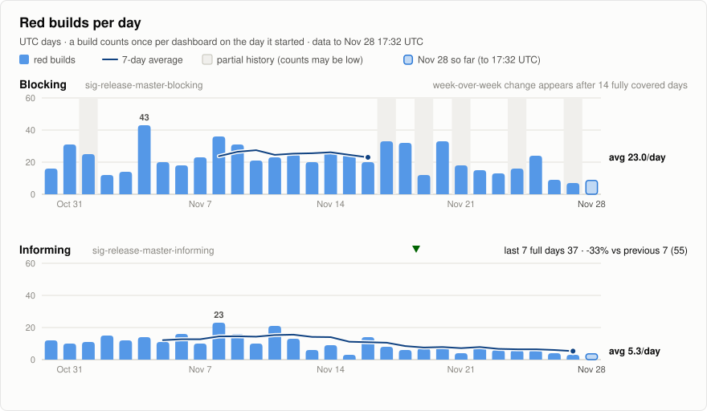
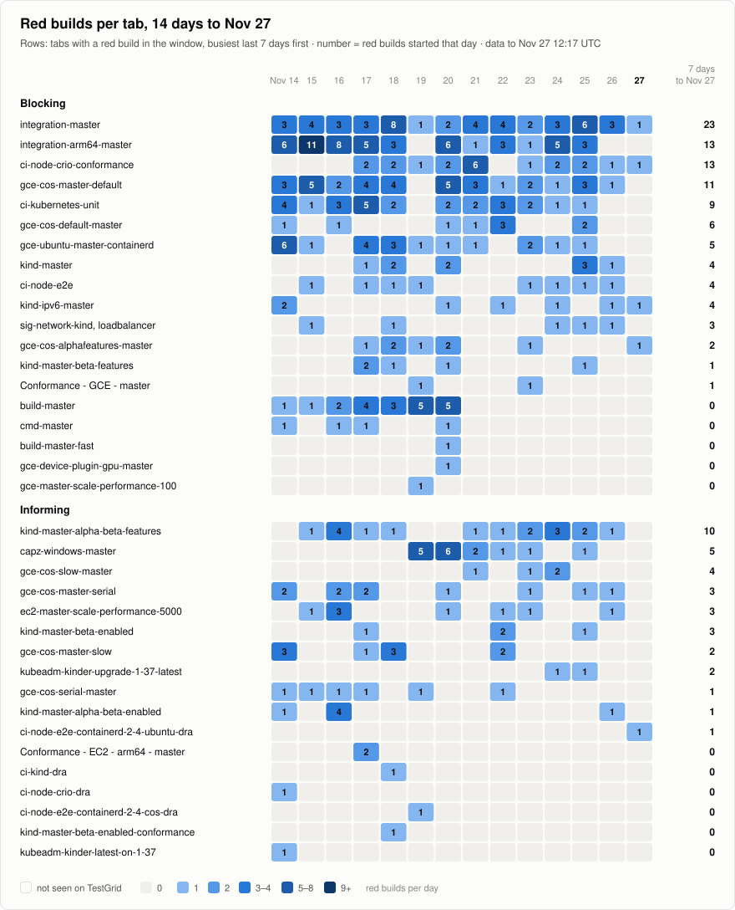

# Red TestGrid builds

Updated 2026-11-21T02:14:16Z. The builds with a red cell on sig-release-master-blocking and sig-release-master-informing that the runs found: seen red on TestGrid, or taken from GCS by TestGrid's rule ([what that can miss or add](../README.md#limits)); times are UTC. Each archived build is in the folder of the run that first archived it, under [runs/](runs/). A file marked provisional may have been taken before Prow finished uploading; it is compared with GCS on every run and fetched again if GCS changes.

<picture>
  <source media="(prefers-color-scheme: dark)" srcset="charts/trend-dark.svg">
  
</picture>

<picture>
  <source media="(prefers-color-scheme: dark)" srcset="charts/tabs-dark.svg">
  
</picture>

Red builds per tab (table)

| Dashboard | Tab | 7 days to Nov 21 | 14 days |
|---|---|---:|---:|
| Blocking | integration-arm64-master | 33 | 80 |
| Blocking | integration-master | 21 | 36 |
| Blocking | gce-cos-master-default | 20 | 42 |
| Blocking | build-master | 20 | 29 |
| Blocking | ci-kubernetes-unit | 13 | 26 |
| Blocking | gce-ubuntu-master-containerd | 10 | 37 |
| Blocking | ci-node-crio-conformance | 7 | 13 |
| Blocking | gce-cos-alphafeatures-master | 6 | 9 |
| Blocking | kind-master | 5 | 8 |
| Blocking | kind-master-beta-features | 4 | 9 |
| Blocking | ci-node-e2e | 4 | 6 |
| Blocking | cmd-master | 3 | 6 |
| Blocking | gce-cos-default-master | 2 | 12 |
| Blocking | sig-network-kind, loadbalancer | 2 | 3 |
| Blocking | kind-ipv6-master | 1 | 6 |
| Blocking | gce-device-plugin-gpu-master | 1 | 5 |
| Blocking | Conformance - GCE - master | 1 | 3 |
| Blocking | gce-master-scale-performance-100 | 1 | 3 |
| Blocking | build-master-fast | 1 | 1 |
| Blocking | verify-master | 0 | 3 |
| Blocking | conformance-ga-only | 0 | 1 |
| Informing | capz-windows-master | 11 | 37 |
| Informing | kind-master-alpha-beta-features | 7 | 10 |
| Informing | gce-cos-master-serial | 5 | 15 |
| Informing | ec2-master-scale-performance-5000 | 5 | 6 |
| Informing | gce-cos-master-slow | 4 | 20 |
| Informing | gce-cos-serial-master | 4 | 14 |
| Informing | kind-master-alpha-beta-enabled | 4 | 8 |
| Informing | Conformance - EC2 - arm64 - master | 2 | 8 |
| Informing | kind-master-beta-enabled | 1 | 7 |
| Informing | ci-node-e2e-containerd-2-4-cos-dra | 1 | 2 |
| Informing | kind-master-beta-enabled-conformance | 1 | 2 |
| Informing | ci-kind-dra | 1 | 1 |
| Informing | Conformance - EC2 - master | 0 | 4 |
| Informing | gce-cos-master-alpha-features | 0 | 2 |
| Informing | gce-cos-slow-master | 0 | 2 |
| Informing | gce-master-scale-correctness | 0 | 2 |
| Informing | ci-node-crio-dra | 0 | 1 |
| Informing | ci-node-e2e-containerd-2-4-ubuntu-dra | 0 | 1 |
| Informing | kubeadm-kinder-latest | 0 | 1 |
| Informing | kubeadm-kinder-latest-on-1-37 | 0 | 1 |

Daily counts (table)

| Day (UTC) | Blocking | Informing |
|---|---:|---:|
| 2026-11-21 | 0 (so far, to 02:14 UTC) | 0 (so far, to 02:14 UTC) |
| 2026-11-20 | 33 (partial) | 8 (partial) |
| 2026-11-19 | 12 (partial) | 7 |
| 2026-11-18 | 32 | 6 |
| 2026-11-17 | 33 (partial) | 8 |
| 2026-11-16 | 20 | 14 |
| 2026-11-15 | 25 | 3 |
| 2026-11-14 | 27 | 9 |
| 2026-11-13 | 20 | 6 |
| 2026-11-12 | 25 | 13 |
| 2026-11-11 | 23 | 21 |
| 2026-11-10 | 21 | 10 |
| 2026-11-09 | 31 | 16 |
| 2026-11-08 | 36 | 23 |
| 2026-11-07 | 23 | 10 |
| 2026-11-06 | 18 | 16 |
| 2026-11-05 | 20 | 11 |
| 2026-11-04 | 43 | 14 |
| 2026-11-03 | 14 | 12 |
| 2026-11-02 | 12 | 15 |
| 2026-11-01 | 25 (partial) | 11 |
| 2026-10-31 | 31 | 10 |
| 2026-10-30 | 16 | 12 |
| 2026-10-29 | 25 | 19 |
| 2026-10-28 | 19 | 15 |
| 2026-10-27 | 23 | 8 (partial) |
| 2026-10-26 | 18 | 7 (partial) |
| 2026-10-25 | 18 | 12 |
| 2026-10-24 | 6 | 11 |
| 2026-10-23 | 9 | 16 |

## Runs in the last 14 days

Collection result is how the run's fetch went: ok, interrupted, its number of problems (errors, serious warnings, and the tabs and dashboard summaries it could not read, listed in the README of the run's folder and in its run.json), no run report if the run was cut off before writing one, or unreadable run report if its run.json cannot be read. It does not include the verification that follows the fetch ([cross_check.py](../tool/cross_check.py)).

Verification is the outcome that verification recorded in the run's verification.json: ok, its number of problems, timed out, interrupted, stopped (by an error), or incomplete (it ended without recording one). It is pending for the run that wrote this page until its verification ends, when the workflow puts the outcome here; not recorded when the run has no verification.json (it ran before verifications were recorded, was not verified, or none could be written); and unreadable when the file is damaged.

| Run (UTC) | New builds | Updated | Collection result | Verification |
|---|---:|---:|---|---|
| [2026-11-21 02:13:12](runs/2026-11/2026-11-21T021312Z/) | 5 | 0 | ok | [ok](runs/2026-11/2026-11-21T021312Z/verification.json) |
| [2026-11-20 20:17:15](runs/2026-11/2026-11-20T201715Z/) | 36 | 0 | ok | [ok](runs/2026-11/2026-11-20T201715Z/verification.json) |
| [2026-11-20 02:18:31](runs/2026-11/2026-11-20T021831Z/) | 3 | 0 | ok | [ok](runs/2026-11/2026-11-20T021831Z/verification.json) |
| [2026-11-19 20:38:49](runs/2026-11/2026-11-19T203849Z/) | 14 | 0 | ok | [ok](runs/2026-11/2026-11-19T203849Z/verification.json) |
| [2026-11-19 02:34:12](runs/2026-11/2026-11-19T023412Z/) | 10 | 0 | ok | [ok](runs/2026-11/2026-11-19T023412Z/verification.json) |
| [2026-11-18 20:32:36](runs/2026-11/2026-11-18T203236Z/) | 30 | 0 | ok | [ok](runs/2026-11/2026-11-18T203236Z/verification.json) |
| [2026-11-18 00:58:20](runs/2026-11/2026-11-18T005820Z/) | 17 | 0 | ok | [ok](runs/2026-11/2026-11-18T005820Z/verification.json) |
| [2026-11-17 15:59:47](runs/2026-11/2026-11-17T155947Z/) | 19 | 0 | ok | [ok](runs/2026-11/2026-11-17T155947Z/verification.json) |
| [2026-11-17 03:53:02](runs/2026-11/2026-11-17T035302Z/) | 12 | 0 | ok | [ok](runs/2026-11/2026-11-17T035302Z/verification.json) |
| [2026-11-16 19:37:54](runs/2026-11/2026-11-16T193754Z/) | 22 | 0 | ok | [ok](runs/2026-11/2026-11-16T193754Z/verification.json) |
| [2026-11-16 06:25:27](runs/2026-11/2026-11-16T062527Z/) | 17 | 0 | ok | [ok](runs/2026-11/2026-11-16T062527Z/verification.json) |
| [2026-11-15 16:20:38](runs/2026-11/2026-11-15T162038Z/) | 9 | 0 | ok | [ok](runs/2026-11/2026-11-15T162038Z/verification.json) |
| [2026-11-15 06:29:41](runs/2026-11/2026-11-15T062941Z/) | 16 | 0 | ok | [ok](runs/2026-11/2026-11-15T062941Z/verification.json) |
| [2026-11-14 15:48:27](runs/2026-11/2026-11-14T154827Z/) | 16 | 0 | ok | [ok](runs/2026-11/2026-11-14T154827Z/verification.json) |
| [2026-11-14 06:20:09](runs/2026-11/2026-11-14T062009Z/) | 18 | 0 | ok | [ok](runs/2026-11/2026-11-14T062009Z/verification.json) |
| [2026-11-13 17:12:55](runs/2026-11/2026-11-13T171255Z/) | 16 | 0 | ok | [ok](runs/2026-11/2026-11-13T171255Z/verification.json) |
| [2026-11-13 06:44:16](runs/2026-11/2026-11-13T064416Z/) | 15 | 0 | ok | [ok](runs/2026-11/2026-11-13T064416Z/verification.json) |
| [2026-11-12 17:36:14](runs/2026-11/2026-11-12T173614Z/) | 19 | 0 | ok | [ok](runs/2026-11/2026-11-12T173614Z/verification.json) |
| [2026-11-12 07:09:02](runs/2026-11/2026-11-12T070902Z/) | 28 | 0 | ok | [ok](runs/2026-11/2026-11-12T070902Z/verification.json) |
| [2026-11-11 14:27:20](runs/2026-11/2026-11-11T142720Z/) | 11 | 0 | ok | [ok](runs/2026-11/2026-11-11T142720Z/verification.json) |
| [2026-11-11 06:15:43](runs/2026-11/2026-11-11T061543Z/) | 23 | 0 | ok | [ok](runs/2026-11/2026-11-11T061543Z/verification.json) |
| [2026-11-10 14:52:16](runs/2026-11/2026-11-10T145216Z/) | 15 | 0 | ok | [ok](runs/2026-11/2026-11-10T145216Z/verification.json) |
| [2026-11-10 03:34:24](runs/2026-11/2026-11-10T033424Z/) | 13 | 0 | ok | [ok](runs/2026-11/2026-11-10T033424Z/verification.json) |
| [2026-11-09 19:50:21](runs/2026-11/2026-11-09T195021Z/) | 28 | 0 | ok | [ok](runs/2026-11/2026-11-09T195021Z/verification.json) |
| [2026-11-09 06:23:45](runs/2026-11/2026-11-09T062345Z/) | 18 | 0 | ok | [ok](runs/2026-11/2026-11-09T062345Z/verification.json) |
| [2026-11-08 17:56:17](runs/2026-11/2026-11-08T175617Z/) | 53 | 0 | ok | [ok](runs/2026-11/2026-11-08T175617Z/verification.json) |
| [2026-11-08 00:35:32](runs/2026-11/2026-11-08T003532Z/) | 15 | 0 | ok | [ok](runs/2026-11/2026-11-08T003532Z/verification.json) |

## Builds from the last 14 days

482 archived builds that started since 2026-11-08 (UTC), newest first.

### 2026-11-20

| Time | Tab | Build | Red tests | Files |
|---|---|---|---|---|
| 22:48 | blocking#ci-kubernetes-unit | [ci-kubernetes-unit 2123911237480747008](https://prow.k8s.io/view/gs/kubernetes-ci-logs/logs/ci-kubernetes-unit/2123911237480747008) | \[sig-node\] k8s.io/kubernetes/pkg/kubelet.prober (+1) | [build-log.txt.gz](runs/2026-11/2026-11-21T021312Z/ci-kubernetes-unit/2123911237480747008/build-log.txt.gz) [podinfo.json.gz](runs/2026-11/2026-11-21T021312Z/ci-kubernetes-unit/2123911237480747008/podinfo.json.gz) |
| 21:54 | blocking#ci-node-crio-conformance | [ci-node-crio-conformance 2123897656014016512](https://prow.k8s.io/view/gs/kubernetes-ci-logs/logs/ci-node-crio-conformance/2123897656014016512) | E2eNode Suite.\[It\] \[sig-node\] MirrorPod (Pod Generation) mirror pod updates mirror pod: up (+2) | [build-log.txt.gz](runs/2026-11/2026-11-21T021312Z/ci-node-crio-conformance/2123897656014016512/build-log.txt.gz) [podinfo.json.gz](runs/2026-11/2026-11-21T021312Z/ci-node-crio-conformance/2123897656014016512/podinfo.json.gz) [artifacts/ as .tar.xz](https://github.com/thc1006/testgrid-red-build-logs/releases/download/node-logs-2026-11/ci-node-crio-conformance_2123897656014016512.tar.xz) |
| 21:47 | blocking#gce-cos-master-default | [ci-kubernetes-e2e-gci-gce 2123896136279265280](https://prow.k8s.io/view/gs/kubernetes-ci-logs/logs/ci-kubernetes-e2e-gci-gce/2123896136279265280) | Kubernetes e2e suite.\[It\] \[sig-storage\] CSI Mock volume expansion Expansion with recovery (+2) | [build-log.txt.gz](runs/2026-11/2026-11-21T021312Z/ci-kubernetes-e2e-gci-gce/2123896136279265280/build-log.txt.gz) [podinfo.json.gz](runs/2026-11/2026-11-21T021312Z/ci-kubernetes-e2e-gci-gce/2123896136279265280/podinfo.json.gz) |
| 19:57 | blocking#integration-arm64-master | [ci-kubernetes-integration-arm64-master 2123868201988132864](https://prow.k8s.io/view/gs/kubernetes-ci-logs/logs/ci-kubernetes-integration-arm64-master/2123868201988132864) | \[sig-api-machinery\] k8s.io/kubernetes/test/integration/apiserver.coordinatedleaderelection (+1) | [build-log.txt.gz](runs/2026-11/2026-11-21T021312Z/ci-kubernetes-integration-arm64-master/2123868201988132864/build-log.txt.gz) [podinfo.json.gz](runs/2026-11/2026-11-21T021312Z/ci-kubernetes-integration-arm64-master/2123868201988132864/podinfo.json.gz) |
| 18:44 | informing#capz-windows-master | [ci-kubernetes-e2e-capz-master-windows 2123849831590924288](https://prow.k8s.io/view/gs/kubernetes-ci-logs/logs/ci-kubernetes-e2e-capz-master-windows/2123849831590924288) | ci-kubernetes-e2e-capz-master-windows.Overall | [build-log.txt.gz](runs/2026-11/2026-11-21T021312Z/ci-kubernetes-e2e-capz-master-windows/2123849831590924288/build-log.txt.gz) [podinfo.json.gz](runs/2026-11/2026-11-21T021312Z/ci-kubernetes-e2e-capz-master-windows/2123849831590924288/podinfo.json.gz) |
| 18:43 | blocking#build-master | [ci-kubernetes-build 2123849578884108288](https://prow.k8s.io/view/gs/kubernetes-ci-logs/logs/ci-kubernetes-build/2123849578884108288) | ci-kubernetes-build.Overall | [build-log.txt.gz](runs/2026-11/2026-11-20T201715Z/ci-kubernetes-build/2123849578884108288/build-log.txt.gz) [podinfo.json.gz](runs/2026-11/2026-11-20T201715Z/ci-kubernetes-build/2123849578884108288/podinfo.json.gz) |
| 18:28 | blocking#build-master | [ci-kubernetes-build 2123845803800793088](https://prow.k8s.io/view/gs/kubernetes-ci-logs/logs/ci-kubernetes-build/2123845803800793088) | ci-kubernetes-build.Overall | [build-log.txt.gz](runs/2026-11/2026-11-20T201715Z/ci-kubernetes-build/2123845803800793088/build-log.txt.gz) [podinfo.json.gz](runs/2026-11/2026-11-20T201715Z/ci-kubernetes-build/2123845803800793088/podinfo.json.gz) |
| 17:28 | blocking#build-master | [ci-kubernetes-build 2123830704419639296](https://prow.k8s.io/view/gs/kubernetes-ci-logs/logs/ci-kubernetes-build/2123830704419639296) | ci-kubernetes-build.Overall | [build-log.txt.gz](runs/2026-11/2026-11-20T201715Z/ci-kubernetes-build/2123830704419639296/build-log.txt.gz) [podinfo.json.gz](runs/2026-11/2026-11-20T201715Z/ci-kubernetes-build/2123830704419639296/podinfo.json.gz) |
| 16:57 | blocking#integration-arm64-master | [ci-kubernetes-integration-arm64-master 2123822903840477184](https://prow.k8s.io/view/gs/kubernetes-ci-logs/logs/ci-kubernetes-integration-arm64-master/2123822903840477184) | \[sig-node\] k8s.io/kubernetes/test/integration.imperativeevictionresponder (+1) | [build-log.txt.gz](runs/2026-11/2026-11-20T201715Z/ci-kubernetes-integration-arm64-master/2123822903840477184/build-log.txt.gz) [podinfo.json.gz](runs/2026-11/2026-11-20T201715Z/ci-kubernetes-integration-arm64-master/2123822903840477184/podinfo.json.gz) |
| 16:25 | blocking#gce-cos-master-default | [ci-kubernetes-e2e-gci-gce 2123815113935818752](https://prow.k8s.io/view/gs/kubernetes-ci-logs/logs/ci-kubernetes-e2e-gci-gce/2123815113935818752) | Kubernetes e2e suite.\[It\] \[sig-storage\] Volume metrics Ephemeral should create prometheus (+2) | [build-log.txt.gz](runs/2026-11/2026-11-20T201715Z/ci-kubernetes-e2e-gci-gce/2123815113935818752/build-log.txt.gz) [podinfo.json.gz](runs/2026-11/2026-11-20T201715Z/ci-kubernetes-e2e-gci-gce/2123815113935818752/podinfo.json.gz) |
| 16:02 | blocking#kind-master-beta-features | [ci-kubernetes-e2e-kind-beta-features 2123809063136399360](https://prow.k8s.io/view/gs/kubernetes-ci-logs/logs/ci-kubernetes-e2e-kind-beta-features/2123809063136399360) | Kubernetes e2e suite.\[It\] \[sig-api-machinery\] ResourceQuota \[FeatureGate:VolumeAttributesC (+1) | [build-log.txt.gz](runs/2026-11/2026-11-20T201715Z/ci-kubernetes-e2e-kind-beta-features/2123809063136399360/build-log.txt.gz) [podinfo.json.gz](runs/2026-11/2026-11-20T201715Z/ci-kubernetes-e2e-kind-beta-features/2123809063136399360/podinfo.json.gz) |
| 15:54 | blocking#ci-node-crio-conformance | [ci-node-crio-conformance 2123807047869796352](https://prow.k8s.io/view/gs/kubernetes-ci-logs/logs/ci-node-crio-conformance/2123807047869796352) | E2eNode Suite.\[It\] \[sig-node\] MirrorPod (Pod Generation) mirror pod updates mirror pod: up (+2) | [build-log.txt.gz](runs/2026-11/2026-11-20T201715Z/ci-node-crio-conformance/2123807047869796352/build-log.txt.gz) [podinfo.json.gz](runs/2026-11/2026-11-20T201715Z/ci-node-crio-conformance/2123807047869796352/podinfo.json.gz) [artifacts/ as .tar.xz](https://github.com/thc1006/testgrid-red-build-logs/releases/download/node-logs-2026-11/ci-node-crio-conformance_2123807047869796352.tar.xz) |
| 15:31 | blocking#gce-device-plugin-gpu-master | [ci-kubernetes-e2e-gce-device-plugin-gpu 2123801260493639680](https://prow.k8s.io/view/gs/kubernetes-ci-logs/logs/ci-kubernetes-e2e-gce-device-plugin-gpu/2123801260493639680) | kubetest2.Up (+1) | [build-log.txt.gz](runs/2026-11/2026-11-20T201715Z/ci-kubernetes-e2e-gce-device-plugin-gpu/2123801260493639680/build-log.txt.gz) [podinfo.json.gz](runs/2026-11/2026-11-20T201715Z/ci-kubernetes-e2e-gce-device-plugin-gpu/2123801260493639680/podinfo.json.gz) |
| 15:11 | informing#gce-cos-master-serial | [ci-kubernetes-e2e-gci-gce-serial 2123796478903193600](https://prow.k8s.io/view/gs/kubernetes-ci-logs/logs/ci-kubernetes-e2e-gci-gce-serial/2123796478903193600) | Kubernetes e2e suite.\[It\] \[sig-node\] Pod InPlace Resize Memory-Backed Volume (deferred-res (+2) | [build-log.txt.gz](runs/2026-11/2026-11-20T201715Z/ci-kubernetes-e2e-gci-gce-serial/2123796478903193600/build-log.txt.gz) [podinfo.json.gz](runs/2026-11/2026-11-20T201715Z/ci-kubernetes-e2e-gci-gce-serial/2123796478903193600/podinfo.json.gz) |
| 14:27 | blocking#kind-master | [ci-kubernetes-e2e-kind 2123785153892323328](https://prow.k8s.io/view/gs/kubernetes-ci-logs/logs/ci-kubernetes-e2e-kind/2123785153892323328) | Kubernetes e2e suite.\[It\] \[sig-storage\] In-tree Volumes \[Driver: nfs\] \[Testpattern: Pre-pr (+1) | [build-log.txt.gz](runs/2026-11/2026-11-20T201715Z/ci-kubernetes-e2e-kind/2123785153892323328/build-log.txt.gz) [podinfo.json.gz](runs/2026-11/2026-11-20T201715Z/ci-kubernetes-e2e-kind/2123785153892323328/podinfo.json.gz) |
| 13:40 | blocking#gce-cos-master-default | [ci-kubernetes-e2e-gci-gce 2123773577680392192](https://prow.k8s.io/view/gs/kubernetes-ci-logs/logs/ci-kubernetes-e2e-gci-gce/2123773577680392192) | Kubernetes e2e suite.\[It\] \[sig-node\] Pod InPlace Resize Container guaranteed pods with mul (+2) | [build-log.txt.gz](runs/2026-11/2026-11-20T201715Z/ci-kubernetes-e2e-gci-gce/2123773577680392192/build-log.txt.gz) [podinfo.json.gz](runs/2026-11/2026-11-20T201715Z/ci-kubernetes-e2e-gci-gce/2123773577680392192/podinfo.json.gz) |
| 13:07 | blocking#build-master | [ci-kubernetes-build 2123765020700446720](https://prow.k8s.io/view/gs/kubernetes-ci-logs/logs/ci-kubernetes-build/2123765020700446720) | ci-kubernetes-build.Overall | [build-log.txt.gz](runs/2026-11/2026-11-20T201715Z/ci-kubernetes-build/2123765020700446720/build-log.txt.gz) [podinfo.json.gz](runs/2026-11/2026-11-20T201715Z/ci-kubernetes-build/2123765020700446720/podinfo.json.gz) |
| 12:46 | blocking#ci-kubernetes-unit | [ci-kubernetes-unit 2123759736661741568](https://prow.k8s.io/view/gs/kubernetes-ci-logs/logs/ci-kubernetes-unit/2123759736661741568) | \[sig-api-machinery\] k8s.io/apiserver/pkg/server.filters (+2) | [build-log.txt.gz](runs/2026-11/2026-11-20T201715Z/ci-kubernetes-unit/2123759736661741568/build-log.txt.gz) [podinfo.json.gz](runs/2026-11/2026-11-20T201715Z/ci-kubernetes-unit/2123759736661741568/podinfo.json.gz) |
| 12:44 | informing#capz-windows-master | [ci-kubernetes-e2e-capz-master-windows 2123759232850333696](https://prow.k8s.io/view/gs/kubernetes-ci-logs/logs/ci-kubernetes-e2e-capz-master-windows/2123759232850333696) | Kubernetes e2e suite.\[It\] \[sig-node\] Downward API Downward API tests for pod level resourc (+3) | [build-log.txt.gz](runs/2026-11/2026-11-20T201715Z/ci-kubernetes-e2e-capz-master-windows/2123759232850333696/build-log.txt.gz) [podinfo.json.gz](runs/2026-11/2026-11-20T201715Z/ci-kubernetes-e2e-capz-master-windows/2123759232850333696/podinfo.json.gz) |
| 11:55 | blocking#gce-ubuntu-master-containerd | [ci-kubernetes-e2e-ubuntu-gce-containerd 2123747161362403328](https://prow.k8s.io/view/gs/kubernetes-ci-logs/logs/ci-kubernetes-e2e-ubuntu-gce-containerd/2123747161362403328) | Kubernetes e2e suite.\[It\] \[sig-network\] Networking Granular Checks: Services should update (+2) | [build-log.txt.gz](runs/2026-11/2026-11-20T201715Z/ci-kubernetes-e2e-ubuntu-gce-containerd/2123747161362403328/build-log.txt.gz) [podinfo.json.gz](runs/2026-11/2026-11-20T201715Z/ci-kubernetes-e2e-ubuntu-gce-containerd/2123747161362403328/podinfo.json.gz) |
| 11:54 | blocking#integration-arm64-master | [ci-kubernetes-integration-arm64-master 2123746649833476096](https://prow.k8s.io/view/gs/kubernetes-ci-logs/logs/ci-kubernetes-integration-arm64-master/2123746649833476096) | \[sig-api-machinery\] k8s.io/kubernetes/test/integration/apiserver.coordinatedleaderelection (+1) | [build-log.txt.gz](runs/2026-11/2026-11-20T201715Z/ci-kubernetes-integration-arm64-master/2123746649833476096/build-log.txt.gz) [podinfo.json.gz](runs/2026-11/2026-11-20T201715Z/ci-kubernetes-integration-arm64-master/2123746649833476096/podinfo.json.gz) |
| 11:52 | blocking#integration-master | [ci-kubernetes-integration-master 2123746146894483456](https://prow.k8s.io/view/gs/kubernetes-ci-logs/logs/ci-kubernetes-integration-master/2123746146894483456) | \[sig-api-machinery\] k8s.io/kubernetes/test/integration.examples (+1) | [build-log.txt.gz](runs/2026-11/2026-11-20T201715Z/ci-kubernetes-integration-master/2123746146894483456/build-log.txt.gz) [podinfo.json.gz](runs/2026-11/2026-11-20T201715Z/ci-kubernetes-integration-master/2123746146894483456/podinfo.json.gz) |
| 10:59 | blocking#build-master | [ci-kubernetes-build 2123732813021712384](https://prow.k8s.io/view/gs/kubernetes-ci-logs/logs/ci-kubernetes-build/2123732813021712384) | ci-kubernetes-build.Overall | [build-log.txt.gz](runs/2026-11/2026-11-20T201715Z/ci-kubernetes-build/2123732813021712384/build-log.txt.gz) [podinfo.json.gz](runs/2026-11/2026-11-20T201715Z/ci-kubernetes-build/2123732813021712384/podinfo.json.gz) |
| 10:40 | blocking#build-master-fast | [ci-kubernetes-build-fast 2123728026750423040](https://prow.k8s.io/view/gs/kubernetes-ci-logs/logs/ci-kubernetes-build-fast/2123728026750423040) | ci-kubernetes-build-fast.Pod (+1) | [build-log.txt.gz](runs/2026-11/2026-11-20T201715Z/ci-kubernetes-build-fast/2123728026750423040/build-log.txt.gz) [podinfo.json.gz](runs/2026-11/2026-11-20T201715Z/ci-kubernetes-build-fast/2123728026750423040/podinfo.json.gz) |
| 10:22 | blocking#gce-cos-master-default | [ci-kubernetes-e2e-gci-gce 2123723748669394944](https://prow.k8s.io/view/gs/kubernetes-ci-logs/logs/ci-kubernetes-e2e-gci-gce/2123723748669394944) | Kubernetes e2e suite.\[It\] \[sig-api-machinery\] ResourceQuota should verify ResourceQuota wi (+2) | [build-log.txt.gz](runs/2026-11/2026-11-20T201715Z/ci-kubernetes-e2e-gci-gce/2123723748669394944/build-log.txt.gz) [podinfo.json.gz](runs/2026-11/2026-11-20T201715Z/ci-kubernetes-e2e-gci-gce/2123723748669394944/podinfo.json.gz) |
| 09:58 | blocking#kind-ipv6-master | [ci-kubernetes-e2e-kind-ipv6 2123717457339224064](https://prow.k8s.io/view/gs/kubernetes-ci-logs/logs/ci-kubernetes-e2e-kind-ipv6/2123717457339224064) | Kubernetes e2e suite.\[It\] \[sig-storage\] In-tree Volumes \[Driver: nfs\] \[Testpattern: Inline (+1) | [build-log.txt.gz](runs/2026-11/2026-11-20T201715Z/ci-kubernetes-e2e-kind-ipv6/2123717457339224064/build-log.txt.gz) [podinfo.json.gz](runs/2026-11/2026-11-20T201715Z/ci-kubernetes-e2e-kind-ipv6/2123717457339224064/podinfo.json.gz) |
| 09:43 | informing#capz-windows-master | [ci-kubernetes-e2e-capz-master-windows 2123713683002494976](https://prow.k8s.io/view/gs/kubernetes-ci-logs/logs/ci-kubernetes-e2e-capz-master-windows/2123713683002494976) | Kubernetes e2e suite.\[It\] \[sig-node\] Downward API Downward API tests for pod level resourc (+3) | [build-log.txt.gz](runs/2026-11/2026-11-20T201715Z/ci-kubernetes-e2e-capz-master-windows/2123713683002494976/build-log.txt.gz) [podinfo.json.gz](runs/2026-11/2026-11-20T201715Z/ci-kubernetes-e2e-capz-master-windows/2123713683002494976/podinfo.json.gz) |
| 09:36 | blocking#gce-cos-alphafeatures-master | [ci-kubernetes-e2e-gce-cos-alphafeatures-master 2123711921650667520](https://prow.k8s.io/view/gs/kubernetes-ci-logs/logs/ci-kubernetes-e2e-gce-cos-alphafeatures-master/2123711921650667520) | kubetest.TearDown (+2) | [build-log.txt.gz](runs/2026-11/2026-11-20T201715Z/ci-kubernetes-e2e-gce-cos-alphafeatures-master/2123711921650667520/build-log.txt.gz) [podinfo.json.gz](runs/2026-11/2026-11-20T201715Z/ci-kubernetes-e2e-gce-cos-alphafeatures-master/2123711921650667520/podinfo.json.gz) |
| 09:01 | blocking#cmd-master | [ci-kubernetes-cmd-master 2123703112433668096](https://prow.k8s.io/view/gs/kubernetes-ci-logs/logs/ci-kubernetes-cmd-master/2123703112433668096) | test-cmd.run\_kubectl\_apply\_tests (+1) | [build-log.txt.gz](runs/2026-11/2026-11-20T201715Z/ci-kubernetes-cmd-master/2123703112433668096/build-log.txt.gz) [podinfo.json.gz](runs/2026-11/2026-11-20T201715Z/ci-kubernetes-cmd-master/2123703112433668096/podinfo.json.gz) |
| 08:45 | blocking#gce-cos-default-master | [ci-kubernetes-e2e-gce-cos-default-master 2123699086828769280](https://prow.k8s.io/view/gs/kubernetes-ci-logs/logs/ci-kubernetes-e2e-gce-cos-default-master/2123699086828769280) | Kubernetes e2e suite.\[It\] \[sig-node\] \[DRA\] control plane supports count/resourceclaims.res (+2) | [build-log.txt.gz](runs/2026-11/2026-11-20T201715Z/ci-kubernetes-e2e-gce-cos-default-master/2123699086828769280/build-log.txt.gz) [podinfo.json.gz](runs/2026-11/2026-11-20T201715Z/ci-kubernetes-e2e-gce-cos-default-master/2123699086828769280/podinfo.json.gz) |
| 07:50 | blocking#integration-arm64-master | [ci-kubernetes-integration-arm64-master 2123685245084504064](https://prow.k8s.io/view/gs/kubernetes-ci-logs/logs/ci-kubernetes-integration-arm64-master/2123685245084504064) | \[sig-api-machinery\] k8s.io/kubernetes/test/integration/apiserver.coordinatedleaderelection (+1) | [build-log.txt.gz](runs/2026-11/2026-11-20T201715Z/ci-kubernetes-integration-arm64-master/2123685245084504064/build-log.txt.gz) [podinfo.json.gz](runs/2026-11/2026-11-20T201715Z/ci-kubernetes-integration-arm64-master/2123685245084504064/podinfo.json.gz) |
| 07:02 | informing#ec2-master-scale-performance-5000 | [ci-kubernetes-e2e-ec2-scale-performance-5000 2123673165937774592](https://prow.k8s.io/view/gs/kubernetes-ci-logs/logs/ci-kubernetes-e2e-ec2-scale-performance-5000/2123673165937774592) | ClusterLoaderV2.load overall (/home/prow/go/src/k8s.io/perf-tests/clusterloader2/testing/l (+3) | [build-log.txt.gz](runs/2026-11/2026-11-20T201715Z/ci-kubernetes-e2e-ec2-scale-performance-5000/2123673165937774592/build-log.txt.gz) [podinfo.json.gz](runs/2026-11/2026-11-20T201715Z/ci-kubernetes-e2e-ec2-scale-performance-5000/2123673165937774592/podinfo.json.gz) |
| 06:42 | informing#capz-windows-master | [ci-kubernetes-e2e-capz-master-windows 2123668132521316352](https://prow.k8s.io/view/gs/kubernetes-ci-logs/logs/ci-kubernetes-e2e-capz-master-windows/2123668132521316352) | Kubernetes e2e suite.\[It\] \[sig-node\] Downward API Downward API tests for pod level resourc (+3) | [build-log.txt.gz](runs/2026-11/2026-11-20T201715Z/ci-kubernetes-e2e-capz-master-windows/2123668132521316352/build-log.txt.gz) [podinfo.json.gz](runs/2026-11/2026-11-20T201715Z/ci-kubernetes-e2e-capz-master-windows/2123668132521316352/podinfo.json.gz) |
| 04:49 | blocking#integration-arm64-master | [ci-kubernetes-integration-arm64-master 2123639693386977280](https://prow.k8s.io/view/gs/kubernetes-ci-logs/logs/ci-kubernetes-integration-arm64-master/2123639693386977280) | \[sig-api-machinery\] k8s.io/kubernetes/test/integration/apiserver.coordinatedleaderelection (+1) | [build-log.txt.gz](runs/2026-11/2026-11-20T201715Z/ci-kubernetes-integration-arm64-master/2123639693386977280/build-log.txt.gz) [podinfo.json.gz](runs/2026-11/2026-11-20T201715Z/ci-kubernetes-integration-arm64-master/2123639693386977280/podinfo.json.gz) |
| 03:08 | informing#capz-windows-master | [ci-kubernetes-e2e-capz-master-windows 2123614277481795584](https://prow.k8s.io/view/gs/kubernetes-ci-logs/logs/ci-kubernetes-e2e-capz-master-windows/2123614277481795584) | Kubernetes e2e suite.\[It\] \[sig-node\] Downward API Downward API tests for pod level resourc (+3) | [build-log.txt.gz](runs/2026-11/2026-11-20T201715Z/ci-kubernetes-e2e-capz-master-windows/2123614277481795584/build-log.txt.gz) [podinfo.json.gz](runs/2026-11/2026-11-20T201715Z/ci-kubernetes-e2e-capz-master-windows/2123614277481795584/podinfo.json.gz) |
| 02:46 | blocking#integration-master | [ci-kubernetes-integration-master 2123608740820160512](https://prow.k8s.io/view/gs/kubernetes-ci-logs/logs/ci-kubernetes-integration-master/2123608740820160512) | \[sig-api-machinery\] k8s.io/kubernetes/test/integration/apiserver.coordinatedleaderelection (+1) | [build-log.txt.gz](runs/2026-11/2026-11-20T201715Z/ci-kubernetes-integration-master/2123608740820160512/build-log.txt.gz) [podinfo.json.gz](runs/2026-11/2026-11-20T201715Z/ci-kubernetes-integration-master/2123608740820160512/podinfo.json.gz) |
| 02:34 | blocking#gce-cos-master-default | [ci-kubernetes-e2e-gci-gce 2123605972235587584](https://prow.k8s.io/view/gs/kubernetes-ci-logs/logs/ci-kubernetes-e2e-gci-gce/2123605972235587584) | Kubernetes e2e suite.\[It\] \[sig-node\] Pod InPlace Resize Memory-Backed Volume \[FeatureGate: (+2) | [build-log.txt.gz](runs/2026-11/2026-11-20T201715Z/ci-kubernetes-e2e-gci-gce/2123605972235587584/build-log.txt.gz) [podinfo.json.gz](runs/2026-11/2026-11-20T201715Z/ci-kubernetes-e2e-gci-gce/2123605972235587584/podinfo.json.gz) |
| 02:19 | blocking#kind-master | [ci-kubernetes-e2e-kind 2123601946211258368](https://prow.k8s.io/view/gs/kubernetes-ci-logs/logs/ci-kubernetes-e2e-kind/2123601946211258368) | Kubernetes e2e suite.\[It\] \[sig-api-machinery\] ResourceQuota should create a ResourceQuota (+1) | [build-log.txt.gz](runs/2026-11/2026-11-20T201715Z/ci-kubernetes-e2e-kind/2123601946211258368/build-log.txt.gz) [podinfo.json.gz](runs/2026-11/2026-11-20T201715Z/ci-kubernetes-e2e-kind/2123601946211258368/podinfo.json.gz) |
| 01:32 | blocking#gce-cos-alphafeatures-master | [ci-kubernetes-e2e-gce-cos-alphafeatures-master 2123590116877275136](https://prow.k8s.io/view/gs/kubernetes-ci-logs/logs/ci-kubernetes-e2e-gce-cos-alphafeatures-master/2123590116877275136) | kubetest.TearDown (+2) | [build-log.txt.gz](runs/2026-11/2026-11-20T201715Z/ci-kubernetes-e2e-gce-cos-alphafeatures-master/2123590116877275136/build-log.txt.gz) [podinfo.json.gz](runs/2026-11/2026-11-20T201715Z/ci-kubernetes-e2e-gce-cos-alphafeatures-master/2123590116877275136/podinfo.json.gz) |
| 00:47 | blocking#integration-arm64-master | [ci-kubernetes-integration-arm64-master 2123578791493111808](https://prow.k8s.io/view/gs/kubernetes-ci-logs/logs/ci-kubernetes-integration-arm64-master/2123578791493111808) | \[sig-api-machinery\] k8s.io/kubernetes/test/integration/apiserver.coordinatedleaderelection (+1) | [build-log.txt.gz](runs/2026-11/2026-11-20T021831Z/ci-kubernetes-integration-arm64-master/2123578791493111808/build-log.txt.gz) [podinfo.json.gz](runs/2026-11/2026-11-20T021831Z/ci-kubernetes-integration-arm64-master/2123578791493111808/podinfo.json.gz) |
| 00:08 | informing#capz-windows-master | [ci-kubernetes-e2e-capz-master-windows 2123568977346039808](https://prow.k8s.io/view/gs/kubernetes-ci-logs/logs/ci-kubernetes-e2e-capz-master-windows/2123568977346039808) | Kubernetes e2e suite.\[It\] \[sig-node\] Downward API Downward API tests for pod level resourc (+3) | [build-log.txt.gz](runs/2026-11/2026-11-20T201715Z/ci-kubernetes-e2e-capz-master-windows/2123568977346039808/build-log.txt.gz) [podinfo.json.gz](runs/2026-11/2026-11-20T201715Z/ci-kubernetes-e2e-capz-master-windows/2123568977346039808/podinfo.json.gz) |

### 2026-11-19

| Time | Tab | Build | Red tests | Files |
|---|---|---|---|---|
| 23:18 | informing#gce-cos-serial-master | [ci-kubernetes-e2e-gce-cos-serial-master 2123556393716813824](https://prow.k8s.io/view/gs/kubernetes-ci-logs/logs/ci-kubernetes-e2e-gce-cos-serial-master/2123556393716813824) | Kubernetes e2e suite.\[It\] \[sig-apps\] Daemon set should surge pods onto nodes when spec was (+2) | [build-log.txt.gz](runs/2026-11/2026-11-20T201715Z/ci-kubernetes-e2e-gce-cos-serial-master/2123556393716813824/build-log.txt.gz) [podinfo.json.gz](runs/2026-11/2026-11-20T201715Z/ci-kubernetes-e2e-gce-cos-serial-master/2123556393716813824/podinfo.json.gz) |
| 21:07 | informing#capz-windows-master | [ci-kubernetes-e2e-capz-master-windows 2123523428060237824](https://prow.k8s.io/view/gs/kubernetes-ci-logs/logs/ci-kubernetes-e2e-capz-master-windows/2123523428060237824) | Kubernetes e2e suite.\[It\] \[sig-node\] Downward API Downward API tests for pod level resourc (+3) | [build-log.txt.gz](runs/2026-11/2026-11-20T021831Z/ci-kubernetes-e2e-capz-master-windows/2123523428060237824/build-log.txt.gz) [podinfo.json.gz](runs/2026-11/2026-11-20T021831Z/ci-kubernetes-e2e-capz-master-windows/2123523428060237824/podinfo.json.gz) |
| 18:06 | blocking#build-master | [ci-kubernetes-build 2123477875729371136](https://prow.k8s.io/view/gs/kubernetes-ci-logs/logs/ci-kubernetes-build/2123477875729371136) | ci-kubernetes-build.Overall | [build-log.txt.gz](runs/2026-11/2026-11-19T203849Z/ci-kubernetes-build/2123477875729371136/build-log.txt.gz) [podinfo.json.gz](runs/2026-11/2026-11-19T203849Z/ci-kubernetes-build/2123477875729371136/podinfo.json.gz) |
| 18:05 | informing#capz-windows-master | [ci-kubernetes-e2e-capz-master-windows 2123477624423452672](https://prow.k8s.io/view/gs/kubernetes-ci-logs/logs/ci-kubernetes-e2e-capz-master-windows/2123477624423452672) | Kubernetes e2e suite.\[It\] \[sig-node\] Downward API Downward API tests for pod level resourc (+3) | [build-log.txt.gz](runs/2026-11/2026-11-20T021831Z/ci-kubernetes-e2e-capz-master-windows/2123477624423452672/build-log.txt.gz) [podinfo.json.gz](runs/2026-11/2026-11-20T021831Z/ci-kubernetes-e2e-capz-master-windows/2123477624423452672/podinfo.json.gz) |
| 17:51 | blocking#build-master | [ci-kubernetes-build 2123474102206337024](https://prow.k8s.io/view/gs/kubernetes-ci-logs/logs/ci-kubernetes-build/2123474102206337024) | ci-kubernetes-build.Overall | [build-log.txt.gz](runs/2026-11/2026-11-19T203849Z/ci-kubernetes-build/2123474102206337024/build-log.txt.gz) [podinfo.json.gz](runs/2026-11/2026-11-19T203849Z/ci-kubernetes-build/2123474102206337024/podinfo.json.gz) |
| 17:45 | blocking#ci-node-crio-conformance | [ci-node-crio-conformance 2123472603061424128](https://prow.k8s.io/view/gs/kubernetes-ci-logs/logs/ci-node-crio-conformance/2123472603061424128) | E2eNode Suite.\[It\] \[sig-node\] MirrorPod (Pod Generation) mirror pod updates mirror pod: up (+2) | [build-log.txt.gz](runs/2026-11/2026-11-19T203849Z/ci-node-crio-conformance/2123472603061424128/build-log.txt.gz) [podinfo.json.gz](runs/2026-11/2026-11-19T203849Z/ci-node-crio-conformance/2123472603061424128/podinfo.json.gz) [artifacts/ as .tar.xz](https://github.com/thc1006/testgrid-red-build-logs/releases/download/node-logs-2026-11/ci-node-crio-conformance_2123472603061424128.tar.xz) |
| 17:28 | blocking#gce-cos-alphafeatures-master | [ci-kubernetes-e2e-gce-cos-alphafeatures-master 2123468312531701760](https://prow.k8s.io/view/gs/kubernetes-ci-logs/logs/ci-kubernetes-e2e-gce-cos-alphafeatures-master/2123468312531701760) | kubetest.TearDown (+2) | [build-log.txt.gz](runs/2026-11/2026-11-19T203849Z/ci-kubernetes-e2e-gce-cos-alphafeatures-master/2123468312531701760/build-log.txt.gz) [podinfo.json.gz](runs/2026-11/2026-11-19T203849Z/ci-kubernetes-e2e-gce-cos-alphafeatures-master/2123468312531701760/podinfo.json.gz) |
| 15:42 | informing#ci-node-e2e-containerd-2-4-cos-dra | [ci-node-e2e-containerd-2-4-cos-dra 2123441637886529536](https://prow.k8s.io/view/gs/kubernetes-ci-logs/logs/ci-node-e2e-containerd-2-4-cos-dra/2123441637886529536) | kubetest2.Test (+1) | [build-log.txt.gz](runs/2026-11/2026-11-19T203849Z/ci-node-e2e-containerd-2-4-cos-dra/2123441637886529536/build-log.txt.gz) [podinfo.json.gz](runs/2026-11/2026-11-19T203849Z/ci-node-e2e-containerd-2-4-cos-dra/2123441637886529536/podinfo.json.gz) |
| 15:05 | informing#capz-windows-master | [ci-kubernetes-e2e-capz-master-windows 2123432326636507136](https://prow.k8s.io/view/gs/kubernetes-ci-logs/logs/ci-kubernetes-e2e-capz-master-windows/2123432326636507136) | Kubernetes e2e suite.\[It\] \[sig-node\] Downward API Downward API tests for pod level resourc (+3) | [build-log.txt.gz](runs/2026-11/2026-11-19T203849Z/ci-kubernetes-e2e-capz-master-windows/2123432326636507136/build-log.txt.gz) [podinfo.json.gz](runs/2026-11/2026-11-19T203849Z/ci-kubernetes-e2e-capz-master-windows/2123432326636507136/podinfo.json.gz) |
| 14:06 | blocking#build-master | [ci-kubernetes-build 2123417477089071104](https://prow.k8s.io/view/gs/kubernetes-ci-logs/logs/ci-kubernetes-build/2123417477089071104) | ci-kubernetes-build.Overall | [build-log.txt.gz](runs/2026-11/2026-11-19T203849Z/ci-kubernetes-build/2123417477089071104/build-log.txt.gz) [podinfo.json.gz](runs/2026-11/2026-11-19T203849Z/ci-kubernetes-build/2123417477089071104/podinfo.json.gz) |
| 13:46 | blocking#integration-master | [ci-kubernetes-integration-master 2123412443945242624](https://prow.k8s.io/view/gs/kubernetes-ci-logs/logs/ci-kubernetes-integration-master/2123412443945242624) | \[sig-apps\] k8s.io/kubernetes/test/integration.daemonset (+1) | [build-log.txt.gz](runs/2026-11/2026-11-19T203849Z/ci-kubernetes-integration-master/2123412443945242624/build-log.txt.gz) [podinfo.json.gz](runs/2026-11/2026-11-19T203849Z/ci-kubernetes-integration-master/2123412443945242624/podinfo.json.gz) |
| 12:05 | informing#capz-windows-master | [ci-kubernetes-e2e-capz-master-windows 2123387027473829888](https://prow.k8s.io/view/gs/kubernetes-ci-logs/logs/ci-kubernetes-e2e-capz-master-windows/2123387027473829888) | Kubernetes e2e suite.\[It\] \[sig-node\] Downward API Downward API tests for pod level resourc (+3) | [build-log.txt.gz](runs/2026-11/2026-11-19T203849Z/ci-kubernetes-e2e-capz-master-windows/2123387027473829888/build-log.txt.gz) [podinfo.json.gz](runs/2026-11/2026-11-19T203849Z/ci-kubernetes-e2e-capz-master-windows/2123387027473829888/podinfo.json.gz) |
| 09:05 | informing#capz-windows-master | [ci-kubernetes-e2e-capz-master-windows 2123341742320128000](https://prow.k8s.io/view/gs/kubernetes-ci-logs/logs/ci-kubernetes-e2e-capz-master-windows/2123341742320128000) | Kubernetes e2e suite.\[It\] \[sig-node\] Downward API Downward API tests for pod level resourc (+3) | [build-log.txt.gz](runs/2026-11/2026-11-19T203849Z/ci-kubernetes-e2e-capz-master-windows/2123341742320128000/build-log.txt.gz) [podinfo.json.gz](runs/2026-11/2026-11-19T203849Z/ci-kubernetes-e2e-capz-master-windows/2123341742320128000/podinfo.json.gz) |
| 07:56 | blocking#ci-node-e2e | [ci-kubernetes-node-e2e-containerd 2123324362768519168](https://prow.k8s.io/view/gs/kubernetes-ci-logs/logs/ci-kubernetes-node-e2e-containerd/2123324362768519168) | kubetest.Node Tests (+1) | [build-log.txt.gz](runs/2026-11/2026-11-19T203849Z/ci-kubernetes-node-e2e-containerd/2123324362768519168/build-log.txt.gz) [podinfo.json.gz](runs/2026-11/2026-11-19T203849Z/ci-kubernetes-node-e2e-containerd/2123324362768519168/podinfo.json.gz) [artifacts/ as .tar.xz](https://github.com/thc1006/testgrid-red-build-logs/releases/download/node-logs-2026-11/ci-kubernetes-node-e2e-containerd_2123324362768519168.tar.xz) |
| 06:47 | blocking#build-master | [ci-kubernetes-build 2123306998119272448](https://prow.k8s.io/view/gs/kubernetes-ci-logs/logs/ci-kubernetes-build/2123306998119272448) | ci-kubernetes-build.Overall | [build-log.txt.gz](runs/2026-11/2026-11-19T203849Z/ci-kubernetes-build/2123306998119272448/build-log.txt.gz) [podinfo.json.gz](runs/2026-11/2026-11-19T203849Z/ci-kubernetes-build/2123306998119272448/podinfo.json.gz) |
| 02:35 | blocking#Conformance - GCE - master | [ci-kubernetes-gce-conformance-latest 2123243580913881088](https://prow.k8s.io/view/gs/kubernetes-ci-logs/logs/ci-kubernetes-gce-conformance-latest/2123243580913881088) | ci-kubernetes-gce-conformance-latest.Overall | [build-log.txt.gz](runs/2026-11/2026-11-19T203849Z/ci-kubernetes-gce-conformance-latest/2123243580913881088/build-log.txt.gz) [podinfo.json.gz](runs/2026-11/2026-11-19T203849Z/ci-kubernetes-gce-conformance-latest/2123243580913881088/podinfo.json.gz) |
| 02:18 | blocking#gce-master-scale-performance-100 | [ci-kubernetes-e2e-gce-scale-performance-100 2123239301427761152](https://prow.k8s.io/view/gs/kubernetes-ci-logs/logs/ci-kubernetes-e2e-gce-scale-performance-100/2123239301427761152) | ci-kubernetes-e2e-gce-scale-performance-100.Overall | [build-log.txt.gz](runs/2026-11/2026-11-19T203849Z/ci-kubernetes-e2e-gce-scale-performance-100/2123239301427761152/build-log.txt.gz) [podinfo.json.gz](runs/2026-11/2026-11-19T203849Z/ci-kubernetes-e2e-gce-scale-performance-100/2123239301427761152/podinfo.json.gz) |
| 01:51 | blocking#gce-ubuntu-master-containerd | [ci-kubernetes-e2e-ubuntu-gce-containerd 2123232758011531264](https://prow.k8s.io/view/gs/kubernetes-ci-logs/logs/ci-kubernetes-e2e-ubuntu-gce-containerd/2123232758011531264) | Kubernetes e2e suite.\[It\] \[sig-auth\] Projected PodCertificate \[FeatureGate:PodCertificateR (+2) | [build-log.txt.gz](runs/2026-11/2026-11-19T023412Z/ci-kubernetes-e2e-ubuntu-gce-containerd/2123232758011531264/build-log.txt.gz) [podinfo.json.gz](runs/2026-11/2026-11-19T023412Z/ci-kubernetes-e2e-ubuntu-gce-containerd/2123232758011531264/podinfo.json.gz) |
| 01:46 | blocking#build-master | [ci-kubernetes-build 2123231249148416000](https://prow.k8s.io/view/gs/kubernetes-ci-logs/logs/ci-kubernetes-build/2123231249148416000) | ci-kubernetes-build.Overall | [build-log.txt.gz](runs/2026-11/2026-11-19T023412Z/ci-kubernetes-build/2123231249148416000/build-log.txt.gz) [podinfo.json.gz](runs/2026-11/2026-11-19T023412Z/ci-kubernetes-build/2123231249148416000/podinfo.json.gz) |

### 2026-11-18

| Time | Tab | Build | Red tests | Files |
|---|---|---|---|---|
| 23:53 | informing#gce-cos-master-slow | [ci-kubernetes-e2e-gci-gce-slow 2123203062104330240](https://prow.k8s.io/view/gs/kubernetes-ci-logs/logs/ci-kubernetes-e2e-gci-gce-slow/2123203062104330240) | Kubernetes e2e suite.\[It\] \[sig-network\] LoadBalancers ExternalTrafficPolicy: Local \[Featur (+3) | [build-log.txt.gz](runs/2026-11/2026-11-19T023412Z/ci-kubernetes-e2e-gci-gce-slow/2123203062104330240/build-log.txt.gz) [podinfo.json.gz](runs/2026-11/2026-11-19T023412Z/ci-kubernetes-e2e-gci-gce-slow/2123203062104330240/podinfo.json.gz) |
| 23:24 | blocking#gce-cos-master-default | [ci-kubernetes-e2e-gci-gce 2123195764099256320](https://prow.k8s.io/view/gs/kubernetes-ci-logs/logs/ci-kubernetes-e2e-gci-gce/2123195764099256320) | Kubernetes e2e suite.\[It\] \[sig-node\] Pod InPlace Resize Memory-Backed Volume \[FeatureGate: (+2) | [build-log.txt.gz](runs/2026-11/2026-11-19T023412Z/ci-kubernetes-e2e-gci-gce/2123195764099256320/build-log.txt.gz) [podinfo.json.gz](runs/2026-11/2026-11-19T023412Z/ci-kubernetes-e2e-gci-gce/2123195764099256320/podinfo.json.gz) |
| 23:20 | blocking#gce-cos-alphafeatures-master | [ci-kubernetes-e2e-gce-cos-alphafeatures-master 2123194505728364544](https://prow.k8s.io/view/gs/kubernetes-ci-logs/logs/ci-kubernetes-e2e-gce-cos-alphafeatures-master/2123194505728364544) | kubetest.TearDown (+2) | [build-log.txt.gz](runs/2026-11/2026-11-19T023412Z/ci-kubernetes-e2e-gce-cos-alphafeatures-master/2123194505728364544/build-log.txt.gz) [podinfo.json.gz](runs/2026-11/2026-11-19T023412Z/ci-kubernetes-e2e-gce-cos-alphafeatures-master/2123194505728364544/podinfo.json.gz) |
| 22:24 | blocking#gce-ubuntu-master-containerd | [ci-kubernetes-e2e-ubuntu-gce-containerd 2123180666039308288](https://prow.k8s.io/view/gs/kubernetes-ci-logs/logs/ci-kubernetes-e2e-ubuntu-gce-containerd/2123180666039308288) | Kubernetes e2e suite.\[It\] \[sig-api-machinery\] ResourceQuota should verify ResourceQuota wi (+2) | [build-log.txt.gz](runs/2026-11/2026-11-19T023412Z/ci-kubernetes-e2e-ubuntu-gce-containerd/2123180666039308288/build-log.txt.gz) [podinfo.json.gz](runs/2026-11/2026-11-19T023412Z/ci-kubernetes-e2e-ubuntu-gce-containerd/2123180666039308288/podinfo.json.gz) |
| 21:02 | informing#gce-cos-master-slow | [ci-kubernetes-e2e-gci-gce-slow 2123160028180385792](https://prow.k8s.io/view/gs/kubernetes-ci-logs/logs/ci-kubernetes-e2e-gci-gce-slow/2123160028180385792) | Kubernetes e2e suite.\[It\] \[sig-network\] LoadBalancers ExternalTrafficPolicy: Local \[Featur (+5) | [build-log.txt.gz](runs/2026-11/2026-11-19T023412Z/ci-kubernetes-e2e-gci-gce-slow/2123160028180385792/build-log.txt.gz) [podinfo.json.gz](runs/2026-11/2026-11-19T023412Z/ci-kubernetes-e2e-gci-gce-slow/2123160028180385792/podinfo.json.gz) |
| 20:37 | blocking#integration-master | [ci-kubernetes-integration-master 2123153498630524928](https://prow.k8s.io/view/gs/kubernetes-ci-logs/logs/ci-kubernetes-integration-master/2123153498630524928) | \[sig-apps\] k8s.io/kubernetes/test/integration.job (+1) | [build-log.txt.gz](runs/2026-11/2026-11-19T023412Z/ci-kubernetes-integration-master/2123153498630524928/build-log.txt.gz) [podinfo.json.gz](runs/2026-11/2026-11-19T023412Z/ci-kubernetes-integration-master/2123153498630524928/podinfo.json.gz) |
| 20:24 | blocking#gce-cos-master-default | [ci-kubernetes-e2e-gci-gce 2123150465091768320](https://prow.k8s.io/view/gs/kubernetes-ci-logs/logs/ci-kubernetes-e2e-gci-gce/2123150465091768320) | Kubernetes e2e suite.\[It\] \[sig-node\] Pod InPlace Resize Memory-Backed Volume \[FeatureGate: (+2) | [build-log.txt.gz](runs/2026-11/2026-11-19T023412Z/ci-kubernetes-e2e-gci-gce/2123150465091768320/build-log.txt.gz) [podinfo.json.gz](runs/2026-11/2026-11-19T023412Z/ci-kubernetes-e2e-gci-gce/2123150465091768320/podinfo.json.gz) |
| 20:07 | blocking#kind-master | [ci-kubernetes-e2e-kind 2123145935641907200](https://prow.k8s.io/view/gs/kubernetes-ci-logs/logs/ci-kubernetes-e2e-kind/2123145935641907200) | Kubernetes e2e suite.\[It\] \[sig-storage\] Volume metrics PVC should create prometheus metric (+1) | [build-log.txt.gz](runs/2026-11/2026-11-19T023412Z/ci-kubernetes-e2e-kind/2123145935641907200/build-log.txt.gz) [podinfo.json.gz](runs/2026-11/2026-11-19T023412Z/ci-kubernetes-e2e-kind/2123145935641907200/podinfo.json.gz) |
| 19:51 | blocking#build-master | [ci-kubernetes-build 2123141909600800768](https://prow.k8s.io/view/gs/kubernetes-ci-logs/logs/ci-kubernetes-build/2123141909600800768) | ci-kubernetes-build.Overall | [build-log.txt.gz](runs/2026-11/2026-11-18T203236Z/ci-kubernetes-build/2123141909600800768/build-log.txt.gz) [podinfo.json.gz](runs/2026-11/2026-11-18T203236Z/ci-kubernetes-build/2123141909600800768/podinfo.json.gz) |
| 19:46 | informing#kind-master-beta-enabled-conformance | [ci-kubernetes-e2e-kind-beta-enabled-conformance 2123140651997466624](https://prow.k8s.io/view/gs/kubernetes-ci-logs/logs/ci-kubernetes-e2e-kind-beta-enabled-conformance/2123140651997466624) | ci-kubernetes-e2e-kind-beta-enabled-conformance.Overall | [build-log.txt.gz](runs/2026-11/2026-11-18T203236Z/ci-kubernetes-e2e-kind-beta-enabled-conformance/2123140651997466624/build-log.txt.gz) [podinfo.json.gz](runs/2026-11/2026-11-18T203236Z/ci-kubernetes-e2e-kind-beta-enabled-conformance/2123140651997466624/podinfo.json.gz) |
| 19:37 | blocking#integration-master | [ci-kubernetes-integration-master 2123138385554968576](https://prow.k8s.io/view/gs/kubernetes-ci-logs/logs/ci-kubernetes-integration-master/2123138385554968576) | \[sig-scheduling\] k8s.io/kubernetes/test/integration/scheduler/preemption.misc (+1) | [build-log.txt.gz](runs/2026-11/2026-11-18T203236Z/ci-kubernetes-integration-master/2123138385554968576/build-log.txt.gz) [podinfo.json.gz](runs/2026-11/2026-11-18T203236Z/ci-kubernetes-integration-master/2123138385554968576/podinfo.json.gz) |
| 18:37 | blocking#integration-master | [ci-kubernetes-integration-master 2123123286165426176](https://prow.k8s.io/view/gs/kubernetes-ci-logs/logs/ci-kubernetes-integration-master/2123123286165426176) | \[sig-scheduling\] k8s.io/kubernetes/test/integration/scheduler.preemption (+1) | [build-log.txt.gz](runs/2026-11/2026-11-18T203236Z/ci-kubernetes-integration-master/2123123286165426176/build-log.txt.gz) [podinfo.json.gz](runs/2026-11/2026-11-18T203236Z/ci-kubernetes-integration-master/2123123286165426176/podinfo.json.gz) |
| 18:34 | blocking#ci-node-crio-conformance | [ci-node-crio-conformance 2123122530800635904](https://prow.k8s.io/view/gs/kubernetes-ci-logs/logs/ci-node-crio-conformance/2123122530800635904) | E2eNode Suite.\[It\] \[sig-node\] MirrorPod (Pod Generation) mirror pod updates mirror pod: up (+2) | [build-log.txt.gz](runs/2026-11/2026-11-18T203236Z/ci-node-crio-conformance/2123122530800635904/build-log.txt.gz) [podinfo.json.gz](runs/2026-11/2026-11-18T203236Z/ci-node-crio-conformance/2123122530800635904/podinfo.json.gz) [artifacts/ as .tar.xz](https://github.com/thc1006/testgrid-red-build-logs/releases/download/node-logs-2026-11/ci-node-crio-conformance_2123122530800635904.tar.xz) |
| 17:50 | blocking#build-master | [ci-kubernetes-build 2123111458790182912](https://prow.k8s.io/view/gs/kubernetes-ci-logs/logs/ci-kubernetes-build/2123111458790182912) | ci-kubernetes-build.Overall | [build-log.txt.gz](runs/2026-11/2026-11-18T203236Z/ci-kubernetes-build/2123111458790182912/build-log.txt.gz) [podinfo.json.gz](runs/2026-11/2026-11-18T203236Z/ci-kubernetes-build/2123111458790182912/podinfo.json.gz) |
| 17:35 | blocking#build-master | [ci-kubernetes-build 2123107683572649984](https://prow.k8s.io/view/gs/kubernetes-ci-logs/logs/ci-kubernetes-build/2123107683572649984) | ci-kubernetes-build.Overall | [build-log.txt.gz](runs/2026-11/2026-11-18T203236Z/ci-kubernetes-build/2123107683572649984/build-log.txt.gz) [podinfo.json.gz](runs/2026-11/2026-11-18T203236Z/ci-kubernetes-build/2123107683572649984/podinfo.json.gz) |
| 16:38 | blocking#integration-arm64-master | [ci-kubernetes-integration-arm64-master 2123093338503516160](https://prow.k8s.io/view/gs/kubernetes-ci-logs/logs/ci-kubernetes-integration-arm64-master/2123093338503516160) | \[sig-node\] k8s.io/kubernetes/test/integration.imperativeevictionresponder (+2) | [build-log.txt.gz](runs/2026-11/2026-11-18T203236Z/ci-kubernetes-integration-arm64-master/2123093338503516160/build-log.txt.gz) [podinfo.json.gz](runs/2026-11/2026-11-18T203236Z/ci-kubernetes-integration-arm64-master/2123093338503516160/podinfo.json.gz) |
| 16:36 | blocking#integration-master | [ci-kubernetes-integration-master 2123092835648409600](https://prow.k8s.io/view/gs/kubernetes-ci-logs/logs/ci-kubernetes-integration-master/2123092835648409600) | \[sig-api-machinery\] k8s.io/kubernetes/test/integration.examples (+1) | [build-log.txt.gz](runs/2026-11/2026-11-18T203236Z/ci-kubernetes-integration-master/2123092835648409600/build-log.txt.gz) [podinfo.json.gz](runs/2026-11/2026-11-18T203236Z/ci-kubernetes-integration-master/2123092835648409600/podinfo.json.gz) |
| 16:31 | informing#gce-cos-master-slow | [ci-kubernetes-e2e-gci-gce-slow 2123091828210143232](https://prow.k8s.io/view/gs/kubernetes-ci-logs/logs/ci-kubernetes-e2e-gci-gce-slow/2123091828210143232) | Kubernetes e2e suite.\[It\] \[sig-network\] LoadBalancers ExternalTrafficPolicy: Local \[Featur (+2) | [build-log.txt.gz](runs/2026-11/2026-11-18T203236Z/ci-kubernetes-e2e-gci-gce-slow/2123091828210143232/build-log.txt.gz) [podinfo.json.gz](runs/2026-11/2026-11-18T203236Z/ci-kubernetes-e2e-gci-gce-slow/2123091828210143232/podinfo.json.gz) |
| 16:16 | blocking#gce-ubuntu-master-containerd | [ci-kubernetes-e2e-ubuntu-gce-containerd 2123088059510558720](https://prow.k8s.io/view/gs/kubernetes-ci-logs/logs/ci-kubernetes-e2e-ubuntu-gce-containerd/2123088059510558720) | Kubernetes e2e suite.\[It\] \[sig-storage\] In-tree Volumes \[Driver: nfs3\] \[Testpattern: Dynam (+2) | [build-log.txt.gz](runs/2026-11/2026-11-18T203236Z/ci-kubernetes-e2e-ubuntu-gce-containerd/2123088059510558720/build-log.txt.gz) [podinfo.json.gz](runs/2026-11/2026-11-18T203236Z/ci-kubernetes-e2e-ubuntu-gce-containerd/2123088059510558720/podinfo.json.gz) |
| 15:36 | blocking#kind-master-beta-features | [ci-kubernetes-e2e-kind-beta-features 2123077735617138688](https://prow.k8s.io/view/gs/kubernetes-ci-logs/logs/ci-kubernetes-e2e-kind-beta-features/2123077735617138688) | Kubernetes e2e suite.\[It\] \[sig-storage\] In-tree Volumes \[Driver: nfs\] \[Testpattern: Inline (+1) | [build-log.txt.gz](runs/2026-11/2026-11-18T203236Z/ci-kubernetes-e2e-kind-beta-features/2123077735617138688/build-log.txt.gz) [podinfo.json.gz](runs/2026-11/2026-11-18T203236Z/ci-kubernetes-e2e-kind-beta-features/2123077735617138688/podinfo.json.gz) |
| 15:26 | blocking#ci-kubernetes-unit | [ci-kubernetes-unit 2123074967200337920](https://prow.k8s.io/view/gs/kubernetes-ci-logs/logs/ci-kubernetes-unit/2123074967200337920) | \[sig-api-machinery\] k8s.io/apiserver/pkg/server.filters (+1) | [build-log.txt.gz](runs/2026-11/2026-11-18T203236Z/ci-kubernetes-unit/2123074967200337920/build-log.txt.gz) [podinfo.json.gz](runs/2026-11/2026-11-18T203236Z/ci-kubernetes-unit/2123074967200337920/podinfo.json.gz) |
| 14:57 | blocking#sig-network-kind, loadbalancer | [ci-kubernetes-kind-cloud-provider-loadbalancer 2123067920996110336](https://prow.k8s.io/view/gs/kubernetes-ci-logs/logs/ci-kubernetes-kind-cloud-provider-loadbalancer/2123067920996110336) | ci-kubernetes-kind-cloud-provider-loadbalancer.Overall | [build-log.txt.gz](runs/2026-11/2026-11-18T203236Z/ci-kubernetes-kind-cloud-provider-loadbalancer/2123067920996110336/build-log.txt.gz) [podinfo.json.gz](runs/2026-11/2026-11-18T203236Z/ci-kubernetes-kind-cloud-provider-loadbalancer/2123067920996110336/podinfo.json.gz) |
| 14:41 | informing#kind-master-alpha-beta-features | [ci-kubernetes-e2e-kind-alpha-beta-features 2123063907802157056](https://prow.k8s.io/view/gs/kubernetes-ci-logs/logs/ci-kubernetes-e2e-kind-alpha-beta-features/2123063907802157056) | Kubernetes e2e suite.\[It\] \[sig-storage\] PersistentVolumes NFS with multiple PVs and PVCs a (+1) | [build-log.txt.gz](runs/2026-11/2026-11-18T203236Z/ci-kubernetes-e2e-kind-alpha-beta-features/2123063907802157056/build-log.txt.gz) [podinfo.json.gz](runs/2026-11/2026-11-18T203236Z/ci-kubernetes-e2e-kind-alpha-beta-features/2123063907802157056/podinfo.json.gz) |
| 14:31 | blocking#gce-cos-master-default | [ci-kubernetes-e2e-gci-gce 2123061628881604608](https://prow.k8s.io/view/gs/kubernetes-ci-logs/logs/ci-kubernetes-e2e-gci-gce/2123061628881604608) | Kubernetes e2e suite.\[It\] \[sig-node\] Pod InPlace Resize Memory-Backed Volume \[FeatureGate: (+2) | [build-log.txt.gz](runs/2026-11/2026-11-18T203236Z/ci-kubernetes-e2e-gci-gce/2123061628881604608/build-log.txt.gz) [podinfo.json.gz](runs/2026-11/2026-11-18T203236Z/ci-kubernetes-e2e-gci-gce/2123061628881604608/podinfo.json.gz) |
| 13:38 | blocking#integration-arm64-master | [ci-kubernetes-integration-arm64-master 2123048039235981312](https://prow.k8s.io/view/gs/kubernetes-ci-logs/logs/ci-kubernetes-integration-arm64-master/2123048039235981312) | \[sig-api-machinery\] k8s.io/kubernetes/test/integration/apiserver.coordinatedleaderelection (+1) | [build-log.txt.gz](runs/2026-11/2026-11-18T203236Z/ci-kubernetes-integration-arm64-master/2123048039235981312/build-log.txt.gz) [podinfo.json.gz](runs/2026-11/2026-11-18T203236Z/ci-kubernetes-integration-arm64-master/2123048039235981312/podinfo.json.gz) |
| 11:18 | blocking#gce-cos-alphafeatures-master | [ci-kubernetes-e2e-gce-cos-alphafeatures-master 2123012807866716160](https://prow.k8s.io/view/gs/kubernetes-ci-logs/logs/ci-kubernetes-e2e-gce-cos-alphafeatures-master/2123012807866716160) | kubetest.Timeout (+2) | [build-log.txt.gz](runs/2026-11/2026-11-18T203236Z/ci-kubernetes-e2e-gce-cos-alphafeatures-master/2123012807866716160/build-log.txt.gz) [podinfo.json.gz](runs/2026-11/2026-11-18T203236Z/ci-kubernetes-e2e-gce-cos-alphafeatures-master/2123012807866716160/podinfo.json.gz) |
| 10:36 | blocking#integration-master | [ci-kubernetes-integration-master 2123002237146894336](https://prow.k8s.io/view/gs/kubernetes-ci-logs/logs/ci-kubernetes-integration-master/2123002237146894336) | \[sig-scheduling\] k8s.io/kubernetes/test/integration/scheduler.preemption (+1) | [build-log.txt.gz](runs/2026-11/2026-11-18T203236Z/ci-kubernetes-integration-master/2123002237146894336/build-log.txt.gz) [podinfo.json.gz](runs/2026-11/2026-11-18T203236Z/ci-kubernetes-integration-master/2123002237146894336/podinfo.json.gz) |
| 09:36 | blocking#integration-master | [ci-kubernetes-integration-master 2122987138109673472](https://prow.k8s.io/view/gs/kubernetes-ci-logs/logs/ci-kubernetes-integration-master/2122987138109673472) | \[sig-api-machinery\] k8s.io/kubernetes/test/integration/apiserver.coordinatedleaderelection (+1) | [build-log.txt.gz](runs/2026-11/2026-11-18T203236Z/ci-kubernetes-integration-master/2122987138109673472/build-log.txt.gz) [podinfo.json.gz](runs/2026-11/2026-11-18T203236Z/ci-kubernetes-integration-master/2122987138109673472/podinfo.json.gz) |
| 06:36 | blocking#integration-master | [ci-kubernetes-integration-master 2122941838791806976](https://prow.k8s.io/view/gs/kubernetes-ci-logs/logs/ci-kubernetes-integration-master/2122941838791806976) | \[sig-api-machinery\] k8s.io/kubernetes/test/integration/apiserver.coordinatedleaderelection (+2) | [build-log.txt.gz](runs/2026-11/2026-11-18T203236Z/ci-kubernetes-integration-master/2122941838791806976/build-log.txt.gz) [podinfo.json.gz](runs/2026-11/2026-11-18T203236Z/ci-kubernetes-integration-master/2122941838791806976/podinfo.json.gz) |
| 05:29 | blocking#gce-ubuntu-master-containerd | [ci-kubernetes-e2e-ubuntu-gce-containerd 2122925230316851200](https://prow.k8s.io/view/gs/kubernetes-ci-logs/logs/ci-kubernetes-e2e-ubuntu-gce-containerd/2122925230316851200) | Kubernetes e2e suite.\[It\] \[sig-network\] Networking Granular Checks: Services should update (+2) | [build-log.txt.gz](runs/2026-11/2026-11-18T203236Z/ci-kubernetes-e2e-ubuntu-gce-containerd/2122925230316851200/build-log.txt.gz) [podinfo.json.gz](runs/2026-11/2026-11-18T203236Z/ci-kubernetes-e2e-ubuntu-gce-containerd/2122925230316851200/podinfo.json.gz) |
| 05:05 | blocking#kind-master | [ci-kubernetes-e2e-kind 2122918937287987200](https://prow.k8s.io/view/gs/kubernetes-ci-logs/logs/ci-kubernetes-e2e-kind/2122918937287987200) | Kubernetes e2e suite.\[It\] \[sig-api-machinery\] CustomResourceDefinition resources \[Privileg (+1) | [build-log.txt.gz](runs/2026-11/2026-11-18T203236Z/ci-kubernetes-e2e-kind/2122918937287987200/build-log.txt.gz) [podinfo.json.gz](runs/2026-11/2026-11-18T203236Z/ci-kubernetes-e2e-kind/2122918937287987200/podinfo.json.gz) |
| 05:03 | blocking#gce-cos-master-default | [ci-kubernetes-e2e-gci-gce 2122918686300835840](https://prow.k8s.io/view/gs/kubernetes-ci-logs/logs/ci-kubernetes-e2e-gci-gce/2122918686300835840) | Kubernetes e2e suite.\[It\] \[sig-api-machinery\] ResourceQuota should verify ResourceQuota wi (+2) | [build-log.txt.gz](runs/2026-11/2026-11-18T203236Z/ci-kubernetes-e2e-gci-gce/2122918686300835840/build-log.txt.gz) [podinfo.json.gz](runs/2026-11/2026-11-18T203236Z/ci-kubernetes-e2e-gci-gce/2122918686300835840/podinfo.json.gz) |
| 04:34 | blocking#integration-master | [ci-kubernetes-integration-master 2122911147458826240](https://prow.k8s.io/view/gs/kubernetes-ci-logs/logs/ci-kubernetes-integration-master/2122911147458826240) | \[sig-scheduling\] k8s.io/kubernetes/test/integration/scheduler.preemption (+1) | [build-log.txt.gz](runs/2026-11/2026-11-18T203236Z/ci-kubernetes-integration-master/2122911147458826240/build-log.txt.gz) [podinfo.json.gz](runs/2026-11/2026-11-18T203236Z/ci-kubernetes-integration-master/2122911147458826240/podinfo.json.gz) |
| 03:37 | informing#ci-kind-dra | [ci-kind-dra 2122897043235016704](https://prow.k8s.io/view/gs/kubernetes-ci-logs/logs/ci-kind-dra/2122897043235016704) | ci-kind-dra.Overall | [build-log.txt.gz](runs/2026-11/2026-11-18T203236Z/ci-kind-dra/2122897043235016704/build-log.txt.gz) [podinfo.json.gz](runs/2026-11/2026-11-18T203236Z/ci-kind-dra/2122897043235016704/podinfo.json.gz) |
| 02:21 | blocking#ci-kubernetes-unit | [ci-kubernetes-unit 2122877665181437952](https://prow.k8s.io/view/gs/kubernetes-ci-logs/logs/ci-kubernetes-unit/2122877665181437952) | \[sig-testing\] k8s.io.ktesting (+1) | [build-log.txt.gz](runs/2026-11/2026-11-18T203236Z/ci-kubernetes-unit/2122877665181437952/build-log.txt.gz) [podinfo.json.gz](runs/2026-11/2026-11-18T203236Z/ci-kubernetes-unit/2122877665181437952/podinfo.json.gz) |
| 01:50 | blocking#ci-node-e2e | [ci-kubernetes-node-e2e-containerd 2122869864136708096](https://prow.k8s.io/view/gs/kubernetes-ci-logs/logs/ci-kubernetes-node-e2e-containerd/2122869864136708096) | kubetest.Node Tests (+1) | [build-log.txt.gz](runs/2026-11/2026-11-18T203236Z/ci-kubernetes-node-e2e-containerd/2122869864136708096/build-log.txt.gz) [podinfo.json.gz](runs/2026-11/2026-11-18T203236Z/ci-kubernetes-node-e2e-containerd/2122869864136708096/podinfo.json.gz) [artifacts/ as .tar.xz](https://github.com/thc1006/testgrid-red-build-logs/releases/download/node-logs-2026-11/ci-kubernetes-node-e2e-containerd_2122869864136708096.tar.xz) |
| 01:29 | blocking#ci-node-crio-conformance | [ci-node-crio-conformance 2122864578659356672](https://prow.k8s.io/view/gs/kubernetes-ci-logs/logs/ci-node-crio-conformance/2122864578659356672) | E2eNode Suite.\[It\] \[sig-node\] MirrorPod (Pod Generation) mirror pod updates mirror pod: up (+2) | [build-log.txt.gz](runs/2026-11/2026-11-18T203236Z/ci-node-crio-conformance/2122864578659356672/build-log.txt.gz) [podinfo.json.gz](runs/2026-11/2026-11-18T203236Z/ci-node-crio-conformance/2122864578659356672/podinfo.json.gz) [artifacts/ as .tar.xz](https://github.com/thc1006/testgrid-red-build-logs/releases/download/node-logs-2026-11/ci-node-crio-conformance_2122864578659356672.tar.xz) |
| 00:32 | blocking#integration-arm64-master | [ci-kubernetes-integration-arm64-master 2122850235960004608](https://prow.k8s.io/view/gs/kubernetes-ci-logs/logs/ci-kubernetes-integration-arm64-master/2122850235960004608) | \[sig-api-machinery\] k8s.io/kubernetes/test/integration/apiserver.coordinatedleaderelection (+2) | [build-log.txt.gz](runs/2026-11/2026-11-18T203236Z/ci-kubernetes-integration-arm64-master/2122850235960004608/build-log.txt.gz) [podinfo.json.gz](runs/2026-11/2026-11-18T203236Z/ci-kubernetes-integration-arm64-master/2122850235960004608/podinfo.json.gz) |

### 2026-11-17

| Time | Tab | Build | Red tests | Files |
|---|---|---|---|---|
| 23:32 | blocking#integration-arm64-master | [ci-kubernetes-integration-arm64-master 2122835134150348800](https://prow.k8s.io/view/gs/kubernetes-ci-logs/logs/ci-kubernetes-integration-arm64-master/2122835134150348800) | \[sig-apps\] k8s.io/kubernetes/test/integration.job (+1) | [build-log.txt.gz](runs/2026-11/2026-11-18T005820Z/ci-kubernetes-integration-arm64-master/2122835134150348800/build-log.txt.gz) [podinfo.json.gz](runs/2026-11/2026-11-18T005820Z/ci-kubernetes-integration-arm64-master/2122835134150348800/podinfo.json.gz) |
| 22:28 | blocking#kind-master-beta-features | [ci-kubernetes-e2e-kind-beta-features 2122819029650378752](https://prow.k8s.io/view/gs/kubernetes-ci-logs/logs/ci-kubernetes-e2e-kind-beta-features/2122819029650378752) | Kubernetes e2e suite.\[It\] \[sig-storage\] CSI Volumes \[Driver: csi-hostpath\] \[Testpattern: D (+1) | [build-log.txt.gz](runs/2026-11/2026-11-18T005820Z/ci-kubernetes-e2e-kind-beta-features/2122819029650378752/build-log.txt.gz) [podinfo.json.gz](runs/2026-11/2026-11-18T005820Z/ci-kubernetes-e2e-kind-beta-features/2122819029650378752/podinfo.json.gz) |
| 22:28 | blocking#integration-master | [ci-kubernetes-integration-master 2122819029381943296](https://prow.k8s.io/view/gs/kubernetes-ci-logs/logs/ci-kubernetes-integration-master/2122819029381943296) | \[sig-apps\] k8s.io/kubernetes/test/integration.job (+1) | [build-log.txt.gz](runs/2026-11/2026-11-18T005820Z/ci-kubernetes-integration-master/2122819029381943296/build-log.txt.gz) [podinfo.json.gz](runs/2026-11/2026-11-18T005820Z/ci-kubernetes-integration-master/2122819029381943296/podinfo.json.gz) |
| 21:47 | blocking#gce-cos-master-default | [ci-kubernetes-e2e-gci-gce 2122808963450802176](https://prow.k8s.io/view/gs/kubernetes-ci-logs/logs/ci-kubernetes-e2e-gci-gce/2122808963450802176) | Kubernetes e2e suite.\[It\] \[sig-storage\] PersistentVolumes NFS when invoking the Recycle re (+2) | [build-log.txt.gz](runs/2026-11/2026-11-18T005820Z/ci-kubernetes-e2e-gci-gce/2122808963450802176/build-log.txt.gz) [podinfo.json.gz](runs/2026-11/2026-11-18T005820Z/ci-kubernetes-e2e-gci-gce/2122808963450802176/podinfo.json.gz) |
| 20:59 | blocking#build-master | [ci-kubernetes-build 2122796631932801024](https://prow.k8s.io/view/gs/kubernetes-ci-logs/logs/ci-kubernetes-build/2122796631932801024) | ci-kubernetes-build.Overall | [build-log.txt.gz](runs/2026-11/2026-11-18T005820Z/ci-kubernetes-build/2122796631932801024/build-log.txt.gz) [podinfo.json.gz](runs/2026-11/2026-11-18T005820Z/ci-kubernetes-build/2122796631932801024/podinfo.json.gz) |
| 20:40 | blocking#gce-ubuntu-master-containerd | [ci-kubernetes-e2e-ubuntu-gce-containerd 2122792102302584832](https://prow.k8s.io/view/gs/kubernetes-ci-logs/logs/ci-kubernetes-e2e-ubuntu-gce-containerd/2122792102302584832) | Kubernetes e2e suite.\[It\] \[sig-api-machinery\] AdmissionWebhook \[Privileged:ClusterAdmin\] s (+2) | [build-log.txt.gz](runs/2026-11/2026-11-18T005820Z/ci-kubernetes-e2e-ubuntu-gce-containerd/2122792102302584832/build-log.txt.gz) [podinfo.json.gz](runs/2026-11/2026-11-18T005820Z/ci-kubernetes-e2e-ubuntu-gce-containerd/2122792102302584832/podinfo.json.gz) |
| 20:31 | blocking#integration-arm64-master | [ci-kubernetes-integration-arm64-master 2122789333453770752](https://prow.k8s.io/view/gs/kubernetes-ci-logs/logs/ci-kubernetes-integration-arm64-master/2122789333453770752) | \[sig-scheduling\] k8s.io/kubernetes/test/integration/scheduler.preemption (+1) | [build-log.txt.gz](runs/2026-11/2026-11-18T005820Z/ci-kubernetes-integration-arm64-master/2122789333453770752/build-log.txt.gz) [podinfo.json.gz](runs/2026-11/2026-11-18T005820Z/ci-kubernetes-integration-arm64-master/2122789333453770752/podinfo.json.gz) |
| 20:15 | blocking#ci-kubernetes-unit | [ci-kubernetes-unit 2122785557791641600](https://prow.k8s.io/view/gs/kubernetes-ci-logs/logs/ci-kubernetes-unit/2122785557791641600) | \[sig-testing\] k8s.io.ktesting (+1) | [build-log.txt.gz](runs/2026-11/2026-11-18T005820Z/ci-kubernetes-unit/2122785557791641600/build-log.txt.gz) [podinfo.json.gz](runs/2026-11/2026-11-18T005820Z/ci-kubernetes-unit/2122785557791641600/podinfo.json.gz) |
| 19:40 | blocking#cmd-master | [ci-kubernetes-cmd-master 2122776749065375744](https://prow.k8s.io/view/gs/kubernetes-ci-logs/logs/ci-kubernetes-cmd-master/2122776749065375744) | test-cmd.run\_kubectl\_apply\_tests (+1) | [build-log.txt.gz](runs/2026-11/2026-11-18T005820Z/ci-kubernetes-cmd-master/2122776749065375744/build-log.txt.gz) [podinfo.json.gz](runs/2026-11/2026-11-18T005820Z/ci-kubernetes-cmd-master/2122776749065375744/podinfo.json.gz) |
| 19:14 | blocking#ci-kubernetes-unit | [ci-kubernetes-unit 2122770207083597824](https://prow.k8s.io/view/gs/kubernetes-ci-logs/logs/ci-kubernetes-unit/2122770207083597824) | \[sig-storage\] k8s.io/kubernetes/pkg/registry/core/persistentvolume.storage (+1) | [build-log.txt.gz](runs/2026-11/2026-11-18T005820Z/ci-kubernetes-unit/2122770207083597824/build-log.txt.gz) [podinfo.json.gz](runs/2026-11/2026-11-18T005820Z/ci-kubernetes-unit/2122770207083597824/podinfo.json.gz) |
| 18:35 | informing#kind-master-alpha-beta-features | [ci-kubernetes-e2e-kind-alpha-beta-features 2122760392571621376](https://prow.k8s.io/view/gs/kubernetes-ci-logs/logs/ci-kubernetes-e2e-kind-alpha-beta-features/2122760392571621376) | Kubernetes e2e suite.\[It\] \[sig-storage\] Volume metrics Ephemeral should create prometheus (+1) | [build-log.txt.gz](runs/2026-11/2026-11-18T005820Z/ci-kubernetes-e2e-kind-alpha-beta-features/2122760392571621376/build-log.txt.gz) [podinfo.json.gz](runs/2026-11/2026-11-18T005820Z/ci-kubernetes-e2e-kind-alpha-beta-features/2122760392571621376/podinfo.json.gz) |
| 17:56 | blocking#gce-ubuntu-master-containerd | [ci-kubernetes-e2e-ubuntu-gce-containerd 2122750828526702592](https://prow.k8s.io/view/gs/kubernetes-ci-logs/logs/ci-kubernetes-e2e-ubuntu-gce-containerd/2122750828526702592) | Kubernetes e2e suite.\[It\] \[sig-node\] Pods Extended (pod generation) Pod Generation pod gen (+2) | [build-log.txt.gz](runs/2026-11/2026-11-18T005820Z/ci-kubernetes-e2e-ubuntu-gce-containerd/2122750828526702592/build-log.txt.gz) [podinfo.json.gz](runs/2026-11/2026-11-18T005820Z/ci-kubernetes-e2e-ubuntu-gce-containerd/2122750828526702592/podinfo.json.gz) |
| 17:29 | blocking#gce-cos-master-default | [ci-kubernetes-e2e-gci-gce 2122744033003442176](https://prow.k8s.io/view/gs/kubernetes-ci-logs/logs/ci-kubernetes-e2e-gci-gce/2122744033003442176) | Kubernetes e2e suite.\[It\] \[sig-api-machinery\] ResourceQuota should verify ResourceQuota wi (+2) | [build-log.txt.gz](runs/2026-11/2026-11-18T005820Z/ci-kubernetes-e2e-gci-gce/2122744033003442176/build-log.txt.gz) [podinfo.json.gz](runs/2026-11/2026-11-18T005820Z/ci-kubernetes-e2e-gci-gce/2122744033003442176/podinfo.json.gz) |
| 17:23 | blocking#ci-node-crio-conformance | [ci-node-crio-conformance 2122742283571826688](https://prow.k8s.io/view/gs/kubernetes-ci-logs/logs/ci-node-crio-conformance/2122742283571826688) | kubetest2.Test (+1) | [build-log.txt.gz](runs/2026-11/2026-11-18T005820Z/ci-node-crio-conformance/2122742283571826688/build-log.txt.gz) [podinfo.json.gz](runs/2026-11/2026-11-18T005820Z/ci-node-crio-conformance/2122742283571826688/podinfo.json.gz) |
| 17:08 | blocking#gce-cos-alphafeatures-master | [ci-kubernetes-e2e-gce-cos-alphafeatures-master 2122738496400527360](https://prow.k8s.io/view/gs/kubernetes-ci-logs/logs/ci-kubernetes-e2e-gce-cos-alphafeatures-master/2122738496400527360) | kubetest.TearDown (+2) | [build-log.txt.gz](runs/2026-11/2026-11-18T005820Z/ci-kubernetes-e2e-gce-cos-alphafeatures-master/2122738496400527360/build-log.txt.gz) [podinfo.json.gz](runs/2026-11/2026-11-18T005820Z/ci-kubernetes-e2e-gce-cos-alphafeatures-master/2122738496400527360/podinfo.json.gz) |
| 16:41 | informing#Conformance - EC2 - arm64 - master | [ci-kubernetes-ec2-arm64-conformance-latest 2122731712742952960](https://prow.k8s.io/view/gs/kubernetes-ci-logs/logs/ci-kubernetes-ec2-arm64-conformance-latest/2122731712742952960) | kubetest2.Up (+1) | [build-log.txt.gz](runs/2026-11/2026-11-18T005820Z/ci-kubernetes-ec2-arm64-conformance-latest/2122731712742952960/build-log.txt.gz) [podinfo.json.gz](runs/2026-11/2026-11-18T005820Z/ci-kubernetes-ec2-arm64-conformance-latest/2122731712742952960/podinfo.json.gz) |
| 15:30 | blocking#integration-arm64-master | [ci-kubernetes-integration-arm64-master 2122713833565851648](https://prow.k8s.io/view/gs/kubernetes-ci-logs/logs/ci-kubernetes-integration-arm64-master/2122713833565851648) | \[sig-api-machinery\] k8s.io/kubernetes/test/integration/apiserver.coordinatedleaderelection (+2) | [build-log.txt.gz](runs/2026-11/2026-11-18T005820Z/ci-kubernetes-integration-arm64-master/2122713833565851648/build-log.txt.gz) [podinfo.json.gz](runs/2026-11/2026-11-18T005820Z/ci-kubernetes-integration-arm64-master/2122713833565851648/podinfo.json.gz) |
| 14:50 | blocking#gce-cos-master-default | [ci-kubernetes-e2e-gci-gce 2122704019611717632](https://prow.k8s.io/view/gs/kubernetes-ci-logs/logs/ci-kubernetes-e2e-gci-gce/2122704019611717632) | Kubernetes e2e suite.\[It\] \[sig-node\] Pod InPlace Resize Memory-Backed Volume \[FeatureGate: (+2) | [build-log.txt.gz](runs/2026-11/2026-11-17T155947Z/ci-kubernetes-e2e-gci-gce/2122704019611717632/build-log.txt.gz) [podinfo.json.gz](runs/2026-11/2026-11-17T155947Z/ci-kubernetes-e2e-gci-gce/2122704019611717632/podinfo.json.gz) |
| 13:11 | blocking#ci-kubernetes-unit | [ci-kubernetes-unit 2122678853255041024](https://prow.k8s.io/view/gs/kubernetes-ci-logs/logs/ci-kubernetes-unit/2122678853255041024) | \[sig-api-machinery\] k8s.io/apiserver/pkg/server.filters (+1) | [build-log.txt.gz](runs/2026-11/2026-11-17T155947Z/ci-kubernetes-unit/2122678853255041024/build-log.txt.gz) [podinfo.json.gz](runs/2026-11/2026-11-17T155947Z/ci-kubernetes-unit/2122678853255041024/podinfo.json.gz) |
| 12:30 | blocking#integration-arm64-master | [ci-kubernetes-integration-arm64-master 2122668535032320000](https://prow.k8s.io/view/gs/kubernetes-ci-logs/logs/ci-kubernetes-integration-arm64-master/2122668535032320000) | \[sig-scheduling\] k8s.io/kubernetes/test/integration/scheduler.preemption (+1) | [build-log.txt.gz](runs/2026-11/2026-11-17T155947Z/ci-kubernetes-integration-arm64-master/2122668535032320000/build-log.txt.gz) [podinfo.json.gz](runs/2026-11/2026-11-17T155947Z/ci-kubernetes-integration-arm64-master/2122668535032320000/podinfo.json.gz) |
| 12:28 | blocking#gce-ubuntu-master-containerd | [ci-kubernetes-e2e-ubuntu-gce-containerd 2122668285550923776](https://prow.k8s.io/view/gs/kubernetes-ci-logs/logs/ci-kubernetes-e2e-ubuntu-gce-containerd/2122668285550923776) | Kubernetes e2e suite.\[It\] \[sig-storage\] CSI Mock volume expansion Expansion with recovery (+2) | [build-log.txt.gz](runs/2026-11/2026-11-17T155947Z/ci-kubernetes-e2e-ubuntu-gce-containerd/2122668285550923776/build-log.txt.gz) [podinfo.json.gz](runs/2026-11/2026-11-17T155947Z/ci-kubernetes-e2e-ubuntu-gce-containerd/2122668285550923776/podinfo.json.gz) |
| 11:15 | blocking#build-master | [ci-kubernetes-build 2122649661478014976](https://prow.k8s.io/view/gs/kubernetes-ci-logs/logs/ci-kubernetes-build/2122649661478014976) | ci-kubernetes-build.Overall | [build-log.txt.gz](runs/2026-11/2026-11-17T155947Z/ci-kubernetes-build/2122649661478014976/build-log.txt.gz) [podinfo.json.gz](runs/2026-11/2026-11-17T155947Z/ci-kubernetes-build/2122649661478014976/podinfo.json.gz) |
| 10:57 | informing#gce-cos-master-slow | [ci-kubernetes-e2e-gci-gce-slow 2122645381933174784](https://prow.k8s.io/view/gs/kubernetes-ci-logs/logs/ci-kubernetes-e2e-gci-gce-slow/2122645381933174784) | Kubernetes e2e suite.\[It\] \[sig-network\] LoadBalancers ExternalTrafficPolicy: Local \[Featur (+2) | [build-log.txt.gz](runs/2026-11/2026-11-17T155947Z/ci-kubernetes-e2e-gci-gce-slow/2122645381933174784/build-log.txt.gz) [podinfo.json.gz](runs/2026-11/2026-11-17T155947Z/ci-kubernetes-e2e-gci-gce-slow/2122645381933174784/podinfo.json.gz) |
| 10:41 | informing#Conformance - EC2 - arm64 - master | [ci-kubernetes-ec2-arm64-conformance-latest 2122641103508213760](https://prow.k8s.io/view/gs/kubernetes-ci-logs/logs/ci-kubernetes-ec2-arm64-conformance-latest/2122641103508213760) | kubetest2.Up (+1) | [build-log.txt.gz](runs/2026-11/2026-11-17T155947Z/ci-kubernetes-ec2-arm64-conformance-latest/2122641103508213760/build-log.txt.gz) [podinfo.json.gz](runs/2026-11/2026-11-17T155947Z/ci-kubernetes-ec2-arm64-conformance-latest/2122641103508213760/podinfo.json.gz) |
| 10:30 | blocking#integration-arm64-master | [ci-kubernetes-integration-arm64-master 2122638337096290304](https://prow.k8s.io/view/gs/kubernetes-ci-logs/logs/ci-kubernetes-integration-arm64-master/2122638337096290304) | \[sig-api-machinery\] k8s.io/kubernetes/test/integration/apiserver.coordinatedleaderelection (+1) | [build-log.txt.gz](runs/2026-11/2026-11-17T155947Z/ci-kubernetes-integration-arm64-master/2122638337096290304/build-log.txt.gz) [podinfo.json.gz](runs/2026-11/2026-11-17T155947Z/ci-kubernetes-integration-arm64-master/2122638337096290304/podinfo.json.gz) |
| 09:46 | blocking#ci-node-e2e | [ci-kubernetes-node-e2e-containerd 2122627262632169472](https://prow.k8s.io/view/gs/kubernetes-ci-logs/logs/ci-kubernetes-node-e2e-containerd/2122627262632169472) | kubetest.Node Tests (+1) | [build-log.txt.gz](runs/2026-11/2026-11-17T155947Z/ci-kubernetes-node-e2e-containerd/2122627262632169472/build-log.txt.gz) [podinfo.json.gz](runs/2026-11/2026-11-17T155947Z/ci-kubernetes-node-e2e-containerd/2122627262632169472/podinfo.json.gz) [artifacts/ as .tar.xz](https://github.com/thc1006/testgrid-red-build-logs/releases/download/node-logs-2026-11/ci-kubernetes-node-e2e-containerd_2122627262632169472.tar.xz) |
| 09:26 | blocking#gce-cos-master-default | [ci-kubernetes-e2e-gci-gce 2122622481863806976](https://prow.k8s.io/view/gs/kubernetes-ci-logs/logs/ci-kubernetes-e2e-gci-gce/2122622481863806976) | Kubernetes e2e suite.\[It\] \[sig-node\] \[DRA\] control plane supports count/resourceclaims.res (+2) | [build-log.txt.gz](runs/2026-11/2026-11-17T155947Z/ci-kubernetes-e2e-gci-gce/2122622481863806976/build-log.txt.gz) [podinfo.json.gz](runs/2026-11/2026-11-17T155947Z/ci-kubernetes-e2e-gci-gce/2122622481863806976/podinfo.json.gz) |
| 08:51 | informing#gce-cos-master-serial | [ci-kubernetes-e2e-gci-gce-serial 2122613683384225792](https://prow.k8s.io/view/gs/kubernetes-ci-logs/logs/ci-kubernetes-e2e-gci-gce-serial/2122613683384225792) | Kubernetes e2e suite.\[It\] \[sig-storage\] CSI Volumes \[Driver: csi-hostpath\] \[Testpattern: D (+2) | [build-log.txt.gz](runs/2026-11/2026-11-17T155947Z/ci-kubernetes-e2e-gci-gce-serial/2122613683384225792/build-log.txt.gz) [podinfo.json.gz](runs/2026-11/2026-11-17T155947Z/ci-kubernetes-e2e-gci-gce-serial/2122613683384225792/podinfo.json.gz) |
| 08:25 | blocking#integration-master | [ci-kubernetes-integration-master 2122606878130180096](https://prow.k8s.io/view/gs/kubernetes-ci-logs/logs/ci-kubernetes-integration-master/2122606878130180096) | \[sig-api-machinery\] k8s.io/kubernetes/test/integration/apiserver.coordinatedleaderelection (+1) | [build-log.txt.gz](runs/2026-11/2026-11-17T155947Z/ci-kubernetes-integration-master/2122606878130180096/build-log.txt.gz) [podinfo.json.gz](runs/2026-11/2026-11-17T155947Z/ci-kubernetes-integration-master/2122606878130180096/podinfo.json.gz) |
| 06:22 | blocking#ci-node-crio-conformance | [ci-node-crio-conformance 2122575923852087296](https://prow.k8s.io/view/gs/kubernetes-ci-logs/logs/ci-node-crio-conformance/2122575923852087296) | E2eNode Suite.\[It\] \[sig-node\] MirrorPod (Pod Generation) mirror pod updates mirror pod: up (+3) | [build-log.txt.gz](runs/2026-11/2026-11-17T155947Z/ci-node-crio-conformance/2122575923852087296/build-log.txt.gz) [podinfo.json.gz](runs/2026-11/2026-11-17T155947Z/ci-node-crio-conformance/2122575923852087296/podinfo.json.gz) [artifacts/ as .tar.xz](https://github.com/thc1006/testgrid-red-build-logs/releases/download/node-logs-2026-11/ci-node-crio-conformance_2122575923852087296.tar.xz) |
| 06:00 | blocking#build-master | [ci-kubernetes-build 2122570387131731968](https://prow.k8s.io/view/gs/kubernetes-ci-logs/logs/ci-kubernetes-build/2122570387131731968) | ci-kubernetes-build.Overall | [build-log.txt.gz](runs/2026-11/2026-11-17T155947Z/ci-kubernetes-build/2122570387131731968/build-log.txt.gz) [podinfo.json.gz](runs/2026-11/2026-11-17T155947Z/ci-kubernetes-build/2122570387131731968/podinfo.json.gz) |
| 05:43 | blocking#gce-ubuntu-master-containerd | [ci-kubernetes-e2e-ubuntu-gce-containerd 2122566361963040768](https://prow.k8s.io/view/gs/kubernetes-ci-logs/logs/ci-kubernetes-e2e-ubuntu-gce-containerd/2122566361963040768) | Kubernetes e2e suite.\[It\] \[sig-network\] Networking Granular Checks: Services should update (+2) | [build-log.txt.gz](runs/2026-11/2026-11-17T155947Z/ci-kubernetes-e2e-ubuntu-gce-containerd/2122566361963040768/build-log.txt.gz) [podinfo.json.gz](runs/2026-11/2026-11-17T155947Z/ci-kubernetes-e2e-ubuntu-gce-containerd/2122566361963040768/podinfo.json.gz) |
| 05:42 | informing#gce-cos-serial-master | [ci-kubernetes-e2e-gce-cos-serial-master 2122565857396658176](https://prow.k8s.io/view/gs/kubernetes-ci-logs/logs/ci-kubernetes-e2e-gce-cos-serial-master/2122565857396658176) | Kubernetes e2e suite.\[It\] \[sig-storage\] CSI Volumes \[Driver: pd.csi.storage.gke.io\] \[Provi (+2) | [build-log.txt.gz](runs/2026-11/2026-11-17T155947Z/ci-kubernetes-e2e-gce-cos-serial-master/2122565857396658176/build-log.txt.gz) [podinfo.json.gz](runs/2026-11/2026-11-17T155947Z/ci-kubernetes-e2e-gce-cos-serial-master/2122565857396658176/podinfo.json.gz) |
| 04:36 | informing#gce-cos-master-serial | [ci-kubernetes-e2e-gci-gce-serial 2122549505504055296](https://prow.k8s.io/view/gs/kubernetes-ci-logs/logs/ci-kubernetes-e2e-gci-gce-serial/2122549505504055296) | Kubernetes e2e suite.\[It\] \[sig-storage\] CSI Volumes \[Driver: csi-hostpath\] \[Testpattern: D (+2) | [build-log.txt.gz](runs/2026-11/2026-11-17T155947Z/ci-kubernetes-e2e-gci-gce-serial/2122549505504055296/build-log.txt.gz) [podinfo.json.gz](runs/2026-11/2026-11-17T155947Z/ci-kubernetes-e2e-gci-gce-serial/2122549505504055296/podinfo.json.gz) |
| 03:54 | blocking#kind-master | [ci-kubernetes-e2e-kind 2122538677912473600](https://prow.k8s.io/view/gs/kubernetes-ci-logs/logs/ci-kubernetes-e2e-kind/2122538677912473600) | Kubernetes e2e suite.\[It\] \[sig-storage\] PersistentVolumes NFS with Single PV - PVC pairs c (+1) | [build-log.txt.gz](runs/2026-11/2026-11-17T155947Z/ci-kubernetes-e2e-kind/2122538677912473600/build-log.txt.gz) [podinfo.json.gz](runs/2026-11/2026-11-17T155947Z/ci-kubernetes-e2e-kind/2122538677912473600/podinfo.json.gz) |
| 03:11 | blocking#ci-kubernetes-unit | [ci-kubernetes-unit 2122527857908387840](https://prow.k8s.io/view/gs/kubernetes-ci-logs/logs/ci-kubernetes-unit/2122527857908387840) | \[sig-network\] k8s.io/kubernetes/pkg/controller/nodeipam/ipam.sync (+1) | [build-log.txt.gz](runs/2026-11/2026-11-17T155947Z/ci-kubernetes-unit/2122527857908387840/build-log.txt.gz) [podinfo.json.gz](runs/2026-11/2026-11-17T155947Z/ci-kubernetes-unit/2122527857908387840/podinfo.json.gz) |
| 02:24 | blocking#kind-master-beta-features | [ci-kubernetes-e2e-kind-beta-features 2122516030126297088](https://prow.k8s.io/view/gs/kubernetes-ci-logs/logs/ci-kubernetes-e2e-kind-beta-features/2122516030126297088) | Kubernetes e2e suite.\[It\] \[sig-storage\] Volume metrics Ephemeral should create prometheus (+1) | [build-log.txt.gz](runs/2026-11/2026-11-17T035302Z/ci-kubernetes-e2e-kind-beta-features/2122516030126297088/build-log.txt.gz) [podinfo.json.gz](runs/2026-11/2026-11-17T035302Z/ci-kubernetes-e2e-kind-beta-features/2122516030126297088/podinfo.json.gz) |
| 02:24 | blocking#integration-master | [ci-kubernetes-integration-master 2122516029266464768](https://prow.k8s.io/view/gs/kubernetes-ci-logs/logs/ci-kubernetes-integration-master/2122516029266464768) | \[sig-scheduling\] k8s.io/kubernetes/test/integration/scheduler.preemption (+1) | [build-log.txt.gz](runs/2026-11/2026-11-17T035302Z/ci-kubernetes-integration-master/2122516029266464768/build-log.txt.gz) [podinfo.json.gz](runs/2026-11/2026-11-17T035302Z/ci-kubernetes-integration-master/2122516029266464768/podinfo.json.gz) |
| 01:38 | informing#kind-master-beta-enabled | [ci-kubernetes-e2e-kind-beta-enabled 2122504452043706368](https://prow.k8s.io/view/gs/kubernetes-ci-logs/logs/ci-kubernetes-e2e-kind-beta-enabled/2122504452043706368) | Kubernetes e2e suite.\[It\] \[sig-storage\] In-tree Volumes \[Driver: nfs\] \[Testpattern: Pre-pr (+2) | [build-log.txt.gz](runs/2026-11/2026-11-17T035302Z/ci-kubernetes-e2e-kind-beta-enabled/2122504452043706368/build-log.txt.gz) [podinfo.json.gz](runs/2026-11/2026-11-17T035302Z/ci-kubernetes-e2e-kind-beta-enabled/2122504452043706368/podinfo.json.gz) |
| 01:36 | blocking#build-master | [ci-kubernetes-build 2122503948974690304](https://prow.k8s.io/view/gs/kubernetes-ci-logs/logs/ci-kubernetes-build/2122503948974690304) | ci-kubernetes-build.Overall | [build-log.txt.gz](runs/2026-11/2026-11-17T035302Z/ci-kubernetes-build/2122503948974690304/build-log.txt.gz) [podinfo.json.gz](runs/2026-11/2026-11-17T035302Z/ci-kubernetes-build/2122503948974690304/podinfo.json.gz) |
| 00:08 | blocking#ci-kubernetes-unit | [ci-kubernetes-unit 2122481802621751297](https://prow.k8s.io/view/gs/kubernetes-ci-logs/logs/ci-kubernetes-unit/2122481802621751297) | \[sig-testing\] k8s.io.ktesting (+1) | [build-log.txt.gz](runs/2026-11/2026-11-17T035302Z/ci-kubernetes-unit/2122481802621751297/build-log.txt.gz) [podinfo.json.gz](runs/2026-11/2026-11-17T035302Z/ci-kubernetes-unit/2122481802621751297/podinfo.json.gz) |

### 2026-11-16

| Time | Tab | Build | Red tests | Files |
|---|---|---|---|---|
| 23:53 | informing#ec2-master-scale-performance-5000 | [ci-kubernetes-e2e-ec2-scale-performance-5000 2122477822906732544](https://prow.k8s.io/view/gs/kubernetes-ci-logs/logs/ci-kubernetes-e2e-ec2-scale-performance-5000/2122477822906732544) | kubetest2.Test (+1) | [build-log.txt.gz](runs/2026-11/2026-11-17T035302Z/ci-kubernetes-e2e-ec2-scale-performance-5000/2122477822906732544/build-log.txt.gz) [podinfo.json.gz](runs/2026-11/2026-11-17T035302Z/ci-kubernetes-e2e-ec2-scale-performance-5000/2122477822906732544/podinfo.json.gz) |
| 23:26 | blocking#integration-arm64-master | [ci-kubernetes-integration-arm64-master 2122471233625788416](https://prow.k8s.io/view/gs/kubernetes-ci-logs/logs/ci-kubernetes-integration-arm64-master/2122471233625788416) | \[sig-api-machinery\] k8s.io/kubernetes/test/integration/apiserver.coordinatedleaderelection (+2) | [build-log.txt.gz](runs/2026-11/2026-11-17T035302Z/ci-kubernetes-integration-arm64-master/2122471233625788416/build-log.txt.gz) [podinfo.json.gz](runs/2026-11/2026-11-17T035302Z/ci-kubernetes-integration-arm64-master/2122471233625788416/podinfo.json.gz) |
| 20:54 | informing#ec2-master-scale-performance-5000 | [ci-kubernetes-e2e-ec2-scale-performance-5000 2122432856553689088](https://prow.k8s.io/view/gs/kubernetes-ci-logs/logs/ci-kubernetes-e2e-ec2-scale-performance-5000/2122432856553689088) | kubetest2.Test (+1) | [build-log.txt.gz](runs/2026-11/2026-11-17T035302Z/ci-kubernetes-e2e-ec2-scale-performance-5000/2122432856553689088/build-log.txt.gz) [podinfo.json.gz](runs/2026-11/2026-11-17T035302Z/ci-kubernetes-e2e-ec2-scale-performance-5000/2122432856553689088/podinfo.json.gz) |
| 20:30 | informing#kind-master-alpha-beta-features | [ci-kubernetes-e2e-kind-alpha-beta-features 2122426941037350912](https://prow.k8s.io/view/gs/kubernetes-ci-logs/logs/ci-kubernetes-e2e-kind-alpha-beta-features/2122426941037350912) | Kubernetes e2e suite.\[It\] \[sig-apps\] Job should allow updating pod resources for a job tha (+3) | [build-log.txt.gz](runs/2026-11/2026-11-17T035302Z/ci-kubernetes-e2e-kind-alpha-beta-features/2122426941037350912/build-log.txt.gz) [podinfo.json.gz](runs/2026-11/2026-11-17T035302Z/ci-kubernetes-e2e-kind-alpha-beta-features/2122426941037350912/podinfo.json.gz) |
| 20:01 | informing#gce-cos-master-serial | [ci-kubernetes-e2e-gci-gce-serial 2122419894162034688](https://prow.k8s.io/view/gs/kubernetes-ci-logs/logs/ci-kubernetes-e2e-gci-gce-serial/2122419894162034688) | Kubernetes e2e suite.\[It\] \[sig-storage\] CSI Volumes \[Driver: pd.csi.storage.gke.io\] \[Provi (+2) | [build-log.txt.gz](runs/2026-11/2026-11-17T035302Z/ci-kubernetes-e2e-gci-gce-serial/2122419894162034688/build-log.txt.gz) [podinfo.json.gz](runs/2026-11/2026-11-17T035302Z/ci-kubernetes-e2e-gci-gce-serial/2122419894162034688/podinfo.json.gz) |
| 19:56 | informing#kind-master-alpha-beta-enabled | [ci-kubernetes-e2e-kind-alpha-beta-enabled 2122418132944424960](https://prow.k8s.io/view/gs/kubernetes-ci-logs/logs/ci-kubernetes-e2e-kind-alpha-beta-enabled/2122418132944424960) | Kubernetes e2e suite.\[It\] \[sig-apps\] Job should allow updating pod resources for a job tha (+3) | [build-log.txt.gz](runs/2026-11/2026-11-17T035302Z/ci-kubernetes-e2e-kind-alpha-beta-enabled/2122418132944424960/build-log.txt.gz) [podinfo.json.gz](runs/2026-11/2026-11-17T035302Z/ci-kubernetes-e2e-kind-alpha-beta-enabled/2122418132944424960/podinfo.json.gz) |
| 18:29 | informing#kind-master-alpha-beta-features | [ci-kubernetes-e2e-kind-alpha-beta-features 2122396508773945344](https://prow.k8s.io/view/gs/kubernetes-ci-logs/logs/ci-kubernetes-e2e-kind-alpha-beta-features/2122396508773945344) | Kubernetes e2e suite.\[It\] \[sig-apps\] Job should allow updating pod resources for a job tha (+3) | [build-log.txt.gz](runs/2026-11/2026-11-16T193754Z/ci-kubernetes-e2e-kind-alpha-beta-features/2122396508773945344/build-log.txt.gz) [podinfo.json.gz](runs/2026-11/2026-11-16T193754Z/ci-kubernetes-e2e-kind-alpha-beta-features/2122396508773945344/podinfo.json.gz) |
| 18:16 | blocking#integration-master | [ci-kubernetes-integration-master 2122393219042906112](https://prow.k8s.io/view/gs/kubernetes-ci-logs/logs/ci-kubernetes-integration-master/2122393219042906112) | \[sig-scheduling\] k8s.io/kubernetes/test/integration/scheduler.preemption (+1) | [build-log.txt.gz](runs/2026-11/2026-11-16T193754Z/ci-kubernetes-integration-master/2122393219042906112/build-log.txt.gz) [podinfo.json.gz](runs/2026-11/2026-11-16T193754Z/ci-kubernetes-integration-master/2122393219042906112/podinfo.json.gz) |
| 17:55 | informing#kind-master-alpha-beta-enabled | [ci-kubernetes-e2e-kind-alpha-beta-enabled 2122387933032878080](https://prow.k8s.io/view/gs/kubernetes-ci-logs/logs/ci-kubernetes-e2e-kind-alpha-beta-enabled/2122387933032878080) | Kubernetes e2e suite.\[It\] \[sig-apps\] Job should allow updating pod resources for a job tha (+3) | [build-log.txt.gz](runs/2026-11/2026-11-16T193754Z/ci-kubernetes-e2e-kind-alpha-beta-enabled/2122387933032878080/build-log.txt.gz) [podinfo.json.gz](runs/2026-11/2026-11-16T193754Z/ci-kubernetes-e2e-kind-alpha-beta-enabled/2122387933032878080/podinfo.json.gz) |
| 16:52 | blocking#build-master | [ci-kubernetes-build 2122372079884963840](https://prow.k8s.io/view/gs/kubernetes-ci-logs/logs/ci-kubernetes-build/2122372079884963840) | ci-kubernetes-build.Overall | [build-log.txt.gz](runs/2026-11/2026-11-16T193754Z/ci-kubernetes-build/2122372079884963840/build-log.txt.gz) [podinfo.json.gz](runs/2026-11/2026-11-16T193754Z/ci-kubernetes-build/2122372079884963840/podinfo.json.gz) |
| 16:28 | informing#kind-master-alpha-beta-features | [ci-kubernetes-e2e-kind-alpha-beta-features 2122366039256731648](https://prow.k8s.io/view/gs/kubernetes-ci-logs/logs/ci-kubernetes-e2e-kind-alpha-beta-features/2122366039256731648) | Kubernetes e2e suite.\[It\] \[sig-apps\] Job should allow updating pod resources for a job tha (+3) | [build-log.txt.gz](runs/2026-11/2026-11-16T193754Z/ci-kubernetes-e2e-kind-alpha-beta-features/2122366039256731648/build-log.txt.gz) [podinfo.json.gz](runs/2026-11/2026-11-16T193754Z/ci-kubernetes-e2e-kind-alpha-beta-features/2122366039256731648/podinfo.json.gz) |
| 16:21 | blocking#integration-arm64-master | [ci-kubernetes-integration-arm64-master 2122364276973768704](https://prow.k8s.io/view/gs/kubernetes-ci-logs/logs/ci-kubernetes-integration-arm64-master/2122364276973768704) | \[sig-apps\] k8s.io/kubernetes/test/integration.job (+1) | [build-log.txt.gz](runs/2026-11/2026-11-16T193754Z/ci-kubernetes-integration-arm64-master/2122364276973768704/build-log.txt.gz) [podinfo.json.gz](runs/2026-11/2026-11-16T193754Z/ci-kubernetes-integration-arm64-master/2122364276973768704/podinfo.json.gz) |
| 15:54 | informing#kind-master-alpha-beta-enabled | [ci-kubernetes-e2e-kind-alpha-beta-enabled 2122357483375693824](https://prow.k8s.io/view/gs/kubernetes-ci-logs/logs/ci-kubernetes-e2e-kind-alpha-beta-enabled/2122357483375693824) | Kubernetes e2e suite.\[It\] \[sig-apps\] Job should allow updating pod resources for a job tha (+3) | [build-log.txt.gz](runs/2026-11/2026-11-16T193754Z/ci-kubernetes-e2e-kind-alpha-beta-enabled/2122357483375693824/build-log.txt.gz) [podinfo.json.gz](runs/2026-11/2026-11-16T193754Z/ci-kubernetes-e2e-kind-alpha-beta-enabled/2122357483375693824/podinfo.json.gz) |
| 15:45 | informing#gce-cos-master-serial | [ci-kubernetes-e2e-gci-gce-serial 2122355468713070592](https://prow.k8s.io/view/gs/kubernetes-ci-logs/logs/ci-kubernetes-e2e-gci-gce-serial/2122355468713070592) | Kubernetes e2e suite.\[It\] \[sig-storage\] CSI Volumes \[Driver: csi-hostpath\] \[Testpattern: D (+2) | [build-log.txt.gz](runs/2026-11/2026-11-17T035302Z/ci-kubernetes-e2e-gci-gce-serial/2122355468713070592/build-log.txt.gz) [podinfo.json.gz](runs/2026-11/2026-11-17T035302Z/ci-kubernetes-e2e-gci-gce-serial/2122355468713070592/podinfo.json.gz) |
| 14:29 | informing#kind-master-alpha-beta-features | [ci-kubernetes-e2e-kind-alpha-beta-features 2122335839961747456](https://prow.k8s.io/view/gs/kubernetes-ci-logs/logs/ci-kubernetes-e2e-kind-alpha-beta-features/2122335839961747456) | Kubernetes e2e suite.\[It\] \[sig-apps\] Job should allow updating pod resources for a job tha (+3) | [build-log.txt.gz](runs/2026-11/2026-11-16T193754Z/ci-kubernetes-e2e-kind-alpha-beta-features/2122335839961747456/build-log.txt.gz) [podinfo.json.gz](runs/2026-11/2026-11-16T193754Z/ci-kubernetes-e2e-kind-alpha-beta-features/2122335839961747456/podinfo.json.gz) |
| 13:54 | informing#kind-master-alpha-beta-enabled | [ci-kubernetes-e2e-kind-alpha-beta-enabled 2122327283661279232](https://prow.k8s.io/view/gs/kubernetes-ci-logs/logs/ci-kubernetes-e2e-kind-alpha-beta-enabled/2122327283661279232) | Kubernetes e2e suite.\[It\] \[sig-apps\] Job should allow updating pod resources for a job tha (+3) | [build-log.txt.gz](runs/2026-11/2026-11-16T193754Z/ci-kubernetes-e2e-kind-alpha-beta-enabled/2122327283661279232/build-log.txt.gz) [podinfo.json.gz](runs/2026-11/2026-11-16T193754Z/ci-kubernetes-e2e-kind-alpha-beta-enabled/2122327283661279232/podinfo.json.gz) |
| 13:42 | blocking#gce-cos-master-default | [ci-kubernetes-e2e-gci-gce 2122324515676491776](https://prow.k8s.io/view/gs/kubernetes-ci-logs/logs/ci-kubernetes-e2e-gci-gce/2122324515676491776) | Kubernetes e2e suite.\[It\] \[sig-node\] Pod InPlace Resize Memory-Backed Volume \[FeatureGate: (+2) | [build-log.txt.gz](runs/2026-11/2026-11-16T193754Z/ci-kubernetes-e2e-gci-gce/2122324515676491776/build-log.txt.gz) [podinfo.json.gz](runs/2026-11/2026-11-16T193754Z/ci-kubernetes-e2e-gci-gce/2122324515676491776/podinfo.json.gz) |
| 13:32 | informing#gce-cos-serial-master | [ci-kubernetes-e2e-gce-cos-serial-master 2122321746982866944](https://prow.k8s.io/view/gs/kubernetes-ci-logs/logs/ci-kubernetes-e2e-gce-cos-serial-master/2122321746982866944) | Kubernetes e2e suite.\[It\] \[sig-storage\] CSI Volumes \[Driver: pd.csi.storage.gke.io\] \[Provi (+2) | [build-log.txt.gz](runs/2026-11/2026-11-16T193754Z/ci-kubernetes-e2e-gce-cos-serial-master/2122321746982866944/build-log.txt.gz) [podinfo.json.gz](runs/2026-11/2026-11-16T193754Z/ci-kubernetes-e2e-gce-cos-serial-master/2122321746982866944/podinfo.json.gz) |
| 13:21 | blocking#integration-arm64-master | [ci-kubernetes-integration-arm64-master 2122318978901610496](https://prow.k8s.io/view/gs/kubernetes-ci-logs/logs/ci-kubernetes-integration-arm64-master/2122318978901610496) | \[sig-scheduling\] k8s.io/kubernetes/test/integration/scheduler.preemption (+1) | [build-log.txt.gz](runs/2026-11/2026-11-16T193754Z/ci-kubernetes-integration-arm64-master/2122318978901610496/build-log.txt.gz) [podinfo.json.gz](runs/2026-11/2026-11-16T193754Z/ci-kubernetes-integration-arm64-master/2122318978901610496/podinfo.json.gz) |
| 12:21 | blocking#integration-arm64-master | [ci-kubernetes-integration-arm64-master 2122303878216028160](https://prow.k8s.io/view/gs/kubernetes-ci-logs/logs/ci-kubernetes-integration-arm64-master/2122303878216028160) | \[sig-api-machinery\] k8s.io/kubernetes/test/integration/apiserver.coordinatedleaderelection (+1) | [build-log.txt.gz](runs/2026-11/2026-11-16T193754Z/ci-kubernetes-integration-arm64-master/2122303878216028160/build-log.txt.gz) [podinfo.json.gz](runs/2026-11/2026-11-16T193754Z/ci-kubernetes-integration-arm64-master/2122303878216028160/podinfo.json.gz) |
| 11:31 | blocking#build-master | [ci-kubernetes-build 2122291295467606016](https://prow.k8s.io/view/gs/kubernetes-ci-logs/logs/ci-kubernetes-build/2122291295467606016) | ci-kubernetes-build.Overall | [build-log.txt.gz](runs/2026-11/2026-11-16T193754Z/ci-kubernetes-build/2122291295467606016/build-log.txt.gz) [podinfo.json.gz](runs/2026-11/2026-11-16T193754Z/ci-kubernetes-build/2122291295467606016/podinfo.json.gz) |
| 10:59 | blocking#ci-kubernetes-unit | [ci-kubernetes-unit 2122283242303262720](https://prow.k8s.io/view/gs/kubernetes-ci-logs/logs/ci-kubernetes-unit/2122283242303262720) | \[sig-testing\] k8s.io.ktesting (+1) | [build-log.txt.gz](runs/2026-11/2026-11-16T193754Z/ci-kubernetes-unit/2122283242303262720/build-log.txt.gz) [podinfo.json.gz](runs/2026-11/2026-11-16T193754Z/ci-kubernetes-unit/2122283242303262720/podinfo.json.gz) |
| 10:31 | blocking#gce-cos-default-master | [ci-kubernetes-e2e-gce-cos-default-master 2122276196996616192](https://prow.k8s.io/view/gs/kubernetes-ci-logs/logs/ci-kubernetes-e2e-gce-cos-default-master/2122276196996616192) | Kubernetes e2e suite.\[It\] \[sig-storage\] PersistentVolumes NFS with Single PV - PVC pairs c (+2) | [build-log.txt.gz](runs/2026-11/2026-11-16T193754Z/ci-kubernetes-e2e-gce-cos-default-master/2122276196996616192/build-log.txt.gz) [podinfo.json.gz](runs/2026-11/2026-11-16T193754Z/ci-kubernetes-e2e-gce-cos-default-master/2122276196996616192/podinfo.json.gz) |
| 08:59 | blocking#ci-kubernetes-unit | [ci-kubernetes-unit 2122253042697900032](https://prow.k8s.io/view/gs/kubernetes-ci-logs/logs/ci-kubernetes-unit/2122253042697900032) | \[sig-api-machinery\] k8s.io/apiserver/pkg/storage/cacher.delegator (+1) | [build-log.txt.gz](runs/2026-11/2026-11-16T193754Z/ci-kubernetes-unit/2122253042697900032/build-log.txt.gz) [podinfo.json.gz](runs/2026-11/2026-11-16T193754Z/ci-kubernetes-unit/2122253042697900032/podinfo.json.gz) |
| 08:00 | blocking#ci-kubernetes-unit | [ci-kubernetes-unit 2122237943337717760](https://prow.k8s.io/view/gs/kubernetes-ci-logs/logs/ci-kubernetes-unit/2122237943337717760) | \[sig-api-machinery\] k8s.io/apiserver/pkg/storage/cacher.delegator (+1) | [build-log.txt.gz](runs/2026-11/2026-11-16T193754Z/ci-kubernetes-unit/2122237943337717760/build-log.txt.gz) [podinfo.json.gz](runs/2026-11/2026-11-16T193754Z/ci-kubernetes-unit/2122237943337717760/podinfo.json.gz) |
| 07:19 | blocking#integration-arm64-master | [ci-kubernetes-integration-arm64-master 2122227876936814592](https://prow.k8s.io/view/gs/kubernetes-ci-logs/logs/ci-kubernetes-integration-arm64-master/2122227876936814592) | \[sig-scheduling\] k8s.io/kubernetes/test/integration/scheduler.preemption (+1) | [build-log.txt.gz](runs/2026-11/2026-11-16T193754Z/ci-kubernetes-integration-arm64-master/2122227876936814592/build-log.txt.gz) [podinfo.json.gz](runs/2026-11/2026-11-16T193754Z/ci-kubernetes-integration-arm64-master/2122227876936814592/podinfo.json.gz) |
| 07:02 | informing#ec2-master-scale-performance-5000 | [ci-kubernetes-e2e-ec2-scale-performance-5000 2122223599195525120](https://prow.k8s.io/view/gs/kubernetes-ci-logs/logs/ci-kubernetes-e2e-ec2-scale-performance-5000/2122223599195525120) | ClusterLoaderV2.load overall (/home/prow/go/src/k8s.io/perf-tests/clusterloader2/testing/l (+3) | [build-log.txt.gz](runs/2026-11/2026-11-16T193754Z/ci-kubernetes-e2e-ec2-scale-performance-5000/2122223599195525120/build-log.txt.gz) [podinfo.json.gz](runs/2026-11/2026-11-16T193754Z/ci-kubernetes-e2e-ec2-scale-performance-5000/2122223599195525120/podinfo.json.gz) |
| 06:19 | blocking#integration-arm64-master | [ci-kubernetes-integration-arm64-master 2122212777710850048](https://prow.k8s.io/view/gs/kubernetes-ci-logs/logs/ci-kubernetes-integration-arm64-master/2122212777710850048) | \[sig-apps\] k8s.io/kubernetes/test/integration.daemonset (+1) | [build-log.txt.gz](runs/2026-11/2026-11-16T193754Z/ci-kubernetes-integration-arm64-master/2122212777710850048/build-log.txt.gz) [podinfo.json.gz](runs/2026-11/2026-11-16T193754Z/ci-kubernetes-integration-arm64-master/2122212777710850048/podinfo.json.gz) |
| 06:13 | blocking#gce-cos-master-default | [ci-kubernetes-e2e-gci-gce 2122211518727589888](https://prow.k8s.io/view/gs/kubernetes-ci-logs/logs/ci-kubernetes-e2e-gci-gce/2122211518727589888) | Kubernetes e2e suite.\[It\] \[sig-node\] Pod InPlace Resize Memory-Backed Volume \[FeatureGate: (+2) | [build-log.txt.gz](runs/2026-11/2026-11-16T193754Z/ci-kubernetes-e2e-gci-gce/2122211518727589888/build-log.txt.gz) [podinfo.json.gz](runs/2026-11/2026-11-16T193754Z/ci-kubernetes-e2e-gci-gce/2122211518727589888/podinfo.json.gz) |
| 05:19 | blocking#integration-arm64-master | [ci-kubernetes-integration-arm64-master 2122197677377589248](https://prow.k8s.io/view/gs/kubernetes-ci-logs/logs/ci-kubernetes-integration-arm64-master/2122197677377589248) | \[sig-scheduling\] k8s.io/kubernetes/test/integration/scheduler.preemption (+1) | [build-log.txt.gz](runs/2026-11/2026-11-16T062527Z/ci-kubernetes-integration-arm64-master/2122197677377589248/build-log.txt.gz) [podinfo.json.gz](runs/2026-11/2026-11-16T062527Z/ci-kubernetes-integration-arm64-master/2122197677377589248/podinfo.json.gz) |
| 04:19 | blocking#integration-arm64-master | [ci-kubernetes-integration-arm64-master 2122182577614753792](https://prow.k8s.io/view/gs/kubernetes-ci-logs/logs/ci-kubernetes-integration-arm64-master/2122182577614753792) | \[sig-apps\] k8s.io/kubernetes/test/integration.daemonset (+3) | [build-log.txt.gz](runs/2026-11/2026-11-16T062527Z/ci-kubernetes-integration-arm64-master/2122182577614753792/build-log.txt.gz) [podinfo.json.gz](runs/2026-11/2026-11-16T062527Z/ci-kubernetes-integration-arm64-master/2122182577614753792/podinfo.json.gz) |
| 02:12 | blocking#integration-master | [ci-kubernetes-integration-master 2122150618758909952](https://prow.k8s.io/view/gs/kubernetes-ci-logs/logs/ci-kubernetes-integration-master/2122150618758909952) | \[sig-api-machinery\] k8s.io/kubernetes/test/integration/apiserver.coordinatedleaderelection (+1) | [build-log.txt.gz](runs/2026-11/2026-11-16T062527Z/ci-kubernetes-integration-master/2122150618758909952/build-log.txt.gz) [podinfo.json.gz](runs/2026-11/2026-11-16T062527Z/ci-kubernetes-integration-master/2122150618758909952/podinfo.json.gz) |
| 01:28 | blocking#cmd-master | [ci-kubernetes-cmd-master 2122139543925690368](https://prow.k8s.io/view/gs/kubernetes-ci-logs/logs/ci-kubernetes-cmd-master/2122139543925690368) | test-cmd.run\_crd\_deletion\_recreation\_tests (+1) | [build-log.txt.gz](runs/2026-11/2026-11-16T062527Z/ci-kubernetes-cmd-master/2122139543925690368/build-log.txt.gz) [podinfo.json.gz](runs/2026-11/2026-11-16T062527Z/ci-kubernetes-cmd-master/2122139543925690368/podinfo.json.gz) |
| 01:12 | blocking#integration-master | [ci-kubernetes-integration-master 2122135519239344128](https://prow.k8s.io/view/gs/kubernetes-ci-logs/logs/ci-kubernetes-integration-master/2122135519239344128) | \[sig-apps\] k8s.io/kubernetes/test/integration.daemonset (+1) | [build-log.txt.gz](runs/2026-11/2026-11-16T062527Z/ci-kubernetes-integration-master/2122135519239344128/build-log.txt.gz) [podinfo.json.gz](runs/2026-11/2026-11-16T062527Z/ci-kubernetes-integration-master/2122135519239344128/podinfo.json.gz) |

### 2026-11-15

| Time | Tab | Build | Red tests | Files |
|---|---|---|---|---|
| 22:36 | blocking#build-master | [ci-kubernetes-build 2122096259517911040](https://prow.k8s.io/view/gs/kubernetes-ci-logs/logs/ci-kubernetes-build/2122096259517911040) | ci-kubernetes-build.Overall | [build-log.txt.gz](runs/2026-11/2026-11-16T062527Z/ci-kubernetes-build/2122096259517911040/build-log.txt.gz) [podinfo.json.gz](runs/2026-11/2026-11-16T062527Z/ci-kubernetes-build/2122096259517911040/podinfo.json.gz) |
| 22:18 | blocking#integration-arm64-master | [ci-kubernetes-integration-arm64-master 2122091728147058688](https://prow.k8s.io/view/gs/kubernetes-ci-logs/logs/ci-kubernetes-integration-arm64-master/2122091728147058688) | \[sig-apps\] k8s.io/kubernetes/test/integration.daemonset (+2) | [build-log.txt.gz](runs/2026-11/2026-11-16T062527Z/ci-kubernetes-integration-arm64-master/2122091728147058688/build-log.txt.gz) [podinfo.json.gz](runs/2026-11/2026-11-16T062527Z/ci-kubernetes-integration-arm64-master/2122091728147058688/podinfo.json.gz) |
| 21:39 | blocking#ci-node-e2e | [ci-kubernetes-node-e2e-containerd 2122081914239062016](https://prow.k8s.io/view/gs/kubernetes-ci-logs/logs/ci-kubernetes-node-e2e-containerd/2122081914239062016) | kubetest.Node Tests (+1) | [build-log.txt.gz](runs/2026-11/2026-11-16T062527Z/ci-kubernetes-node-e2e-containerd/2122081914239062016/build-log.txt.gz) [podinfo.json.gz](runs/2026-11/2026-11-16T062527Z/ci-kubernetes-node-e2e-containerd/2122081914239062016/podinfo.json.gz) [artifacts/ as .tar.xz](https://github.com/thc1006/testgrid-red-build-logs/releases/download/node-logs-2026-11/ci-kubernetes-node-e2e-containerd_2122081914239062016.tar.xz) |
| 21:17 | blocking#integration-arm64-master | [ci-kubernetes-integration-arm64-master 2122076378038800384](https://prow.k8s.io/view/gs/kubernetes-ci-logs/logs/ci-kubernetes-integration-arm64-master/2122076378038800384) | \[sig-apps\] k8s.io/kubernetes/test/integration.daemonset (+1) | [build-log.txt.gz](runs/2026-11/2026-11-16T062527Z/ci-kubernetes-integration-arm64-master/2122076378038800384/build-log.txt.gz) [podinfo.json.gz](runs/2026-11/2026-11-16T062527Z/ci-kubernetes-integration-arm64-master/2122076378038800384/podinfo.json.gz) |
| 21:10 | blocking#gce-cos-master-default | [ci-kubernetes-e2e-gci-gce 2122074868064194560](https://prow.k8s.io/view/gs/kubernetes-ci-logs/logs/ci-kubernetes-e2e-gci-gce/2122074868064194560) | Kubernetes e2e suite.\[It\] \[sig-api-machinery\] CustomResourceDefinition resources \[Privileg (+2) | [build-log.txt.gz](runs/2026-11/2026-11-16T062527Z/ci-kubernetes-e2e-gci-gce/2122074868064194560/build-log.txt.gz) [podinfo.json.gz](runs/2026-11/2026-11-16T062527Z/ci-kubernetes-e2e-gci-gce/2122074868064194560/podinfo.json.gz) |
| 20:28 | blocking#gce-cos-master-default | [ci-kubernetes-e2e-gci-gce 2122064297881243648](https://prow.k8s.io/view/gs/kubernetes-ci-logs/logs/ci-kubernetes-e2e-gci-gce/2122064297881243648) | Kubernetes e2e suite.\[It\] \[sig-api-machinery\] ResourceQuota should create a ResourceQuota (+2) | [build-log.txt.gz](runs/2026-11/2026-11-16T062527Z/ci-kubernetes-e2e-gci-gce/2122064297881243648/build-log.txt.gz) [podinfo.json.gz](runs/2026-11/2026-11-16T062527Z/ci-kubernetes-e2e-gci-gce/2122064297881243648/podinfo.json.gz) |
| 20:13 | blocking#integration-master | [ci-kubernetes-integration-master 2122059264385093632](https://prow.k8s.io/view/gs/kubernetes-ci-logs/logs/ci-kubernetes-integration-master/2122059264385093632) | \[sig-scheduling\] k8s.io/kubernetes/test/integration/scheduler.preemption (+1) | [build-log.txt.gz](runs/2026-11/2026-11-16T062527Z/ci-kubernetes-integration-master/2122059264385093632/build-log.txt.gz) [podinfo.json.gz](runs/2026-11/2026-11-16T062527Z/ci-kubernetes-integration-master/2122059264385093632/podinfo.json.gz) |
| 19:15 | blocking#integration-arm64-master | [ci-kubernetes-integration-arm64-master 2122045674202599424](https://prow.k8s.io/view/gs/kubernetes-ci-logs/logs/ci-kubernetes-integration-arm64-master/2122045674202599424) | \[sig-apps\] k8s.io/kubernetes/test/integration.daemonset (+1) | [build-log.txt.gz](runs/2026-11/2026-11-16T062527Z/ci-kubernetes-integration-arm64-master/2122045674202599424/build-log.txt.gz) [podinfo.json.gz](runs/2026-11/2026-11-16T062527Z/ci-kubernetes-integration-arm64-master/2122045674202599424/podinfo.json.gz) |
| 18:14 | blocking#integration-arm64-master | [ci-kubernetes-integration-arm64-master 2122030323251286016](https://prow.k8s.io/view/gs/kubernetes-ci-logs/logs/ci-kubernetes-integration-arm64-master/2122030323251286016) | \[sig-api-machinery\] k8s.io/kubernetes/test/integration/apiserver.coordinatedleaderelection (+2) | [build-log.txt.gz](runs/2026-11/2026-11-16T062527Z/ci-kubernetes-integration-arm64-master/2122030323251286016/build-log.txt.gz) [podinfo.json.gz](runs/2026-11/2026-11-16T062527Z/ci-kubernetes-integration-arm64-master/2122030323251286016/podinfo.json.gz) |
| 17:27 | blocking#sig-network-kind, loadbalancer | [ci-kubernetes-kind-cloud-provider-loadbalancer 2122018495666327552](https://prow.k8s.io/view/gs/kubernetes-ci-logs/logs/ci-kubernetes-kind-cloud-provider-loadbalancer/2122018495666327552) | Kubernetes e2e suite.\[It\] \[sig-network\] Networking Granular Checks: Services should update (+1) | [build-log.txt.gz](runs/2026-11/2026-11-16T062527Z/ci-kubernetes-kind-cloud-provider-loadbalancer/2122018495666327552/build-log.txt.gz) [podinfo.json.gz](runs/2026-11/2026-11-16T062527Z/ci-kubernetes-kind-cloud-provider-loadbalancer/2122018495666327552/podinfo.json.gz) |
| 17:10 | blocking#gce-cos-master-default | [ci-kubernetes-e2e-gci-gce 2122014467968471040](https://prow.k8s.io/view/gs/kubernetes-ci-logs/logs/ci-kubernetes-e2e-gci-gce/2122014467968471040) | Kubernetes e2e suite.\[It\] \[sig-api-machinery\] ResourceQuota \[FeatureGate:VolumeAttributesC (+2) | [build-log.txt.gz](runs/2026-11/2026-11-16T062527Z/ci-kubernetes-e2e-gci-gce/2122014467968471040/build-log.txt.gz) [podinfo.json.gz](runs/2026-11/2026-11-16T062527Z/ci-kubernetes-e2e-gci-gce/2122014467968471040/podinfo.json.gz) |
| 16:13 | blocking#integration-arm64-master | [ci-kubernetes-integration-arm64-master 2121999872390336512](https://prow.k8s.io/view/gs/kubernetes-ci-logs/logs/ci-kubernetes-integration-arm64-master/2121999872390336512) | \[sig-api-machinery\] k8s.io/kubernetes/test/integration/apiserver.coordinatedleaderelection (+2) | [build-log.txt.gz](runs/2026-11/2026-11-16T062527Z/ci-kubernetes-integration-arm64-master/2121999872390336512/build-log.txt.gz) [podinfo.json.gz](runs/2026-11/2026-11-16T062527Z/ci-kubernetes-integration-arm64-master/2121999872390336512/podinfo.json.gz) |
| 15:07 | blocking#integration-master | [ci-kubernetes-integration-master 2121982759294472192](https://prow.k8s.io/view/gs/kubernetes-ci-logs/logs/ci-kubernetes-integration-master/2121982759294472192) | \[sig-api-machinery\] k8s.io/kubernetes/test/integration/apiserver.coordinatedleaderelection (+1) | [build-log.txt.gz](runs/2026-11/2026-11-15T162038Z/ci-kubernetes-integration-master/2121982759294472192/build-log.txt.gz) [podinfo.json.gz](runs/2026-11/2026-11-15T162038Z/ci-kubernetes-integration-master/2121982759294472192/podinfo.json.gz) |
| 14:13 | blocking#integration-arm64-master | [ci-kubernetes-integration-arm64-master 2121969672499761152](https://prow.k8s.io/view/gs/kubernetes-ci-logs/logs/ci-kubernetes-integration-arm64-master/2121969672499761152) | \[sig-apps\] k8s.io/kubernetes/test/integration.daemonset (+1) | [build-log.txt.gz](runs/2026-11/2026-11-15T162038Z/ci-kubernetes-integration-arm64-master/2121969672499761152/build-log.txt.gz) [podinfo.json.gz](runs/2026-11/2026-11-15T162038Z/ci-kubernetes-integration-arm64-master/2121969672499761152/podinfo.json.gz) |
| 13:12 | blocking#integration-arm64-master | [ci-kubernetes-integration-arm64-master 2121954322387308544](https://prow.k8s.io/view/gs/kubernetes-ci-logs/logs/ci-kubernetes-integration-arm64-master/2121954322387308544) | \[sig-apps\] k8s.io/kubernetes/test/integration.daemonset (+1) | [build-log.txt.gz](runs/2026-11/2026-11-15T162038Z/ci-kubernetes-integration-arm64-master/2121954322387308544/build-log.txt.gz) [podinfo.json.gz](runs/2026-11/2026-11-15T162038Z/ci-kubernetes-integration-arm64-master/2121954322387308544/podinfo.json.gz) |
| 12:11 | blocking#integration-arm64-master | [ci-kubernetes-integration-arm64-master 2121938971159171072](https://prow.k8s.io/view/gs/kubernetes-ci-logs/logs/ci-kubernetes-integration-arm64-master/2121938971159171072) | \[sig-apps\] k8s.io/kubernetes/test/integration.daemonset (+1) | [build-log.txt.gz](runs/2026-11/2026-11-15T162038Z/ci-kubernetes-integration-arm64-master/2121938971159171072/build-log.txt.gz) [podinfo.json.gz](runs/2026-11/2026-11-15T162038Z/ci-kubernetes-integration-arm64-master/2121938971159171072/podinfo.json.gz) |
| 10:44 | blocking#gce-ubuntu-master-containerd | [ci-kubernetes-e2e-ubuntu-gce-containerd 2121917327921385472](https://prow.k8s.io/view/gs/kubernetes-ci-logs/logs/ci-kubernetes-e2e-ubuntu-gce-containerd/2121917327921385472) | Kubernetes e2e suite.\[It\] \[sig-api-machinery\] ResourceQuota \[FeatureGate:VolumeAttributesC (+2) | [build-log.txt.gz](runs/2026-11/2026-11-15T162038Z/ci-kubernetes-e2e-ubuntu-gce-containerd/2121917327921385472/build-log.txt.gz) [podinfo.json.gz](runs/2026-11/2026-11-15T162038Z/ci-kubernetes-e2e-ubuntu-gce-containerd/2121917327921385472/podinfo.json.gz) |
| 09:52 | blocking#gce-cos-master-default | [ci-kubernetes-e2e-gci-gce 2121904240954707968](https://prow.k8s.io/view/gs/kubernetes-ci-logs/logs/ci-kubernetes-e2e-gci-gce/2121904240954707968) | Kubernetes e2e suite.\[It\] \[sig-node\] Pod InPlace Resize Container guaranteed pods with mul (+2) | [build-log.txt.gz](runs/2026-11/2026-11-15T162038Z/ci-kubernetes-e2e-gci-gce/2121904240954707968/build-log.txt.gz) [podinfo.json.gz](runs/2026-11/2026-11-15T162038Z/ci-kubernetes-e2e-gci-gce/2121904240954707968/podinfo.json.gz) |
| 09:10 | blocking#integration-arm64-master | [ci-kubernetes-integration-arm64-master 2121893419419701248](https://prow.k8s.io/view/gs/kubernetes-ci-logs/logs/ci-kubernetes-integration-arm64-master/2121893419419701248) | \[sig-api-machinery\] k8s.io/kubernetes/test/integration/apiserver.coordinatedleaderelection (+1) | [build-log.txt.gz](runs/2026-11/2026-11-15T162038Z/ci-kubernetes-integration-arm64-master/2121893419419701248/build-log.txt.gz) [podinfo.json.gz](runs/2026-11/2026-11-15T162038Z/ci-kubernetes-integration-arm64-master/2121893419419701248/podinfo.json.gz) |
| 07:02 | informing#ec2-master-scale-performance-5000 | [ci-kubernetes-e2e-ec2-scale-performance-5000 2121861207492136960](https://prow.k8s.io/view/gs/kubernetes-ci-logs/logs/ci-kubernetes-e2e-ec2-scale-performance-5000/2121861207492136960) | ClusterLoaderV2.load overall (/home/prow/go/src/k8s.io/perf-tests/clusterloader2/testing/l (+3) | [build-log.txt.gz](runs/2026-11/2026-11-15T162038Z/ci-kubernetes-e2e-ec2-scale-performance-5000/2121861207492136960/build-log.txt.gz) [podinfo.json.gz](runs/2026-11/2026-11-15T162038Z/ci-kubernetes-e2e-ec2-scale-performance-5000/2121861207492136960/podinfo.json.gz) |
| 05:15 | informing#gce-cos-serial-master | [ci-kubernetes-e2e-gce-cos-serial-master 2121834280521830400](https://prow.k8s.io/view/gs/kubernetes-ci-logs/logs/ci-kubernetes-e2e-gce-cos-serial-master/2121834280521830400) | Kubernetes e2e suite.\[It\] \[sig-storage\] CSI Volumes \[Driver: csi-hostpath\] \[Testpattern: D (+2) | [build-log.txt.gz](runs/2026-11/2026-11-15T162038Z/ci-kubernetes-e2e-gce-cos-serial-master/2121834280521830400/build-log.txt.gz) [podinfo.json.gz](runs/2026-11/2026-11-15T162038Z/ci-kubernetes-e2e-gce-cos-serial-master/2121834280521830400/podinfo.json.gz) |
| 05:04 | blocking#integration-master | [ci-kubernetes-integration-master 2121831512084058112](https://prow.k8s.io/view/gs/kubernetes-ci-logs/logs/ci-kubernetes-integration-master/2121831512084058112) | \[sig-scheduling\] k8s.io/kubernetes/test/integration/scheduler/podgroup.topology\_aware\_sche (+1) | [build-log.txt.gz](runs/2026-11/2026-11-15T062941Z/ci-kubernetes-integration-master/2121831512084058112/build-log.txt.gz) [podinfo.json.gz](runs/2026-11/2026-11-15T062941Z/ci-kubernetes-integration-master/2121831512084058112/podinfo.json.gz) |
| 04:23 | informing#kind-master-alpha-beta-features | [ci-kubernetes-e2e-kind-alpha-beta-features 2121821194075246592](https://prow.k8s.io/view/gs/kubernetes-ci-logs/logs/ci-kubernetes-e2e-kind-alpha-beta-features/2121821194075246592) | Kubernetes e2e suite.\[It\] \[sig-node\] Pods Extended (pod generation) Pod Generation pod gen (+1) | [build-log.txt.gz](runs/2026-11/2026-11-15T062941Z/ci-kubernetes-e2e-kind-alpha-beta-features/2121821194075246592/build-log.txt.gz) [podinfo.json.gz](runs/2026-11/2026-11-15T062941Z/ci-kubernetes-e2e-kind-alpha-beta-features/2121821194075246592/podinfo.json.gz) |
| 04:10 | blocking#integration-arm64-master | [ci-kubernetes-integration-arm64-master 2121817921532465152](https://prow.k8s.io/view/gs/kubernetes-ci-logs/logs/ci-kubernetes-integration-arm64-master/2121817921532465152) | \[sig-scheduling\] k8s.io/kubernetes/test/integration/scheduler.preemption (+1) | [build-log.txt.gz](runs/2026-11/2026-11-15T062941Z/ci-kubernetes-integration-arm64-master/2121817921532465152/build-log.txt.gz) [podinfo.json.gz](runs/2026-11/2026-11-15T062941Z/ci-kubernetes-integration-arm64-master/2121817921532465152/podinfo.json.gz) |
| 03:52 | blocking#ci-kubernetes-unit | [ci-kubernetes-unit 2121813391398932480](https://prow.k8s.io/view/gs/kubernetes-ci-logs/logs/ci-kubernetes-unit/2121813391398932480) | \[sig-api-machinery\] k8s.io/apiserver/pkg/storage/cacher.delegator (+1) | [build-log.txt.gz](runs/2026-11/2026-11-15T062941Z/ci-kubernetes-unit/2121813391398932480/build-log.txt.gz) [podinfo.json.gz](runs/2026-11/2026-11-15T062941Z/ci-kubernetes-unit/2121813391398932480/podinfo.json.gz) |
| 03:05 | blocking#integration-master | [ci-kubernetes-integration-master 2121801311811801088](https://prow.k8s.io/view/gs/kubernetes-ci-logs/logs/ci-kubernetes-integration-master/2121801311811801088) | \[sig-scheduling\] k8s.io/kubernetes/test/integration/scheduler.podgroup (+1) | [build-log.txt.gz](runs/2026-11/2026-11-15T062941Z/ci-kubernetes-integration-master/2121801311811801088/build-log.txt.gz) [podinfo.json.gz](runs/2026-11/2026-11-15T062941Z/ci-kubernetes-integration-master/2121801311811801088/podinfo.json.gz) |
| 02:12 | blocking#integration-arm64-master | [ci-kubernetes-integration-arm64-master 2121787722157789184](https://prow.k8s.io/view/gs/kubernetes-ci-logs/logs/ci-kubernetes-integration-arm64-master/2121787722157789184) | \[sig-apps\] k8s.io/kubernetes/test/integration.daemonset (+1) | [build-log.txt.gz](runs/2026-11/2026-11-15T062941Z/ci-kubernetes-integration-arm64-master/2121787722157789184/build-log.txt.gz) [podinfo.json.gz](runs/2026-11/2026-11-15T062941Z/ci-kubernetes-integration-arm64-master/2121787722157789184/podinfo.json.gz) |
| 01:48 | blocking#gce-cos-master-default | [ci-kubernetes-e2e-gci-gce 2121782436932096000](https://prow.k8s.io/view/gs/kubernetes-ci-logs/logs/ci-kubernetes-e2e-gci-gce/2121782436932096000) | Kubernetes e2e suite.\[It\] \[sig-storage\] In-tree Volumes \[Driver: nfs\] \[Testpattern: Pre-pr (+2) | [build-log.txt.gz](runs/2026-11/2026-11-15T062941Z/ci-kubernetes-e2e-gci-gce/2121782436932096000/build-log.txt.gz) [podinfo.json.gz](runs/2026-11/2026-11-15T062941Z/ci-kubernetes-e2e-gci-gce/2121782436932096000/podinfo.json.gz) |

### 2026-11-14

| Time | Tab | Build | Red tests | Files |
|---|---|---|---|---|
| 22:10 | blocking#gce-ubuntu-master-containerd | [ci-kubernetes-e2e-ubuntu-gce-containerd 2121727586550681600](https://prow.k8s.io/view/gs/kubernetes-ci-logs/logs/ci-kubernetes-e2e-ubuntu-gce-containerd/2121727586550681600) | Kubernetes e2e suite.\[It\] \[sig-network\] Services should implement NodePort and HealthCheck (+2) | [build-log.txt.gz](runs/2026-11/2026-11-15T062941Z/ci-kubernetes-e2e-ubuntu-gce-containerd/2121727586550681600/build-log.txt.gz) [podinfo.json.gz](runs/2026-11/2026-11-15T062941Z/ci-kubernetes-e2e-ubuntu-gce-containerd/2121727586550681600/podinfo.json.gz) |
| 21:10 | informing#gce-cos-serial-master | [ci-kubernetes-e2e-gce-cos-serial-master 2121712224362827776](https://prow.k8s.io/view/gs/kubernetes-ci-logs/logs/ci-kubernetes-e2e-gce-cos-serial-master/2121712224362827776) | Kubernetes e2e suite.\[It\] \[sig-apps\] Daemon set should surge pods onto nodes when spec was (+2) | [build-log.txt.gz](runs/2026-11/2026-11-15T062941Z/ci-kubernetes-e2e-gce-cos-serial-master/2121712224362827776/build-log.txt.gz) [podinfo.json.gz](runs/2026-11/2026-11-15T062941Z/ci-kubernetes-e2e-gce-cos-serial-master/2121712224362827776/podinfo.json.gz) |
| 20:47 | informing#gce-cos-master-serial | [ci-kubernetes-e2e-gci-gce-serial 2121706687650861056](https://prow.k8s.io/view/gs/kubernetes-ci-logs/logs/ci-kubernetes-e2e-gci-gce-serial/2121706687650861056) | Kubernetes e2e suite.\[It\] \[sig-storage\] In-tree Volumes \[Driver: local\] \[LocalVolumeType: (+2) | [build-log.txt.gz](runs/2026-11/2026-11-15T062941Z/ci-kubernetes-e2e-gci-gce-serial/2121706687650861056/build-log.txt.gz) [podinfo.json.gz](runs/2026-11/2026-11-15T062941Z/ci-kubernetes-e2e-gci-gce-serial/2121706687650861056/podinfo.json.gz) |
| 19:08 | blocking#integration-arm64-master | [ci-kubernetes-integration-arm64-master 2121681521772335104](https://prow.k8s.io/view/gs/kubernetes-ci-logs/logs/ci-kubernetes-integration-arm64-master/2121681521772335104) | \[sig-apps\] k8s.io/kubernetes/test/integration.daemonset (+2) | [build-log.txt.gz](runs/2026-11/2026-11-15T062941Z/ci-kubernetes-integration-arm64-master/2121681521772335104/build-log.txt.gz) [podinfo.json.gz](runs/2026-11/2026-11-15T062941Z/ci-kubernetes-integration-arm64-master/2121681521772335104/podinfo.json.gz) |
| 19:04 | blocking#integration-master | [ci-kubernetes-integration-master 2121680012015833088](https://prow.k8s.io/view/gs/kubernetes-ci-logs/logs/ci-kubernetes-integration-master/2121680012015833088) | \[sig-scheduling\] k8s.io/kubernetes/test/integration/scheduler.preemption (+1) | [build-log.txt.gz](runs/2026-11/2026-11-15T062941Z/ci-kubernetes-integration-master/2121680012015833088/build-log.txt.gz) [podinfo.json.gz](runs/2026-11/2026-11-15T062941Z/ci-kubernetes-integration-master/2121680012015833088/podinfo.json.gz) |
| 17:50 | informing#gce-cos-master-slow | [ci-kubernetes-e2e-gci-gce-slow 2121662142796009472](https://prow.k8s.io/view/gs/kubernetes-ci-logs/logs/ci-kubernetes-e2e-gci-gce-slow/2121662142796009472) | Kubernetes e2e suite.\[It\] \[sig-network\] LoadBalancers ExternalTrafficPolicy: Local \[Featur (+2) | [build-log.txt.gz](runs/2026-11/2026-11-15T062941Z/ci-kubernetes-e2e-gci-gce-slow/2121662142796009472/build-log.txt.gz) [podinfo.json.gz](runs/2026-11/2026-11-15T062941Z/ci-kubernetes-e2e-gci-gce-slow/2121662142796009472/podinfo.json.gz) |
| 17:02 | blocking#gce-ubuntu-master-containerd | [ci-kubernetes-e2e-ubuntu-gce-containerd 2121650064014184448](https://prow.k8s.io/view/gs/kubernetes-ci-logs/logs/ci-kubernetes-e2e-ubuntu-gce-containerd/2121650064014184448) | Kubernetes e2e suite.\[It\] \[sig-storage\] CSI Volumes \[Driver: csi-hostpath\] \[Testpattern: D (+2) | [build-log.txt.gz](runs/2026-11/2026-11-15T062941Z/ci-kubernetes-e2e-ubuntu-gce-containerd/2121650064014184448/build-log.txt.gz) [podinfo.json.gz](runs/2026-11/2026-11-15T062941Z/ci-kubernetes-e2e-ubuntu-gce-containerd/2121650064014184448/podinfo.json.gz) |
| 17:01 | blocking#kind-ipv6-master | [ci-kubernetes-e2e-kind-ipv6 2121649561121329152](https://prow.k8s.io/view/gs/kubernetes-ci-logs/logs/ci-kubernetes-e2e-kind-ipv6/2121649561121329152) | Kubernetes e2e suite.\[It\] \[sig-storage\] PersistentVolumes NFS with Single PV - PVC pairs c (+1) | [build-log.txt.gz](runs/2026-11/2026-11-15T062941Z/ci-kubernetes-e2e-kind-ipv6/2121649561121329152/build-log.txt.gz) [podinfo.json.gz](runs/2026-11/2026-11-15T062941Z/ci-kubernetes-e2e-kind-ipv6/2121649561121329152/podinfo.json.gz) |
| 15:59 | blocking#integration-master | [ci-kubernetes-integration-master 2121633957903601664](https://prow.k8s.io/view/gs/kubernetes-ci-logs/logs/ci-kubernetes-integration-master/2121633957903601664) | \[sig-auth\] k8s.io/kubernetes/test/integration.serving (+1) | [build-log.txt.gz](runs/2026-11/2026-11-15T062941Z/ci-kubernetes-integration-master/2121633957903601664/build-log.txt.gz) [podinfo.json.gz](runs/2026-11/2026-11-15T062941Z/ci-kubernetes-integration-master/2121633957903601664/podinfo.json.gz) |
| 15:05 | blocking#integration-arm64-master | [ci-kubernetes-integration-arm64-master 2121620367951794176](https://prow.k8s.io/view/gs/kubernetes-ci-logs/logs/ci-kubernetes-integration-arm64-master/2121620367951794176) | \[sig-api-machinery\] k8s.io/kubernetes/test/integration/apiserver.coordinatedleaderelection (+1) | [build-log.txt.gz](runs/2026-11/2026-11-14T154827Z/ci-kubernetes-integration-arm64-master/2121620367951794176/build-log.txt.gz) [podinfo.json.gz](runs/2026-11/2026-11-14T154827Z/ci-kubernetes-integration-arm64-master/2121620367951794176/podinfo.json.gz) |
| 14:53 | informing#ci-node-crio-dra | [ci-node-crio-dra 2121617599044259840](https://prow.k8s.io/view/gs/kubernetes-ci-logs/logs/ci-node-crio-dra/2121617599044259840) | kubetest2.Test (+1) | [build-log.txt.gz](runs/2026-11/2026-11-14T154827Z/ci-node-crio-dra/2121617599044259840/build-log.txt.gz) [podinfo.json.gz](runs/2026-11/2026-11-14T154827Z/ci-node-crio-dra/2121617599044259840/podinfo.json.gz) |
| 14:12 | blocking#cmd-master | [ci-kubernetes-cmd-master 2121607029968605184](https://prow.k8s.io/view/gs/kubernetes-ci-logs/logs/ci-kubernetes-cmd-master/2121607029968605184) | test-cmd.run\_assert\_singular\_name\_tests (+1) | [build-log.txt.gz](runs/2026-11/2026-11-14T154827Z/ci-kubernetes-cmd-master/2121607029968605184/build-log.txt.gz) [podinfo.json.gz](runs/2026-11/2026-11-14T154827Z/ci-kubernetes-cmd-master/2121607029968605184/podinfo.json.gz) |
| 13:10 | blocking#gce-cos-master-default | [ci-kubernetes-e2e-gci-gce 2121591679206035456](https://prow.k8s.io/view/gs/kubernetes-ci-logs/logs/ci-kubernetes-e2e-gci-gce/2121591679206035456) | Kubernetes e2e suite.\[It\] \[sig-node\] Pod InPlace Resize Container guaranteed pods with mul (+2) | [build-log.txt.gz](runs/2026-11/2026-11-14T154827Z/ci-kubernetes-e2e-gci-gce/2121591679206035456/build-log.txt.gz) [podinfo.json.gz](runs/2026-11/2026-11-14T154827Z/ci-kubernetes-e2e-gci-gce/2121591679206035456/podinfo.json.gz) |
| 12:27 | blocking#gce-cos-master-default | [ci-kubernetes-e2e-gci-gce 2121580857612308480](https://prow.k8s.io/view/gs/kubernetes-ci-logs/logs/ci-kubernetes-e2e-gci-gce/2121580857612308480) | Kubernetes e2e suite.\[It\] \[sig-storage\] PersistentVolumes NFS with Single PV - PVC pairs c (+2) | [build-log.txt.gz](runs/2026-11/2026-11-14T154827Z/ci-kubernetes-e2e-gci-gce/2121580857612308480/build-log.txt.gz) [podinfo.json.gz](runs/2026-11/2026-11-14T154827Z/ci-kubernetes-e2e-gci-gce/2121580857612308480/podinfo.json.gz) |
| 12:23 | blocking#gce-cos-default-master | [ci-kubernetes-e2e-gce-cos-default-master 2121579598821986304](https://prow.k8s.io/view/gs/kubernetes-ci-logs/logs/ci-kubernetes-e2e-gce-cos-default-master/2121579598821986304) | Kubernetes e2e suite.\[It\] \[sig-api-machinery\] ResourceQuota should verify ResourceQuota wi (+2) | [build-log.txt.gz](runs/2026-11/2026-11-14T154827Z/ci-kubernetes-e2e-gce-cos-default-master/2121579598821986304/build-log.txt.gz) [podinfo.json.gz](runs/2026-11/2026-11-14T154827Z/ci-kubernetes-e2e-gce-cos-default-master/2121579598821986304/podinfo.json.gz) |
| 11:47 | informing#kind-master-alpha-beta-enabled | [ci-kubernetes-e2e-kind-alpha-beta-enabled 2121570538466840576](https://prow.k8s.io/view/gs/kubernetes-ci-logs/logs/ci-kubernetes-e2e-kind-alpha-beta-enabled/2121570538466840576) | Kubernetes e2e suite.\[It\] \[sig-storage\] In-tree Volumes \[Driver: local\] \[LocalVolumeType: (+2) | [build-log.txt.gz](runs/2026-11/2026-11-14T154827Z/ci-kubernetes-e2e-kind-alpha-beta-enabled/2121570538466840576/build-log.txt.gz) [podinfo.json.gz](runs/2026-11/2026-11-14T154827Z/ci-kubernetes-e2e-kind-alpha-beta-enabled/2121570538466840576/podinfo.json.gz) |
| 11:26 | informing#gce-cos-master-slow | [ci-kubernetes-e2e-gci-gce-slow 2121565505100713984](https://prow.k8s.io/view/gs/kubernetes-ci-logs/logs/ci-kubernetes-e2e-gci-gce-slow/2121565505100713984) | Kubernetes e2e suite.\[It\] \[sig-network\] LoadBalancers ExternalTrafficPolicy: Local \[Featur (+2) | [build-log.txt.gz](runs/2026-11/2026-11-14T154827Z/ci-kubernetes-e2e-gci-gce-slow/2121565505100713984/build-log.txt.gz) [podinfo.json.gz](runs/2026-11/2026-11-14T154827Z/ci-kubernetes-e2e-gci-gce-slow/2121565505100713984/podinfo.json.gz) |
| 11:14 | blocking#gce-ubuntu-master-containerd | [ci-kubernetes-e2e-ubuntu-gce-containerd 2121562486732754944](https://prow.k8s.io/view/gs/kubernetes-ci-logs/logs/ci-kubernetes-e2e-ubuntu-gce-containerd/2121562486732754944) | Kubernetes e2e suite.\[It\] \[sig-network\] Networking Granular Checks: Services should update (+2) | [build-log.txt.gz](runs/2026-11/2026-11-14T154827Z/ci-kubernetes-e2e-ubuntu-gce-containerd/2121562486732754944/build-log.txt.gz) [podinfo.json.gz](runs/2026-11/2026-11-14T154827Z/ci-kubernetes-e2e-ubuntu-gce-containerd/2121562486732754944/podinfo.json.gz) |
| 10:43 | blocking#ci-kubernetes-unit | [ci-kubernetes-unit 2121554432385617920](https://prow.k8s.io/view/gs/kubernetes-ci-logs/logs/ci-kubernetes-unit/2121554432385617920) | \[sig-scheduling\] k8s.io/kubernetes/pkg/scheduler/framework.preemption (+1) | [build-log.txt.gz](runs/2026-11/2026-11-14T154827Z/ci-kubernetes-unit/2121554432385617920/build-log.txt.gz) [podinfo.json.gz](runs/2026-11/2026-11-14T154827Z/ci-kubernetes-unit/2121554432385617920/podinfo.json.gz) |
| 09:43 | blocking#ci-kubernetes-unit | [ci-kubernetes-unit 2121539332480176128](https://prow.k8s.io/view/gs/kubernetes-ci-logs/logs/ci-kubernetes-unit/2121539332480176128) | \[sig-api-machinery\] k8s.io/apiserver/pkg/storage/cacher.delegator (+1) | [build-log.txt.gz](runs/2026-11/2026-11-14T154827Z/ci-kubernetes-unit/2121539332480176128/build-log.txt.gz) [podinfo.json.gz](runs/2026-11/2026-11-14T154827Z/ci-kubernetes-unit/2121539332480176128/podinfo.json.gz) |
| 09:04 | blocking#integration-arm64-master | [ci-kubernetes-integration-arm64-master 2121529517636849664](https://prow.k8s.io/view/gs/kubernetes-ci-logs/logs/ci-kubernetes-integration-arm64-master/2121529517636849664) | \[sig-apps\] k8s.io/kubernetes/test/integration.daemonset (+1) | [build-log.txt.gz](runs/2026-11/2026-11-14T154827Z/ci-kubernetes-integration-arm64-master/2121529517636849664/build-log.txt.gz) [podinfo.json.gz](runs/2026-11/2026-11-14T154827Z/ci-kubernetes-integration-arm64-master/2121529517636849664/podinfo.json.gz) |
| 08:33 | blocking#gce-cos-master-default | [ci-kubernetes-e2e-gci-gce 2121521968640430080](https://prow.k8s.io/view/gs/kubernetes-ci-logs/logs/ci-kubernetes-e2e-gci-gce/2121521968640430080) | Kubernetes e2e suite.\[It\] \[sig-storage\] PersistentVolumes NFS with multiple PVs and PVCs a (+2) | [build-log.txt.gz](runs/2026-11/2026-11-14T154827Z/ci-kubernetes-e2e-gci-gce/2121521968640430080/build-log.txt.gz) [podinfo.json.gz](runs/2026-11/2026-11-14T154827Z/ci-kubernetes-e2e-gci-gce/2121521968640430080/podinfo.json.gz) |
| 08:17 | informing#gce-cos-master-slow | [ci-kubernetes-e2e-gci-gce-slow 2121517941257146368](https://prow.k8s.io/view/gs/kubernetes-ci-logs/logs/ci-kubernetes-e2e-gci-gce-slow/2121517941257146368) | kubetest.Up (+1) | [build-log.txt.gz](runs/2026-11/2026-11-14T154827Z/ci-kubernetes-e2e-gci-gce-slow/2121517941257146368/build-log.txt.gz) [podinfo.json.gz](runs/2026-11/2026-11-14T154827Z/ci-kubernetes-e2e-gci-gce-slow/2121517941257146368/podinfo.json.gz) |
| 07:56 | blocking#kind-ipv6-master | [ci-kubernetes-e2e-kind-ipv6 2121512405409206272](https://prow.k8s.io/view/gs/kubernetes-ci-logs/logs/ci-kubernetes-e2e-kind-ipv6/2121512405409206272) | Kubernetes e2e suite.\[It\] \[sig-storage\] PersistentVolumes NFS with Single PV - PVC pairs c (+1) | [build-log.txt.gz](runs/2026-11/2026-11-14T154827Z/ci-kubernetes-e2e-kind-ipv6/2121512405409206272/build-log.txt.gz) [podinfo.json.gz](runs/2026-11/2026-11-14T154827Z/ci-kubernetes-e2e-kind-ipv6/2121512405409206272/podinfo.json.gz) |
| 05:43 | blocking#ci-kubernetes-unit | [ci-kubernetes-unit 2121478935312076800](https://prow.k8s.io/view/gs/kubernetes-ci-logs/logs/ci-kubernetes-unit/2121478935312076800) | \[sig-api-machinery\] k8s.io/apiserver/pkg/storage/cacher.delegator (+1) | [build-log.txt.gz](runs/2026-11/2026-11-14T062009Z/ci-kubernetes-unit/2121478935312076800/build-log.txt.gz) [podinfo.json.gz](runs/2026-11/2026-11-14T062009Z/ci-kubernetes-unit/2121478935312076800/podinfo.json.gz) |
| 04:42 | blocking#gce-ubuntu-master-containerd | [ci-kubernetes-e2e-ubuntu-gce-containerd 2121463835658293248](https://prow.k8s.io/view/gs/kubernetes-ci-logs/logs/ci-kubernetes-e2e-ubuntu-gce-containerd/2121463835658293248) | Kubernetes e2e suite.\[It\] \[sig-node\] Lifecycle sleep action zero value when create a pod w (+2) | [build-log.txt.gz](runs/2026-11/2026-11-14T062009Z/ci-kubernetes-e2e-ubuntu-gce-containerd/2121463835658293248/build-log.txt.gz) [podinfo.json.gz](runs/2026-11/2026-11-14T062009Z/ci-kubernetes-e2e-ubuntu-gce-containerd/2121463835658293248/podinfo.json.gz) |
| 04:04 | blocking#integration-arm64-master | [ci-kubernetes-integration-arm64-master 2121454019544092672](https://prow.k8s.io/view/gs/kubernetes-ci-logs/logs/ci-kubernetes-integration-arm64-master/2121454019544092672) | \[sig-apps\] k8s.io/kubernetes/test/integration.daemonset (+1) | [build-log.txt.gz](runs/2026-11/2026-11-14T062009Z/ci-kubernetes-integration-arm64-master/2121454019544092672/build-log.txt.gz) [podinfo.json.gz](runs/2026-11/2026-11-14T062009Z/ci-kubernetes-integration-arm64-master/2121454019544092672/podinfo.json.gz) |
| 03:38 | informing#gce-cos-master-serial | [ci-kubernetes-e2e-gci-gce-serial 2121447728918564864](https://prow.k8s.io/view/gs/kubernetes-ci-logs/logs/ci-kubernetes-e2e-gci-gce-serial/2121447728918564864) | Kubernetes e2e suite.\[It\] \[sig-storage\] CSI Volumes \[Driver: csi-hostpath\] \[Testpattern: D (+2) | [build-log.txt.gz](runs/2026-11/2026-11-14T154827Z/ci-kubernetes-e2e-gci-gce-serial/2121447728918564864/build-log.txt.gz) [podinfo.json.gz](runs/2026-11/2026-11-14T154827Z/ci-kubernetes-e2e-gci-gce-serial/2121447728918564864/podinfo.json.gz) |
| 03:04 | blocking#integration-arm64-master | [ci-kubernetes-integration-arm64-master 2121438919777062912](https://prow.k8s.io/view/gs/kubernetes-ci-logs/logs/ci-kubernetes-integration-arm64-master/2121438919777062912) | \[sig-api-machinery\] k8s.io/kubernetes/test/integration/apiserver.coordinatedleaderelection (+1) | [build-log.txt.gz](runs/2026-11/2026-11-14T062009Z/ci-kubernetes-integration-arm64-master/2121438919777062912/build-log.txt.gz) [podinfo.json.gz](runs/2026-11/2026-11-14T062009Z/ci-kubernetes-integration-arm64-master/2121438919777062912/podinfo.json.gz) |
| 02:56 | blocking#integration-master | [ci-kubernetes-integration-master 2121436906842492928](https://prow.k8s.io/view/gs/kubernetes-ci-logs/logs/ci-kubernetes-integration-master/2121436906842492928) | \[sig-api-machinery\] k8s.io/kubernetes/test/integration/apiserver.coordinatedleaderelection (+1) | [build-log.txt.gz](runs/2026-11/2026-11-14T062009Z/ci-kubernetes-integration-master/2121436906842492928/build-log.txt.gz) [podinfo.json.gz](runs/2026-11/2026-11-14T062009Z/ci-kubernetes-integration-master/2121436906842492928/podinfo.json.gz) |
| 02:52 | blocking#build-master | [ci-kubernetes-build 2121435901232943104](https://prow.k8s.io/view/gs/kubernetes-ci-logs/logs/ci-kubernetes-build/2121435901232943104) | ci-kubernetes-build.Overall | [build-log.txt.gz](runs/2026-11/2026-11-14T062009Z/ci-kubernetes-build/2121435901232943104/build-log.txt.gz) [podinfo.json.gz](runs/2026-11/2026-11-14T062009Z/ci-kubernetes-build/2121435901232943104/podinfo.json.gz) |
| 02:34 | blocking#gce-ubuntu-master-containerd | [ci-kubernetes-e2e-ubuntu-gce-containerd 2121431622933811200](https://prow.k8s.io/view/gs/kubernetes-ci-logs/logs/ci-kubernetes-e2e-ubuntu-gce-containerd/2121431622933811200) | Kubernetes e2e suite.\[It\] \[sig-cli\] Kubectl client Simple pod should support inline execut (+3) | [build-log.txt.gz](runs/2026-11/2026-11-14T062009Z/ci-kubernetes-e2e-ubuntu-gce-containerd/2121431622933811200/build-log.txt.gz) [podinfo.json.gz](runs/2026-11/2026-11-14T062009Z/ci-kubernetes-e2e-ubuntu-gce-containerd/2121431622933811200/podinfo.json.gz) |
| 01:43 | blocking#ci-kubernetes-unit | [ci-kubernetes-unit 2121418535367348224](https://prow.k8s.io/view/gs/kubernetes-ci-logs/logs/ci-kubernetes-unit/2121418535367348224) | \[sig-storage\] k8s.io/kubernetes/pkg/registry/core/persistentvolume.storage (+1) | [build-log.txt.gz](runs/2026-11/2026-11-14T062009Z/ci-kubernetes-unit/2121418535367348224/build-log.txt.gz) [podinfo.json.gz](runs/2026-11/2026-11-14T062009Z/ci-kubernetes-unit/2121418535367348224/podinfo.json.gz) |
| 01:16 | blocking#gce-ubuntu-master-containerd | [ci-kubernetes-e2e-ubuntu-gce-containerd 2121411993385570304](https://prow.k8s.io/view/gs/kubernetes-ci-logs/logs/ci-kubernetes-e2e-ubuntu-gce-containerd/2121411993385570304) | Kubernetes e2e suite.\[It\] \[sig-cli\] Kubectl Port forwarding Shutdown client connection whi (+2) | [build-log.txt.gz](runs/2026-11/2026-11-14T062009Z/ci-kubernetes-e2e-ubuntu-gce-containerd/2121411993385570304/build-log.txt.gz) [podinfo.json.gz](runs/2026-11/2026-11-14T062009Z/ci-kubernetes-e2e-ubuntu-gce-containerd/2121411993385570304/podinfo.json.gz) |
| 01:04 | blocking#integration-arm64-master | [ci-kubernetes-integration-arm64-master 2121408720511438848](https://prow.k8s.io/view/gs/kubernetes-ci-logs/logs/ci-kubernetes-integration-arm64-master/2121408720511438848) | \[sig-api-machinery\] k8s.io/apiextensions-apiserver/test.integration (+2) | [build-log.txt.gz](runs/2026-11/2026-11-14T062009Z/ci-kubernetes-integration-arm64-master/2121408720511438848/build-log.txt.gz) [podinfo.json.gz](runs/2026-11/2026-11-14T062009Z/ci-kubernetes-integration-arm64-master/2121408720511438848/podinfo.json.gz) |
| 00:34 | informing#kubeadm-kinder-latest-on-1-37 | [ci-kubernetes-e2e-kubeadm-kinder-latest-on-1-37 2121401170781016064](https://prow.k8s.io/view/gs/kubernetes-ci-logs/logs/ci-kubernetes-e2e-kubeadm-kinder-latest-on-1-37/2121401170781016064) | task-01-add-kubernetes-versions (+2) | [build-log.txt.gz](runs/2026-11/2026-11-14T062009Z/ci-kubernetes-e2e-kubeadm-kinder-latest-on-1-37/2121401170781016064/build-log.txt.gz) [podinfo.json.gz](runs/2026-11/2026-11-14T062009Z/ci-kubernetes-e2e-kubeadm-kinder-latest-on-1-37/2121401170781016064/podinfo.json.gz) |

### 2026-11-13

| Time | Tab | Build | Red tests | Files |
|---|---|---|---|---|
| 21:22 | blocking#build-master | [ci-kubernetes-build 2121352853720141824](https://prow.k8s.io/view/gs/kubernetes-ci-logs/logs/ci-kubernetes-build/2121352853720141824) | ci-kubernetes-build.Overall | [build-log.txt.gz](runs/2026-11/2026-11-14T062009Z/ci-kubernetes-build/2121352853720141824/build-log.txt.gz) [podinfo.json.gz](runs/2026-11/2026-11-14T062009Z/ci-kubernetes-build/2121352853720141824/podinfo.json.gz) |
| 20:37 | blocking#build-master | [ci-kubernetes-build 2121341542600806400](https://prow.k8s.io/view/gs/kubernetes-ci-logs/logs/ci-kubernetes-build/2121341542600806400) | ci-kubernetes-build.Overall | [build-log.txt.gz](runs/2026-11/2026-11-14T062009Z/ci-kubernetes-build/2121341542600806400/build-log.txt.gz) [podinfo.json.gz](runs/2026-11/2026-11-14T062009Z/ci-kubernetes-build/2121341542600806400/podinfo.json.gz) |
| 19:43 | blocking#ci-kubernetes-unit | [ci-kubernetes-unit 2121327938547748864](https://prow.k8s.io/view/gs/kubernetes-ci-logs/logs/ci-kubernetes-unit/2121327938547748864) | \[sig-api-machinery\] k8s.io/apiserver/pkg/storage/cacher.delegator (+1) | [build-log.txt.gz](runs/2026-11/2026-11-14T062009Z/ci-kubernetes-unit/2121327938547748864/build-log.txt.gz) [podinfo.json.gz](runs/2026-11/2026-11-14T062009Z/ci-kubernetes-unit/2121327938547748864/podinfo.json.gz) |
| 19:12 | informing#capz-windows-master | [ci-kubernetes-e2e-capz-master-windows 2121320389039624192](https://prow.k8s.io/view/gs/kubernetes-ci-logs/logs/ci-kubernetes-e2e-capz-master-windows/2121320389039624192) | ci-kubernetes-e2e-capz-master-windows.Overall | [build-log.txt.gz](runs/2026-11/2026-11-14T062009Z/ci-kubernetes-e2e-capz-master-windows/2121320389039624192/build-log.txt.gz) [podinfo.json.gz](runs/2026-11/2026-11-14T062009Z/ci-kubernetes-e2e-capz-master-windows/2121320389039624192/podinfo.json.gz) |
| 16:34 | blocking#gce-ubuntu-master-containerd | [ci-kubernetes-e2e-ubuntu-gce-containerd 2121280625095741440](https://prow.k8s.io/view/gs/kubernetes-ci-logs/logs/ci-kubernetes-e2e-ubuntu-gce-containerd/2121280625095741440) | Kubernetes e2e suite.\[It\] \[sig-cli\] Kubectl client Simple pod should support inline execut (+3) | [build-log.txt.gz](runs/2026-11/2026-11-14T062009Z/ci-kubernetes-e2e-ubuntu-gce-containerd/2121280625095741440/build-log.txt.gz) [podinfo.json.gz](runs/2026-11/2026-11-14T062009Z/ci-kubernetes-e2e-ubuntu-gce-containerd/2121280625095741440/podinfo.json.gz) |
| 16:12 | informing#capz-windows-master | [ci-kubernetes-e2e-capz-master-windows 2121275088828370944](https://prow.k8s.io/view/gs/kubernetes-ci-logs/logs/ci-kubernetes-e2e-capz-master-windows/2121275088828370944) | Kubernetes e2e suite.\[It\] \[sig-auth\] \[FeatureGate:ClusterTrustBundle\] \[FeatureGate:Cluster (+1) | [build-log.txt.gz](runs/2026-11/2026-11-14T062009Z/ci-kubernetes-e2e-capz-master-windows/2121275088828370944/build-log.txt.gz) [podinfo.json.gz](runs/2026-11/2026-11-14T062009Z/ci-kubernetes-e2e-capz-master-windows/2121275088828370944/podinfo.json.gz) |
| 16:12 | blocking#gce-cos-master-default | [ci-kubernetes-e2e-gci-gce 2121275088580907008](https://prow.k8s.io/view/gs/kubernetes-ci-logs/logs/ci-kubernetes-e2e-gci-gce/2121275088580907008) | Kubernetes e2e suite.\[It\] \[sig-api-machinery\] AdmissionWebhook \[Privileged:ClusterAdmin\] s (+2) | [build-log.txt.gz](runs/2026-11/2026-11-13T171255Z/ci-kubernetes-e2e-gci-gce/2121275088580907008/build-log.txt.gz) [podinfo.json.gz](runs/2026-11/2026-11-13T171255Z/ci-kubernetes-e2e-gci-gce/2121275088580907008/podinfo.json.gz) |
| 16:02 | blocking#integration-arm64-master | [ci-kubernetes-integration-arm64-master 2121272320864555008](https://prow.k8s.io/view/gs/kubernetes-ci-logs/logs/ci-kubernetes-integration-arm64-master/2121272320864555008) | \[sig-scheduling\] k8s.io/kubernetes/test/integration/scheduler.preemption (+1) | [build-log.txt.gz](runs/2026-11/2026-11-13T171255Z/ci-kubernetes-integration-arm64-master/2121272320864555008/build-log.txt.gz) [podinfo.json.gz](runs/2026-11/2026-11-13T171255Z/ci-kubernetes-integration-arm64-master/2121272320864555008/podinfo.json.gz) |
| 15:54 | blocking#integration-master | [ci-kubernetes-integration-master 2121270307518943232](https://prow.k8s.io/view/gs/kubernetes-ci-logs/logs/ci-kubernetes-integration-master/2121270307518943232) | \[sig-scheduling\] k8s.io/kubernetes/test/integration/scheduler/podgroup.topology\_aware\_sche (+1) | [build-log.txt.gz](runs/2026-11/2026-11-13T171255Z/ci-kubernetes-integration-master/2121270307518943232/build-log.txt.gz) [podinfo.json.gz](runs/2026-11/2026-11-13T171255Z/ci-kubernetes-integration-master/2121270307518943232/podinfo.json.gz) |
| 15:43 | blocking#build-master | [ci-kubernetes-build 2121267538976313344](https://prow.k8s.io/view/gs/kubernetes-ci-logs/logs/ci-kubernetes-build/2121267538976313344) | ci-kubernetes-build.Overall | [build-log.txt.gz](runs/2026-11/2026-11-13T171255Z/ci-kubernetes-build/2121267538976313344/build-log.txt.gz) [podinfo.json.gz](runs/2026-11/2026-11-13T171255Z/ci-kubernetes-build/2121267538976313344/podinfo.json.gz) |
| 14:52 | blocking#ci-node-crio-conformance | [ci-node-crio-conformance 2121254704120860672](https://prow.k8s.io/view/gs/kubernetes-ci-logs/logs/ci-node-crio-conformance/2121254704120860672) | kubetest2.Test (+1) | [build-log.txt.gz](runs/2026-11/2026-11-13T171255Z/ci-node-crio-conformance/2121254704120860672/build-log.txt.gz) [podinfo.json.gz](runs/2026-11/2026-11-13T171255Z/ci-node-crio-conformance/2121254704120860672/podinfo.json.gz) |
| 14:44 | informing#gce-cos-master-serial | [ci-kubernetes-e2e-gci-gce-serial 2121252943045857280](https://prow.k8s.io/view/gs/kubernetes-ci-logs/logs/ci-kubernetes-e2e-gci-gce-serial/2121252943045857280) | Kubernetes e2e suite.\[It\] \[sig-storage\] CSI Volumes \[Driver: pd.csi.storage.gke.io\] \[Provi (+2) | [build-log.txt.gz](runs/2026-11/2026-11-14T062009Z/ci-kubernetes-e2e-gci-gce-serial/2121252943045857280/build-log.txt.gz) [podinfo.json.gz](runs/2026-11/2026-11-14T062009Z/ci-kubernetes-e2e-gci-gce-serial/2121252943045857280/podinfo.json.gz) |
| 13:41 | blocking#ci-kubernetes-unit | [ci-kubernetes-unit 2121236334419906560](https://prow.k8s.io/view/gs/kubernetes-ci-logs/logs/ci-kubernetes-unit/2121236334419906560) | \[sig-api-machinery\] k8s.io/apiserver/pkg/server.egressselector (+1) | [build-log.txt.gz](runs/2026-11/2026-11-13T171255Z/ci-kubernetes-unit/2121236334419906560/build-log.txt.gz) [podinfo.json.gz](runs/2026-11/2026-11-13T171255Z/ci-kubernetes-unit/2121236334419906560/podinfo.json.gz) |
| 12:28 | blocking#gce-cos-master-default | [ci-kubernetes-e2e-gci-gce 2121218717210644480](https://prow.k8s.io/view/gs/kubernetes-ci-logs/logs/ci-kubernetes-e2e-gci-gce/2121218717210644480) | Kubernetes e2e suite.\[It\] \[sig-cli\] Kubectl client Simple pod should return command exit c (+2) | [build-log.txt.gz](runs/2026-11/2026-11-13T171255Z/ci-kubernetes-e2e-gci-gce/2121218717210644480/build-log.txt.gz) [podinfo.json.gz](runs/2026-11/2026-11-13T171255Z/ci-kubernetes-e2e-gci-gce/2121218717210644480/podinfo.json.gz) |
| 12:17 | informing#kind-master-alpha-beta-features | [ci-kubernetes-e2e-kind-alpha-beta-features 2121215696649064448](https://prow.k8s.io/view/gs/kubernetes-ci-logs/logs/ci-kubernetes-e2e-kind-alpha-beta-features/2121215696649064448) | Kubernetes e2e suite.\[It\] \[sig-storage\] Volume metrics PVC should create prometheus metric (+1) | [build-log.txt.gz](runs/2026-11/2026-11-13T171255Z/ci-kubernetes-e2e-kind-alpha-beta-features/2121215696649064448/build-log.txt.gz) [podinfo.json.gz](runs/2026-11/2026-11-13T171255Z/ci-kubernetes-e2e-kind-alpha-beta-features/2121215696649064448/podinfo.json.gz) |
| 11:58 | blocking#integration-arm64-master | [ci-kubernetes-integration-arm64-master 2121210916857974784](https://prow.k8s.io/view/gs/kubernetes-ci-logs/logs/ci-kubernetes-integration-arm64-master/2121210916857974784) | \[sig-apps\] k8s.io/kubernetes/test/integration.daemonset (+1) | [build-log.txt.gz](runs/2026-11/2026-11-13T171255Z/ci-kubernetes-integration-arm64-master/2121210916857974784/build-log.txt.gz) [podinfo.json.gz](runs/2026-11/2026-11-13T171255Z/ci-kubernetes-integration-arm64-master/2121210916857974784/podinfo.json.gz) |
| 09:36 | blocking#build-master | [ci-kubernetes-build 2121175180729389056](https://prow.k8s.io/view/gs/kubernetes-ci-logs/logs/ci-kubernetes-build/2121175180729389056) | ci-kubernetes-build.Overall | [build-log.txt.gz](runs/2026-11/2026-11-13T171255Z/ci-kubernetes-build/2121175180729389056/build-log.txt.gz) [podinfo.json.gz](runs/2026-11/2026-11-13T171255Z/ci-kubernetes-build/2121175180729389056/podinfo.json.gz) |
| 08:57 | blocking#integration-arm64-master | [ci-kubernetes-integration-arm64-master 2121165365743456256](https://prow.k8s.io/view/gs/kubernetes-ci-logs/logs/ci-kubernetes-integration-arm64-master/2121165365743456256) | \[sig-apps\] k8s.io/kubernetes/test/integration.daemonset (+1) | [build-log.txt.gz](runs/2026-11/2026-11-13T171255Z/ci-kubernetes-integration-arm64-master/2121165365743456256/build-log.txt.gz) [podinfo.json.gz](runs/2026-11/2026-11-13T171255Z/ci-kubernetes-integration-arm64-master/2121165365743456256/podinfo.json.gz) |
| 08:47 | blocking#integration-master | [ci-kubernetes-integration-master 2121162849349799936](https://prow.k8s.io/view/gs/kubernetes-ci-logs/logs/ci-kubernetes-integration-master/2121162849349799936) | \[sig-scheduling\] k8s.io/kubernetes/test/integration/scheduler.preemption (+1) | [build-log.txt.gz](runs/2026-11/2026-11-13T171255Z/ci-kubernetes-integration-master/2121162849349799936/build-log.txt.gz) [podinfo.json.gz](runs/2026-11/2026-11-13T171255Z/ci-kubernetes-integration-master/2121162849349799936/podinfo.json.gz) |
| 07:57 | blocking#integration-arm64-master | [ci-kubernetes-integration-arm64-master 2121150265431166976](https://prow.k8s.io/view/gs/kubernetes-ci-logs/logs/ci-kubernetes-integration-arm64-master/2121150265431166976) | \[sig-apps\] k8s.io/kubernetes/test/integration.daemonset (+1) | [build-log.txt.gz](runs/2026-11/2026-11-13T171255Z/ci-kubernetes-integration-arm64-master/2121150265431166976/build-log.txt.gz) [podinfo.json.gz](runs/2026-11/2026-11-13T171255Z/ci-kubernetes-integration-arm64-master/2121150265431166976/podinfo.json.gz) |
| 07:18 | blocking#build-master | [ci-kubernetes-build 2121140451388952576](https://prow.k8s.io/view/gs/kubernetes-ci-logs/logs/ci-kubernetes-build/2121140451388952576) | ci-kubernetes-build.Overall | [build-log.txt.gz](runs/2026-11/2026-11-13T171255Z/ci-kubernetes-build/2121140451388952576/build-log.txt.gz) [podinfo.json.gz](runs/2026-11/2026-11-13T171255Z/ci-kubernetes-build/2121140451388952576/podinfo.json.gz) |
| 07:02 | informing#ec2-master-scale-performance-5000 | [ci-kubernetes-e2e-ec2-scale-performance-5000 2121136425117159424](https://prow.k8s.io/view/gs/kubernetes-ci-logs/logs/ci-kubernetes-e2e-ec2-scale-performance-5000/2121136425117159424) | ClusterLoaderV2.load overall (/home/prow/go/src/k8s.io/perf-tests/clusterloader2/testing/l (+3) | [build-log.txt.gz](runs/2026-11/2026-11-13T171255Z/ci-kubernetes-e2e-ec2-scale-performance-5000/2121136425117159424/build-log.txt.gz) [podinfo.json.gz](runs/2026-11/2026-11-13T171255Z/ci-kubernetes-e2e-ec2-scale-performance-5000/2121136425117159424/podinfo.json.gz) |
| 06:08 | informing#gce-cos-master-serial | [ci-kubernetes-e2e-gci-gce-serial 2121123085758238720](https://prow.k8s.io/view/gs/kubernetes-ci-logs/logs/ci-kubernetes-e2e-gci-gce-serial/2121123085758238720) | Kubernetes e2e suite.\[It\] \[sig-storage\] CSI Volumes \[Driver: pd.csi.storage.gke.io\] \[Provi (+2) | [build-log.txt.gz](runs/2026-11/2026-11-13T171255Z/ci-kubernetes-e2e-gci-gce-serial/2121123085758238720/build-log.txt.gz) [podinfo.json.gz](runs/2026-11/2026-11-13T171255Z/ci-kubernetes-e2e-gci-gce-serial/2121123085758238720/podinfo.json.gz) |
| 05:47 | blocking#integration-master | [ci-kubernetes-integration-master 2121117549188878336](https://prow.k8s.io/view/gs/kubernetes-ci-logs/logs/ci-kubernetes-integration-master/2121117549188878336) | \[sig-scheduling\] k8s.io/kubernetes/test/integration/scheduler/podgroup.topology\_aware\_sche (+1) | [build-log.txt.gz](runs/2026-11/2026-11-13T064416Z/ci-kubernetes-integration-master/2121117549188878336/build-log.txt.gz) [podinfo.json.gz](runs/2026-11/2026-11-13T064416Z/ci-kubernetes-integration-master/2121117549188878336/podinfo.json.gz) |
| 01:56 | blocking#integration-arm64-master | [ci-kubernetes-integration-arm64-master 2121059415665676288](https://prow.k8s.io/view/gs/kubernetes-ci-logs/logs/ci-kubernetes-integration-arm64-master/2121059415665676288) | \[sig-apps\] k8s.io/kubernetes/test/integration.daemonset (+1) | [build-log.txt.gz](runs/2026-11/2026-11-13T064416Z/ci-kubernetes-integration-arm64-master/2121059415665676288/build-log.txt.gz) [podinfo.json.gz](runs/2026-11/2026-11-13T064416Z/ci-kubernetes-integration-arm64-master/2121059415665676288/podinfo.json.gz) |
| 00:19 | blocking#gce-cos-default-master | [ci-kubernetes-e2e-gce-cos-default-master 2121035005571371008](https://prow.k8s.io/view/gs/kubernetes-ci-logs/logs/ci-kubernetes-e2e-gce-cos-default-master/2121035005571371008) | Kubernetes e2e suite.\[It\] \[sig-storage\] Volume metrics Ephemeral should create prometheus (+2) | [build-log.txt.gz](runs/2026-11/2026-11-13T064416Z/ci-kubernetes-e2e-gce-cos-default-master/2121035005571371008/build-log.txt.gz) [podinfo.json.gz](runs/2026-11/2026-11-13T064416Z/ci-kubernetes-e2e-gce-cos-default-master/2121035005571371008/podinfo.json.gz) |

### 2026-11-12

| Time | Tab | Build | Red tests | Files |
|---|---|---|---|---|
| 23:57 | blocking#build-master | [ci-kubernetes-build 2121029467798245376](https://prow.k8s.io/view/gs/kubernetes-ci-logs/logs/ci-kubernetes-build/2121029467798245376) | ci-kubernetes-build.Overall | [build-log.txt.gz](runs/2026-11/2026-11-13T064416Z/ci-kubernetes-build/2121029467798245376/build-log.txt.gz) [podinfo.json.gz](runs/2026-11/2026-11-13T064416Z/ci-kubernetes-build/2121029467798245376/podinfo.json.gz) |
| 22:39 | informing#Conformance - EC2 - arm64 - master | [ci-kubernetes-ec2-arm64-conformance-latest 2121009839407632384](https://prow.k8s.io/view/gs/kubernetes-ci-logs/logs/ci-kubernetes-ec2-arm64-conformance-latest/2121009839407632384) | kubetest2.Up (+1) | [build-log.txt.gz](runs/2026-11/2026-11-13T064416Z/ci-kubernetes-ec2-arm64-conformance-latest/2121009839407632384/build-log.txt.gz) [podinfo.json.gz](runs/2026-11/2026-11-13T064416Z/ci-kubernetes-ec2-arm64-conformance-latest/2121009839407632384/podinfo.json.gz) |
| 21:34 | blocking#ci-kubernetes-unit | [ci-kubernetes-unit 2120993481173241856](https://prow.k8s.io/view/gs/kubernetes-ci-logs/logs/ci-kubernetes-unit/2120993481173241856) | \[sig-api-machinery\] k8s.io/apiserver/pkg/storage/cacher.delegator (+1) | [build-log.txt.gz](runs/2026-11/2026-11-13T064416Z/ci-kubernetes-unit/2120993481173241856/build-log.txt.gz) [podinfo.json.gz](runs/2026-11/2026-11-13T064416Z/ci-kubernetes-unit/2120993481173241856/podinfo.json.gz) |
| 21:18 | blocking#ci-node-e2e | [ci-kubernetes-node-e2e-containerd 2120989454163251200](https://prow.k8s.io/view/gs/kubernetes-ci-logs/logs/ci-kubernetes-node-e2e-containerd/2120989454163251200) | kubetest.Node Tests (+1) | [build-log.txt.gz](runs/2026-11/2026-11-13T064416Z/ci-kubernetes-node-e2e-containerd/2120989454163251200/build-log.txt.gz) [podinfo.json.gz](runs/2026-11/2026-11-13T064416Z/ci-kubernetes-node-e2e-containerd/2120989454163251200/podinfo.json.gz) [artifacts/ as .tar.xz](https://github.com/thc1006/testgrid-red-build-logs/releases/download/node-logs-2026-11/ci-kubernetes-node-e2e-containerd_2120989454163251200.tar.xz) |
| 20:07 | informing#Conformance - EC2 - master | [ci-kubernetes-ec2-conformance-latest 2120971586210107392](https://prow.k8s.io/view/gs/kubernetes-ci-logs/logs/ci-kubernetes-ec2-conformance-latest/2120971586210107392) | ci-kubernetes-ec2-conformance-latest.Overall | [build-log.txt.gz](runs/2026-11/2026-11-13T064416Z/ci-kubernetes-ec2-conformance-latest/2120971586210107392/build-log.txt.gz) [podinfo.json.gz](runs/2026-11/2026-11-13T064416Z/ci-kubernetes-ec2-conformance-latest/2120971586210107392/podinfo.json.gz) |
| 19:56 | blocking#integration-arm64-master | [ci-kubernetes-integration-arm64-master 2120968819311644672](https://prow.k8s.io/view/gs/kubernetes-ci-logs/logs/ci-kubernetes-integration-arm64-master/2120968819311644672) | \[sig-apps\] k8s.io/kubernetes/test/integration.daemonset (+1) | [build-log.txt.gz](runs/2026-11/2026-11-13T064416Z/ci-kubernetes-integration-arm64-master/2120968819311644672/build-log.txt.gz) [podinfo.json.gz](runs/2026-11/2026-11-13T064416Z/ci-kubernetes-integration-arm64-master/2120968819311644672/podinfo.json.gz) |
| 19:47 | blocking#integration-master | [ci-kubernetes-integration-master 2120966552730734592](https://prow.k8s.io/view/gs/kubernetes-ci-logs/logs/ci-kubernetes-integration-master/2120966552730734592) | \[sig-api-machinery\] k8s.io/kubernetes/test/integration.storageversionmigrator (+1) | [build-log.txt.gz](runs/2026-11/2026-11-13T064416Z/ci-kubernetes-integration-master/2120966552730734592/build-log.txt.gz) [podinfo.json.gz](runs/2026-11/2026-11-13T064416Z/ci-kubernetes-integration-master/2120966552730734592/podinfo.json.gz) |
| 19:31 | blocking#gce-device-plugin-gpu-master | [ci-kubernetes-e2e-gce-device-plugin-gpu 2120962526928703488](https://prow.k8s.io/view/gs/kubernetes-ci-logs/logs/ci-kubernetes-e2e-gce-device-plugin-gpu/2120962526928703488) | kubetest2.Up (+1) | [build-log.txt.gz](runs/2026-11/2026-11-13T064416Z/ci-kubernetes-e2e-gce-device-plugin-gpu/2120962526928703488/build-log.txt.gz) [podinfo.json.gz](runs/2026-11/2026-11-13T064416Z/ci-kubernetes-e2e-gce-device-plugin-gpu/2120962526928703488/podinfo.json.gz) |
| 18:56 | blocking#integration-arm64-master | [ci-kubernetes-integration-arm64-master 2120953718185660416](https://prow.k8s.io/view/gs/kubernetes-ci-logs/logs/ci-kubernetes-integration-arm64-master/2120953718185660416) | \[sig-apps\] k8s.io/kubernetes/test/integration.daemonset (+1) | [build-log.txt.gz](runs/2026-11/2026-11-13T064416Z/ci-kubernetes-integration-arm64-master/2120953718185660416/build-log.txt.gz) [podinfo.json.gz](runs/2026-11/2026-11-13T064416Z/ci-kubernetes-integration-arm64-master/2120953718185660416/podinfo.json.gz) |
| 18:40 | informing#gce-cos-serial-master | [ci-kubernetes-e2e-gce-cos-serial-master 2120949691678986240](https://prow.k8s.io/view/gs/kubernetes-ci-logs/logs/ci-kubernetes-e2e-gce-cos-serial-master/2120949691678986240) | Kubernetes e2e suite.\[It\] \[sig-storage\] CSI Volumes \[Driver: csi-hostpath\] \[Testpattern: D (+2) | [build-log.txt.gz](runs/2026-11/2026-11-13T064416Z/ci-kubernetes-e2e-gce-cos-serial-master/2120949691678986240/build-log.txt.gz) [podinfo.json.gz](runs/2026-11/2026-11-13T064416Z/ci-kubernetes-e2e-gce-cos-serial-master/2120949691678986240/podinfo.json.gz) |
| 17:45 | blocking#ci-node-crio-conformance | [ci-node-crio-conformance 2120935850106687488](https://prow.k8s.io/view/gs/kubernetes-ci-logs/logs/ci-node-crio-conformance/2120935850106687488) | kubetest2.Test (+1) | [build-log.txt.gz](runs/2026-11/2026-11-13T064416Z/ci-node-crio-conformance/2120935850106687488/build-log.txt.gz) [podinfo.json.gz](runs/2026-11/2026-11-13T064416Z/ci-node-crio-conformance/2120935850106687488/podinfo.json.gz) |
| 16:39 | informing#Conformance - EC2 - arm64 - master | [ci-kubernetes-ec2-arm64-conformance-latest 2120919240453132288](https://prow.k8s.io/view/gs/kubernetes-ci-logs/logs/ci-kubernetes-ec2-arm64-conformance-latest/2120919240453132288) | kubetest2.Up (+1) | [build-log.txt.gz](runs/2026-11/2026-11-12T173614Z/ci-kubernetes-ec2-arm64-conformance-latest/2120919240453132288/build-log.txt.gz) [podinfo.json.gz](runs/2026-11/2026-11-12T173614Z/ci-kubernetes-ec2-arm64-conformance-latest/2120919240453132288/podinfo.json.gz) |
| 16:09 | informing#capz-windows-master | [ci-kubernetes-e2e-capz-master-windows 2120911943232393216](https://prow.k8s.io/view/gs/kubernetes-ci-logs/logs/ci-kubernetes-e2e-capz-master-windows/2120911943232393216) | Kubernetes e2e suite.\[It\] \[sig-api-machinery\] WebSocket streaming port forwarding over the (+1) | [build-log.txt.gz](runs/2026-11/2026-11-13T064416Z/ci-kubernetes-e2e-capz-master-windows/2120911943232393216/build-log.txt.gz) [podinfo.json.gz](runs/2026-11/2026-11-13T064416Z/ci-kubernetes-e2e-capz-master-windows/2120911943232393216/podinfo.json.gz) |
| 15:58 | blocking#integration-arm64-master | [ci-kubernetes-integration-arm64-master 2120908420360966144](https://prow.k8s.io/view/gs/kubernetes-ci-logs/logs/ci-kubernetes-integration-arm64-master/2120908420360966144) | \[sig-apps\] k8s.io/kubernetes/test/integration.daemonset (+1) | [build-log.txt.gz](runs/2026-11/2026-11-12T173614Z/ci-kubernetes-integration-arm64-master/2120908420360966144/build-log.txt.gz) [podinfo.json.gz](runs/2026-11/2026-11-12T173614Z/ci-kubernetes-integration-arm64-master/2120908420360966144/podinfo.json.gz) |
| 14:56 | blocking#integration-arm64-master | [ci-kubernetes-integration-arm64-master 2120893319285313536](https://prow.k8s.io/view/gs/kubernetes-ci-logs/logs/ci-kubernetes-integration-arm64-master/2120893319285313536) | \[sig-apps\] k8s.io/kubernetes/test/integration.daemonset (+1) | [build-log.txt.gz](runs/2026-11/2026-11-12T173614Z/ci-kubernetes-integration-arm64-master/2120893319285313536/build-log.txt.gz) [podinfo.json.gz](runs/2026-11/2026-11-12T173614Z/ci-kubernetes-integration-arm64-master/2120893319285313536/podinfo.json.gz) |
| 14:47 | blocking#integration-master | [ci-kubernetes-integration-master 2120891054801555456](https://prow.k8s.io/view/gs/kubernetes-ci-logs/logs/ci-kubernetes-integration-master/2120891054801555456) | \[sig-apps\] k8s.io/kubernetes/test/integration.daemonset (+1) | [build-log.txt.gz](runs/2026-11/2026-11-12T173614Z/ci-kubernetes-integration-master/2120891054801555456/build-log.txt.gz) [podinfo.json.gz](runs/2026-11/2026-11-12T173614Z/ci-kubernetes-integration-master/2120891054801555456/podinfo.json.gz) |
| 14:16 | blocking#gce-cos-master-default | [ci-kubernetes-e2e-gci-gce 2120883504974663680](https://prow.k8s.io/view/gs/kubernetes-ci-logs/logs/ci-kubernetes-e2e-gci-gce/2120883504974663680) | Kubernetes e2e suite.\[It\] \[sig-storage\] PersistentVolumes NFS with Single PV - PVC pairs c (+2) | [build-log.txt.gz](runs/2026-11/2026-11-12T173614Z/ci-kubernetes-e2e-gci-gce/2120883504974663680/build-log.txt.gz) [podinfo.json.gz](runs/2026-11/2026-11-12T173614Z/ci-kubernetes-e2e-gci-gce/2120883504974663680/podinfo.json.gz) |
| 14:07 | informing#Conformance - EC2 - master | [ci-kubernetes-ec2-conformance-latest 2120880988522287104](https://prow.k8s.io/view/gs/kubernetes-ci-logs/logs/ci-kubernetes-ec2-conformance-latest/2120880988522287104) | kubetest2.Up (+1) | [build-log.txt.gz](runs/2026-11/2026-11-12T173614Z/ci-kubernetes-ec2-conformance-latest/2120880988522287104/build-log.txt.gz) [podinfo.json.gz](runs/2026-11/2026-11-12T173614Z/ci-kubernetes-ec2-conformance-latest/2120880988522287104/podinfo.json.gz) |
| 13:09 | informing#capz-windows-master | [ci-kubernetes-e2e-capz-master-windows 2120866644728221696](https://prow.k8s.io/view/gs/kubernetes-ci-logs/logs/ci-kubernetes-e2e-capz-master-windows/2120866644728221696) | Kubernetes e2e suite.\[It\] \[sig-api-machinery\] WebSocket streaming port forwarding over the (+1) | [build-log.txt.gz](runs/2026-11/2026-11-12T173614Z/ci-kubernetes-e2e-capz-master-windows/2120866644728221696/build-log.txt.gz) [podinfo.json.gz](runs/2026-11/2026-11-12T173614Z/ci-kubernetes-e2e-capz-master-windows/2120866644728221696/podinfo.json.gz) |
| 12:55 | blocking#integration-arm64-master | [ci-kubernetes-integration-arm64-master 2120862869732986880](https://prow.k8s.io/view/gs/kubernetes-ci-logs/logs/ci-kubernetes-integration-arm64-master/2120862869732986880) | \[sig-apps\] k8s.io/kubernetes/test/integration.daemonset (+1) | [build-log.txt.gz](runs/2026-11/2026-11-12T173614Z/ci-kubernetes-integration-arm64-master/2120862869732986880/build-log.txt.gz) [podinfo.json.gz](runs/2026-11/2026-11-12T173614Z/ci-kubernetes-integration-arm64-master/2120862869732986880/podinfo.json.gz) |
| 12:33 | blocking#ci-kubernetes-unit | [ci-kubernetes-unit 2120857333159432192](https://prow.k8s.io/view/gs/kubernetes-ci-logs/logs/ci-kubernetes-unit/2120857333159432192) | \[sig-api-machinery\] k8s.io/apiserver/pkg/storage/cacher.delegator (+1) | [build-log.txt.gz](runs/2026-11/2026-11-12T173614Z/ci-kubernetes-unit/2120857333159432192/build-log.txt.gz) [podinfo.json.gz](runs/2026-11/2026-11-12T173614Z/ci-kubernetes-unit/2120857333159432192/podinfo.json.gz) |
| 11:54 | blocking#integration-arm64-master | [ci-kubernetes-integration-arm64-master 2120847516973928448](https://prow.k8s.io/view/gs/kubernetes-ci-logs/logs/ci-kubernetes-integration-arm64-master/2120847516973928448) | \[sig-apps\] k8s.io/kubernetes/test/integration.daemonset (+1) | [build-log.txt.gz](runs/2026-11/2026-11-12T173614Z/ci-kubernetes-integration-arm64-master/2120847516973928448/build-log.txt.gz) [podinfo.json.gz](runs/2026-11/2026-11-12T173614Z/ci-kubernetes-integration-arm64-master/2120847516973928448/podinfo.json.gz) |
| 10:36 | informing#gce-cos-serial-master | [ci-kubernetes-e2e-gce-cos-serial-master 2120827888935636992](https://prow.k8s.io/view/gs/kubernetes-ci-logs/logs/ci-kubernetes-e2e-gce-cos-serial-master/2120827888935636992) | Kubernetes e2e suite.\[It\] \[sig-storage\] CSI Volumes \[Driver: csi-hostpath\] \[Testpattern: D (+2) | [build-log.txt.gz](runs/2026-11/2026-11-12T173614Z/ci-kubernetes-e2e-gce-cos-serial-master/2120827888935636992/build-log.txt.gz) [podinfo.json.gz](runs/2026-11/2026-11-12T173614Z/ci-kubernetes-e2e-gce-cos-serial-master/2120827888935636992/podinfo.json.gz) |
| 10:08 | informing#capz-windows-master | [ci-kubernetes-e2e-capz-master-windows 2120821093852778496](https://prow.k8s.io/view/gs/kubernetes-ci-logs/logs/ci-kubernetes-e2e-capz-master-windows/2120821093852778496) | Kubernetes e2e suite.\[It\] \[sig-api-machinery\] WebSocket streaming port forwarding over the (+1) | [build-log.txt.gz](runs/2026-11/2026-11-12T173614Z/ci-kubernetes-e2e-capz-master-windows/2120821093852778496/build-log.txt.gz) [podinfo.json.gz](runs/2026-11/2026-11-12T173614Z/ci-kubernetes-e2e-capz-master-windows/2120821093852778496/podinfo.json.gz) |
| 09:52 | blocking#integration-arm64-master | [ci-kubernetes-integration-arm64-master 2120816815671087104](https://prow.k8s.io/view/gs/kubernetes-ci-logs/logs/ci-kubernetes-integration-arm64-master/2120816815671087104) | \[sig-apps\] k8s.io/kubernetes/test/integration.daemonset (+1) | [build-log.txt.gz](runs/2026-11/2026-11-12T173614Z/ci-kubernetes-integration-arm64-master/2120816815671087104/build-log.txt.gz) [podinfo.json.gz](runs/2026-11/2026-11-12T173614Z/ci-kubernetes-integration-arm64-master/2120816815671087104/podinfo.json.gz) |
| 08:15 | blocking#gce-cos-master-default | [ci-kubernetes-e2e-gci-gce 2120792655204978688](https://prow.k8s.io/view/gs/kubernetes-ci-logs/logs/ci-kubernetes-e2e-gci-gce/2120792655204978688) | kubetest.Up (+1) | [build-log.txt.gz](runs/2026-11/2026-11-12T173614Z/ci-kubernetes-e2e-gci-gce/2120792655204978688/build-log.txt.gz) [podinfo.json.gz](runs/2026-11/2026-11-12T173614Z/ci-kubernetes-e2e-gci-gce/2120792655204978688/podinfo.json.gz) [bootstrap-e2e-master.containerd.log.gz](runs/2026-11/2026-11-12T173614Z/ci-kubernetes-e2e-gci-gce/2120792655204978688/bootstrap-e2e-master.containerd.log.gz) [bootstrap-e2e-master.etcd.log.gz](runs/2026-11/2026-11-12T173614Z/ci-kubernetes-e2e-gci-gce/2120792655204978688/bootstrap-e2e-master.etcd.log.gz) [bootstrap-e2e-master.kube-apiserver.log.gz](runs/2026-11/2026-11-12T173614Z/ci-kubernetes-e2e-gci-gce/2120792655204978688/bootstrap-e2e-master.kube-apiserver.log.gz) [bootstrap-e2e-master.kube-master-configuration.log.gz](runs/2026-11/2026-11-12T173614Z/ci-kubernetes-e2e-gci-gce/2120792655204978688/bootstrap-e2e-master.kube-master-configuration.log.gz) [bootstrap-e2e-master.kube-master-installation.log.gz](runs/2026-11/2026-11-12T173614Z/ci-kubernetes-e2e-gci-gce/2120792655204978688/bootstrap-e2e-master.kube-master-installation.log.gz) [bootstrap-e2e-master.serial-1.log.gz](runs/2026-11/2026-11-12T173614Z/ci-kubernetes-e2e-gci-gce/2120792655204978688/bootstrap-e2e-master.serial-1.log.gz) [bootstrap-e2e-minion-group-0k6m.kube-node-configuration.log.gz](runs/2026-11/2026-11-12T173614Z/ci-kubernetes-e2e-gci-gce/2120792655204978688/bootstrap-e2e-minion-group-0k6m.kube-node-configuration.log.gz) [bootstrap-e2e-minion-group-0k6m.kube-node-installation.log.gz](runs/2026-11/2026-11-12T173614Z/ci-kubernetes-e2e-gci-gce/2120792655204978688/bootstrap-e2e-minion-group-0k6m.kube-node-installation.log.gz) [bootstrap-e2e-minion-group-t8qh.kube-node-configuration.log.gz](runs/2026-11/2026-11-12T173614Z/ci-kubernetes-e2e-gci-gce/2120792655204978688/bootstrap-e2e-minion-group-t8qh.kube-node-configuration.log.gz) [bootstrap-e2e-minion-group-t8qh.kube-node-installation.log.gz](runs/2026-11/2026-11-12T173614Z/ci-kubernetes-e2e-gci-gce/2120792655204978688/bootstrap-e2e-minion-group-t8qh.kube-node-installation.log.gz) [bootstrap-e2e-minion-group-vxqm.kube-node-configuration.log.gz](runs/2026-11/2026-11-12T173614Z/ci-kubernetes-e2e-gci-gce/2120792655204978688/bootstrap-e2e-minion-group-vxqm.kube-node-configuration.log.gz) [bootstrap-e2e-minion-group-vxqm.kube-node-installation.log.gz](runs/2026-11/2026-11-12T173614Z/ci-kubernetes-e2e-gci-gce/2120792655204978688/bootstrap-e2e-minion-group-vxqm.kube-node-installation.log.gz) |
| 07:40 | blocking#kind-master-beta-features | [ci-kubernetes-e2e-kind-beta-features 2120783595923574784](https://prow.k8s.io/view/gs/kubernetes-ci-logs/logs/ci-kubernetes-e2e-kind-beta-features/2120783595923574784) | Kubernetes e2e suite.\[It\] \[sig-storage\] PersistentVolumes NFS with Single PV - PVC pairs c (+1) | [build-log.txt.gz](runs/2026-11/2026-11-12T173614Z/ci-kubernetes-e2e-kind-beta-features/2120783595923574784/build-log.txt.gz) [podinfo.json.gz](runs/2026-11/2026-11-12T173614Z/ci-kubernetes-e2e-kind-beta-features/2120783595923574784/podinfo.json.gz) |
| 07:28 | blocking#ci-kubernetes-unit | [ci-kubernetes-unit 2120780575601070080](https://prow.k8s.io/view/gs/kubernetes-ci-logs/logs/ci-kubernetes-unit/2120780575601070080) | \[sig-api-machinery\] k8s.io/apiserver/pkg/storage/cacher.delegator (+1) | [build-log.txt.gz](runs/2026-11/2026-11-12T173614Z/ci-kubernetes-unit/2120780575601070080/build-log.txt.gz) [podinfo.json.gz](runs/2026-11/2026-11-12T173614Z/ci-kubernetes-unit/2120780575601070080/podinfo.json.gz) |
| 07:07 | informing#capz-windows-master | [ci-kubernetes-e2e-capz-master-windows 2120775543279325184](https://prow.k8s.io/view/gs/kubernetes-ci-logs/logs/ci-kubernetes-e2e-capz-master-windows/2120775543279325184) | Kubernetes e2e suite.\[It\] \[sig-api-machinery\] WebSocket streaming port forwarding over the (+1) | [build-log.txt.gz](runs/2026-11/2026-11-12T173614Z/ci-kubernetes-e2e-capz-master-windows/2120775543279325184/build-log.txt.gz) [podinfo.json.gz](runs/2026-11/2026-11-12T173614Z/ci-kubernetes-e2e-capz-master-windows/2120775543279325184/podinfo.json.gz) |
| 06:51 | blocking#gce-cos-alphafeatures-master | [ci-kubernetes-e2e-gce-cos-alphafeatures-master 2120771264099389440](https://prow.k8s.io/view/gs/kubernetes-ci-logs/logs/ci-kubernetes-e2e-gce-cos-alphafeatures-master/2120771264099389440) | Kubernetes e2e suite.\[It\] \[sig-network\] Networking Granular Checks: Services should update (+2) | [build-log.txt.gz](runs/2026-11/2026-11-12T173614Z/ci-kubernetes-e2e-gce-cos-alphafeatures-master/2120771264099389440/build-log.txt.gz) [podinfo.json.gz](runs/2026-11/2026-11-12T173614Z/ci-kubernetes-e2e-gce-cos-alphafeatures-master/2120771264099389440/podinfo.json.gz) |
| 06:50 | blocking#integration-arm64-master | [ci-kubernetes-integration-arm64-master 2120771012290154496](https://prow.k8s.io/view/gs/kubernetes-ci-logs/logs/ci-kubernetes-integration-arm64-master/2120771012290154496) | \[sig-apps\] k8s.io/kubernetes/test/integration.daemonset (+1) | [build-log.txt.gz](runs/2026-11/2026-11-12T173614Z/ci-kubernetes-integration-arm64-master/2120771012290154496/build-log.txt.gz) [podinfo.json.gz](runs/2026-11/2026-11-12T173614Z/ci-kubernetes-integration-arm64-master/2120771012290154496/podinfo.json.gz) |
| 06:16 | blocking#gce-cos-default-master | [ci-kubernetes-e2e-gce-cos-default-master 2120762457235394560](https://prow.k8s.io/view/gs/kubernetes-ci-logs/logs/ci-kubernetes-e2e-gce-cos-default-master/2120762457235394560) | Kubernetes e2e suite.\[It\] \[sig-storage\] CSI Mock volume expansion Expansion with recovery (+2) | [build-log.txt.gz](runs/2026-11/2026-11-12T070902Z/ci-kubernetes-e2e-gce-cos-default-master/2120762457235394560/build-log.txt.gz) [podinfo.json.gz](runs/2026-11/2026-11-12T070902Z/ci-kubernetes-e2e-gce-cos-default-master/2120762457235394560/podinfo.json.gz) |
| 05:29 | blocking#gce-cos-master-default | [ci-kubernetes-e2e-gci-gce 2120750879995858944](https://prow.k8s.io/view/gs/kubernetes-ci-logs/logs/ci-kubernetes-e2e-gci-gce/2120750879995858944) | Kubernetes e2e suite.\[It\] \[sig-storage\] PersistentVolumes NFS with Single PV - PVC pairs c (+2) | [build-log.txt.gz](runs/2026-11/2026-11-12T070902Z/ci-kubernetes-e2e-gci-gce/2120750879995858944/build-log.txt.gz) [podinfo.json.gz](runs/2026-11/2026-11-12T070902Z/ci-kubernetes-e2e-gci-gce/2120750879995858944/podinfo.json.gz) |
| 04:06 | informing#capz-windows-master | [ci-kubernetes-e2e-capz-master-windows 2120729993133690880](https://prow.k8s.io/view/gs/kubernetes-ci-logs/logs/ci-kubernetes-e2e-capz-master-windows/2120729993133690880) | Kubernetes e2e suite.\[It\] \[sig-api-machinery\] WebSocket streaming port forwarding over the (+1) | [build-log.txt.gz](runs/2026-11/2026-11-12T070902Z/ci-kubernetes-e2e-capz-master-windows/2120729993133690880/build-log.txt.gz) [podinfo.json.gz](runs/2026-11/2026-11-12T070902Z/ci-kubernetes-e2e-capz-master-windows/2120729993133690880/podinfo.json.gz) |
| 01:54 | informing#gce-cos-slow-master | [ci-kubernetes-e2e-gce-cos-slow-master 2120696522503884800](https://prow.k8s.io/view/gs/kubernetes-ci-logs/logs/ci-kubernetes-e2e-gce-cos-slow-master/2120696522503884800) | Kubernetes e2e suite.\[It\] \[sig-network\] LoadBalancers ExternalTrafficPolicy: Local \[Featur (+2) | [build-log.txt.gz](runs/2026-11/2026-11-12T070902Z/ci-kubernetes-e2e-gce-cos-slow-master/2120696522503884800/build-log.txt.gz) [podinfo.json.gz](runs/2026-11/2026-11-12T070902Z/ci-kubernetes-e2e-gce-cos-slow-master/2120696522503884800/podinfo.json.gz) |
| 01:49 | blocking#integration-arm64-master | [ci-kubernetes-integration-arm64-master 2120695262308470784](https://prow.k8s.io/view/gs/kubernetes-ci-logs/logs/ci-kubernetes-integration-arm64-master/2120695262308470784) | \[sig-apps\] k8s.io/kubernetes/test/integration.daemonset (+1) | [build-log.txt.gz](runs/2026-11/2026-11-12T070902Z/ci-kubernetes-integration-arm64-master/2120695262308470784/build-log.txt.gz) [podinfo.json.gz](runs/2026-11/2026-11-12T070902Z/ci-kubernetes-integration-arm64-master/2120695262308470784/podinfo.json.gz) |
| 01:33 | blocking#build-master | [ci-kubernetes-build 2120691235705327616](https://prow.k8s.io/view/gs/kubernetes-ci-logs/logs/ci-kubernetes-build/2120691235705327616) | ci-kubernetes-build.Overall | [build-log.txt.gz](runs/2026-11/2026-11-12T070902Z/ci-kubernetes-build/2120691235705327616/build-log.txt.gz) [podinfo.json.gz](runs/2026-11/2026-11-12T070902Z/ci-kubernetes-build/2120691235705327616/podinfo.json.gz) |
| 00:12 | informing#capz-windows-master | [ci-kubernetes-e2e-capz-master-windows 2120671103503306752](https://prow.k8s.io/view/gs/kubernetes-ci-logs/logs/ci-kubernetes-e2e-capz-master-windows/2120671103503306752) | Kubernetes e2e suite.\[It\] \[sig-api-machinery\] WebSocket streaming port forwarding over the (+1) | [build-log.txt.gz](runs/2026-11/2026-11-12T070902Z/ci-kubernetes-e2e-capz-master-windows/2120671103503306752/build-log.txt.gz) [podinfo.json.gz](runs/2026-11/2026-11-12T070902Z/ci-kubernetes-e2e-capz-master-windows/2120671103503306752/podinfo.json.gz) |

### 2026-11-11

| Time | Tab | Build | Red tests | Files |
|---|---|---|---|---|
| 23:13 | informing#gce-cos-master-slow | [ci-kubernetes-e2e-gci-gce-slow 2120656254887006208](https://prow.k8s.io/view/gs/kubernetes-ci-logs/logs/ci-kubernetes-e2e-gci-gce-slow/2120656254887006208) | Kubernetes e2e suite.\[It\] \[sig-network\] LoadBalancers ExternalTrafficPolicy: Local \[Featur (+2) | [build-log.txt.gz](runs/2026-11/2026-11-12T070902Z/ci-kubernetes-e2e-gci-gce-slow/2120656254887006208/build-log.txt.gz) [podinfo.json.gz](runs/2026-11/2026-11-12T070902Z/ci-kubernetes-e2e-gci-gce-slow/2120656254887006208/podinfo.json.gz) |
| 22:49 | blocking#integration-arm64-master | [ci-kubernetes-integration-arm64-master 2120649964185980928](https://prow.k8s.io/view/gs/kubernetes-ci-logs/logs/ci-kubernetes-integration-arm64-master/2120649964185980928) | \[sig-apps\] k8s.io/kubernetes/test/integration.daemonset (+1) | [build-log.txt.gz](runs/2026-11/2026-11-12T070902Z/ci-kubernetes-integration-arm64-master/2120649964185980928/build-log.txt.gz) [podinfo.json.gz](runs/2026-11/2026-11-12T070902Z/ci-kubernetes-integration-arm64-master/2120649964185980928/podinfo.json.gz) |
| 21:51 | blocking#integration-arm64-master | [ci-kubernetes-integration-arm64-master 2120634865199091712](https://prow.k8s.io/view/gs/kubernetes-ci-logs/logs/ci-kubernetes-integration-arm64-master/2120634865199091712) | \[sig-apps\] k8s.io/kubernetes/test/integration.daemonset (+1) | [build-log.txt.gz](runs/2026-11/2026-11-12T070902Z/ci-kubernetes-integration-arm64-master/2120634865199091712/build-log.txt.gz) [podinfo.json.gz](runs/2026-11/2026-11-12T070902Z/ci-kubernetes-integration-arm64-master/2120634865199091712/podinfo.json.gz) |
| 21:12 | informing#capz-windows-master | [ci-kubernetes-e2e-capz-master-windows 2120625805527617536](https://prow.k8s.io/view/gs/kubernetes-ci-logs/logs/ci-kubernetes-e2e-capz-master-windows/2120625805527617536) | Kubernetes e2e suite.\[It\] \[sig-api-machinery\] WebSocket streaming port forwarding over the (+1) | [build-log.txt.gz](runs/2026-11/2026-11-12T070902Z/ci-kubernetes-e2e-capz-master-windows/2120625805527617536/build-log.txt.gz) [podinfo.json.gz](runs/2026-11/2026-11-12T070902Z/ci-kubernetes-e2e-capz-master-windows/2120625805527617536/podinfo.json.gz) |
| 21:11 | informing#kind-master-beta-enabled | [ci-kubernetes-e2e-kind-beta-enabled 2120625301250641921](https://prow.k8s.io/view/gs/kubernetes-ci-logs/logs/ci-kubernetes-e2e-kind-beta-enabled/2120625301250641921) | Kubernetes e2e suite.\[It\] \[sig-storage\] PersistentVolumes NFS with multiple PVs and PVCs a (+1) | [build-log.txt.gz](runs/2026-11/2026-11-12T070902Z/ci-kubernetes-e2e-kind-beta-enabled/2120625301250641921/build-log.txt.gz) [podinfo.json.gz](runs/2026-11/2026-11-12T070902Z/ci-kubernetes-e2e-kind-beta-enabled/2120625301250641921/podinfo.json.gz) |
| 20:29 | blocking#gce-cos-master-default | [ci-kubernetes-e2e-gci-gce 2120614982776262656](https://prow.k8s.io/view/gs/kubernetes-ci-logs/logs/ci-kubernetes-e2e-gci-gce/2120614982776262656) | Kubernetes e2e suite.\[It\] \[sig-api-machinery\] AdmissionWebhook \[Privileged:ClusterAdmin\] s (+2) | [build-log.txt.gz](runs/2026-11/2026-11-12T070902Z/ci-kubernetes-e2e-gci-gce/2120614982776262656/build-log.txt.gz) [podinfo.json.gz](runs/2026-11/2026-11-12T070902Z/ci-kubernetes-e2e-gci-gce/2120614982776262656/podinfo.json.gz) |
| 20:07 | informing#Conformance - EC2 - master | [ci-kubernetes-ec2-conformance-latest 2120609195706290176](https://prow.k8s.io/view/gs/kubernetes-ci-logs/logs/ci-kubernetes-ec2-conformance-latest/2120609195706290176) | kubetest2.Up (+1) | [build-log.txt.gz](runs/2026-11/2026-11-12T070902Z/ci-kubernetes-ec2-conformance-latest/2120609195706290176/build-log.txt.gz) [podinfo.json.gz](runs/2026-11/2026-11-12T070902Z/ci-kubernetes-ec2-conformance-latest/2120609195706290176/podinfo.json.gz) |
| 19:49 | blocking#integration-arm64-master | [ci-kubernetes-integration-arm64-master 2120604664343826432](https://prow.k8s.io/view/gs/kubernetes-ci-logs/logs/ci-kubernetes-integration-arm64-master/2120604664343826432) | \[sig-apps\] k8s.io/kubernetes/test/integration.daemonset (+1) | [build-log.txt.gz](runs/2026-11/2026-11-12T070902Z/ci-kubernetes-integration-arm64-master/2120604664343826432/build-log.txt.gz) [podinfo.json.gz](runs/2026-11/2026-11-12T070902Z/ci-kubernetes-integration-arm64-master/2120604664343826432/podinfo.json.gz) |
| 18:51 | blocking#cmd-master | [ci-kubernetes-cmd-master 2120590068421758976](https://prow.k8s.io/view/gs/kubernetes-ci-logs/logs/ci-kubernetes-cmd-master/2120590068421758976) | test-cmd.run\_crd\_deletion\_recreation\_tests (+1) | [build-log.txt.gz](runs/2026-11/2026-11-12T070902Z/ci-kubernetes-cmd-master/2120590068421758976/build-log.txt.gz) [podinfo.json.gz](runs/2026-11/2026-11-12T070902Z/ci-kubernetes-cmd-master/2120590068421758976/podinfo.json.gz) |
| 18:23 | informing#gce-cos-serial-master | [ci-kubernetes-e2e-gce-cos-serial-master 2120583053293129728](https://prow.k8s.io/view/gs/kubernetes-ci-logs/logs/ci-kubernetes-e2e-gce-cos-serial-master/2120583053293129728) | Kubernetes e2e suite.\[It\] \[sig-storage\] In-tree Volumes \[Driver: local\] \[LocalVolumeType: (+2) | [build-log.txt.gz](runs/2026-11/2026-11-12T070902Z/ci-kubernetes-e2e-gce-cos-serial-master/2120583053293129728/build-log.txt.gz) [podinfo.json.gz](runs/2026-11/2026-11-12T070902Z/ci-kubernetes-e2e-gce-cos-serial-master/2120583053293129728/podinfo.json.gz) |
| 18:12 | informing#capz-windows-master | [ci-kubernetes-e2e-capz-master-windows 2120580505408638976](https://prow.k8s.io/view/gs/kubernetes-ci-logs/logs/ci-kubernetes-e2e-capz-master-windows/2120580505408638976) | Kubernetes e2e suite.\[It\] \[sig-api-machinery\] WebSocket streaming port forwarding over the (+1) | [build-log.txt.gz](runs/2026-11/2026-11-12T070902Z/ci-kubernetes-e2e-capz-master-windows/2120580505408638976/build-log.txt.gz) [podinfo.json.gz](runs/2026-11/2026-11-12T070902Z/ci-kubernetes-e2e-capz-master-windows/2120580505408638976/podinfo.json.gz) |
| 16:58 | informing#gce-cos-master-slow | [ci-kubernetes-e2e-gci-gce-slow 2120561882925371392](https://prow.k8s.io/view/gs/kubernetes-ci-logs/logs/ci-kubernetes-e2e-gci-gce-slow/2120561882925371392) | Kubernetes e2e suite.\[It\] \[sig-network\] LoadBalancers ExternalTrafficPolicy: Local \[Featur (+2) | [build-log.txt.gz](runs/2026-11/2026-11-12T070902Z/ci-kubernetes-e2e-gci-gce-slow/2120561882925371392/build-log.txt.gz) [podinfo.json.gz](runs/2026-11/2026-11-12T070902Z/ci-kubernetes-e2e-gci-gce-slow/2120561882925371392/podinfo.json.gz) |
| 16:49 | blocking#integration-arm64-master | [ci-kubernetes-integration-arm64-master 2120559366531715072](https://prow.k8s.io/view/gs/kubernetes-ci-logs/logs/ci-kubernetes-integration-arm64-master/2120559366531715072) | \[sig-api-machinery\] k8s.io/apiextensions-apiserver/test.integration (+2) | [build-log.txt.gz](runs/2026-11/2026-11-12T070902Z/ci-kubernetes-integration-arm64-master/2120559366531715072/build-log.txt.gz) [podinfo.json.gz](runs/2026-11/2026-11-12T070902Z/ci-kubernetes-integration-arm64-master/2120559366531715072/podinfo.json.gz) |
| 16:38 | informing#Conformance - EC2 - arm64 - master | [ci-kubernetes-ec2-arm64-conformance-latest 2120556597338968064](https://prow.k8s.io/view/gs/kubernetes-ci-logs/logs/ci-kubernetes-ec2-arm64-conformance-latest/2120556597338968064) | kubetest2.Up (+1) | [build-log.txt.gz](runs/2026-11/2026-11-12T070902Z/ci-kubernetes-ec2-arm64-conformance-latest/2120556597338968064/build-log.txt.gz) [podinfo.json.gz](runs/2026-11/2026-11-12T070902Z/ci-kubernetes-ec2-arm64-conformance-latest/2120556597338968064/podinfo.json.gz) |
| 15:31 | blocking#gce-device-plugin-gpu-master | [ci-kubernetes-e2e-gce-device-plugin-gpu 2120539736937336832](https://prow.k8s.io/view/gs/kubernetes-ci-logs/logs/ci-kubernetes-e2e-gce-device-plugin-gpu/2120539736937336832) | Kubernetes e2e suite.\[It\] \[sig-node\] \[Feature:GPUDevicePlugin\] Sanity test using nvidia-sm (+2) | [build-log.txt.gz](runs/2026-11/2026-11-12T070902Z/ci-kubernetes-e2e-gce-device-plugin-gpu/2120539736937336832/build-log.txt.gz) [podinfo.json.gz](runs/2026-11/2026-11-12T070902Z/ci-kubernetes-e2e-gce-device-plugin-gpu/2120539736937336832/podinfo.json.gz) |
| 15:12 | informing#capz-windows-master | [ci-kubernetes-e2e-capz-master-windows 2120535207646859264](https://prow.k8s.io/view/gs/kubernetes-ci-logs/logs/ci-kubernetes-e2e-capz-master-windows/2120535207646859264) | Kubernetes e2e suite.\[It\] \[sig-api-machinery\] WebSocket streaming port forwarding over the (+1) | [build-log.txt.gz](runs/2026-11/2026-11-12T070902Z/ci-kubernetes-e2e-capz-master-windows/2120535207646859264/build-log.txt.gz) [podinfo.json.gz](runs/2026-11/2026-11-12T070902Z/ci-kubernetes-e2e-capz-master-windows/2120535207646859264/podinfo.json.gz) |
| 14:49 | blocking#integration-arm64-master | [ci-kubernetes-integration-arm64-master 2120529166896992256](https://prow.k8s.io/view/gs/kubernetes-ci-logs/logs/ci-kubernetes-integration-arm64-master/2120529166896992256) | \[sig-apps\] k8s.io/kubernetes/test/integration.daemonset (+1) | [build-log.txt.gz](runs/2026-11/2026-11-12T070902Z/ci-kubernetes-integration-arm64-master/2120529166896992256/build-log.txt.gz) [podinfo.json.gz](runs/2026-11/2026-11-12T070902Z/ci-kubernetes-integration-arm64-master/2120529166896992256/podinfo.json.gz) |
| 14:07 | informing#Conformance - EC2 - master | [ci-kubernetes-ec2-conformance-latest 2120518596709847040](https://prow.k8s.io/view/gs/kubernetes-ci-logs/logs/ci-kubernetes-ec2-conformance-latest/2120518596709847040) | kubetest2.Up (+1) | [build-log.txt.gz](runs/2026-11/2026-11-12T070902Z/ci-kubernetes-ec2-conformance-latest/2120518596709847040/build-log.txt.gz) [podinfo.json.gz](runs/2026-11/2026-11-12T070902Z/ci-kubernetes-ec2-conformance-latest/2120518596709847040/podinfo.json.gz) |
| 14:04 | blocking#gce-cos-default-master | [ci-kubernetes-e2e-gce-cos-default-master 2120517841663823872](https://prow.k8s.io/view/gs/kubernetes-ci-logs/logs/ci-kubernetes-e2e-gce-cos-default-master/2120517841663823872) | Kubernetes e2e suite.\[It\] \[sig-cli\] Kubectl client Simple pod should support inline execut (+3) | [build-log.txt.gz](runs/2026-11/2026-11-12T070902Z/ci-kubernetes-e2e-gce-cos-default-master/2120517841663823872/build-log.txt.gz) [podinfo.json.gz](runs/2026-11/2026-11-12T070902Z/ci-kubernetes-e2e-gce-cos-default-master/2120517841663823872/podinfo.json.gz) |
| 13:38 | blocking#gce-ubuntu-master-containerd | [ci-kubernetes-e2e-ubuntu-gce-containerd 2120511550761472000](https://prow.k8s.io/view/gs/kubernetes-ci-logs/logs/ci-kubernetes-e2e-ubuntu-gce-containerd/2120511550761472000) | Kubernetes e2e suite.\[It\] \[sig-apps\] StatefulSet StatefulSet Recreate Update Strategy shou (+2) | [build-log.txt.gz](runs/2026-11/2026-11-11T142720Z/ci-kubernetes-e2e-ubuntu-gce-containerd/2120511550761472000/build-log.txt.gz) [podinfo.json.gz](runs/2026-11/2026-11-11T142720Z/ci-kubernetes-e2e-ubuntu-gce-containerd/2120511550761472000/podinfo.json.gz) |
| 12:49 | blocking#integration-arm64-master | [ci-kubernetes-integration-arm64-master 2120498967048359936](https://prow.k8s.io/view/gs/kubernetes-ci-logs/logs/ci-kubernetes-integration-arm64-master/2120498967048359936) | \[sig-apps\] k8s.io/kubernetes/test/integration.daemonset (+1) | [build-log.txt.gz](runs/2026-11/2026-11-11T142720Z/ci-kubernetes-integration-arm64-master/2120498967048359936/build-log.txt.gz) [podinfo.json.gz](runs/2026-11/2026-11-11T142720Z/ci-kubernetes-integration-arm64-master/2120498967048359936/podinfo.json.gz) |
| 12:12 | informing#capz-windows-master | [ci-kubernetes-e2e-capz-master-windows 2120489907611766784](https://prow.k8s.io/view/gs/kubernetes-ci-logs/logs/ci-kubernetes-e2e-capz-master-windows/2120489907611766784) | Kubernetes e2e suite.\[It\] \[sig-api-machinery\] WebSocket streaming port forwarding over the (+1) | [build-log.txt.gz](runs/2026-11/2026-11-12T070902Z/ci-kubernetes-e2e-capz-master-windows/2120489907611766784/build-log.txt.gz) [podinfo.json.gz](runs/2026-11/2026-11-12T070902Z/ci-kubernetes-e2e-capz-master-windows/2120489907611766784/podinfo.json.gz) |
| 12:05 | blocking#gce-cos-master-default | [ci-kubernetes-e2e-gci-gce 2120488146801004544](https://prow.k8s.io/view/gs/kubernetes-ci-logs/logs/ci-kubernetes-e2e-gci-gce/2120488146801004544) | Kubernetes e2e suite.\[It\] \[sig-node\] Pod InPlace Resize Memory-Backed Volume \[FeatureGate: (+2) | [build-log.txt.gz](runs/2026-11/2026-11-11T142720Z/ci-kubernetes-e2e-gci-gce/2120488146801004544/build-log.txt.gz) [podinfo.json.gz](runs/2026-11/2026-11-11T142720Z/ci-kubernetes-e2e-gci-gce/2120488146801004544/podinfo.json.gz) |
| 11:16 | informing#gce-cos-master-serial | [ci-kubernetes-e2e-gci-gce-serial 2120475815148785664](https://prow.k8s.io/view/gs/kubernetes-ci-logs/logs/ci-kubernetes-e2e-gci-gce-serial/2120475815148785664) | Kubernetes e2e suite.\[It\] \[sig-storage\] CSI Volumes \[Driver: csi-hostpath\] \[Testpattern: D (+2) | [build-log.txt.gz](runs/2026-11/2026-11-12T070902Z/ci-kubernetes-e2e-gci-gce-serial/2120475815148785664/build-log.txt.gz) [podinfo.json.gz](runs/2026-11/2026-11-12T070902Z/ci-kubernetes-e2e-gci-gce-serial/2120475815148785664/podinfo.json.gz) |
| 10:38 | informing#Conformance - EC2 - arm64 - master | [ci-kubernetes-ec2-arm64-conformance-latest 2120466000078966784](https://prow.k8s.io/view/gs/kubernetes-ci-logs/logs/ci-kubernetes-ec2-arm64-conformance-latest/2120466000078966784) | kubetest2.Up (+1) | [build-log.txt.gz](runs/2026-11/2026-11-11T142720Z/ci-kubernetes-ec2-arm64-conformance-latest/2120466000078966784/build-log.txt.gz) [podinfo.json.gz](runs/2026-11/2026-11-11T142720Z/ci-kubernetes-ec2-arm64-conformance-latest/2120466000078966784/podinfo.json.gz) |
| 09:12 | informing#capz-windows-master | [ci-kubernetes-e2e-capz-master-windows 2120444608482643968](https://prow.k8s.io/view/gs/kubernetes-ci-logs/logs/ci-kubernetes-e2e-capz-master-windows/2120444608482643968) | Kubernetes e2e suite.\[It\] \[sig-api-machinery\] WebSocket streaming port forwarding over the (+1) | [build-log.txt.gz](runs/2026-11/2026-11-11T142720Z/ci-kubernetes-e2e-capz-master-windows/2120444608482643968/build-log.txt.gz) [podinfo.json.gz](runs/2026-11/2026-11-11T142720Z/ci-kubernetes-e2e-capz-master-windows/2120444608482643968/podinfo.json.gz) |
| 08:48 | blocking#integration-arm64-master | [ci-kubernetes-integration-arm64-master 2120438316674322432](https://prow.k8s.io/view/gs/kubernetes-ci-logs/logs/ci-kubernetes-integration-arm64-master/2120438316674322432) | \[sig-network\] k8s.io/kubernetes/test/integration.dualstack (+1) | [build-log.txt.gz](runs/2026-11/2026-11-11T142720Z/ci-kubernetes-integration-arm64-master/2120438316674322432/build-log.txt.gz) [podinfo.json.gz](runs/2026-11/2026-11-11T142720Z/ci-kubernetes-integration-arm64-master/2120438316674322432/podinfo.json.gz) |
| 08:21 | blocking#gce-ubuntu-master-containerd | [ci-kubernetes-e2e-ubuntu-gce-containerd 2120431774273114112](https://prow.k8s.io/view/gs/kubernetes-ci-logs/logs/ci-kubernetes-e2e-ubuntu-gce-containerd/2120431774273114112) | Kubernetes e2e suite.\[It\] \[sig-network\] Services should implement NodePort and HealthCheck (+2) | [build-log.txt.gz](runs/2026-11/2026-11-11T142720Z/ci-kubernetes-e2e-ubuntu-gce-containerd/2120431774273114112/build-log.txt.gz) [podinfo.json.gz](runs/2026-11/2026-11-11T142720Z/ci-kubernetes-e2e-ubuntu-gce-containerd/2120431774273114112/podinfo.json.gz) |
| 07:47 | blocking#integration-arm64-master | [ci-kubernetes-integration-arm64-master 2120422965488128000](https://prow.k8s.io/view/gs/kubernetes-ci-logs/logs/ci-kubernetes-integration-arm64-master/2120422965488128000) | \[sig-apps\] k8s.io/kubernetes/test/integration.daemonset (+1) | [build-log.txt.gz](runs/2026-11/2026-11-11T142720Z/ci-kubernetes-integration-arm64-master/2120422965488128000/build-log.txt.gz) [podinfo.json.gz](runs/2026-11/2026-11-11T142720Z/ci-kubernetes-integration-arm64-master/2120422965488128000/podinfo.json.gz) |
| 06:11 | informing#capz-windows-master | [ci-kubernetes-e2e-capz-master-windows 2120399058026631168](https://prow.k8s.io/view/gs/kubernetes-ci-logs/logs/ci-kubernetes-e2e-capz-master-windows/2120399058026631168) | Kubernetes e2e suite.\[It\] \[sig-api-machinery\] WebSocket streaming port forwarding over the (+3) | [build-log.txt.gz](runs/2026-11/2026-11-11T142720Z/ci-kubernetes-e2e-capz-master-windows/2120399058026631168/build-log.txt.gz) [podinfo.json.gz](runs/2026-11/2026-11-11T142720Z/ci-kubernetes-e2e-capz-master-windows/2120399058026631168/podinfo.json.gz) |
| 05:35 | informing#kind-master-alpha-beta-enabled | [ci-kubernetes-e2e-kind-alpha-beta-enabled 2120389747338645504](https://prow.k8s.io/view/gs/kubernetes-ci-logs/logs/ci-kubernetes-e2e-kind-alpha-beta-enabled/2120389747338645504) | Kubernetes e2e suite.\[It\] \[sig-apps\] StatefulSet StatefulSet Recreate Update Strategy shou (+1) | [build-log.txt.gz](runs/2026-11/2026-11-11T142720Z/ci-kubernetes-e2e-kind-alpha-beta-enabled/2120389747338645504/build-log.txt.gz) [podinfo.json.gz](runs/2026-11/2026-11-11T142720Z/ci-kubernetes-e2e-kind-alpha-beta-enabled/2120389747338645504/podinfo.json.gz) |
| 05:23 | blocking#ci-kubernetes-unit | [ci-kubernetes-unit 2120386474984607744](https://prow.k8s.io/view/gs/kubernetes-ci-logs/logs/ci-kubernetes-unit/2120386474984607744) | \[sig-api-machinery\] k8s.io/apiserver/pkg/storage/cacher.delegator (+1) | [build-log.txt.gz](runs/2026-11/2026-11-11T061543Z/ci-kubernetes-unit/2120386474984607744/build-log.txt.gz) [podinfo.json.gz](runs/2026-11/2026-11-11T061543Z/ci-kubernetes-unit/2120386474984607744/podinfo.json.gz) |
| 05:09 | informing#kind-master-beta-enabled | [ci-kubernetes-e2e-kind-beta-enabled 2120383204589309952](https://prow.k8s.io/view/gs/kubernetes-ci-logs/logs/ci-kubernetes-e2e-kind-beta-enabled/2120383204589309952) | Kubernetes e2e suite.\[It\] \[sig-apps\] StatefulSet StatefulSet Recreate Update Strategy shou (+1) | [build-log.txt.gz](runs/2026-11/2026-11-11T061543Z/ci-kubernetes-e2e-kind-beta-enabled/2120383204589309952/build-log.txt.gz) [podinfo.json.gz](runs/2026-11/2026-11-11T061543Z/ci-kubernetes-e2e-kind-beta-enabled/2120383204589309952/podinfo.json.gz) |
| 04:31 | blocking#kind-master-beta-features | [ci-kubernetes-e2e-kind-beta-features 2120372886383366144](https://prow.k8s.io/view/gs/kubernetes-ci-logs/logs/ci-kubernetes-e2e-kind-beta-features/2120372886383366144) | Kubernetes e2e suite.\[It\] \[sig-apps\] StatefulSet StatefulSet Recreate Update Strategy shou (+1) | [build-log.txt.gz](runs/2026-11/2026-11-11T061543Z/ci-kubernetes-e2e-kind-beta-features/2120372886383366144/build-log.txt.gz) [podinfo.json.gz](runs/2026-11/2026-11-11T061543Z/ci-kubernetes-e2e-kind-beta-features/2120372886383366144/podinfo.json.gz) |
| 04:05 | blocking#kind-master | [ci-kubernetes-e2e-kind 2120367098143182848](https://prow.k8s.io/view/gs/kubernetes-ci-logs/logs/ci-kubernetes-e2e-kind/2120367098143182848) | Kubernetes e2e suite.\[It\] \[sig-apps\] StatefulSet StatefulSet Recreate Update Strategy shou (+1) | [build-log.txt.gz](runs/2026-11/2026-11-11T061543Z/ci-kubernetes-e2e-kind/2120367098143182848/build-log.txt.gz) [podinfo.json.gz](runs/2026-11/2026-11-11T061543Z/ci-kubernetes-e2e-kind/2120367098143182848/podinfo.json.gz) |
| 03:33 | blocking#integration-master | [ci-kubernetes-integration-master 2120359044169338880](https://prow.k8s.io/view/gs/kubernetes-ci-logs/logs/ci-kubernetes-integration-master/2120359044169338880) | \[sig-api-machinery\] k8s.io/kubernetes/test/integration.storageversionmigrator (+1) | [build-log.txt.gz](runs/2026-11/2026-11-11T061543Z/ci-kubernetes-integration-master/2120359044169338880/build-log.txt.gz) [podinfo.json.gz](runs/2026-11/2026-11-11T061543Z/ci-kubernetes-integration-master/2120359044169338880/podinfo.json.gz) |
| 03:20 | blocking#ci-kubernetes-unit | [ci-kubernetes-unit 2120355772272480256](https://prow.k8s.io/view/gs/kubernetes-ci-logs/logs/ci-kubernetes-unit/2120355772272480256) | \[sig-api-machinery\] k8s.io/apiserver/pkg/storage/cacher.delegator (+1) | [build-log.txt.gz](runs/2026-11/2026-11-11T061543Z/ci-kubernetes-unit/2120355772272480256/build-log.txt.gz) [podinfo.json.gz](runs/2026-11/2026-11-11T061543Z/ci-kubernetes-unit/2120355772272480256/podinfo.json.gz) |
| 03:10 | informing#capz-windows-master | [ci-kubernetes-e2e-capz-master-windows 2120353508224929792](https://prow.k8s.io/view/gs/kubernetes-ci-logs/logs/ci-kubernetes-e2e-capz-master-windows/2120353508224929792) | Kubernetes e2e suite.\[It\] \[sig-api-machinery\] WebSocket streaming port forwarding over the (+2) | [build-log.txt.gz](runs/2026-11/2026-11-11T061543Z/ci-kubernetes-e2e-capz-master-windows/2120353508224929792/build-log.txt.gz) [podinfo.json.gz](runs/2026-11/2026-11-11T061543Z/ci-kubernetes-e2e-capz-master-windows/2120353508224929792/podinfo.json.gz) |
| 03:10 | informing#kind-master-beta-enabled | [ci-kubernetes-e2e-kind-beta-enabled 2120352753480896512](https://prow.k8s.io/view/gs/kubernetes-ci-logs/logs/ci-kubernetes-e2e-kind-beta-enabled/2120352753480896512) | Kubernetes e2e suite.\[It\] \[sig-storage\] PersistentVolumes NFS with Single PV - PVC pairs c (+1) | [build-log.txt.gz](runs/2026-11/2026-11-11T061543Z/ci-kubernetes-e2e-kind-beta-enabled/2120352753480896512/build-log.txt.gz) [podinfo.json.gz](runs/2026-11/2026-11-11T061543Z/ci-kubernetes-e2e-kind-beta-enabled/2120352753480896512/podinfo.json.gz) |
| 02:43 | informing#gce-cos-master-serial | [ci-kubernetes-e2e-gci-gce-serial 2120346713217568768](https://prow.k8s.io/view/gs/kubernetes-ci-logs/logs/ci-kubernetes-e2e-gci-gce-serial/2120346713217568768) | Kubernetes e2e suite.\[It\] \[sig-storage\] CSI Volumes \[Driver: pd.csi.storage.gke.io\] \[Provi (+2) | [build-log.txt.gz](runs/2026-11/2026-11-11T142720Z/ci-kubernetes-e2e-gci-gce-serial/2120346713217568768/build-log.txt.gz) [podinfo.json.gz](runs/2026-11/2026-11-11T142720Z/ci-kubernetes-e2e-gci-gce-serial/2120346713217568768/podinfo.json.gz) |
| 01:41 | blocking#integration-arm64-master | [ci-kubernetes-integration-arm64-master 2120330858127691776](https://prow.k8s.io/view/gs/kubernetes-ci-logs/logs/ci-kubernetes-integration-arm64-master/2120330858127691776) | \[sig-apps\] k8s.io/kubernetes/test/integration.daemonset (+1) | [build-log.txt.gz](runs/2026-11/2026-11-11T061543Z/ci-kubernetes-integration-arm64-master/2120330858127691776/build-log.txt.gz) [podinfo.json.gz](runs/2026-11/2026-11-11T061543Z/ci-kubernetes-integration-arm64-master/2120330858127691776/podinfo.json.gz) |
| 01:32 | blocking#integration-master | [ci-kubernetes-integration-master 2120328341981499392](https://prow.k8s.io/view/gs/kubernetes-ci-logs/logs/ci-kubernetes-integration-master/2120328341981499392) | \[sig-api-machinery\] k8s.io/apiextensions-apiserver/test/integration.conversion (+1) | [build-log.txt.gz](runs/2026-11/2026-11-11T061543Z/ci-kubernetes-integration-master/2120328341981499392/build-log.txt.gz) [podinfo.json.gz](runs/2026-11/2026-11-11T061543Z/ci-kubernetes-integration-master/2120328341981499392/podinfo.json.gz) |
| 00:40 | blocking#sig-network-kind, loadbalancer | [ci-kubernetes-kind-cloud-provider-loadbalancer 2120315507323179008](https://prow.k8s.io/view/gs/kubernetes-ci-logs/logs/ci-kubernetes-kind-cloud-provider-loadbalancer/2120315507323179008) | Kubernetes e2e suite.\[It\] \[sig-network\] Networking Granular Checks: Services should update (+1) | [build-log.txt.gz](runs/2026-11/2026-11-11T061543Z/ci-kubernetes-kind-cloud-provider-loadbalancer/2120315507323179008/build-log.txt.gz) [podinfo.json.gz](runs/2026-11/2026-11-11T061543Z/ci-kubernetes-kind-cloud-provider-loadbalancer/2120315507323179008/podinfo.json.gz) |
| 00:10 | informing#capz-windows-master | [ci-kubernetes-e2e-capz-master-windows 2120308208416329728](https://prow.k8s.io/view/gs/kubernetes-ci-logs/logs/ci-kubernetes-e2e-capz-master-windows/2120308208416329728) | Kubernetes e2e suite.\[It\] \[sig-api-machinery\] WebSocket streaming port forwarding over the (+1) | [build-log.txt.gz](runs/2026-11/2026-11-11T061543Z/ci-kubernetes-e2e-capz-master-windows/2120308208416329728/build-log.txt.gz) [podinfo.json.gz](runs/2026-11/2026-11-11T061543Z/ci-kubernetes-e2e-capz-master-windows/2120308208416329728/podinfo.json.gz) |

### 2026-11-10

| Time | Tab | Build | Red tests | Files |
|---|---|---|---|---|
| 22:26 | informing#gce-cos-master-serial | [ci-kubernetes-e2e-gci-gce-serial 2120282035820957696](https://prow.k8s.io/view/gs/kubernetes-ci-logs/logs/ci-kubernetes-e2e-gci-gce-serial/2120282035820957696) | Kubernetes e2e suite.\[It\] \[sig-storage\] CSI Volumes \[Driver: csi-hostpath\] \[Testpattern: D (+2) | [build-log.txt.gz](runs/2026-11/2026-11-11T061543Z/ci-kubernetes-e2e-gci-gce-serial/2120282035820957696/build-log.txt.gz) [podinfo.json.gz](runs/2026-11/2026-11-11T061543Z/ci-kubernetes-e2e-gci-gce-serial/2120282035820957696/podinfo.json.gz) |
| 22:00 | informing#gce-cos-serial-master | [ci-kubernetes-e2e-gce-cos-serial-master 2120275241732149248](https://prow.k8s.io/view/gs/kubernetes-ci-logs/logs/ci-kubernetes-e2e-gce-cos-serial-master/2120275241732149248) | Kubernetes e2e suite.\[It\] \[sig-node\] Pod InPlace Resize Container (deferred-resizes) pod-r (+2) | [build-log.txt.gz](runs/2026-11/2026-11-11T061543Z/ci-kubernetes-e2e-gce-cos-serial-master/2120275241732149248/build-log.txt.gz) [podinfo.json.gz](runs/2026-11/2026-11-11T061543Z/ci-kubernetes-e2e-gce-cos-serial-master/2120275241732149248/podinfo.json.gz) |
| 21:42 | blocking#gce-cos-master-default | [ci-kubernetes-e2e-gci-gce 2120270962485104640](https://prow.k8s.io/view/gs/kubernetes-ci-logs/logs/ci-kubernetes-e2e-gci-gce/2120270962485104640) | Kubernetes e2e suite.\[It\] \[sig-storage\] In-tree Volumes \[Driver: nfs3\] \[Testpattern: Pre-p (+2) | [build-log.txt.gz](runs/2026-11/2026-11-11T061543Z/ci-kubernetes-e2e-gci-gce/2120270962485104640/build-log.txt.gz) [podinfo.json.gz](runs/2026-11/2026-11-11T061543Z/ci-kubernetes-e2e-gci-gce/2120270962485104640/podinfo.json.gz) |
| 20:59 | blocking#gce-ubuntu-master-containerd | [ci-kubernetes-e2e-ubuntu-gce-containerd 2120260141570854912](https://prow.k8s.io/view/gs/kubernetes-ci-logs/logs/ci-kubernetes-e2e-ubuntu-gce-containerd/2120260141570854912) | Kubernetes e2e suite.\[It\] \[sig-cli\] Kubectl client Simple pod should return command exit c (+2) | [build-log.txt.gz](runs/2026-11/2026-11-11T061543Z/ci-kubernetes-e2e-ubuntu-gce-containerd/2120260141570854912/build-log.txt.gz) [podinfo.json.gz](runs/2026-11/2026-11-11T061543Z/ci-kubernetes-e2e-ubuntu-gce-containerd/2120260141570854912/podinfo.json.gz) |
| 18:59 | blocking#gce-ubuntu-master-containerd | [ci-kubernetes-e2e-ubuntu-gce-containerd 2120229942804353024](https://prow.k8s.io/view/gs/kubernetes-ci-logs/logs/ci-kubernetes-e2e-ubuntu-gce-containerd/2120229942804353024) | Kubernetes e2e suite.\[It\] \[sig-apps\] StatefulSet StatefulSet Recreate Update Strategy shou (+3) | [build-log.txt.gz](runs/2026-11/2026-11-11T061543Z/ci-kubernetes-e2e-ubuntu-gce-containerd/2120229942804353024/build-log.txt.gz) [podinfo.json.gz](runs/2026-11/2026-11-11T061543Z/ci-kubernetes-e2e-ubuntu-gce-containerd/2120229942804353024/podinfo.json.gz) |
| 17:17 | blocking#Conformance - GCE - master | [ci-kubernetes-gce-conformance-latest 2120204037159653376](https://prow.k8s.io/view/gs/kubernetes-ci-logs/logs/ci-kubernetes-gce-conformance-latest/2120204037159653376) | ci-kubernetes-gce-conformance-latest.Overall | [build-log.txt.gz](runs/2026-11/2026-11-11T061543Z/ci-kubernetes-gce-conformance-latest/2120204037159653376/build-log.txt.gz) [podinfo.json.gz](runs/2026-11/2026-11-11T061543Z/ci-kubernetes-gce-conformance-latest/2120204037159653376/podinfo.json.gz) |
| 17:01 | informing#gce-master-scale-correctness | [ci-kubernetes-e2e-gce-scale-correctness 2120200249984159744](https://prow.k8s.io/view/gs/kubernetes-ci-logs/logs/ci-kubernetes-e2e-gce-scale-correctness/2120200249984159744) | Kubernetes e2e suite.\[It\] \[sig-apps\] StatefulSet StatefulSet Recreate Update Strategy shou | [build-log.txt.gz](runs/2026-11/2026-11-11T061543Z/ci-kubernetes-e2e-gce-scale-correctness/2120200249984159744/build-log.txt.gz) [podinfo.json.gz](runs/2026-11/2026-11-11T061543Z/ci-kubernetes-e2e-gce-scale-correctness/2120200249984159744/podinfo.json.gz) |
| 16:59 | blocking#kind-master | [ci-kubernetes-e2e-kind 2120199491058405376](https://prow.k8s.io/view/gs/kubernetes-ci-logs/logs/ci-kubernetes-e2e-kind/2120199491058405376) | Kubernetes e2e suite.\[It\] \[sig-api-machinery\] ResourceQuota should create a ResourceQuota (+1) | [build-log.txt.gz](runs/2026-11/2026-11-11T061543Z/ci-kubernetes-e2e-kind/2120199491058405376/build-log.txt.gz) [podinfo.json.gz](runs/2026-11/2026-11-11T061543Z/ci-kubernetes-e2e-kind/2120199491058405376/podinfo.json.gz) |
| 16:56 | informing#capz-windows-master | [ci-kubernetes-e2e-capz-master-windows 2120198989054742528](https://prow.k8s.io/view/gs/kubernetes-ci-logs/logs/ci-kubernetes-e2e-capz-master-windows/2120198989054742528) | ci-kubernetes-e2e-capz-master-windows.Overall | [build-log.txt.gz](runs/2026-11/2026-11-11T061543Z/ci-kubernetes-e2e-capz-master-windows/2120198989054742528/build-log.txt.gz) [podinfo.json.gz](runs/2026-11/2026-11-11T061543Z/ci-kubernetes-e2e-capz-master-windows/2120198989054742528/podinfo.json.gz) |
| 16:09 | informing#gce-cos-master-slow | [ci-kubernetes-e2e-gci-gce-slow 2120187159280357376](https://prow.k8s.io/view/gs/kubernetes-ci-logs/logs/ci-kubernetes-e2e-gci-gce-slow/2120187159280357376) | Kubernetes e2e suite.\[It\] \[sig-network\] LoadBalancers ExternalTrafficPolicy: Local \[Featur (+2) | [build-log.txt.gz](runs/2026-11/2026-11-11T061543Z/ci-kubernetes-e2e-gci-gce-slow/2120187159280357376/build-log.txt.gz) [podinfo.json.gz](runs/2026-11/2026-11-11T061543Z/ci-kubernetes-e2e-gci-gce-slow/2120187159280357376/podinfo.json.gz) |
| 14:17 | blocking#ci-kubernetes-unit | [ci-kubernetes-unit 2120158721660162048](https://prow.k8s.io/view/gs/kubernetes-ci-logs/logs/ci-kubernetes-unit/2120158721660162048) | \[sig-api-machinery\] k8s.io/apiserver/pkg/storage.cacher (+1) | [build-log.txt.gz](runs/2026-11/2026-11-10T145216Z/ci-kubernetes-unit/2120158721660162048/build-log.txt.gz) [podinfo.json.gz](runs/2026-11/2026-11-10T145216Z/ci-kubernetes-unit/2120158721660162048/podinfo.json.gz) |
| 13:38 | blocking#integration-arm64-master | [ci-kubernetes-integration-arm64-master 2120148906963636224](https://prow.k8s.io/view/gs/kubernetes-ci-logs/logs/ci-kubernetes-integration-arm64-master/2120148906963636224) | \[sig-apps\] k8s.io/kubernetes/test/integration.daemonset (+1) | [build-log.txt.gz](runs/2026-11/2026-11-10T145216Z/ci-kubernetes-integration-arm64-master/2120148906963636224/build-log.txt.gz) [podinfo.json.gz](runs/2026-11/2026-11-10T145216Z/ci-kubernetes-integration-arm64-master/2120148906963636224/podinfo.json.gz) |
| 12:42 | informing#capz-windows-master | [ci-kubernetes-e2e-capz-master-windows 2120135065731076096](https://prow.k8s.io/view/gs/kubernetes-ci-logs/logs/ci-kubernetes-e2e-capz-master-windows/2120135065731076096) | ci-kubernetes-e2e-capz-master-windows.Overall | [build-log.txt.gz](runs/2026-11/2026-11-11T061543Z/ci-kubernetes-e2e-capz-master-windows/2120135065731076096/build-log.txt.gz) [podinfo.json.gz](runs/2026-11/2026-11-11T061543Z/ci-kubernetes-e2e-capz-master-windows/2120135065731076096/podinfo.json.gz) |
| 12:08 | blocking#gce-ubuntu-master-containerd | [ci-kubernetes-e2e-ubuntu-gce-containerd 2120126509044731904](https://prow.k8s.io/view/gs/kubernetes-ci-logs/logs/ci-kubernetes-e2e-ubuntu-gce-containerd/2120126509044731904) | Kubernetes e2e suite.\[It\] \[sig-network\] Networking Granular Checks: Services should update (+2) | [build-log.txt.gz](runs/2026-11/2026-11-10T145216Z/ci-kubernetes-e2e-ubuntu-gce-containerd/2120126509044731904/build-log.txt.gz) [podinfo.json.gz](runs/2026-11/2026-11-10T145216Z/ci-kubernetes-e2e-ubuntu-gce-containerd/2120126509044731904/podinfo.json.gz) |
| 11:29 | blocking#gce-ubuntu-master-containerd | [ci-kubernetes-e2e-ubuntu-gce-containerd 2120116694268514304](https://prow.k8s.io/view/gs/kubernetes-ci-logs/logs/ci-kubernetes-e2e-ubuntu-gce-containerd/2120116694268514304) | Kubernetes e2e suite.\[It\] \[sig-apps\] ReplicaSet should validate Replicaset Status endpoint (+3) | [build-log.txt.gz](runs/2026-11/2026-11-10T145216Z/ci-kubernetes-e2e-ubuntu-gce-containerd/2120116694268514304/build-log.txt.gz) [podinfo.json.gz](runs/2026-11/2026-11-10T145216Z/ci-kubernetes-e2e-ubuntu-gce-containerd/2120116694268514304/podinfo.json.gz) |
| 10:41 | blocking#gce-cos-master-default | [ci-kubernetes-e2e-gci-gce 2120104615784484864](https://prow.k8s.io/view/gs/kubernetes-ci-logs/logs/ci-kubernetes-e2e-gci-gce/2120104615784484864) | Kubernetes e2e suite.\[It\] \[sig-node\] Pod InPlace Resize Memory-Backed Volume \[FeatureGate: (+2) | [build-log.txt.gz](runs/2026-11/2026-11-10T145216Z/ci-kubernetes-e2e-gci-gce/2120104615784484864/build-log.txt.gz) [podinfo.json.gz](runs/2026-11/2026-11-10T145216Z/ci-kubernetes-e2e-gci-gce/2120104615784484864/podinfo.json.gz) |
| 10:38 | blocking#integration-arm64-master | [ci-kubernetes-integration-arm64-master 2120103609239605248](https://prow.k8s.io/view/gs/kubernetes-ci-logs/logs/ci-kubernetes-integration-arm64-master/2120103609239605248) | \[sig-apps\] k8s.io/kubernetes/test/integration.daemonset (+1) | [build-log.txt.gz](runs/2026-11/2026-11-10T145216Z/ci-kubernetes-integration-arm64-master/2120103609239605248/build-log.txt.gz) [podinfo.json.gz](runs/2026-11/2026-11-10T145216Z/ci-kubernetes-integration-arm64-master/2120103609239605248/podinfo.json.gz) |
| 08:38 | blocking#integration-arm64-master | [ci-kubernetes-integration-arm64-master 2120073409407750144](https://prow.k8s.io/view/gs/kubernetes-ci-logs/logs/ci-kubernetes-integration-arm64-master/2120073409407750144) | \[sig-apps\] k8s.io/kubernetes/test/integration.daemonset (+1) | [build-log.txt.gz](runs/2026-11/2026-11-10T145216Z/ci-kubernetes-integration-arm64-master/2120073409407750144/build-log.txt.gz) [podinfo.json.gz](runs/2026-11/2026-11-10T145216Z/ci-kubernetes-integration-arm64-master/2120073409407750144/podinfo.json.gz) |
| 07:38 | blocking#integration-arm64-master | [ci-kubernetes-integration-arm64-master 2120058309116432384](https://prow.k8s.io/view/gs/kubernetes-ci-logs/logs/ci-kubernetes-integration-arm64-master/2120058309116432384) | \[sig-apps\] k8s.io/kubernetes/test/integration.daemonset (+1) | [build-log.txt.gz](runs/2026-11/2026-11-10T145216Z/ci-kubernetes-integration-arm64-master/2120058309116432384/build-log.txt.gz) [podinfo.json.gz](runs/2026-11/2026-11-10T145216Z/ci-kubernetes-integration-arm64-master/2120058309116432384/podinfo.json.gz) |
| 07:31 | blocking#integration-master | [ci-kubernetes-integration-master 2120056295938592768](https://prow.k8s.io/view/gs/kubernetes-ci-logs/logs/ci-kubernetes-integration-master/2120056295938592768) | \[sig-apps\] k8s.io/kubernetes/test/integration.daemonset (+1) | [build-log.txt.gz](runs/2026-11/2026-11-10T145216Z/ci-kubernetes-integration-master/2120056295938592768/build-log.txt.gz) [podinfo.json.gz](runs/2026-11/2026-11-10T145216Z/ci-kubernetes-integration-master/2120056295938592768/podinfo.json.gz) |
| 05:30 | informing#capz-windows-master | [ci-kubernetes-e2e-capz-master-windows 2120026349283315712](https://prow.k8s.io/view/gs/kubernetes-ci-logs/logs/ci-kubernetes-e2e-capz-master-windows/2120026349283315712) | ci-kubernetes-e2e-capz-master-windows.Overall | [build-log.txt.gz](runs/2026-11/2026-11-10T145216Z/ci-kubernetes-e2e-capz-master-windows/2120026349283315712/build-log.txt.gz) [podinfo.json.gz](runs/2026-11/2026-11-10T145216Z/ci-kubernetes-e2e-capz-master-windows/2120026349283315712/podinfo.json.gz) |
| 05:30 | blocking#integration-master | [ci-kubernetes-integration-master 2120026096463253504](https://prow.k8s.io/view/gs/kubernetes-ci-logs/logs/ci-kubernetes-integration-master/2120026096463253504) | \[sig-api-machinery\] k8s.io/kubernetes/test/integration/apiserver.storage (+2) | [build-log.txt.gz](runs/2026-11/2026-11-10T145216Z/ci-kubernetes-integration-master/2120026096463253504/build-log.txt.gz) [podinfo.json.gz](runs/2026-11/2026-11-10T145216Z/ci-kubernetes-integration-master/2120026096463253504/podinfo.json.gz) |
| 05:01 | blocking#gce-master-scale-performance-100 | [ci-kubernetes-e2e-gce-scale-performance-100 2120018810378391552](https://prow.k8s.io/view/gs/kubernetes-ci-logs/logs/ci-kubernetes-e2e-gce-scale-performance-100/2120018810378391552) | ci-kubernetes-e2e-gce-scale-performance-100.Overall | [build-log.txt.gz](runs/2026-11/2026-11-10T145216Z/ci-kubernetes-e2e-gce-scale-performance-100/2120018810378391552/build-log.txt.gz) [podinfo.json.gz](runs/2026-11/2026-11-10T145216Z/ci-kubernetes-e2e-gce-scale-performance-100/2120018810378391552/podinfo.json.gz) |
| 04:38 | informing#Conformance - EC2 - arm64 - master | [ci-kubernetes-ec2-arm64-conformance-latest 2120013009857286144](https://prow.k8s.io/view/gs/kubernetes-ci-logs/logs/ci-kubernetes-ec2-arm64-conformance-latest/2120013009857286144) | kubetest2.Up (+1) | [build-log.txt.gz](runs/2026-11/2026-11-10T145216Z/ci-kubernetes-ec2-arm64-conformance-latest/2120013009857286144/build-log.txt.gz) [podinfo.json.gz](runs/2026-11/2026-11-10T145216Z/ci-kubernetes-ec2-arm64-conformance-latest/2120013009857286144/podinfo.json.gz) |
| 04:11 | blocking#gce-ubuntu-master-containerd | [ci-kubernetes-e2e-ubuntu-gce-containerd 2120006467095367680](https://prow.k8s.io/view/gs/kubernetes-ci-logs/logs/ci-kubernetes-e2e-ubuntu-gce-containerd/2120006467095367680) | Kubernetes e2e suite.\[It\] \[sig-network\] Networking Granular Checks: Services should update (+2) | [build-log.txt.gz](runs/2026-11/2026-11-10T145216Z/ci-kubernetes-e2e-ubuntu-gce-containerd/2120006467095367680/build-log.txt.gz) [podinfo.json.gz](runs/2026-11/2026-11-10T145216Z/ci-kubernetes-e2e-ubuntu-gce-containerd/2120006467095367680/podinfo.json.gz) |
| 03:05 | informing#kind-master-beta-enabled | [ci-kubernetes-e2e-kind-beta-enabled 2119989605863264256](https://prow.k8s.io/view/gs/kubernetes-ci-logs/logs/ci-kubernetes-e2e-kind-beta-enabled/2119989605863264256) | Kubernetes e2e suite.\[It\] \[sig-apps\] StatefulSet StatefulSet Recreate Update Strategy shou (+1) | [build-log.txt.gz](runs/2026-11/2026-11-10T033424Z/ci-kubernetes-e2e-kind-beta-enabled/2119989605863264256/build-log.txt.gz) [podinfo.json.gz](runs/2026-11/2026-11-10T033424Z/ci-kubernetes-e2e-kind-beta-enabled/2119989605863264256/podinfo.json.gz) |
| 02:57 | blocking#build-master | [ci-kubernetes-build 2119987593260044288](https://prow.k8s.io/view/gs/kubernetes-ci-logs/logs/ci-kubernetes-build/2119987593260044288) | ci-kubernetes-build.Overall | [build-log.txt.gz](runs/2026-11/2026-11-10T033424Z/ci-kubernetes-build/2119987593260044288/build-log.txt.gz) [podinfo.json.gz](runs/2026-11/2026-11-10T033424Z/ci-kubernetes-build/2119987593260044288/podinfo.json.gz) |
| 02:35 | blocking#integration-arm64-master | [ci-kubernetes-integration-arm64-master 2119982055918931968](https://prow.k8s.io/view/gs/kubernetes-ci-logs/logs/ci-kubernetes-integration-arm64-master/2119982055918931968) | \[sig-apps\] k8s.io/kubernetes/test/integration.daemonset (+1) | [build-log.txt.gz](runs/2026-11/2026-11-10T033424Z/ci-kubernetes-integration-arm64-master/2119982055918931968/build-log.txt.gz) [podinfo.json.gz](runs/2026-11/2026-11-10T033424Z/ci-kubernetes-integration-arm64-master/2119982055918931968/podinfo.json.gz) |
| 01:22 | blocking#ci-node-crio-conformance | [ci-node-crio-conformance 2119963685949542400](https://prow.k8s.io/view/gs/kubernetes-ci-logs/logs/ci-node-crio-conformance/2119963685949542400) | kubetest2.Test (+1) | [build-log.txt.gz](runs/2026-11/2026-11-10T033424Z/ci-node-crio-conformance/2119963685949542400/build-log.txt.gz) [podinfo.json.gz](runs/2026-11/2026-11-10T033424Z/ci-node-crio-conformance/2119963685949542400/podinfo.json.gz) |
| 01:16 | informing#capz-windows-master | [ci-kubernetes-e2e-capz-master-windows 2119962427721256960](https://prow.k8s.io/view/gs/kubernetes-ci-logs/logs/ci-kubernetes-e2e-capz-master-windows/2119962427721256960) | ci-kubernetes-e2e-capz-master-windows.Overall | [build-log.txt.gz](runs/2026-11/2026-11-10T145216Z/ci-kubernetes-e2e-capz-master-windows/2119962427721256960/build-log.txt.gz) [podinfo.json.gz](runs/2026-11/2026-11-10T145216Z/ci-kubernetes-e2e-capz-master-windows/2119962427721256960/podinfo.json.gz) |
| 00:16 | blocking#kind-master-beta-features | [ci-kubernetes-e2e-kind-beta-features 2119947076153380864](https://prow.k8s.io/view/gs/kubernetes-ci-logs/logs/ci-kubernetes-e2e-kind-beta-features/2119947076153380864) | Kubernetes e2e suite.\[It\] \[sig-apps\] StatefulSet StatefulSet Recreate Update Strategy shou (+1) | [build-log.txt.gz](runs/2026-11/2026-11-10T033424Z/ci-kubernetes-e2e-kind-beta-features/2119947076153380864/build-log.txt.gz) [podinfo.json.gz](runs/2026-11/2026-11-10T033424Z/ci-kubernetes-e2e-kind-beta-features/2119947076153380864/podinfo.json.gz) |

### 2026-11-09

| Time | Tab | Build | Red tests | Files |
|---|---|---|---|---|
| 22:07 | blocking#gce-ubuntu-master-containerd | [ci-kubernetes-e2e-ubuntu-gce-containerd 2119914863307264000](https://prow.k8s.io/view/gs/kubernetes-ci-logs/logs/ci-kubernetes-e2e-ubuntu-gce-containerd/2119914863307264000) | Kubernetes e2e suite.\[It\] \[sig-api-machinery\] ResourceQuota should verify ResourceQuota wi (+2) | [build-log.txt.gz](runs/2026-11/2026-11-10T033424Z/ci-kubernetes-e2e-ubuntu-gce-containerd/2119914863307264000/build-log.txt.gz) [podinfo.json.gz](runs/2026-11/2026-11-10T033424Z/ci-kubernetes-e2e-ubuntu-gce-containerd/2119914863307264000/podinfo.json.gz) |
| 22:06 | informing#kind-master-alpha-beta-features | [ci-kubernetes-e2e-kind-alpha-beta-features 2119914359890120704](https://prow.k8s.io/view/gs/kubernetes-ci-logs/logs/ci-kubernetes-e2e-kind-alpha-beta-features/2119914359890120704) | Kubernetes e2e suite.\[It\] \[sig-apps\] StatefulSet StatefulSet Recreate Update Strategy shou (+1) | [build-log.txt.gz](runs/2026-11/2026-11-10T033424Z/ci-kubernetes-e2e-kind-alpha-beta-features/2119914359890120704/build-log.txt.gz) [podinfo.json.gz](runs/2026-11/2026-11-10T033424Z/ci-kubernetes-e2e-kind-alpha-beta-features/2119914359890120704/podinfo.json.gz) |
| 21:58 | blocking#gce-cos-default-master | [ci-kubernetes-e2e-gce-cos-default-master 2119912346502565888](https://prow.k8s.io/view/gs/kubernetes-ci-logs/logs/ci-kubernetes-e2e-gce-cos-default-master/2119912346502565888) | Kubernetes e2e suite.\[It\] \[sig-apps\] StatefulSet StatefulSet Recreate Update Strategy shou (+2) | [build-log.txt.gz](runs/2026-11/2026-11-10T033424Z/ci-kubernetes-e2e-gce-cos-default-master/2119912346502565888/build-log.txt.gz) [podinfo.json.gz](runs/2026-11/2026-11-10T033424Z/ci-kubernetes-e2e-gce-cos-default-master/2119912346502565888/podinfo.json.gz) |
| 21:37 | blocking#gce-cos-master-default | [ci-kubernetes-e2e-gci-gce 2119907313430040576](https://prow.k8s.io/view/gs/kubernetes-ci-logs/logs/ci-kubernetes-e2e-gci-gce/2119907313430040576) | Kubernetes e2e suite.\[It\] \[sig-storage\] Volume metrics PVC should create prometheus metric (+2) | [build-log.txt.gz](runs/2026-11/2026-11-10T033424Z/ci-kubernetes-e2e-gci-gce/2119907313430040576/build-log.txt.gz) [podinfo.json.gz](runs/2026-11/2026-11-10T033424Z/ci-kubernetes-e2e-gci-gce/2119907313430040576/podinfo.json.gz) |
| 21:35 | informing#gce-cos-serial-master | [ci-kubernetes-e2e-gce-cos-serial-master 2119906557608071168](https://prow.k8s.io/view/gs/kubernetes-ci-logs/logs/ci-kubernetes-e2e-gce-cos-serial-master/2119906557608071168) | Kubernetes e2e suite.\[It\] \[sig-node\] Pod InPlace Resize Container (deferred-resizes) pod-r (+2) | [build-log.txt.gz](runs/2026-11/2026-11-10T033424Z/ci-kubernetes-e2e-gce-cos-serial-master/2119906557608071168/build-log.txt.gz) [podinfo.json.gz](runs/2026-11/2026-11-10T033424Z/ci-kubernetes-e2e-gce-cos-serial-master/2119906557608071168/podinfo.json.gz) |
| 21:33 | blocking#integration-arm64-master | [ci-kubernetes-integration-arm64-master 2119906054337728512](https://prow.k8s.io/view/gs/kubernetes-ci-logs/logs/ci-kubernetes-integration-arm64-master/2119906054337728512) | \[sig-apps\] k8s.io/kubernetes/test/integration.daemonset (+1) | [build-log.txt.gz](runs/2026-11/2026-11-10T033424Z/ci-kubernetes-integration-arm64-master/2119906054337728512/build-log.txt.gz) [podinfo.json.gz](runs/2026-11/2026-11-10T033424Z/ci-kubernetes-integration-arm64-master/2119906054337728512/podinfo.json.gz) |
| 21:04 | informing#capz-windows-master | [ci-kubernetes-e2e-capz-master-windows 2119899008246747136](https://prow.k8s.io/view/gs/kubernetes-ci-logs/logs/ci-kubernetes-e2e-capz-master-windows/2119899008246747136) | ci-kubernetes-e2e-capz-master-windows.Overall | [build-log.txt.gz](runs/2026-11/2026-11-10T033424Z/ci-kubernetes-e2e-capz-master-windows/2119899008246747136/build-log.txt.gz) [podinfo.json.gz](runs/2026-11/2026-11-10T033424Z/ci-kubernetes-e2e-capz-master-windows/2119899008246747136/podinfo.json.gz) |
| 18:14 | blocking#kind-ipv6-master | [ci-kubernetes-e2e-kind-ipv6 2119855973706240000](https://prow.k8s.io/view/gs/kubernetes-ci-logs/logs/ci-kubernetes-e2e-kind-ipv6/2119855973706240000) | Kubernetes e2e suite.\[It\] \[sig-apps\] StatefulSet StatefulSet Recreate Update Strategy shou (+1) | [build-log.txt.gz](runs/2026-11/2026-11-09T195021Z/ci-kubernetes-e2e-kind-ipv6/2119855973706240000/build-log.txt.gz) [podinfo.json.gz](runs/2026-11/2026-11-09T195021Z/ci-kubernetes-e2e-kind-ipv6/2119855973706240000/podinfo.json.gz) |
| 17:29 | informing#kind-master-alpha-beta-enabled | [ci-kubernetes-e2e-kind-alpha-beta-enabled 2119844649030914048](https://prow.k8s.io/view/gs/kubernetes-ci-logs/logs/ci-kubernetes-e2e-kind-alpha-beta-enabled/2119844649030914048) | Kubernetes e2e suite.\[It\] \[sig-api-machinery\] ResourceQuota \[FeatureGate:VolumeAttributesC (+1) | [build-log.txt.gz](runs/2026-11/2026-11-09T195021Z/ci-kubernetes-e2e-kind-alpha-beta-enabled/2119844649030914048/build-log.txt.gz) [podinfo.json.gz](runs/2026-11/2026-11-09T195021Z/ci-kubernetes-e2e-kind-alpha-beta-enabled/2119844649030914048/podinfo.json.gz) |
| 16:50 | informing#capz-windows-master | [ci-kubernetes-e2e-capz-master-windows 2119835086684688384](https://prow.k8s.io/view/gs/kubernetes-ci-logs/logs/ci-kubernetes-e2e-capz-master-windows/2119835086684688384) | ci-kubernetes-e2e-capz-master-windows.Overall | [build-log.txt.gz](runs/2026-11/2026-11-10T033424Z/ci-kubernetes-e2e-capz-master-windows/2119835086684688384/build-log.txt.gz) [podinfo.json.gz](runs/2026-11/2026-11-10T033424Z/ci-kubernetes-e2e-capz-master-windows/2119835086684688384/podinfo.json.gz) |
| 16:31 | blocking#integration-arm64-master | [ci-kubernetes-integration-arm64-master 2119830058607579136](https://prow.k8s.io/view/gs/kubernetes-ci-logs/logs/ci-kubernetes-integration-arm64-master/2119830058607579136) | \[sig-apps\] k8s.io/kubernetes/test/integration.daemonset (+1) | [build-log.txt.gz](runs/2026-11/2026-11-09T195021Z/ci-kubernetes-integration-arm64-master/2119830058607579136/build-log.txt.gz) [podinfo.json.gz](runs/2026-11/2026-11-09T195021Z/ci-kubernetes-integration-arm64-master/2119830058607579136/podinfo.json.gz) |
| 15:31 | blocking#integration-arm64-master | [ci-kubernetes-integration-arm64-master 2119814953174044672](https://prow.k8s.io/view/gs/kubernetes-ci-logs/logs/ci-kubernetes-integration-arm64-master/2119814953174044672) | \[sig-apps\] k8s.io/kubernetes/test/integration.daemonset (+1) | [build-log.txt.gz](runs/2026-11/2026-11-09T195021Z/ci-kubernetes-integration-arm64-master/2119814953174044672/build-log.txt.gz) [podinfo.json.gz](runs/2026-11/2026-11-09T195021Z/ci-kubernetes-integration-arm64-master/2119814953174044672/podinfo.json.gz) |
| 15:05 | informing#kind-master-beta-enabled-conformance | [ci-kubernetes-e2e-kind-beta-enabled-conformance 2119808409623597056](https://prow.k8s.io/view/gs/kubernetes-ci-logs/logs/ci-kubernetes-e2e-kind-beta-enabled-conformance/2119808409623597056) | Kubernetes e2e suite.\[It\] \[sig-api-machinery\] CustomResourceDefinition resources \[Privileg (+1) | [build-log.txt.gz](runs/2026-11/2026-11-09T195021Z/ci-kubernetes-e2e-kind-beta-enabled-conformance/2119808409623597056/build-log.txt.gz) [podinfo.json.gz](runs/2026-11/2026-11-09T195021Z/ci-kubernetes-e2e-kind-beta-enabled-conformance/2119808409623597056/podinfo.json.gz) |
| 14:10 | blocking#ci-kubernetes-unit | [ci-kubernetes-unit 2119794569133428736](https://prow.k8s.io/view/gs/kubernetes-ci-logs/logs/ci-kubernetes-unit/2119794569133428736) | \[sig-api-machinery\] k8s.io/apiserver/pkg/storage/cacher.delegator (+1) | [build-log.txt.gz](runs/2026-11/2026-11-09T195021Z/ci-kubernetes-unit/2119794569133428736/build-log.txt.gz) [podinfo.json.gz](runs/2026-11/2026-11-09T195021Z/ci-kubernetes-unit/2119794569133428736/podinfo.json.gz) |
| 13:31 | blocking#integration-arm64-master | [ci-kubernetes-integration-arm64-master 2119784753988112384](https://prow.k8s.io/view/gs/kubernetes-ci-logs/logs/ci-kubernetes-integration-arm64-master/2119784753988112384) | \[sig-apps\] k8s.io/kubernetes/test/integration.daemonset (+1) | [build-log.txt.gz](runs/2026-11/2026-11-09T195021Z/ci-kubernetes-integration-arm64-master/2119784753988112384/build-log.txt.gz) [podinfo.json.gz](runs/2026-11/2026-11-09T195021Z/ci-kubernetes-integration-arm64-master/2119784753988112384/podinfo.json.gz) |
| 12:31 | blocking#integration-arm64-master | [ci-kubernetes-integration-arm64-master 2119769654690844672](https://prow.k8s.io/view/gs/kubernetes-ci-logs/logs/ci-kubernetes-integration-arm64-master/2119769654690844672) | \[sig-apps\] k8s.io/kubernetes/test/integration.daemonset (+1) | [build-log.txt.gz](runs/2026-11/2026-11-09T195021Z/ci-kubernetes-integration-arm64-master/2119769654690844672/build-log.txt.gz) [podinfo.json.gz](runs/2026-11/2026-11-09T195021Z/ci-kubernetes-integration-arm64-master/2119769654690844672/podinfo.json.gz) |
| 11:53 | blocking#gce-ubuntu-master-containerd | [ci-kubernetes-e2e-ubuntu-gce-containerd 2119760351653269504](https://prow.k8s.io/view/gs/kubernetes-ci-logs/logs/ci-kubernetes-e2e-ubuntu-gce-containerd/2119760351653269504) | Kubernetes e2e suite.\[It\] \[sig-cli\] Kubectl client Simple pod should support inline execut (+3) | [build-log.txt.gz](runs/2026-11/2026-11-09T195021Z/ci-kubernetes-e2e-ubuntu-gce-containerd/2119760351653269504/build-log.txt.gz) [podinfo.json.gz](runs/2026-11/2026-11-09T195021Z/ci-kubernetes-e2e-ubuntu-gce-containerd/2119760351653269504/podinfo.json.gz) |
| 11:31 | blocking#integration-arm64-master | [ci-kubernetes-integration-arm64-master 2119754554550521856](https://prow.k8s.io/view/gs/kubernetes-ci-logs/logs/ci-kubernetes-integration-arm64-master/2119754554550521856) | \[sig-api-machinery\] k8s.io/apiextensions-apiserver/test.integration (+2) | [build-log.txt.gz](runs/2026-11/2026-11-09T195021Z/ci-kubernetes-integration-arm64-master/2119754554550521856/build-log.txt.gz) [podinfo.json.gz](runs/2026-11/2026-11-09T195021Z/ci-kubernetes-integration-arm64-master/2119754554550521856/podinfo.json.gz) |
| 10:33 | blocking#gce-ubuntu-master-containerd | [ci-kubernetes-e2e-ubuntu-gce-containerd 2119740209674326016](https://prow.k8s.io/view/gs/kubernetes-ci-logs/logs/ci-kubernetes-e2e-ubuntu-gce-containerd/2119740209674326016) | Kubernetes e2e suite.\[It\] \[sig-network\] Networking Granular Checks: Services should update (+2) | [build-log.txt.gz](runs/2026-11/2026-11-09T195021Z/ci-kubernetes-e2e-ubuntu-gce-containerd/2119740209674326016/build-log.txt.gz) [podinfo.json.gz](runs/2026-11/2026-11-09T195021Z/ci-kubernetes-e2e-ubuntu-gce-containerd/2119740209674326016/podinfo.json.gz) |
| 09:31 | blocking#integration-arm64-master | [ci-kubernetes-integration-arm64-master 2119724356199256064](https://prow.k8s.io/view/gs/kubernetes-ci-logs/logs/ci-kubernetes-integration-arm64-master/2119724356199256064) | \[sig-apps\] k8s.io/kubernetes/test/integration.daemonset (+1) | [build-log.txt.gz](runs/2026-11/2026-11-09T195021Z/ci-kubernetes-integration-arm64-master/2119724356199256064/build-log.txt.gz) [podinfo.json.gz](runs/2026-11/2026-11-09T195021Z/ci-kubernetes-integration-arm64-master/2119724356199256064/podinfo.json.gz) |
| 08:37 | informing#gce-cos-master-slow | [ci-kubernetes-e2e-gci-gce-slow 2119711016882278400](https://prow.k8s.io/view/gs/kubernetes-ci-logs/logs/ci-kubernetes-e2e-gci-gce-slow/2119711016882278400) | Kubernetes e2e suite.\[It\] \[sig-network\] LoadBalancers ExternalTrafficPolicy: Local \[Featur (+2) | [build-log.txt.gz](runs/2026-11/2026-11-09T195021Z/ci-kubernetes-e2e-gci-gce-slow/2119711016882278400/build-log.txt.gz) [podinfo.json.gz](runs/2026-11/2026-11-09T195021Z/ci-kubernetes-e2e-gci-gce-slow/2119711016882278400/podinfo.json.gz) |
| 08:14 | blocking#kind-master-beta-features | [ci-kubernetes-e2e-kind-beta-features 2119704977311010816](https://prow.k8s.io/view/gs/kubernetes-ci-logs/logs/ci-kubernetes-e2e-kind-beta-features/2119704977311010816) | Kubernetes e2e suite.\[It\] \[sig-apps\] StatefulSet StatefulSet Recreate Update Strategy shou (+1) | [build-log.txt.gz](runs/2026-11/2026-11-09T195021Z/ci-kubernetes-e2e-kind-beta-features/2119704977311010816/build-log.txt.gz) [podinfo.json.gz](runs/2026-11/2026-11-09T195021Z/ci-kubernetes-e2e-kind-beta-features/2119704977311010816/podinfo.json.gz) |
| 08:07 | informing#gce-cos-master-slow | [ci-kubernetes-e2e-gci-gce-slow 2119703467164438528](https://prow.k8s.io/view/gs/kubernetes-ci-logs/logs/ci-kubernetes-e2e-gci-gce-slow/2119703467164438528) | kubetest.Up (+1) | [build-log.txt.gz](runs/2026-11/2026-11-09T195021Z/ci-kubernetes-e2e-gci-gce-slow/2119703467164438528/build-log.txt.gz) [podinfo.json.gz](runs/2026-11/2026-11-09T195021Z/ci-kubernetes-e2e-gci-gce-slow/2119703467164438528/podinfo.json.gz) |
| 08:02 | blocking#gce-ubuntu-master-containerd | [ci-kubernetes-e2e-ubuntu-gce-containerd 2119702208856461312](https://prow.k8s.io/view/gs/kubernetes-ci-logs/logs/ci-kubernetes-e2e-ubuntu-gce-containerd/2119702208856461312) | kubetest.Up (+1) | [build-log.txt.gz](runs/2026-11/2026-11-09T195021Z/ci-kubernetes-e2e-ubuntu-gce-containerd/2119702208856461312/build-log.txt.gz) [podinfo.json.gz](runs/2026-11/2026-11-09T195021Z/ci-kubernetes-e2e-ubuntu-gce-containerd/2119702208856461312/podinfo.json.gz) [bootstrap-e2e-master.containerd.log.gz](runs/2026-11/2026-11-09T195021Z/ci-kubernetes-e2e-ubuntu-gce-containerd/2119702208856461312/bootstrap-e2e-master.containerd.log.gz) [bootstrap-e2e-master.etcd.log.gz](runs/2026-11/2026-11-09T195021Z/ci-kubernetes-e2e-ubuntu-gce-containerd/2119702208856461312/bootstrap-e2e-master.etcd.log.gz) [bootstrap-e2e-master.kube-apiserver.log.gz](runs/2026-11/2026-11-09T195021Z/ci-kubernetes-e2e-ubuntu-gce-containerd/2119702208856461312/bootstrap-e2e-master.kube-apiserver.log.gz) [bootstrap-e2e-master.kube-master-configuration.log.gz](runs/2026-11/2026-11-09T195021Z/ci-kubernetes-e2e-ubuntu-gce-containerd/2119702208856461312/bootstrap-e2e-master.kube-master-configuration.log.gz) [bootstrap-e2e-master.kube-master-installation.log.gz](runs/2026-11/2026-11-09T195021Z/ci-kubernetes-e2e-ubuntu-gce-containerd/2119702208856461312/bootstrap-e2e-master.kube-master-installation.log.gz) [bootstrap-e2e-master.serial-1.log.gz](runs/2026-11/2026-11-09T195021Z/ci-kubernetes-e2e-ubuntu-gce-containerd/2119702208856461312/bootstrap-e2e-master.serial-1.log.gz) [bootstrap-e2e-minion-group-bp9l.kube-node-configuration.log.gz](runs/2026-11/2026-11-09T195021Z/ci-kubernetes-e2e-ubuntu-gce-containerd/2119702208856461312/bootstrap-e2e-minion-group-bp9l.kube-node-configuration.log.gz) [bootstrap-e2e-minion-group-bp9l.kube-node-installation.log.gz](runs/2026-11/2026-11-09T195021Z/ci-kubernetes-e2e-ubuntu-gce-containerd/2119702208856461312/bootstrap-e2e-minion-group-bp9l.kube-node-installation.log.gz) [bootstrap-e2e-minion-group-djrj.kube-node-configuration.log.gz](runs/2026-11/2026-11-09T195021Z/ci-kubernetes-e2e-ubuntu-gce-containerd/2119702208856461312/bootstrap-e2e-minion-group-djrj.kube-node-configuration.log.gz) [bootstrap-e2e-minion-group-djrj.kube-node-installation.log.gz](runs/2026-11/2026-11-09T195021Z/ci-kubernetes-e2e-ubuntu-gce-containerd/2119702208856461312/bootstrap-e2e-minion-group-djrj.kube-node-installation.log.gz) [bootstrap-e2e-minion-group-m24s.kube-node-configuration.log.gz](runs/2026-11/2026-11-09T195021Z/ci-kubernetes-e2e-ubuntu-gce-containerd/2119702208856461312/bootstrap-e2e-minion-group-m24s.kube-node-configuration.log.gz) [bootstrap-e2e-minion-group-m24s.kube-node-installation.log.gz](runs/2026-11/2026-11-09T195021Z/ci-kubernetes-e2e-ubuntu-gce-containerd/2119702208856461312/bootstrap-e2e-minion-group-m24s.kube-node-installation.log.gz) |
| 07:58 | blocking#gce-cos-default-master | [ci-kubernetes-e2e-gce-cos-default-master 2119700950766587904](https://prow.k8s.io/view/gs/kubernetes-ci-logs/logs/ci-kubernetes-e2e-gce-cos-default-master/2119700950766587904) | kubetest.Up (+1) | [build-log.txt.gz](runs/2026-11/2026-11-09T195021Z/ci-kubernetes-e2e-gce-cos-default-master/2119700950766587904/build-log.txt.gz) [podinfo.json.gz](runs/2026-11/2026-11-09T195021Z/ci-kubernetes-e2e-gce-cos-default-master/2119700950766587904/podinfo.json.gz) [bootstrap-e2e-master.containerd.log.gz](runs/2026-11/2026-11-09T195021Z/ci-kubernetes-e2e-gce-cos-default-master/2119700950766587904/bootstrap-e2e-master.containerd.log.gz) [bootstrap-e2e-master.kube-apiserver.log.gz](runs/2026-11/2026-11-09T195021Z/ci-kubernetes-e2e-gce-cos-default-master/2119700950766587904/bootstrap-e2e-master.kube-apiserver.log.gz) [bootstrap-e2e-master.kube-master-configuration.log.gz](runs/2026-11/2026-11-09T195021Z/ci-kubernetes-e2e-gce-cos-default-master/2119700950766587904/bootstrap-e2e-master.kube-master-configuration.log.gz) [bootstrap-e2e-master.kube-master-installation.log.gz](runs/2026-11/2026-11-09T195021Z/ci-kubernetes-e2e-gce-cos-default-master/2119700950766587904/bootstrap-e2e-master.kube-master-installation.log.gz) [bootstrap-e2e-master.serial-1.log.gz](runs/2026-11/2026-11-09T195021Z/ci-kubernetes-e2e-gce-cos-default-master/2119700950766587904/bootstrap-e2e-master.serial-1.log.gz) [bootstrap-e2e-minion-group-6qvc.kube-node-configuration.log.gz](runs/2026-11/2026-11-09T195021Z/ci-kubernetes-e2e-gce-cos-default-master/2119700950766587904/bootstrap-e2e-minion-group-6qvc.kube-node-configuration.log.gz) [bootstrap-e2e-minion-group-6qvc.kube-node-installation.log.gz](runs/2026-11/2026-11-09T195021Z/ci-kubernetes-e2e-gce-cos-default-master/2119700950766587904/bootstrap-e2e-minion-group-6qvc.kube-node-installation.log.gz) [bootstrap-e2e-minion-group-d76p.kube-node-configuration.log.gz](runs/2026-11/2026-11-09T195021Z/ci-kubernetes-e2e-gce-cos-default-master/2119700950766587904/bootstrap-e2e-minion-group-d76p.kube-node-configuration.log.gz) [bootstrap-e2e-minion-group-d76p.kube-node-installation.log.gz](runs/2026-11/2026-11-09T195021Z/ci-kubernetes-e2e-gce-cos-default-master/2119700950766587904/bootstrap-e2e-minion-group-d76p.kube-node-installation.log.gz) [bootstrap-e2e-minion-group-rvxp.kube-node-configuration.log.gz](runs/2026-11/2026-11-09T195021Z/ci-kubernetes-e2e-gce-cos-default-master/2119700950766587904/bootstrap-e2e-minion-group-rvxp.kube-node-configuration.log.gz) [bootstrap-e2e-minion-group-rvxp.kube-node-installation.log.gz](runs/2026-11/2026-11-09T195021Z/ci-kubernetes-e2e-gce-cos-default-master/2119700950766587904/bootstrap-e2e-minion-group-rvxp.kube-node-installation.log.gz) |
| 07:50 | informing#capz-windows-master | [ci-kubernetes-e2e-capz-master-windows 2119699189246988288](https://prow.k8s.io/view/gs/kubernetes-ci-logs/logs/ci-kubernetes-e2e-capz-master-windows/2119699189246988288) | ci-kubernetes-e2e-capz-master-windows.Overall | [build-log.txt.gz](runs/2026-11/2026-11-09T195021Z/ci-kubernetes-e2e-capz-master-windows/2119699189246988288/build-log.txt.gz) [podinfo.json.gz](runs/2026-11/2026-11-09T195021Z/ci-kubernetes-e2e-capz-master-windows/2119699189246988288/podinfo.json.gz) |
| 07:39 | blocking#cmd-master | [ci-kubernetes-cmd-master 2119696169763344384](https://prow.k8s.io/view/gs/kubernetes-ci-logs/logs/ci-kubernetes-cmd-master/2119696169763344384) | test-cmd.run\_crd\_deletion\_recreation\_tests (+1) | [build-log.txt.gz](runs/2026-11/2026-11-09T195021Z/ci-kubernetes-cmd-master/2119696169763344384/build-log.txt.gz) [podinfo.json.gz](runs/2026-11/2026-11-09T195021Z/ci-kubernetes-cmd-master/2119696169763344384/podinfo.json.gz) |
| 07:37 | informing#gce-cos-master-slow | [ci-kubernetes-e2e-gci-gce-slow 2119695917320769536](https://prow.k8s.io/view/gs/kubernetes-ci-logs/logs/ci-kubernetes-e2e-gci-gce-slow/2119695917320769536) | kubetest.Up (+1) | [build-log.txt.gz](runs/2026-11/2026-11-09T195021Z/ci-kubernetes-e2e-gci-gce-slow/2119695917320769536/build-log.txt.gz) [podinfo.json.gz](runs/2026-11/2026-11-09T195021Z/ci-kubernetes-e2e-gci-gce-slow/2119695917320769536/podinfo.json.gz) |
| 07:32 | blocking#gce-ubuntu-master-containerd | [ci-kubernetes-e2e-ubuntu-gce-containerd 2119694659931344896](https://prow.k8s.io/view/gs/kubernetes-ci-logs/logs/ci-kubernetes-e2e-ubuntu-gce-containerd/2119694659931344896) | kubetest.Up (+1) | [build-log.txt.gz](runs/2026-11/2026-11-09T195021Z/ci-kubernetes-e2e-ubuntu-gce-containerd/2119694659931344896/build-log.txt.gz) [podinfo.json.gz](runs/2026-11/2026-11-09T195021Z/ci-kubernetes-e2e-ubuntu-gce-containerd/2119694659931344896/podinfo.json.gz) |
| 07:31 | informing#gce-cos-master-serial | [ci-kubernetes-e2e-gci-gce-serial 2119694407409078272](https://prow.k8s.io/view/gs/kubernetes-ci-logs/logs/ci-kubernetes-e2e-gci-gce-serial/2119694407409078272) | Kubernetes e2e suite.\[It\] \[sig-apps\] Daemon set should surge pods onto nodes when spec was (+2) | [build-log.txt.gz](runs/2026-11/2026-11-09T195021Z/ci-kubernetes-e2e-gci-gce-serial/2119694407409078272/build-log.txt.gz) [podinfo.json.gz](runs/2026-11/2026-11-09T195021Z/ci-kubernetes-e2e-gci-gce-serial/2119694407409078272/podinfo.json.gz) |
| 07:31 | blocking#integration-arm64-master | [ci-kubernetes-integration-arm64-master 2119694155981524992](https://prow.k8s.io/view/gs/kubernetes-ci-logs/logs/ci-kubernetes-integration-arm64-master/2119694155981524992) | \[sig-apps\] k8s.io/kubernetes/test/integration.daemonset (+1) | [build-log.txt.gz](runs/2026-11/2026-11-09T195021Z/ci-kubernetes-integration-arm64-master/2119694155981524992/build-log.txt.gz) [podinfo.json.gz](runs/2026-11/2026-11-09T195021Z/ci-kubernetes-integration-arm64-master/2119694155981524992/podinfo.json.gz) |
| 07:21 | informing#gce-cos-serial-master | [ci-kubernetes-e2e-gce-cos-serial-master 2119691639130689536](https://prow.k8s.io/view/gs/kubernetes-ci-logs/logs/ci-kubernetes-e2e-gce-cos-serial-master/2119691639130689536) | kubetest.Up (+1) | [build-log.txt.gz](runs/2026-11/2026-11-09T195021Z/ci-kubernetes-e2e-gce-cos-serial-master/2119691639130689536/build-log.txt.gz) [podinfo.json.gz](runs/2026-11/2026-11-09T195021Z/ci-kubernetes-e2e-gce-cos-serial-master/2119691639130689536/podinfo.json.gz) |
| 07:18 | blocking#gce-cos-master-default | [ci-kubernetes-e2e-gci-gce 2119691136640487424](https://prow.k8s.io/view/gs/kubernetes-ci-logs/logs/ci-kubernetes-e2e-gci-gce/2119691136640487424) | kubetest.Up (+1) | [build-log.txt.gz](runs/2026-11/2026-11-09T195021Z/ci-kubernetes-e2e-gci-gce/2119691136640487424/build-log.txt.gz) [podinfo.json.gz](runs/2026-11/2026-11-09T195021Z/ci-kubernetes-e2e-gci-gce/2119691136640487424/podinfo.json.gz) |
| 06:35 | informing#gce-cos-master-slow | [ci-kubernetes-e2e-gci-gce-slow 2119680314451169280](https://prow.k8s.io/view/gs/kubernetes-ci-logs/logs/ci-kubernetes-e2e-gci-gce-slow/2119680314451169280) | Kubernetes e2e suite.\[It\] \[sig-network\] LoadBalancers ExternalTrafficPolicy: Local \[Featur (+2) | [build-log.txt.gz](runs/2026-11/2026-11-09T195021Z/ci-kubernetes-e2e-gci-gce-slow/2119680314451169280/build-log.txt.gz) [podinfo.json.gz](runs/2026-11/2026-11-09T195021Z/ci-kubernetes-e2e-gci-gce-slow/2119680314451169280/podinfo.json.gz) |
| 06:31 | blocking#integration-arm64-master | [ci-kubernetes-integration-arm64-master 2119679056344518656](https://prow.k8s.io/view/gs/kubernetes-ci-logs/logs/ci-kubernetes-integration-arm64-master/2119679056344518656) | \[sig-apps\] k8s.io/kubernetes/test/integration.daemonset (+1) | [build-log.txt.gz](runs/2026-11/2026-11-09T195021Z/ci-kubernetes-integration-arm64-master/2119679056344518656/build-log.txt.gz) [podinfo.json.gz](runs/2026-11/2026-11-09T195021Z/ci-kubernetes-integration-arm64-master/2119679056344518656/podinfo.json.gz) |
| 06:24 | blocking#integration-master | [ci-kubernetes-integration-master 2119677294447431680](https://prow.k8s.io/view/gs/kubernetes-ci-logs/logs/ci-kubernetes-integration-master/2119677294447431680) | ci-kubernetes-integration-master.Overall | [build-log.txt.gz](runs/2026-11/2026-11-09T195021Z/ci-kubernetes-integration-master/2119677294447431680/build-log.txt.gz) [podinfo.json.gz](runs/2026-11/2026-11-09T195021Z/ci-kubernetes-integration-master/2119677294447431680/podinfo.json.gz) |
| 06:05 | informing#gce-cos-master-slow | [ci-kubernetes-e2e-gci-gce-slow 2119672764997570560](https://prow.k8s.io/view/gs/kubernetes-ci-logs/logs/ci-kubernetes-e2e-gci-gce-slow/2119672764997570560) | kubetest.Up (+1) | [build-log.txt.gz](runs/2026-11/2026-11-09T062345Z/ci-kubernetes-e2e-gci-gce-slow/2119672764997570560/build-log.txt.gz) [podinfo.json.gz](runs/2026-11/2026-11-09T062345Z/ci-kubernetes-e2e-gci-gce-slow/2119672764997570560/podinfo.json.gz) |
| 06:05 | blocking#gce-cos-master-default | [ci-kubernetes-e2e-gci-gce 2119672764917878784](https://prow.k8s.io/view/gs/kubernetes-ci-logs/logs/ci-kubernetes-e2e-gci-gce/2119672764917878784) | kubetest.Up (+1) | [build-log.txt.gz](runs/2026-11/2026-11-09T062345Z/ci-kubernetes-e2e-gci-gce/2119672764917878784/build-log.txt.gz) [podinfo.json.gz](runs/2026-11/2026-11-09T062345Z/ci-kubernetes-e2e-gci-gce/2119672764917878784/podinfo.json.gz) |
| 05:58 | blocking#gce-cos-default-master | [ci-kubernetes-e2e-gce-cos-default-master 2119670751316414464](https://prow.k8s.io/view/gs/kubernetes-ci-logs/logs/ci-kubernetes-e2e-gce-cos-default-master/2119670751316414464) | kubetest.Up (+1) | [build-log.txt.gz](runs/2026-11/2026-11-09T062345Z/ci-kubernetes-e2e-gce-cos-default-master/2119670751316414464/build-log.txt.gz) [podinfo.json.gz](runs/2026-11/2026-11-09T062345Z/ci-kubernetes-e2e-gce-cos-default-master/2119670751316414464/podinfo.json.gz) |
| 05:41 | blocking#gce-ubuntu-master-containerd | [ci-kubernetes-e2e-ubuntu-gce-containerd 2119666724704882688](https://prow.k8s.io/view/gs/kubernetes-ci-logs/logs/ci-kubernetes-e2e-ubuntu-gce-containerd/2119666724704882688) | kubetest.Up (+1) | [build-log.txt.gz](runs/2026-11/2026-11-09T062345Z/ci-kubernetes-e2e-ubuntu-gce-containerd/2119666724704882688/build-log.txt.gz) [podinfo.json.gz](runs/2026-11/2026-11-09T062345Z/ci-kubernetes-e2e-ubuntu-gce-containerd/2119666724704882688/podinfo.json.gz) |
| 05:35 | informing#gce-cos-master-slow | [ci-kubernetes-e2e-gci-gce-slow 2119665215246176256](https://prow.k8s.io/view/gs/kubernetes-ci-logs/logs/ci-kubernetes-e2e-gci-gce-slow/2119665215246176256) | kubetest.Up (+1) | [build-log.txt.gz](runs/2026-11/2026-11-09T062345Z/ci-kubernetes-e2e-gci-gce-slow/2119665215246176256/build-log.txt.gz) [podinfo.json.gz](runs/2026-11/2026-11-09T062345Z/ci-kubernetes-e2e-gci-gce-slow/2119665215246176256/podinfo.json.gz) [bootstrap-e2e-master.containerd.log.gz](runs/2026-11/2026-11-09T062345Z/ci-kubernetes-e2e-gci-gce-slow/2119665215246176256/bootstrap-e2e-master.containerd.log.gz) [bootstrap-e2e-master.kube-master-configuration.log.gz](runs/2026-11/2026-11-09T062345Z/ci-kubernetes-e2e-gci-gce-slow/2119665215246176256/bootstrap-e2e-master.kube-master-configuration.log.gz) [bootstrap-e2e-master.kube-master-installation.log.gz](runs/2026-11/2026-11-09T062345Z/ci-kubernetes-e2e-gci-gce-slow/2119665215246176256/bootstrap-e2e-master.kube-master-installation.log.gz) [bootstrap-e2e-master.serial-1.log.gz](runs/2026-11/2026-11-09T062345Z/ci-kubernetes-e2e-gci-gce-slow/2119665215246176256/bootstrap-e2e-master.serial-1.log.gz) [bootstrap-e2e-minion-group-j747.kube-node-configuration.log.gz](runs/2026-11/2026-11-09T062345Z/ci-kubernetes-e2e-gci-gce-slow/2119665215246176256/bootstrap-e2e-minion-group-j747.kube-node-configuration.log.gz) [bootstrap-e2e-minion-group-j747.kube-node-installation.log.gz](runs/2026-11/2026-11-09T062345Z/ci-kubernetes-e2e-gci-gce-slow/2119665215246176256/bootstrap-e2e-minion-group-j747.kube-node-installation.log.gz) [bootstrap-e2e-minion-group-kf3x.kube-node-configuration.log.gz](runs/2026-11/2026-11-09T062345Z/ci-kubernetes-e2e-gci-gce-slow/2119665215246176256/bootstrap-e2e-minion-group-kf3x.kube-node-configuration.log.gz) [bootstrap-e2e-minion-group-kf3x.kube-node-installation.log.gz](runs/2026-11/2026-11-09T062345Z/ci-kubernetes-e2e-gci-gce-slow/2119665215246176256/bootstrap-e2e-minion-group-kf3x.kube-node-installation.log.gz) [bootstrap-e2e-minion-group-s2vb.kube-node-configuration.log.gz](runs/2026-11/2026-11-09T062345Z/ci-kubernetes-e2e-gci-gce-slow/2119665215246176256/bootstrap-e2e-minion-group-s2vb.kube-node-configuration.log.gz) [bootstrap-e2e-minion-group-s2vb.kube-node-installation.log.gz](runs/2026-11/2026-11-09T062345Z/ci-kubernetes-e2e-gci-gce-slow/2119665215246176256/bootstrap-e2e-minion-group-s2vb.kube-node-installation.log.gz) |
| 05:35 | blocking#gce-cos-master-default | [ci-kubernetes-e2e-gci-gce 2119665215107764224](https://prow.k8s.io/view/gs/kubernetes-ci-logs/logs/ci-kubernetes-e2e-gci-gce/2119665215107764224) | kubetest.Up (+1) | [build-log.txt.gz](runs/2026-11/2026-11-09T062345Z/ci-kubernetes-e2e-gci-gce/2119665215107764224/build-log.txt.gz) [podinfo.json.gz](runs/2026-11/2026-11-09T062345Z/ci-kubernetes-e2e-gci-gce/2119665215107764224/podinfo.json.gz) |
| 05:31 | blocking#integration-arm64-master | [ci-kubernetes-integration-arm64-master 2119663956741066752](https://prow.k8s.io/view/gs/kubernetes-ci-logs/logs/ci-kubernetes-integration-arm64-master/2119663956741066752) | \[sig-apps\] k8s.io/kubernetes/test/integration.daemonset (+1) | [build-log.txt.gz](runs/2026-11/2026-11-09T062345Z/ci-kubernetes-integration-arm64-master/2119663956741066752/build-log.txt.gz) [podinfo.json.gz](runs/2026-11/2026-11-09T062345Z/ci-kubernetes-integration-arm64-master/2119663956741066752/podinfo.json.gz) |
| 05:15 | blocking#Conformance - GCE - master | [ci-kubernetes-gce-conformance-latest 2119659930955812864](https://prow.k8s.io/view/gs/kubernetes-ci-logs/logs/ci-kubernetes-gce-conformance-latest/2119659930955812864) | kubetest2.Up (+1) | [build-log.txt.gz](runs/2026-11/2026-11-09T062345Z/ci-kubernetes-gce-conformance-latest/2119659930955812864/build-log.txt.gz) [podinfo.json.gz](runs/2026-11/2026-11-09T062345Z/ci-kubernetes-gce-conformance-latest/2119659930955812864/podinfo.json.gz) |
| 05:11 | blocking#gce-ubuntu-master-containerd | [ci-kubernetes-e2e-ubuntu-gce-containerd 2119659174987042816](https://prow.k8s.io/view/gs/kubernetes-ci-logs/logs/ci-kubernetes-e2e-ubuntu-gce-containerd/2119659174987042816) | kubetest.Up (+1) | [build-log.txt.gz](runs/2026-11/2026-11-09T062345Z/ci-kubernetes-e2e-ubuntu-gce-containerd/2119659174987042816/build-log.txt.gz) [podinfo.json.gz](runs/2026-11/2026-11-09T062345Z/ci-kubernetes-e2e-ubuntu-gce-containerd/2119659174987042816/podinfo.json.gz) [bootstrap-e2e-master.containerd.log.gz](runs/2026-11/2026-11-09T062345Z/ci-kubernetes-e2e-ubuntu-gce-containerd/2119659174987042816/bootstrap-e2e-master.containerd.log.gz) [bootstrap-e2e-master.kube-master-configuration.log.gz](runs/2026-11/2026-11-09T062345Z/ci-kubernetes-e2e-ubuntu-gce-containerd/2119659174987042816/bootstrap-e2e-master.kube-master-configuration.log.gz) [bootstrap-e2e-master.kube-master-installation.log.gz](runs/2026-11/2026-11-09T062345Z/ci-kubernetes-e2e-ubuntu-gce-containerd/2119659174987042816/bootstrap-e2e-master.kube-master-installation.log.gz) [bootstrap-e2e-master.serial-1.log.gz](runs/2026-11/2026-11-09T062345Z/ci-kubernetes-e2e-ubuntu-gce-containerd/2119659174987042816/bootstrap-e2e-master.serial-1.log.gz) [bootstrap-e2e-minion-group-7bbm.kube-node-configuration.log.gz](runs/2026-11/2026-11-09T062345Z/ci-kubernetes-e2e-ubuntu-gce-containerd/2119659174987042816/bootstrap-e2e-minion-group-7bbm.kube-node-configuration.log.gz) [bootstrap-e2e-minion-group-7bbm.kube-node-installation.log.gz](runs/2026-11/2026-11-09T062345Z/ci-kubernetes-e2e-ubuntu-gce-containerd/2119659174987042816/bootstrap-e2e-minion-group-7bbm.kube-node-installation.log.gz) [bootstrap-e2e-minion-group-gw39.kube-node-configuration.log.gz](runs/2026-11/2026-11-09T062345Z/ci-kubernetes-e2e-ubuntu-gce-containerd/2119659174987042816/bootstrap-e2e-minion-group-gw39.kube-node-configuration.log.gz) [bootstrap-e2e-minion-group-gw39.kube-node-installation.log.gz](runs/2026-11/2026-11-09T062345Z/ci-kubernetes-e2e-ubuntu-gce-containerd/2119659174987042816/bootstrap-e2e-minion-group-gw39.kube-node-installation.log.gz) [bootstrap-e2e-minion-group-q12w.kube-node-configuration.log.gz](runs/2026-11/2026-11-09T062345Z/ci-kubernetes-e2e-ubuntu-gce-containerd/2119659174987042816/bootstrap-e2e-minion-group-q12w.kube-node-configuration.log.gz) [bootstrap-e2e-minion-group-q12w.kube-node-installation.log.gz](runs/2026-11/2026-11-09T062345Z/ci-kubernetes-e2e-ubuntu-gce-containerd/2119659174987042816/bootstrap-e2e-minion-group-q12w.kube-node-installation.log.gz) |
| 01:58 | blocking#gce-cos-default-master | [ci-kubernetes-e2e-gce-cos-default-master 2119610353233956864](https://prow.k8s.io/view/gs/kubernetes-ci-logs/logs/ci-kubernetes-e2e-gce-cos-default-master/2119610353233956864) | Kubernetes e2e suite.\[It\] \[sig-cli\] Kubectl rollout undo undo should rollback and update d (+2) | [build-log.txt.gz](runs/2026-11/2026-11-09T062345Z/ci-kubernetes-e2e-gce-cos-default-master/2119610353233956864/build-log.txt.gz) [podinfo.json.gz](runs/2026-11/2026-11-09T062345Z/ci-kubernetes-e2e-gce-cos-default-master/2119610353233956864/podinfo.json.gz) |
| 00:36 | informing#capz-windows-master | [ci-kubernetes-e2e-capz-master-windows 2119589968358674432](https://prow.k8s.io/view/gs/kubernetes-ci-logs/logs/ci-kubernetes-e2e-capz-master-windows/2119589968358674432) | ci-kubernetes-e2e-capz-master-windows.Overall | [build-log.txt.gz](runs/2026-11/2026-11-09T062345Z/ci-kubernetes-e2e-capz-master-windows/2119589968358674432/build-log.txt.gz) [podinfo.json.gz](runs/2026-11/2026-11-09T062345Z/ci-kubernetes-e2e-capz-master-windows/2119589968358674432/podinfo.json.gz) |

### 2026-11-08

| Time | Tab | Build | Red tests | Files |
|---|---|---|---|---|
| 23:24 | informing#gce-cos-serial-master | [ci-kubernetes-e2e-gce-cos-serial-master 2119571596837392384](https://prow.k8s.io/view/gs/kubernetes-ci-logs/logs/ci-kubernetes-e2e-gce-cos-serial-master/2119571596837392384) | Kubernetes e2e suite.\[It\] \[sig-storage\] CSI Volumes \[Driver: csi-hostpath\] \[Testpattern: D (+2) | [build-log.txt.gz](runs/2026-11/2026-11-09T062345Z/ci-kubernetes-e2e-gce-cos-serial-master/2119571596837392384/build-log.txt.gz) [podinfo.json.gz](runs/2026-11/2026-11-09T062345Z/ci-kubernetes-e2e-gce-cos-serial-master/2119571596837392384/podinfo.json.gz) |
| 22:11 | blocking#kind-ipv6-master | [ci-kubernetes-e2e-kind-ipv6 2119553226603761664](https://prow.k8s.io/view/gs/kubernetes-ci-logs/logs/ci-kubernetes-e2e-kind-ipv6/2119553226603761664) | Kubernetes e2e suite.\[It\] \[sig-storage\] In-tree Volumes \[Driver: nfs3\] \[Testpattern: Inlin (+1) | [build-log.txt.gz](runs/2026-11/2026-11-09T062345Z/ci-kubernetes-e2e-kind-ipv6/2119553226603761664/build-log.txt.gz) [podinfo.json.gz](runs/2026-11/2026-11-09T062345Z/ci-kubernetes-e2e-kind-ipv6/2119553226603761664/podinfo.json.gz) |
| 20:09 | blocking#kind-master-beta-features | [ci-kubernetes-e2e-kind-beta-features 2119522523639975936](https://prow.k8s.io/view/gs/kubernetes-ci-logs/logs/ci-kubernetes-e2e-kind-beta-features/2119522523639975936) | Kubernetes e2e suite.\[It\] \[sig-storage\] In-tree Volumes \[Driver: nfs\] \[Testpattern: Pre-pr (+1) | [build-log.txt.gz](runs/2026-11/2026-11-09T062345Z/ci-kubernetes-e2e-kind-beta-features/2119522523639975936/build-log.txt.gz) [podinfo.json.gz](runs/2026-11/2026-11-09T062345Z/ci-kubernetes-e2e-kind-beta-features/2119522523639975936/podinfo.json.gz) |
| 19:37 | informing#gce-cos-master-slow | [ci-kubernetes-e2e-gci-gce-slow 2119514721571835904](https://prow.k8s.io/view/gs/kubernetes-ci-logs/logs/ci-kubernetes-e2e-gci-gce-slow/2119514721571835904) | Kubernetes e2e suite.\[It\] \[sig-network\] LoadBalancers ExternalTrafficPolicy: Local \[Featur (+2) | [build-log.txt.gz](runs/2026-11/2026-11-09T062345Z/ci-kubernetes-e2e-gci-gce-slow/2119514721571835904/build-log.txt.gz) [podinfo.json.gz](runs/2026-11/2026-11-09T062345Z/ci-kubernetes-e2e-gci-gce-slow/2119514721571835904/podinfo.json.gz) |
| 19:27 | informing#kind-master-alpha-beta-enabled | [ci-kubernetes-e2e-kind-alpha-beta-enabled 2119511953813540864](https://prow.k8s.io/view/gs/kubernetes-ci-logs/logs/ci-kubernetes-e2e-kind-alpha-beta-enabled/2119511953813540864) | Kubernetes e2e suite.\[It\] \[sig-apps\] StatefulSet StatefulSet Recreate Update Strategy shou (+1) | [build-log.txt.gz](runs/2026-11/2026-11-09T062345Z/ci-kubernetes-e2e-kind-alpha-beta-enabled/2119511953813540864/build-log.txt.gz) [podinfo.json.gz](runs/2026-11/2026-11-09T062345Z/ci-kubernetes-e2e-kind-alpha-beta-enabled/2119511953813540864/podinfo.json.gz) |
| 18:06 | blocking#gce-cos-master-default | [ci-kubernetes-e2e-gci-gce 2119491820583915520](https://prow.k8s.io/view/gs/kubernetes-ci-logs/logs/ci-kubernetes-e2e-gci-gce/2119491820583915520) | Kubernetes e2e suite.\[It\] \[sig-node\] Pod InPlace Resize Memory-Backed Volume \[FeatureGate: (+2) | [build-log.txt.gz](runs/2026-11/2026-11-09T062345Z/ci-kubernetes-e2e-gci-gce/2119491820583915520/build-log.txt.gz) [podinfo.json.gz](runs/2026-11/2026-11-09T062345Z/ci-kubernetes-e2e-gci-gce/2119491820583915520/podinfo.json.gz) |
| 17:01 | informing#gce-master-scale-correctness | [ci-kubernetes-e2e-gce-scale-correctness 2119475466011152384](https://prow.k8s.io/view/gs/kubernetes-ci-logs/logs/ci-kubernetes-e2e-gce-scale-correctness/2119475466011152384) | Kubernetes e2e suite.\[It\] \[sig-apps\] StatefulSet StatefulSet Recreate Update Strategy shou | [build-log.txt.gz](runs/2026-11/2026-11-09T062345Z/ci-kubernetes-e2e-gce-scale-correctness/2119475466011152384/build-log.txt.gz) [podinfo.json.gz](runs/2026-11/2026-11-09T062345Z/ci-kubernetes-e2e-gce-scale-correctness/2119475466011152384/podinfo.json.gz) |
| 15:31 | blocking#gce-device-plugin-gpu-master | [ci-kubernetes-e2e-gce-device-plugin-gpu 2119452562246602752](https://prow.k8s.io/view/gs/kubernetes-ci-logs/logs/ci-kubernetes-e2e-gce-device-plugin-gpu/2119452562246602752) | kubetest2.Up (+1) | [build-log.txt.gz](runs/2026-11/2026-11-08T175617Z/ci-kubernetes-e2e-gce-device-plugin-gpu/2119452562246602752/build-log.txt.gz) [podinfo.json.gz](runs/2026-11/2026-11-08T175617Z/ci-kubernetes-e2e-gce-device-plugin-gpu/2119452562246602752/podinfo.json.gz) |
| 13:57 | blocking#gce-cos-default-master | [ci-kubernetes-e2e-gce-cos-default-master 2119428905868726272](https://prow.k8s.io/view/gs/kubernetes-ci-logs/logs/ci-kubernetes-e2e-gce-cos-default-master/2119428905868726272) | Kubernetes e2e suite.\[It\] \[sig-storage\] PersistentVolumes NFS with Single PV - PVC pairs c (+2) | [build-log.txt.gz](runs/2026-11/2026-11-08T175617Z/ci-kubernetes-e2e-gce-cos-default-master/2119428905868726272/build-log.txt.gz) [podinfo.json.gz](runs/2026-11/2026-11-08T175617Z/ci-kubernetes-e2e-gce-cos-default-master/2119428905868726272/podinfo.json.gz) |
| 13:27 | blocking#integration-arm64-master | [ci-kubernetes-integration-arm64-master 2119421355374940160](https://prow.k8s.io/view/gs/kubernetes-ci-logs/logs/ci-kubernetes-integration-arm64-master/2119421355374940160) | \[sig-api-machinery\] k8s.io/apiextensions-apiserver/test/integration.conversion (+1) | [build-log.txt.gz](runs/2026-11/2026-11-08T175617Z/ci-kubernetes-integration-arm64-master/2119421355374940160/build-log.txt.gz) [podinfo.json.gz](runs/2026-11/2026-11-08T175617Z/ci-kubernetes-integration-arm64-master/2119421355374940160/podinfo.json.gz) |
| 13:09 | informing#kubeadm-kinder-latest | [ci-kubernetes-e2e-kubeadm-kinder-latest 2119416825283350528](https://prow.k8s.io/view/gs/kubernetes-ci-logs/logs/ci-kubernetes-e2e-kubeadm-kinder-latest/2119416825283350528) | ci-kubernetes-e2e-kubeadm-kinder-latest.Overall | [build-log.txt.gz](runs/2026-11/2026-11-08T175617Z/ci-kubernetes-e2e-kubeadm-kinder-latest/2119416825283350528/build-log.txt.gz) [podinfo.json.gz](runs/2026-11/2026-11-08T175617Z/ci-kubernetes-e2e-kubeadm-kinder-latest/2119416825283350528/podinfo.json.gz) |
| 12:44 | blocking#gce-cos-master-default | [ci-kubernetes-e2e-gci-gce 2119410785703694336](https://prow.k8s.io/view/gs/kubernetes-ci-logs/logs/ci-kubernetes-e2e-gci-gce/2119410785703694336) | Kubernetes e2e suite.\[It\] \[sig-cli\] Kubectl client Simple pod should return command exit c (+2) | [build-log.txt.gz](runs/2026-11/2026-11-08T175617Z/ci-kubernetes-e2e-gci-gce/2119410785703694336/build-log.txt.gz) [podinfo.json.gz](runs/2026-11/2026-11-08T175617Z/ci-kubernetes-e2e-gci-gce/2119410785703694336/podinfo.json.gz) |
| 12:02 | informing#gce-cos-master-slow | [ci-kubernetes-e2e-gci-gce-slow 2119400215684321280](https://prow.k8s.io/view/gs/kubernetes-ci-logs/logs/ci-kubernetes-e2e-gci-gce-slow/2119400215684321280) | kubetest.Up (+1) | [build-log.txt.gz](runs/2026-11/2026-11-08T175617Z/ci-kubernetes-e2e-gci-gce-slow/2119400215684321280/build-log.txt.gz) [podinfo.json.gz](runs/2026-11/2026-11-08T175617Z/ci-kubernetes-e2e-gci-gce-slow/2119400215684321280/podinfo.json.gz) [bootstrap-e2e-master.containerd.log.gz](runs/2026-11/2026-11-08T175617Z/ci-kubernetes-e2e-gci-gce-slow/2119400215684321280/bootstrap-e2e-master.containerd.log.gz) [bootstrap-e2e-master.kube-master-configuration.log.gz](runs/2026-11/2026-11-08T175617Z/ci-kubernetes-e2e-gci-gce-slow/2119400215684321280/bootstrap-e2e-master.kube-master-configuration.log.gz) [bootstrap-e2e-master.kube-master-installation.log.gz](runs/2026-11/2026-11-08T175617Z/ci-kubernetes-e2e-gci-gce-slow/2119400215684321280/bootstrap-e2e-master.kube-master-installation.log.gz) [bootstrap-e2e-master.serial-1.log.gz](runs/2026-11/2026-11-08T175617Z/ci-kubernetes-e2e-gci-gce-slow/2119400215684321280/bootstrap-e2e-master.serial-1.log.gz) [bootstrap-e2e-minion-group-4zg6.kube-node-configuration.log.gz](runs/2026-11/2026-11-08T175617Z/ci-kubernetes-e2e-gci-gce-slow/2119400215684321280/bootstrap-e2e-minion-group-4zg6.kube-node-configuration.log.gz) [bootstrap-e2e-minion-group-4zg6.kube-node-installation.log.gz](runs/2026-11/2026-11-08T175617Z/ci-kubernetes-e2e-gci-gce-slow/2119400215684321280/bootstrap-e2e-minion-group-4zg6.kube-node-installation.log.gz) [bootstrap-e2e-minion-group-500w.kube-node-configuration.log.gz](runs/2026-11/2026-11-08T175617Z/ci-kubernetes-e2e-gci-gce-slow/2119400215684321280/bootstrap-e2e-minion-group-500w.kube-node-configuration.log.gz) [bootstrap-e2e-minion-group-500w.kube-node-installation.log.gz](runs/2026-11/2026-11-08T175617Z/ci-kubernetes-e2e-gci-gce-slow/2119400215684321280/bootstrap-e2e-minion-group-500w.kube-node-installation.log.gz) [bootstrap-e2e-minion-group-7hdj.kube-node-configuration.log.gz](runs/2026-11/2026-11-08T175617Z/ci-kubernetes-e2e-gci-gce-slow/2119400215684321280/bootstrap-e2e-minion-group-7hdj.kube-node-configuration.log.gz) [bootstrap-e2e-minion-group-7hdj.kube-node-installation.log.gz](runs/2026-11/2026-11-08T175617Z/ci-kubernetes-e2e-gci-gce-slow/2119400215684321280/bootstrap-e2e-minion-group-7hdj.kube-node-installation.log.gz) |
| 11:09 | blocking#kind-ipv6-master | [ci-kubernetes-e2e-kind-ipv6 2119386627158577152](https://prow.k8s.io/view/gs/kubernetes-ci-logs/logs/ci-kubernetes-e2e-kind-ipv6/2119386627158577152) | Kubernetes e2e suite.\[It\] \[sig-storage\] PersistentVolumes NFS with Single PV - PVC pairs c (+1) | [build-log.txt.gz](runs/2026-11/2026-11-08T175617Z/ci-kubernetes-e2e-kind-ipv6/2119386627158577152/build-log.txt.gz) [podinfo.json.gz](runs/2026-11/2026-11-08T175617Z/ci-kubernetes-e2e-kind-ipv6/2119386627158577152/podinfo.json.gz) |
| 10:59 | blocking#gce-ubuntu-master-containerd | [ci-kubernetes-e2e-ubuntu-gce-containerd 2119384362330886144](https://prow.k8s.io/view/gs/kubernetes-ci-logs/logs/ci-kubernetes-e2e-ubuntu-gce-containerd/2119384362330886144) | kubetest.Up (+1) | [build-log.txt.gz](runs/2026-11/2026-11-08T175617Z/ci-kubernetes-e2e-ubuntu-gce-containerd/2119384362330886144/build-log.txt.gz) [podinfo.json.gz](runs/2026-11/2026-11-08T175617Z/ci-kubernetes-e2e-ubuntu-gce-containerd/2119384362330886144/podinfo.json.gz) |
| 10:37 | blocking#gce-cos-master-default | [ci-kubernetes-e2e-gci-gce 2119378824679395328](https://prow.k8s.io/view/gs/kubernetes-ci-logs/logs/ci-kubernetes-e2e-gci-gce/2119378824679395328) | kubetest.Up (+1) | [build-log.txt.gz](runs/2026-11/2026-11-08T175617Z/ci-kubernetes-e2e-gci-gce/2119378824679395328/build-log.txt.gz) [podinfo.json.gz](runs/2026-11/2026-11-08T175617Z/ci-kubernetes-e2e-gci-gce/2119378824679395328/podinfo.json.gz) |
| 10:37 | informing#Conformance - EC2 - arm64 - master | [ci-kubernetes-ec2-arm64-conformance-latest 2119378573016961024](https://prow.k8s.io/view/gs/kubernetes-ci-logs/logs/ci-kubernetes-ec2-arm64-conformance-latest/2119378573016961024) | kubetest2.Up (+1) | [build-log.txt.gz](runs/2026-11/2026-11-08T175617Z/ci-kubernetes-ec2-arm64-conformance-latest/2119378573016961024/build-log.txt.gz) [podinfo.json.gz](runs/2026-11/2026-11-08T175617Z/ci-kubernetes-ec2-arm64-conformance-latest/2119378573016961024/podinfo.json.gz) |
| 10:29 | blocking#gce-ubuntu-master-containerd | [ci-kubernetes-e2e-ubuntu-gce-containerd 2119376811593830400](https://prow.k8s.io/view/gs/kubernetes-ci-logs/logs/ci-kubernetes-e2e-ubuntu-gce-containerd/2119376811593830400) | kubetest.Up (+1) | [build-log.txt.gz](runs/2026-11/2026-11-08T175617Z/ci-kubernetes-e2e-ubuntu-gce-containerd/2119376811593830400/build-log.txt.gz) [podinfo.json.gz](runs/2026-11/2026-11-08T175617Z/ci-kubernetes-e2e-ubuntu-gce-containerd/2119376811593830400/podinfo.json.gz) [bootstrap-e2e-master.containerd.log.gz](runs/2026-11/2026-11-08T175617Z/ci-kubernetes-e2e-ubuntu-gce-containerd/2119376811593830400/bootstrap-e2e-master.containerd.log.gz) [bootstrap-e2e-master.kube-master-configuration.log.gz](runs/2026-11/2026-11-08T175617Z/ci-kubernetes-e2e-ubuntu-gce-containerd/2119376811593830400/bootstrap-e2e-master.kube-master-configuration.log.gz) [bootstrap-e2e-master.kube-master-installation.log.gz](runs/2026-11/2026-11-08T175617Z/ci-kubernetes-e2e-ubuntu-gce-containerd/2119376811593830400/bootstrap-e2e-master.kube-master-installation.log.gz) [bootstrap-e2e-master.serial-1.log.gz](runs/2026-11/2026-11-08T175617Z/ci-kubernetes-e2e-ubuntu-gce-containerd/2119376811593830400/bootstrap-e2e-master.serial-1.log.gz) [bootstrap-e2e-minion-group-43mh.kube-node-configuration.log.gz](runs/2026-11/2026-11-08T175617Z/ci-kubernetes-e2e-ubuntu-gce-containerd/2119376811593830400/bootstrap-e2e-minion-group-43mh.kube-node-configuration.log.gz) [bootstrap-e2e-minion-group-43mh.kube-node-installation.log.gz](runs/2026-11/2026-11-08T175617Z/ci-kubernetes-e2e-ubuntu-gce-containerd/2119376811593830400/bootstrap-e2e-minion-group-43mh.kube-node-installation.log.gz) [bootstrap-e2e-minion-group-p555.kube-node-configuration.log.gz](runs/2026-11/2026-11-08T175617Z/ci-kubernetes-e2e-ubuntu-gce-containerd/2119376811593830400/bootstrap-e2e-minion-group-p555.kube-node-configuration.log.gz) [bootstrap-e2e-minion-group-p555.kube-node-installation.log.gz](runs/2026-11/2026-11-08T175617Z/ci-kubernetes-e2e-ubuntu-gce-containerd/2119376811593830400/bootstrap-e2e-minion-group-p555.kube-node-installation.log.gz) [bootstrap-e2e-minion-group-wh09.kube-node-configuration.log.gz](runs/2026-11/2026-11-08T175617Z/ci-kubernetes-e2e-ubuntu-gce-containerd/2119376811593830400/bootstrap-e2e-minion-group-wh09.kube-node-configuration.log.gz) [bootstrap-e2e-minion-group-wh09.kube-node-installation.log.gz](runs/2026-11/2026-11-08T175617Z/ci-kubernetes-e2e-ubuntu-gce-containerd/2119376811593830400/bootstrap-e2e-minion-group-wh09.kube-node-installation.log.gz) |
| 10:27 | blocking#integration-arm64-master | [ci-kubernetes-integration-arm64-master 2119376057239867392](https://prow.k8s.io/view/gs/kubernetes-ci-logs/logs/ci-kubernetes-integration-arm64-master/2119376057239867392) | ci-kubernetes-integration-arm64-master.Overall | [build-log.txt.gz](runs/2026-11/2026-11-08T175617Z/ci-kubernetes-integration-arm64-master/2119376057239867392/build-log.txt.gz) [podinfo.json.gz](runs/2026-11/2026-11-08T175617Z/ci-kubernetes-integration-arm64-master/2119376057239867392/podinfo.json.gz) |
| 10:20 | blocking#integration-master | [ci-kubernetes-integration-master 2119374043323830272](https://prow.k8s.io/view/gs/kubernetes-ci-logs/logs/ci-kubernetes-integration-master/2119374043323830272) | ci-kubernetes-integration-master.Overall | [build-log.txt.gz](runs/2026-11/2026-11-08T175617Z/ci-kubernetes-integration-master/2119374043323830272/build-log.txt.gz) [podinfo.json.gz](runs/2026-11/2026-11-08T175617Z/ci-kubernetes-integration-master/2119374043323830272/podinfo.json.gz) |
| 10:15 | blocking#ci-node-crio-conformance | [ci-node-crio-conformance 2119373037441650688](https://prow.k8s.io/view/gs/kubernetes-ci-logs/logs/ci-node-crio-conformance/2119373037441650688) | kubetest2.Test (+1) | [build-log.txt.gz](runs/2026-11/2026-11-08T175617Z/ci-node-crio-conformance/2119373037441650688/build-log.txt.gz) [podinfo.json.gz](runs/2026-11/2026-11-08T175617Z/ci-node-crio-conformance/2119373037441650688/podinfo.json.gz) [artifacts/ as .tar.xz](https://github.com/thc1006/testgrid-red-build-logs/releases/download/node-logs-2026-11/ci-node-crio-conformance_2119373037441650688.tar.xz) |
| 10:07 | informing#gce-cos-master-serial | [ci-kubernetes-e2e-gci-gce-serial 2119371275792027648](https://prow.k8s.io/view/gs/kubernetes-ci-logs/logs/ci-kubernetes-e2e-gci-gce-serial/2119371275792027648) | Kubernetes e2e suite.\[It\] \[sig-storage\] CSI Volumes \[Driver: csi-hostpath\] \[Testpattern: D (+2) | [build-log.txt.gz](runs/2026-11/2026-11-08T175617Z/ci-kubernetes-e2e-gci-gce-serial/2119371275792027648/build-log.txt.gz) [podinfo.json.gz](runs/2026-11/2026-11-08T175617Z/ci-kubernetes-e2e-gci-gce-serial/2119371275792027648/podinfo.json.gz) |
| 10:07 | blocking#gce-cos-master-default | [ci-kubernetes-e2e-gci-gce 2119371275615866880](https://prow.k8s.io/view/gs/kubernetes-ci-logs/logs/ci-kubernetes-e2e-gci-gce/2119371275615866880) | kubetest.Up (+1) | [build-log.txt.gz](runs/2026-11/2026-11-08T175617Z/ci-kubernetes-e2e-gci-gce/2119371275615866880/build-log.txt.gz) [podinfo.json.gz](runs/2026-11/2026-11-08T175617Z/ci-kubernetes-e2e-gci-gce/2119371275615866880/podinfo.json.gz) |
| 10:00 | blocking#gce-master-scale-performance-100 | [ci-kubernetes-e2e-gce-scale-performance-100 2119369261750161408](https://prow.k8s.io/view/gs/kubernetes-ci-logs/logs/ci-kubernetes-e2e-gce-scale-performance-100/2119369261750161408) | ci-kubernetes-e2e-gce-scale-performance-100.Overall | [build-log.txt.gz](runs/2026-11/2026-11-08T175617Z/ci-kubernetes-e2e-gce-scale-performance-100/2119369261750161408/build-log.txt.gz) [podinfo.json.gz](runs/2026-11/2026-11-08T175617Z/ci-kubernetes-e2e-gce-scale-performance-100/2119369261750161408/podinfo.json.gz) |
| 09:59 | blocking#gce-ubuntu-master-containerd | [ci-kubernetes-e2e-ubuntu-gce-containerd 2119369261506891776](https://prow.k8s.io/view/gs/kubernetes-ci-logs/logs/ci-kubernetes-e2e-ubuntu-gce-containerd/2119369261506891776) | kubetest.Up (+1) | [build-log.txt.gz](runs/2026-11/2026-11-08T175617Z/ci-kubernetes-e2e-ubuntu-gce-containerd/2119369261506891776/build-log.txt.gz) [podinfo.json.gz](runs/2026-11/2026-11-08T175617Z/ci-kubernetes-e2e-ubuntu-gce-containerd/2119369261506891776/podinfo.json.gz) |
| 09:57 | blocking#gce-cos-default-master | [ci-kubernetes-e2e-gce-cos-default-master 2119368506540560384](https://prow.k8s.io/view/gs/kubernetes-ci-logs/logs/ci-kubernetes-e2e-gce-cos-default-master/2119368506540560384) | kubetest.Up (+1) | [build-log.txt.gz](runs/2026-11/2026-11-08T175617Z/ci-kubernetes-e2e-gce-cos-default-master/2119368506540560384/build-log.txt.gz) [podinfo.json.gz](runs/2026-11/2026-11-08T175617Z/ci-kubernetes-e2e-gce-cos-default-master/2119368506540560384/podinfo.json.gz) [bootstrap-e2e-master.containerd.log.gz](runs/2026-11/2026-11-08T175617Z/ci-kubernetes-e2e-gce-cos-default-master/2119368506540560384/bootstrap-e2e-master.containerd.log.gz) [bootstrap-e2e-master.etcd.log.gz](runs/2026-11/2026-11-08T175617Z/ci-kubernetes-e2e-gce-cos-default-master/2119368506540560384/bootstrap-e2e-master.etcd.log.gz) [bootstrap-e2e-master.kube-apiserver.log.gz](runs/2026-11/2026-11-08T175617Z/ci-kubernetes-e2e-gce-cos-default-master/2119368506540560384/bootstrap-e2e-master.kube-apiserver.log.gz) [bootstrap-e2e-master.kube-master-configuration.log.gz](runs/2026-11/2026-11-08T175617Z/ci-kubernetes-e2e-gce-cos-default-master/2119368506540560384/bootstrap-e2e-master.kube-master-configuration.log.gz) [bootstrap-e2e-master.kube-master-installation.log.gz](runs/2026-11/2026-11-08T175617Z/ci-kubernetes-e2e-gce-cos-default-master/2119368506540560384/bootstrap-e2e-master.kube-master-installation.log.gz) [bootstrap-e2e-master.serial-1.log.gz](runs/2026-11/2026-11-08T175617Z/ci-kubernetes-e2e-gce-cos-default-master/2119368506540560384/bootstrap-e2e-master.serial-1.log.gz) [bootstrap-e2e-minion-group-f4lk.kube-node-configuration.log.gz](runs/2026-11/2026-11-08T175617Z/ci-kubernetes-e2e-gce-cos-default-master/2119368506540560384/bootstrap-e2e-minion-group-f4lk.kube-node-configuration.log.gz) [bootstrap-e2e-minion-group-f4lk.kube-node-installation.log.gz](runs/2026-11/2026-11-08T175617Z/ci-kubernetes-e2e-gce-cos-default-master/2119368506540560384/bootstrap-e2e-minion-group-f4lk.kube-node-installation.log.gz) [bootstrap-e2e-minion-group-mr95.kube-node-configuration.log.gz](runs/2026-11/2026-11-08T175617Z/ci-kubernetes-e2e-gce-cos-default-master/2119368506540560384/bootstrap-e2e-minion-group-mr95.kube-node-configuration.log.gz) [bootstrap-e2e-minion-group-mr95.kube-node-installation.log.gz](runs/2026-11/2026-11-08T175617Z/ci-kubernetes-e2e-gce-cos-default-master/2119368506540560384/bootstrap-e2e-minion-group-mr95.kube-node-installation.log.gz) [bootstrap-e2e-minion-group-wjnc.kube-node-configuration.log.gz](runs/2026-11/2026-11-08T175617Z/ci-kubernetes-e2e-gce-cos-default-master/2119368506540560384/bootstrap-e2e-minion-group-wjnc.kube-node-configuration.log.gz) [bootstrap-e2e-minion-group-wjnc.kube-node-installation.log.gz](runs/2026-11/2026-11-08T175617Z/ci-kubernetes-e2e-gce-cos-default-master/2119368506540560384/bootstrap-e2e-minion-group-wjnc.kube-node-installation.log.gz) |
| 09:54 | blocking#verify-master | [ci-kubernetes-verify-master 2119367753579106304](https://prow.k8s.io/view/gs/kubernetes-ci-logs/logs/ci-kubernetes-verify-master/2119367753579106304) | ci-kubernetes-verify-master.Overall | [build-log.txt.gz](runs/2026-11/2026-11-08T175617Z/ci-kubernetes-verify-master/2119367753579106304/build-log.txt.gz) [podinfo.json.gz](runs/2026-11/2026-11-08T175617Z/ci-kubernetes-verify-master/2119367753579106304/podinfo.json.gz) |
| 09:45 | informing#gce-cos-slow-master | [ci-kubernetes-e2e-gce-cos-slow-master 2119365486889144320](https://prow.k8s.io/view/gs/kubernetes-ci-logs/logs/ci-kubernetes-e2e-gce-cos-slow-master/2119365486889144320) | kubetest.Up (+1) | [build-log.txt.gz](runs/2026-11/2026-11-08T175617Z/ci-kubernetes-e2e-gce-cos-slow-master/2119365486889144320/build-log.txt.gz) [podinfo.json.gz](runs/2026-11/2026-11-08T175617Z/ci-kubernetes-e2e-gce-cos-slow-master/2119365486889144320/podinfo.json.gz) |
| 09:37 | informing#gce-cos-master-serial | [ci-kubernetes-e2e-gci-gce-serial 2119363724883005440](https://prow.k8s.io/view/gs/kubernetes-ci-logs/logs/ci-kubernetes-e2e-gci-gce-serial/2119363724883005440) | kubetest.Up (+1) | [build-log.txt.gz](runs/2026-11/2026-11-08T175617Z/ci-kubernetes-e2e-gci-gce-serial/2119363724883005440/build-log.txt.gz) [podinfo.json.gz](runs/2026-11/2026-11-08T175617Z/ci-kubernetes-e2e-gci-gce-serial/2119363724883005440/podinfo.json.gz) |
| 09:33 | informing#ci-node-e2e-containerd-2-4-cos-dra | [ci-node-e2e-containerd-2-4-cos-dra 2119362718392651776](https://prow.k8s.io/view/gs/kubernetes-ci-logs/logs/ci-node-e2e-containerd-2-4-cos-dra/2119362718392651776) | kubetest2.Test (+1) | [build-log.txt.gz](runs/2026-11/2026-11-08T175617Z/ci-node-e2e-containerd-2-4-cos-dra/2119362718392651776/build-log.txt.gz) [podinfo.json.gz](runs/2026-11/2026-11-08T175617Z/ci-node-e2e-containerd-2-4-cos-dra/2119362718392651776/podinfo.json.gz) [artifacts/ as .tar.xz](https://github.com/thc1006/testgrid-red-build-logs/releases/download/node-logs-2026-11/ci-node-e2e-containerd-2-4-cos-dra_2119362718392651776.tar.xz) |
| 09:33 | informing#ci-node-e2e-containerd-2-4-ubuntu-dra | [ci-node-e2e-containerd-2-4-ubuntu-dra 2119362718308765696](https://prow.k8s.io/view/gs/kubernetes-ci-logs/logs/ci-node-e2e-containerd-2-4-ubuntu-dra/2119362718308765696) | kubetest2.Test (+1) | [build-log.txt.gz](runs/2026-11/2026-11-08T175617Z/ci-node-e2e-containerd-2-4-ubuntu-dra/2119362718308765696/build-log.txt.gz) [podinfo.json.gz](runs/2026-11/2026-11-08T175617Z/ci-node-e2e-containerd-2-4-ubuntu-dra/2119362718308765696/podinfo.json.gz) [artifacts/ as .tar.xz](https://github.com/thc1006/testgrid-red-build-logs/releases/download/node-logs-2026-11/ci-node-e2e-containerd-2-4-ubuntu-dra_2119362718308765696.tar.xz) |
| 09:31 | blocking#gce-device-plugin-gpu-master | [ci-kubernetes-e2e-gce-device-plugin-gpu 2119361964021911552](https://prow.k8s.io/view/gs/kubernetes-ci-logs/logs/ci-kubernetes-e2e-gce-device-plugin-gpu/2119361964021911552) | kubetest2.Up (+1) | [build-log.txt.gz](runs/2026-11/2026-11-08T175617Z/ci-kubernetes-e2e-gce-device-plugin-gpu/2119361964021911552/build-log.txt.gz) [podinfo.json.gz](runs/2026-11/2026-11-08T175617Z/ci-kubernetes-e2e-gce-device-plugin-gpu/2119361964021911552/podinfo.json.gz) |
| 09:29 | blocking#gce-ubuntu-master-containerd | [ci-kubernetes-e2e-ubuntu-gce-containerd 2119361711696777216](https://prow.k8s.io/view/gs/kubernetes-ci-logs/logs/ci-kubernetes-e2e-ubuntu-gce-containerd/2119361711696777216) | kubetest.Up (+1) | [build-log.txt.gz](runs/2026-11/2026-11-08T175617Z/ci-kubernetes-e2e-ubuntu-gce-containerd/2119361711696777216/build-log.txt.gz) [podinfo.json.gz](runs/2026-11/2026-11-08T175617Z/ci-kubernetes-e2e-ubuntu-gce-containerd/2119361711696777216/podinfo.json.gz) |
| 09:27 | blocking#integration-arm64-master | [ci-kubernetes-integration-arm64-master 2119360957154070528](https://prow.k8s.io/view/gs/kubernetes-ci-logs/logs/ci-kubernetes-integration-arm64-master/2119360957154070528) | ci-kubernetes-integration-arm64-master.Overall | [build-log.txt.gz](runs/2026-11/2026-11-08T175617Z/ci-kubernetes-integration-arm64-master/2119360957154070528/build-log.txt.gz) [podinfo.json.gz](runs/2026-11/2026-11-08T175617Z/ci-kubernetes-integration-arm64-master/2119360957154070528/podinfo.json.gz) |
| 09:23 | informing#gce-cos-master-slow | [ci-kubernetes-e2e-gci-gce-slow 2119360201688616960](https://prow.k8s.io/view/gs/kubernetes-ci-logs/logs/ci-kubernetes-e2e-gci-gce-slow/2119360201688616960) | kubetest.Up (+1) | [build-log.txt.gz](runs/2026-11/2026-11-08T175617Z/ci-kubernetes-e2e-gci-gce-slow/2119360201688616960/build-log.txt.gz) [podinfo.json.gz](runs/2026-11/2026-11-08T175617Z/ci-kubernetes-e2e-gci-gce-slow/2119360201688616960/podinfo.json.gz) |
| 09:23 | informing#gce-cos-serial-master | [ci-kubernetes-e2e-gce-cos-serial-master 2119359951355777024](https://prow.k8s.io/view/gs/kubernetes-ci-logs/logs/ci-kubernetes-e2e-gce-cos-serial-master/2119359951355777024) | kubetest.Up (+1) | [build-log.txt.gz](runs/2026-11/2026-11-08T175617Z/ci-kubernetes-e2e-gce-cos-serial-master/2119359951355777024/build-log.txt.gz) [podinfo.json.gz](runs/2026-11/2026-11-08T175617Z/ci-kubernetes-e2e-gce-cos-serial-master/2119359951355777024/podinfo.json.gz) |
| 09:15 | blocking#ci-node-crio-conformance | [ci-node-crio-conformance 2119357937288744960](https://prow.k8s.io/view/gs/kubernetes-ci-logs/logs/ci-node-crio-conformance/2119357937288744960) | kubetest2.Test (+1) | [build-log.txt.gz](runs/2026-11/2026-11-08T175617Z/ci-node-crio-conformance/2119357937288744960/build-log.txt.gz) [podinfo.json.gz](runs/2026-11/2026-11-08T175617Z/ci-node-crio-conformance/2119357937288744960/podinfo.json.gz) [artifacts/ as .tar.xz](https://github.com/thc1006/testgrid-red-build-logs/releases/download/node-logs-2026-11/ci-node-crio-conformance_2119357937288744960.tar.xz) |
| 09:02 | blocking#ci-node-e2e | [ci-kubernetes-node-e2e-containerd 2119354666939584512](https://prow.k8s.io/view/gs/kubernetes-ci-logs/logs/ci-kubernetes-node-e2e-containerd/2119354666939584512) | kubetest.Node Tests (+1) | [build-log.txt.gz](runs/2026-11/2026-11-08T175617Z/ci-kubernetes-node-e2e-containerd/2119354666939584512/build-log.txt.gz) [podinfo.json.gz](runs/2026-11/2026-11-08T175617Z/ci-kubernetes-node-e2e-containerd/2119354666939584512/podinfo.json.gz) [artifacts/ as .tar.xz](https://github.com/thc1006/testgrid-red-build-logs/releases/download/node-logs-2026-11/ci-kubernetes-node-e2e-containerd_2119354666939584512.tar.xz) |
| 08:59 | blocking#gce-ubuntu-master-containerd | [ci-kubernetes-e2e-ubuntu-gce-containerd 2119354162981376000](https://prow.k8s.io/view/gs/kubernetes-ci-logs/logs/ci-kubernetes-e2e-ubuntu-gce-containerd/2119354162981376000) | kubetest.Up (+1) | [build-log.txt.gz](runs/2026-11/2026-11-08T175617Z/ci-kubernetes-e2e-ubuntu-gce-containerd/2119354162981376000/build-log.txt.gz) [podinfo.json.gz](runs/2026-11/2026-11-08T175617Z/ci-kubernetes-e2e-ubuntu-gce-containerd/2119354162981376000/podinfo.json.gz) |
| 08:53 | blocking#verify-master | [ci-kubernetes-verify-master 2119352416045371392](https://prow.k8s.io/view/gs/kubernetes-ci-logs/logs/ci-kubernetes-verify-master/2119352416045371392) | ci-kubernetes-verify-master.Overall | [build-log.txt.gz](runs/2026-11/2026-11-08T175617Z/ci-kubernetes-verify-master/2119352416045371392/build-log.txt.gz) [podinfo.json.gz](runs/2026-11/2026-11-08T175617Z/ci-kubernetes-verify-master/2119352416045371392/podinfo.json.gz) |
| 08:44 | blocking#gce-cos-master-default | [ci-kubernetes-e2e-gci-gce 2119350387218583552](https://prow.k8s.io/view/gs/kubernetes-ci-logs/logs/ci-kubernetes-e2e-gci-gce/2119350387218583552) | kubetest.Up (+1) | [build-log.txt.gz](runs/2026-11/2026-11-08T175617Z/ci-kubernetes-e2e-gci-gce/2119350387218583552/build-log.txt.gz) [podinfo.json.gz](runs/2026-11/2026-11-08T175617Z/ci-kubernetes-e2e-gci-gce/2119350387218583552/podinfo.json.gz) |
| 08:43 | blocking#gce-cos-alphafeatures-master | [ci-kubernetes-e2e-gce-cos-alphafeatures-master 2119349884501889024](https://prow.k8s.io/view/gs/kubernetes-ci-logs/logs/ci-kubernetes-e2e-gce-cos-alphafeatures-master/2119349884501889024) | kubetest.Up (+1) | [build-log.txt.gz](runs/2026-11/2026-11-08T175617Z/ci-kubernetes-e2e-gce-cos-alphafeatures-master/2119349884501889024/build-log.txt.gz) [podinfo.json.gz](runs/2026-11/2026-11-08T175617Z/ci-kubernetes-e2e-gce-cos-alphafeatures-master/2119349884501889024/podinfo.json.gz) |
| 08:22 | informing#capz-windows-master | [ci-kubernetes-e2e-capz-master-windows 2119344851571970048](https://prow.k8s.io/view/gs/kubernetes-ci-logs/logs/ci-kubernetes-e2e-capz-master-windows/2119344851571970048) | ci-kubernetes-e2e-capz-master-windows.Overall | [build-log.txt.gz](runs/2026-11/2026-11-08T175617Z/ci-kubernetes-e2e-capz-master-windows/2119344851571970048/build-log.txt.gz) [podinfo.json.gz](runs/2026-11/2026-11-08T175617Z/ci-kubernetes-e2e-capz-master-windows/2119344851571970048/podinfo.json.gz) |
| 08:03 | informing#kind-master-alpha-beta-features | [ci-kubernetes-e2e-kind-alpha-beta-features 2119339817442480128](https://prow.k8s.io/view/gs/kubernetes-ci-logs/logs/ci-kubernetes-e2e-kind-alpha-beta-features/2119339817442480128) | Kubernetes e2e suite.\[It\] \[sig-apps\] StatefulSet StatefulSet Recreate Update Strategy shou (+1) | [build-log.txt.gz](runs/2026-11/2026-11-08T175617Z/ci-kubernetes-e2e-kind-alpha-beta-features/2119339817442480128/build-log.txt.gz) [podinfo.json.gz](runs/2026-11/2026-11-08T175617Z/ci-kubernetes-e2e-kind-alpha-beta-features/2119339817442480128/podinfo.json.gz) |
| 05:44 | blocking#kind-master | [ci-kubernetes-e2e-kind 2119304837702094848](https://prow.k8s.io/view/gs/kubernetes-ci-logs/logs/ci-kubernetes-e2e-kind/2119304837702094848) | Kubernetes e2e suite.\[It\] \[sig-storage\] PersistentVolumes NFS with Single PV - PVC pairs c (+1) | [build-log.txt.gz](runs/2026-11/2026-11-08T175617Z/ci-kubernetes-e2e-kind/2119304837702094848/build-log.txt.gz) [podinfo.json.gz](runs/2026-11/2026-11-08T175617Z/ci-kubernetes-e2e-kind/2119304837702094848/podinfo.json.gz) |
| 04:59 | informing#kind-master-beta-enabled | [ci-kubernetes-e2e-kind-beta-enabled 2119293511688785920](https://prow.k8s.io/view/gs/kubernetes-ci-logs/logs/ci-kubernetes-e2e-kind-beta-enabled/2119293511688785920) | ci-kubernetes-e2e-kind-beta-enabled.Pod (+1) | [build-log.txt.gz](runs/2026-11/2026-11-08T175617Z/ci-kubernetes-e2e-kind-beta-enabled/2119293511688785920/build-log.txt.gz) [podinfo.json.gz](runs/2026-11/2026-11-08T175617Z/ci-kubernetes-e2e-kind-beta-enabled/2119293511688785920/podinfo.json.gz) |
| 04:53 | blocking#verify-master | [ci-kubernetes-verify-master 2119292001869369344](https://prow.k8s.io/view/gs/kubernetes-ci-logs/logs/ci-kubernetes-verify-master/2119292001869369344) | ci-kubernetes-verify-master.Pod (+1) | [podinfo.json.gz](runs/2026-11/2026-11-08T175617Z/ci-kubernetes-verify-master/2119292001869369344/podinfo.json.gz) |
| 04:51 | blocking#gce-cos-master-default | [ci-kubernetes-e2e-gci-gce 2119291749993025536](https://prow.k8s.io/view/gs/kubernetes-ci-logs/logs/ci-kubernetes-e2e-gci-gce/2119291749993025536) | ci-kubernetes-e2e-gci-gce.Pod (+1) | [build-log.txt.gz](runs/2026-11/2026-11-08T175617Z/ci-kubernetes-e2e-gci-gce/2119291749993025536/build-log.txt.gz) [podinfo.json.gz](runs/2026-11/2026-11-08T175617Z/ci-kubernetes-e2e-gci-gce/2119291749993025536/podinfo.json.gz) |
| 04:45 | informing#gce-cos-master-alpha-features | [ci-kubernetes-e2e-gci-gce-alpha-features 2119290240286855168](https://prow.k8s.io/view/gs/kubernetes-ci-logs/logs/ci-kubernetes-e2e-gci-gce-alpha-features/2119290240286855168) | Kubernetes e2e suite.\[It\] \[sig-network\] Networking Granular Checks: Services should update (+2) | [build-log.txt.gz](runs/2026-11/2026-11-08T175617Z/ci-kubernetes-e2e-gci-gce-alpha-features/2119290240286855168/build-log.txt.gz) [podinfo.json.gz](runs/2026-11/2026-11-08T175617Z/ci-kubernetes-e2e-gci-gce-alpha-features/2119290240286855168/podinfo.json.gz) |
| 04:43 | blocking#gce-cos-alphafeatures-master | [ci-kubernetes-e2e-gce-cos-alphafeatures-master 2119289484989173760](https://prow.k8s.io/view/gs/kubernetes-ci-logs/logs/ci-kubernetes-e2e-gce-cos-alphafeatures-master/2119289484989173760) | Kubernetes e2e suite.\[It\] \[sig-node\] Pod InPlace Resize Container burstable pods - 1 conta (+2) | [build-log.txt.gz](runs/2026-11/2026-11-08T175617Z/ci-kubernetes-e2e-gce-cos-alphafeatures-master/2119289484989173760/build-log.txt.gz) [podinfo.json.gz](runs/2026-11/2026-11-08T175617Z/ci-kubernetes-e2e-gce-cos-alphafeatures-master/2119289484989173760/podinfo.json.gz) |
| 04:41 | blocking#gce-ubuntu-master-containerd | [ci-kubernetes-e2e-ubuntu-gce-containerd 2119289234316595200](https://prow.k8s.io/view/gs/kubernetes-ci-logs/logs/ci-kubernetes-e2e-ubuntu-gce-containerd/2119289234316595200) | ci-kubernetes-e2e-ubuntu-gce-containerd.Pod (+1) | [podinfo.json.gz](runs/2026-11/2026-11-08T175617Z/ci-kubernetes-e2e-ubuntu-gce-containerd/2119289234316595200/podinfo.json.gz) |
| 04:30 | blocking#conformance-ga-only | [ci-kubernetes-conformance-kind-ga-only 2119286214774231040](https://prow.k8s.io/view/gs/kubernetes-ci-logs/logs/ci-kubernetes-conformance-kind-ga-only/2119286214774231040) | ci-kubernetes-conformance-kind-ga-only.Pod (+1) | [build-log.txt.gz](runs/2026-11/2026-11-08T175617Z/ci-kubernetes-conformance-kind-ga-only/2119286214774231040/build-log.txt.gz) [podinfo.json.gz](runs/2026-11/2026-11-08T175617Z/ci-kubernetes-conformance-kind-ga-only/2119286214774231040/podinfo.json.gz) |
| 04:19 | blocking#integration-master | [ci-kubernetes-integration-master 2119283445371768832](https://prow.k8s.io/view/gs/kubernetes-ci-logs/logs/ci-kubernetes-integration-master/2119283445371768832) | \[sig-api-machinery\] k8s.io/kubernetes/test/integration/apiserver.storage (+1) | [build-log.txt.gz](runs/2026-11/2026-11-08T175617Z/ci-kubernetes-integration-master/2119283445371768832/build-log.txt.gz) [podinfo.json.gz](runs/2026-11/2026-11-08T175617Z/ci-kubernetes-integration-master/2119283445371768832/podinfo.json.gz) |
| 04:16 | blocking#ci-node-crio-conformance | [ci-node-crio-conformance 2119282438646534144](https://prow.k8s.io/view/gs/kubernetes-ci-logs/logs/ci-node-crio-conformance/2119282438646534144) | kubetest2.Test (+2) | [build-log.txt.gz](runs/2026-11/2026-11-08T175617Z/ci-node-crio-conformance/2119282438646534144/build-log.txt.gz) [podinfo.json.gz](runs/2026-11/2026-11-08T175617Z/ci-node-crio-conformance/2119282438646534144/podinfo.json.gz) |
| 04:04 | informing#gce-cos-master-slow | [ci-kubernetes-e2e-gci-gce-slow 2119279922001219584](https://prow.k8s.io/view/gs/kubernetes-ci-logs/logs/ci-kubernetes-e2e-gci-gce-slow/2119279922001219584) | ci-kubernetes-e2e-gci-gce-slow.Pod (+1) | [podinfo.json.gz](runs/2026-11/2026-11-08T175617Z/ci-kubernetes-e2e-gci-gce-slow/2119279922001219584/podinfo.json.gz) |
| 03:54 | informing#gce-cos-master-alpha-features | [ci-kubernetes-e2e-gci-gce-alpha-features 2119277406299623424](https://prow.k8s.io/view/gs/kubernetes-ci-logs/logs/ci-kubernetes-e2e-gci-gce-alpha-features/2119277406299623424) | Kubernetes e2e suite.\[It\] \[sig-node\] Pod InPlace Resize Container guaranteed qos - 1 conta (+2) | [build-log.txt.gz](runs/2026-11/2026-11-08T175617Z/ci-kubernetes-e2e-gci-gce-alpha-features/2119277406299623424/build-log.txt.gz) [podinfo.json.gz](runs/2026-11/2026-11-08T175617Z/ci-kubernetes-e2e-gci-gce-alpha-features/2119277406299623424/podinfo.json.gz) |
| 03:22 | informing#gce-cos-serial-master | [ci-kubernetes-e2e-gce-cos-serial-master 2119269100659150848](https://prow.k8s.io/view/gs/kubernetes-ci-logs/logs/ci-kubernetes-e2e-gce-cos-serial-master/2119269100659150848) | ci-kubernetes-e2e-gce-cos-serial-master.Pod (+1) | [podinfo.json.gz](runs/2026-11/2026-11-08T175617Z/ci-kubernetes-e2e-gce-cos-serial-master/2119269100659150848/podinfo.json.gz) |
| 01:10 | informing#capz-windows-master | [ci-kubernetes-e2e-capz-master-windows 2119236133316464640](https://prow.k8s.io/view/gs/kubernetes-ci-logs/logs/ci-kubernetes-e2e-capz-master-windows/2119236133316464640) | ci-kubernetes-e2e-capz-master-windows.Overall | [build-log.txt.gz](runs/2026-11/2026-11-08T175617Z/ci-kubernetes-e2e-capz-master-windows/2119236133316464640/build-log.txt.gz) [podinfo.json.gz](runs/2026-11/2026-11-08T175617Z/ci-kubernetes-e2e-capz-master-windows/2119236133316464640/podinfo.json.gz) |
| 00:59 | informing#kind-master-beta-enabled | [ci-kubernetes-e2e-kind-beta-enabled 2119233113157537792](https://prow.k8s.io/view/gs/kubernetes-ci-logs/logs/ci-kubernetes-e2e-kind-beta-enabled/2119233113157537792) | Kubernetes e2e suite.\[It\] \[sig-api-machinery\] CustomResourceDefinition resources \[Privileg (+1) | [build-log.txt.gz](runs/2026-11/2026-11-08T175617Z/ci-kubernetes-e2e-kind-beta-enabled/2119233113157537792/build-log.txt.gz) [podinfo.json.gz](runs/2026-11/2026-11-08T175617Z/ci-kubernetes-e2e-kind-beta-enabled/2119233113157537792/podinfo.json.gz) |

## What the archive holds

| | Builds |
|---|---:|
| Archived builds | 1997 |
| … with a log | 1985 |
| … with only podinfo.json (the pod never ran) | 12 |
| … without a file (GCS had none) | 0 |
| … with a file stored in parts (too large for one file in git) | 0 |
| … with control-plane or node logs (its cluster did not come up) | 39 |
| … with its artifacts/ in a release (a node e2e build) | 88 |
| … whose artifacts/ are pending upload | 0 |
| … provisional (perhaps taken before Prow finished uploading) | 0 |
| … still compared with GCS on every run | 66 |
| … given up on after failed comparisons with GCS (still compared at least once a week) | 0 |
| … taken from GCS, judged by TestGrid's rule | 0 |
| Red builds waiting to be archived | 0 |
| … of them with a damaged copy here, to be fetched again | 0 |
| Red builds given up on (after 14 days) | 0 |
| Builds watched until TestGrid's rule can judge them (still running, unreadable, or shown under a config not known or followed here) | 0 |

## Every week

- [2026-W47](weeks/2026-W47.md): Nov 16 – Nov 22, 173 builds
- [2026-W46](weeks/2026-W46.md): Nov 9 – Nov 15, 250 builds
- [2026-W45](weeks/2026-W45.md): Nov 2 – Nov 8, 267 builds
- [2026-W44](weeks/2026-W44.md): Oct 26 – Nov 1, 239 builds
- [2026-W43](weeks/2026-W43.md): Oct 19 – Oct 25, 179 builds
- [2026-W42](weeks/2026-W42.md): Oct 12 – Oct 18, 188 builds
- [2026-W41](weeks/2026-W41.md): Oct 5 – Oct 11, 163 builds
- [2026-W40](weeks/2026-W40.md): Sep 28 – Oct 4, 331 builds
- [2026-W39](weeks/2026-W39.md): Sep 21 – Sep 27, 201 builds
- [2026-W38](weeks/2026-W38.md): Sep 14 – Sep 20, 5 builds
- [2026-W37](weeks/2026-W37.md): Sep 7 – Sep 13, 1 build
